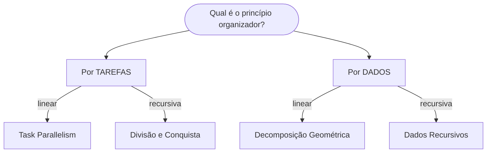
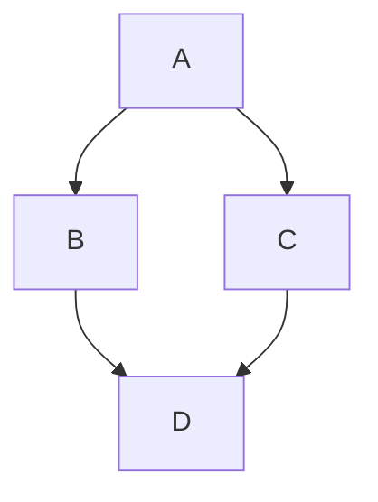

# Aula 06 — Decomposição e estrutura do algoritmo (versão P2)

> Aula de 12/09 · Profa. Larissa C. Shimomura
> **Filtro:** [12c](12c_orientacoes_prova2_revisao2.md). Programação paralela cai **só de forma conceitual**: **sem código** (nem Java, nem Scala). A matéria de programação paralela começa **nesta aula** (a Aula 05 era só introdução).
> **Cortado desta versão** (não cai): organização por fluxo de dados (Pipeline, Event-Based), Flynn/SIMD/MIMD, Group Tasks/Data Sharing em detalhe, trechos de código Java, discussões KNN/ensemble/SQL. A versão completa está no histórico do git.

---

## 1. O que cai (resumo)

| Tópico | Como cai |
|---|---|
| Decomposição de **dados** × de **tarefas** | Definir, dizer quando usar e dar exemplo |
| As **4 estruturas de algoritmo**: Task Parallelism, Divisão e Conquista, Decomposição Geométrica, Dados Recursivos | Conceitual: definir, diferenciar, dar exemplo |
| **Grafo de dependência de tarefas** | Definição (seta **T1 → T3** = da precedente para a que consome a saída). Exercício com pseudocódigo: **em aberto** (ver §5) |
| 4 passos para paralelizar | Conceitual (citado na 1ª revisão) |

---

## 2. Os 4 passos para paralelizar

| Passo | Pergunta | Saída |
|---|---|---|
| **1. Identificação do paralelismo** | *Onde* há paralelismo? O que é independente? | Tarefas, dados, dependências |
| **2. Estrutura do algoritmo** | *Como* organizar esse paralelismo? | Um dos padrões (§4) |
| **3. Estruturas de suporte** | O que sustenta a execução (dados, comunicação, sincronização)? | Master/Worker, Fork/Join… |
| **4. Mecanismos de implementação** | Com quais linguagens/bibliotecas? | Threads, `ExecutorService`, Spark… |

A ênfase da disciplina está nos **passos 1 e 2**.

---

## 3. Decomposição de dados × de tarefas

| | **Decomposição de tarefas** | **Decomposição de dados** |
|---|---|---|
| O que divide | O **trabalho**: funções, etapas, ações | A **estrutura de dados**: vetor, matriz, imagem |
| Ideia | Tarefas **distintas** rodam ao mesmo tempo | Cada unidade recebe **um pedaço** e aplica **a mesma operação** |
| Quando usar | Há funções/etapas independentes entre si | A parte pesada gira em torno de **uma grande estrutura** e a operação se repete nas partes |
| Exemplo | Média, mínimo e máximo como 3 tarefas | Vetor dividido em 4 blocos, cada bloco calcula tudo |

Na frase da professora: "um, eu tô quebrando os **dados**; o outro, eu tô quebrando as **tarefas**". As duas **andam juntas** e muitas vezes se aplicam ao mesmo tempo (ex.: 4 partições × 3 operações = 12 tarefas).

**Boa decomposição:** **flexível** (nº e tamanho das partes parametrizáveis), **eficiente** (o trabalho útil compensa o custo das dependências e a carga fica equilibrada) e **simples**.

> **Pegadinha da média:** mín e máx de partições combinam direto, mas a **média das médias só é correta se as partições tiverem o mesmo tamanho**. O certo é combinar `(soma, contagem)`.

---

## 4. Estrutura do algoritmo: os 4 padrões que caem

| Padrão | Organização | Quando | Exemplo | Atenção |
|---|---|---|---|---|
| **Task Parallelism** | Tarefas, linear | Tarefas muito independentes; "**embaraçosamente paralelo**" (olhando o problema já se vê o que é paralelo) | Processar 1000 arquivos independentes | Escalonamento e balanceamento de carga |
| **Divisão e Conquista** | Tarefas, recursiva | Tarefas independentes geradas **recursivamente** e que precisam ser **combinadas** no fim: dividir → resolver → combinar | Merge sort, maior valor de um vetor | O *split* inicial e o *merge* final são **sequenciais**; limiar para não criar tarefas pequenas demais |
| **Decomposição Geométrica** | Dados, linear | Estruturas **lineares** (vetor, matriz, imagem) divididas em **regiões**; regiões vizinhas podem trocar dados nas **fronteiras** | Imagem dividida em blocos | Comunicação nas fronteiras, balanceamento, granularidade |
| **Dados Recursivos** | Dados, recursiva | Estruturas **recursivas** (árvores, grafos): cada parte tem a mesma organização do todo | Tamanho de uma pasta (soma das subpastas), contar nós de uma árvore | Paralelismo **irregular**; balanceamento dinâmico ajuda |

**Regras que diferenciam:**
- Se a computação em cada partição é **estritamente local** (não precisa da vizinha), o problema é embaraçosamente paralelo → **Task Parallelism**, não geométrica.
- **Divisão e Conquista × Geométrica** (gabarito da lista P2, Ex. 2): D&C tem **recursão** e uma **etapa de combinação** (ex.: `Intercala` do merge sort); a geométrica particiona **diretamente** em blocos independentes, **sem recursão e sem combinar** resultados parciais. Mesmo que o filtro fosse recursivo, só seria D&C se houvesse a etapa de combinação.
- **Blocos × geométrica** (pergunta citada na 1ª revisão): **blocos** (e cíclico) são formas de **mapear/distribuir** os dados entre as threads ([07, §3](07_threads_balanceamento_executor.md)); **geométrica** é o **padrão de estrutura** do algoritmo que divide os dados em regiões.

---

## 5. Grafo de dependência de tarefas

- **Vértices** = tarefas; **arestas** = dependências. A seta vai **da tarefa precedente para a tarefa que consome a sua saída**: se T3 consome a saída de T1, a aresta é **T1 → T3** (confirmado pela professora na 2ª revisão).
- Uma tarefa só começa quando **todas as predecessoras** terminaram. Tarefas **sem caminho entre si** podem rodar **em paralelo**.
- Ao listar o que roda em paralelo, escreva **com a condição**: "T3, T4 e T5 em paralelo, **desde que T1 e T2 tenham terminado**".

A primeiro; **B ‖ C**; D espera as duas. Tempo mínimo = `A + max(B, C) + D` (o caminho mais longo).

> **Em aberto:** ela disse que não cobra o exercício "qual decomposição / quais tarefas paralelizam" sobre **código**, mas o **Ex. 2 da lista P2** pede o grafo e a estrutura em **pseudocódigo** e não foi trabalhado em aula. Na dúvida, saiba resolvê-lo:

**Lista P2, Ex. 2 (gabarito resumido):**

| | Pseudocódigo | Grafo | Estrutura |
|---|---|---|---|
| (a) | `Ordena(A, ini, fim)`: divide ao meio, ordena cada metade (tarefas) e chama `Intercala` | Árvore de `Ordena` descendo até `Ordena(A,i,i)`, e depois a árvore de `Intercala` subindo até `Intercala(A,0,3,7)` | **Divisão e Conquista** (recursão + combinação) |
| (b) | Matriz 8×8 em 4 blocos de 2 linhas: T1–T4 = `FiltraBloco`; T5 = `SalvarImagem` | T1, T2, T3, T4 em paralelo → T5 | **Decomposição Geométrica** (decomposição de dados em blocos) |

---

## 6. Checklist

- [ ] Defino decomposição de dados e de tarefas, com exemplo e quando usar cada uma
- [ ] Diferencio Task Parallelism, D&C, Geométrica e Dados Recursivos e dou um exemplo de cada
- [ ] Sei a regra "estritamente local → Task Parallelism" e a diferença D&C × geométrica
- [ ] Sei a direção da seta no grafo e escrevo o paralelismo com as condições
- [ ] Sei responder o Ex. 2 da lista P2
