# Aula 06 — Identificando o paralelismo e escolhendo a estrutura do algoritmo

> **Computação Escalável (2COP022)** · Profa. Larissa C. Shimomura · Aula de **12/09**
> **Tópicos:** modelos de programação paralela · decomposição de tarefas e de dados · análise de dependências · grafo de tarefas · os 6 padrões de estrutura de algoritmo
> **Pré-requisitos:** noção de thread/processo e de hierarquia de memória
> **Tempo estimado de estudo:** 2 h a 2 h 30

> **[P2] O que a Larissa disse na revisão** ([orientações completas](12b_orientacoes_prova2.md))
> - **Cai, de forma conceitual** (a prática já está no trabalho): definição de decomposição de **dados** × **tarefas**, quando usar cada uma e exemplo.
> - **Cai:** estrutura do algoritmo **só por tarefas** (Task Parallelism, Divisão e Conquista) e **por dados** (Decomposição Geométrica, Dados Recursivos).
> - **Não cai:** organização por **fluxo de dados** (Pipeline, Event-Based Coordination). Nas palavras dela: "só por tarefa e por dados".
> - **Cai como exercício:** grafo de dependência de tarefas + quais tarefas rodam em paralelo (com as condições) + qual padrão usar.
> - Exemplo de pergunta conceitual citada por ela: "diferença entre decomposição em blocos e decomposição geométrica".
> - **Não vai pedir para programar**; código só para ler e interpretar.

---

## Sumário

1. [Mapa da aula](#mapa-da-aula)
2. [Visão geral: modelos e os 4 passos](#1-visão-geral-modelos-de-programação-e-os-4-passos)
3. [Identificação do paralelismo: decomposição](#2-identificação-do-paralelismo-decomposição)
4. [Análise de dependências](#3-análise-de-dependências)
5. [Estrutura do algoritmo: os 6 padrões](#4-estrutura-do-algoritmo-os-6-padrões)
6. [Discussões da aula resolvidas](#5-discussões-da-aula-resolvidas)
7. [Pontos de implementação em Java](#6-pontos-de-implementação-em-java)
8. [Treino de leitura de código](#7-treino-de-leitura-de-código)
9. [Erros comuns / o que cai em prova](#8-erros-comuns--o-que-cai-em-prova)
10. [Fontes](#9-fontes)
11. [Conclusão para revisão](#10-conclusão-para-revisão)

---

## Mapa da aula

A aula segue a linguagem de padrões do livro *Patterns for Parallel Programming* (Mattson, Sanders & Massingill). Ela cobre os **dois primeiros passos** (em azul). Os passos 3 e 4 são o assunto das Aulas 07 e 08.

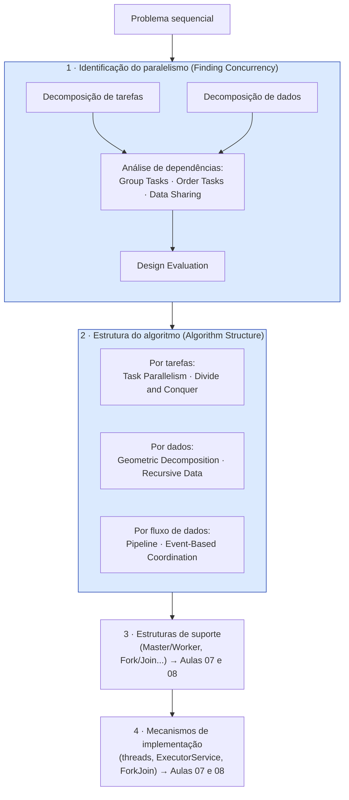

> **O que observar:** cada passo produz insumos para o próximo. Uma decomposição mal feita no passo 1 contamina todas as decisões seguintes. Por isso o *Design Evaluation* fecha o passo 1 antes de seguir adiante.

---

## 1. Visão geral: modelos de programação e os 4 passos

### 1.1 Memória compartilhada × passagem de mensagens

| | **Memória compartilhada** | **Passagem de mensagens** |
|---|---|---|
| Como as unidades se comunicam | Leem e escrevem variáveis em um **espaço de endereçamento comum** | **Enviam e recebem mensagens**; cada processo tem sua própria memória |
| Exemplos | Threads em Java (`Thread`, `ExecutorService`, `ForkJoin`) | MPI, sistemas distribuídos (Hadoop, Spark) |
| Facilidade | Mais fácil: não é preciso distribuir dados "na mão" | O programador distribui os dados e programa toda a comunicação |
| Risco típico | Condição de corrida (*race condition*) em dados compartilhados | Custo de comunicação (latência e banda da rede) |

O livro (§2.2.2) detalha o lado do hardware:
- **SMP** (*symmetric multiprocessor*): todos os processadores acessam toda a memória com a mesma velocidade. É fácil de programar, mas escala pouco, porque a memória vira gargalo.
- **NUMA**: a memória é compartilhada, mas parte dela fica "mais perto" de certos processadores. Por isso a **localidade** passa a importar (tema da Aula 07).
- **Memória distribuída / clusters**: cada nó tem a sua memória e a comunicação é por mensagens. É a base de Big Data (Aula 08).

### 1.2 A arquitetura favorece certos padrões (taxonomia de Flynn)

| Classe | Significado | Padrão favorecido |
|---|---|---|
| **SISD** | 1 fluxo de instruções, 1 fluxo de dados | Sequencial (von Neumann) |
| **SIMD** | **1 instrução** aplicada a **vários dados** ao mesmo tempo (ex.: GPUs, instruções vetoriais) | **Decomposição de dados**: a mesma operação aplicada a partes diferentes dos dados |
| **MISD** | Várias instruções, 1 dado | Praticamente não existe na prática |
| **MIMD** | Cada processador executa **instruções diferentes** sobre **dados diferentes** | Qualquer padrão. É a mais flexível e a maioria dos sistemas modernos se encaixa aqui |

> **Ideia da aula:** em SIMD, a decomposição de dados é natural. Em MIMD temos liberdade para escolher o padrão que melhor se adapta ao **problema**.

### 1.3 Os 4 passos para paralelizar um programa

> **[P2] Cai:** os 4 passos, com ênfase nos dois primeiros (identificação do paralelismo e estrutura do algoritmo), os que foram aprofundados.

| Passo | Pergunta-chave | Saída |
|---|---|---|
| **1. Identificação do paralelismo** | *Onde* existe paralelismo? Quais tarefas e operações são independentes? | Tarefas, dados locais, grupos e ordem, dependências |
| **2. Estrutura do algoritmo** | *Como* estruturar o paralelismo encontrado? | Um (ou mais) dos 6 padrões |
| **3. Estruturas de suporte** | O que é preciso para *sustentar* a execução (dados, comunicação, particionamento, sincronização)? | Master/Worker, Fork/Join, filas compartilhadas, arrays distribuídos… |
| **4. Mecanismos de implementação** | Com *quais* linguagens, bibliotecas e frameworks? | Threads, `ExecutorService`, `ForkJoinPool`, MPI, Spark… |

> **Antes de tudo** (livro, §3.1.1): vale a pena paralelizar? O problema é grande o bastante? **Qual parte é computacionalmente mais intensa?** O esforço de paralelização deve se concentrar nela.

---

## 2. Identificação do paralelismo: decomposição

> **[P2] Cai:** "defina decomposição de dados e de tarefas": definição, quando usar e exemplo (ex.: o vetor dividido em pedaços = dados).

### 2.1 Duas perspectivas de decomposição

- **Decomposição de tarefas** (*task decomposition*): divide o **fluxo de instruções** em partes, as **tarefas**, que podem executar simultaneamente. As operações de uma tarefa devem depender pouco das operações das outras.
- **Decomposição de dados** (*data decomposition*): divide os **dados** em partes distintas (*chunks*) que podem ser processadas de forma relativamente independente. Cada parte é associada às tarefas que vão processá-la.

> ⚠️ **As duas não são independentes.** O livro diz que são "duas facetas da mesma decomposição fundamental": uma decomposição de tarefas implica uma de dados, e vice-versa. A pergunta não é *qual* fazer, e sim **por qual começar**.

### 2.2 Exemplo da aula: 1 milhão de registros → média, mínimo e máximo

**(a) Só decomposição de dados:** quebramos os dados em 4 partes, e cada parte calcula tudo.

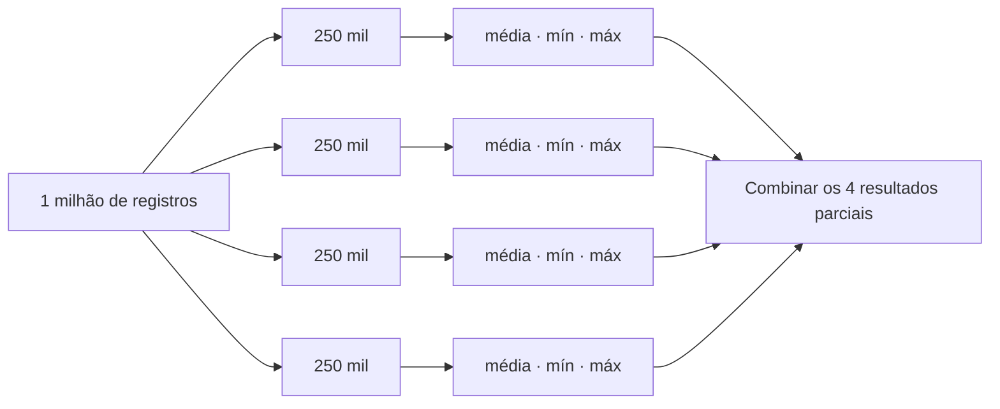

**(b) Só decomposição de tarefas:** cada operação é uma tarefa, e todas leem o conjunto inteiro.

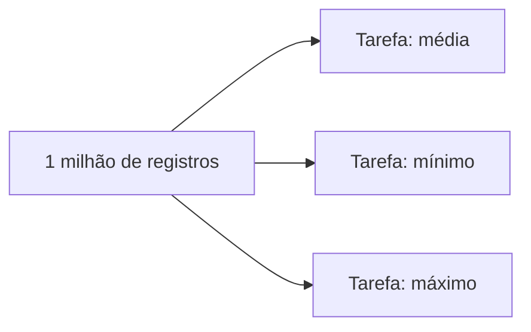

**(c) Tarefas + dados:** cada operação em cada partição. São 4 partições × 3 operações = **12 tarefas**.

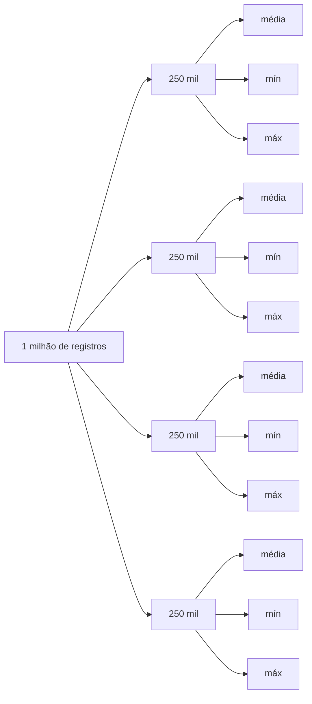

> **O que observar:** (b) tem só 3 tarefas, de modo que no máximo 3 processadores ficam ocupados. (a) escala com o número de partições. (c) gera mais tarefas, mas cada partição é lida 3 vezes. Qual é mais rápido é a discussão que abre a **Aula 07**.

> 💡 **Cuidado com a média!** Mínimo e máximo de partições combinam diretamente: `min(min₁, …, min₄)`. Já a **média das médias só é correta se as partições tiverem o mesmo tamanho**. O certo é cada partição devolver `(soma, contagem)` e combinar com `Σsomas / Σcontagens`. Veja a questão Q2 da seção 7.

### 2.3 Decomposição de tarefas

**Objetivo:** tarefas **suficientemente independentes**, de modo que gerenciar dependências ocupe só uma **pequena fração** do tempo total, e com carga que possa ser **distribuída de forma equilibrada** entre as unidades de processamento (*balanceamento de carga*).

**Na primeira passada, identifique o máximo de tarefas possível.** Como diz o livro: é muito mais fácil começar com tarefas demais e juntá-las depois do que começar com poucas e ter que separá-las.

**Onde procurar tarefas:**

| Onde | Nome no livro | Exemplo |
|---|---|---|
| **Chamadas de função** (a mesma ou funções diferentes) | *Functional decomposition* | `calcularMedia()`, `calcularMin()`, `calcularMax()` em paralelo |
| **Iterações de um laço** independentes | *Loop-splitting* | Cada iteração `for (i...)` sobre um pixel, um registro, uma trajetória |
| **Atualizações em partes dos dados** (junto com decomposição de dados) | *Data-driven* | Cada tarefa atualiza um bloco da matriz |

**Exemplo do livro (imagem médica, §3.2):** simular milhões de trajetórias de raios gama pelo corpo. Cada trajetória é **completamente independente** e vira uma tarefa. Como há muitas tarefas, a solução serve de poucos núcleos até centenas de nós.

### 2.4 Decomposição de dados

**É adequada quando:**
- a parte mais pesada do problema gira em torno de uma **grande estrutura de dados**;
- **operações semelhantes** são aplicadas a **partes diferentes** dos dados;
- as partes podem ser processadas de forma **relativamente independente**.

**Memória compartilhada × distribuída:**
- Em **memória compartilhada**, a decomposição de dados costuma "sair de graça" da decomposição de tarefas: cada thread acessa sua faixa de índices.
- Em **memória distribuída**, é comum ter que **particionar os dados "na mão"** e enviá-los aos nós.

> **"Se a decomposição de dados guia a solução, ela se torna o princípio organizador do algoritmo."** No exercício do **maior valor de um vetor**, dividir o vetor ao meio foi exatamente o que guiou a solução final (que vira o `BuscaMaiorValorTask` da Aula 08).

### 2.5 Características de uma boa decomposição

| | **Tarefas** | **Dados** |
|---|---|---|
| **Flexibilidade** | Número e tamanho de tarefas **parametrizáveis** conforme a arquitetura | Tamanho e quantidade de blocos parametrizáveis. O livro chama esses parâmetros de **"botões de granularidade"** (*granularity knobs*) |
| **Eficiência** | O gerenciamento de dependências é uma fração pequena do tempo, e há tarefas suficientes para ocupar todos os processadores | O trabalho em cada bloco **compensa** o custo das dependências entre blocos, e a carga é bem distribuída |
| **Simplicidade** | Código fácil de manter e depurar; reaproveita o código sequencial | Mapeamento simples entre **índice global ↔ índice local** |

> 💡 **Dependências ficam nas fronteiras, o trabalho fica no interior** (livro, §3.3). O número de células de fronteira cresce como a **superfície** do bloco, e o trabalho cresce como o **volume**. Blocos maiores melhoram a razão computação/comunicação.

---

## 3. Análise de dependências

> **[P2]** Group Tasks / Order Tasks / Data Sharing: ela disse que "a gente viu como fazer isso através do grafo de dependência". Priorize o grafo (§3.4).

**Objetivo:** entender **como as tarefas dependem umas das outras**. A análise responde três perguntas:
- quais tarefas podem executar **simultaneamente**;
- quais precisam de **sincronização**;
- quais **dados** precisam ser **compartilhados**.

As dependências surgem principalmente por:
1. **Compartilhamento de dados:** tarefas que precisam acessar ou trocar dados.
2. **Restrições de ordem:** uma tarefa precisa ocorrer antes (ou depois) de outra.

O livro organiza essa análise em três padrões, aplicados nominalmente nesta ordem, mas com idas e vindas.

### 3.1 Group Tasks (agrupar tarefas)

**Ideia:** em vez de analisar dependências entre dezenas de tarefas individuais, analisa-se entre **grupos**. A dependência entre grupos é mais simples de gerenciar.

**Critérios de agrupamento** (slide + livro, §3.4):
- tarefas que **trabalham juntas sobre uma estrutura compartilhada**;
- tarefas com a **mesma restrição temporal** (ex.: todas esperam um arquivo ser preenchido antes de lê-lo);
- tarefas **independentes**, agrupadas para simplificar o escalonamento. Grupos grandes dão mais flexibilidade para balancear a carga.

### 3.2 Order Tasks (ordenar tarefas)

**Pergunta principal:** quais grupos de tarefas precisam executar **antes ou depois** de outros?

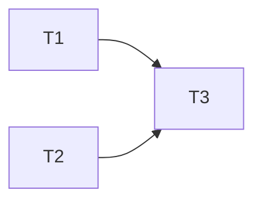

> **O que observar:** T1 e T2 podem executar **concorrentemente**. T3 só começa quando **ambas** terminarem.

⚠️ **A ideia não é tornar o programa serial.** É identificar **quais** tarefas exigem ordem e **como essa ordem convive com o paralelismo** das demais. O livro estabelece dois objetivos:
1. a ordem deve ser **restritiva o suficiente** para que o resultado seja correto;
2. a ordem **não deve ser mais restritiva do que o necessário**. Restrições demais reduzem o paralelismo e a flexibilidade para balancear a carga.

**Fontes de restrição de ordem:** um grupo **produz** dados que outro **consome**; **serviços externos** (ex.: escrever num arquivo em determinada ordem). E igualmente importante: **anotar quando NÃO há restrição**.

### 3.3 Data Sharing (compartilhamento de dados)

Para **cada dado**, pergunte: quem **lê**? Quem **escreve**? Ele é compartilhado entre tarefas? É preciso **comunicar ou sincronizar** o acesso?

O compartilhamento pode criar (1) **dependências** entre tarefas, (2) necessidade de **comunicação** e (3) necessidade de **sincronização**.

**Categorias de dados compartilhados** (livro, §3.6):

| Categoria | Descrição | Tratamento |
|---|---|---|
| **Somente leitura** (*read-only*) | Lido, nunca escrito | Não precisa de proteção. Em memória distribuída, pode ser **replicado** |
| **Efetivamente local** (*effectively-local*) | Particionado: cada parte é acessada por **uma única** tarefa | Não precisa de proteção. Ex.: cada thread escreve só na sua faixa do vetor |
| **Leitura e escrita** (*read-write*) | Lido e escrito por **várias** tarefas | O caso mais difícil: exige acesso exclusivo (locks etc.), que é **caro** |
| ↳ **Acumulação** (*accumulate*) | Caso especial: o dado acumula um resultado (soma, mín, máx…) | Cada tarefa acumula numa **cópia local**, e as cópias são combinadas no final (**redução**) |
| ↳ **Múltiplas leituras / escrita única** | Várias tarefas leem o valor inicial e só uma o modifica | Manter **duas cópias**: a original e a de trabalho |

> ⚠️ Se o compartilhamento for feito errado, uma tarefa pode ler dados inválidos por **condição de corrida** (*race condition*): ela lê antes de a escrita esperada terminar. Na Aula 07 veremos isso acontecer em Java.

### 3.4 Grafo de dependência de tarefas (*Task Dependency Graph*)

> **[P2] Cai como exercício:** desenhar o grafo, listar o que roda em paralelo **com as condições** ("T3, T4 e T5, considerando que T1 e T2 terminaram") e indicar o padrão. Seta = da tarefa que **produz** para a que **consome**. Modelo: [Aula 12, ex. 2](12_joins_spark_revisao_prova.md#exercício-2--grafo-de-dependência-de-tarefas).

- **Vértices:** tarefas.
- **Arestas:** dependências. Uma tarefa só começa quando **todas as predecessoras** terminaram.
- Tarefas **sem caminho entre si** podem executar **em paralelo**.

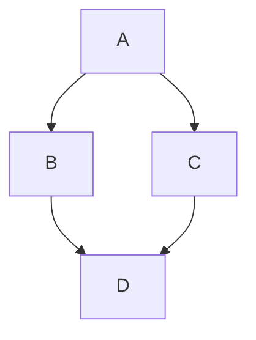

> **O que observar:** A precisa terminar primeiro. **B e C são independentes entre si** e rodam em paralelo. D espera B **e** C. Mesmo com infinitos processadores, o tempo mínimo é `A + max(B, C) + D`, ou seja, o caminho mais longo do grafo.
>
> **Para ir além:** esse caminho mais longo se chama **caminho crítico**. Ele limita o *speedup* máximo, não importa quantos núcleos você tenha.

### 3.5 Design Evaluation (avaliação do design)

Não é exatamente um padrão, e sim uma checagem antes de partir para a implementação:

- [ ] O design é **simples, flexível e eficiente**?
- [ ] O que **priorizar**, dados os requisitos e a arquitetura disponível?
- [ ] **Quanto gerenciamento de dependências** este problema vai exigir?
- [ ] Qual o **custo de particionar** e de **manter o particionamento**? Esse custo compensa?

O livro (§3.7) acrescenta perguntas úteis:
- **Quantos processadores (PEs) existem?** Ter **muito mais tarefas que PEs** facilita manter todos ocupados.
- **Como os dados são compartilhados?** Muito compartilhamento fino favorece memória compartilhada; em memória distribuída, ele custa caro.
- **O tempo de trabalho útil é muito maior que o tempo gasto com dependências?** Quanto maior essa razão, mais eficiente o programa.
- **As tarefas são regulares ou irregulares?** Ou seja, têm custo parecido ou variado? **As interações são síncronas ou assíncronas?** As respostas guiam a escolha do padrão no próximo passo.

> 💡 **Simplicidade conta.** No exemplo da imagem médica, o livro mostra que **replicar** o modelo do corpo (somente leitura) em cada nó gera um programa muito mais simples do que particioná-lo. Às vezes vale "gastar" memória para ganhar simplicidade.

---

## 4. Estrutura do algoritmo: os 6 padrões

### 4.1 Árvore de decisão (slide p.41 · livro Fig. 4.2)

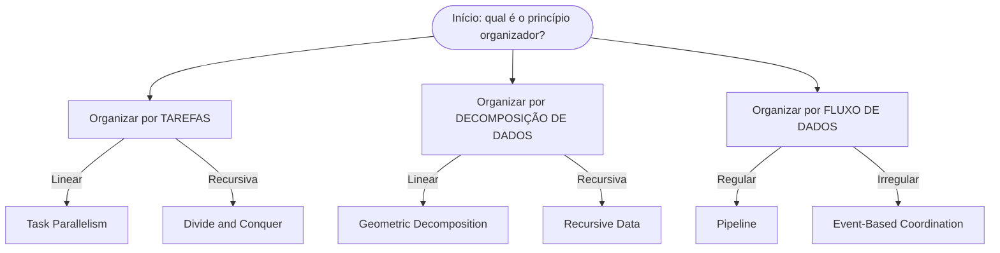

> **Como usar:** (1) escolha o **princípio organizador**, ou seja, o que mais "salta aos olhos": as tarefas em si, a estrutura de dados ou o fluxo dos dados entre grupos de tarefas. (2) Veja como as tarefas ou os dados se organizam: lineares ou recursivos, regulares ou irregulares. Um problema real pode **combinar padrões**. Exemplo do livro: um *pipeline* em que cada estágio usa *task parallelism*.

### 4.2 Organização por tarefas

> **[P2] Cai:** Task Parallelism ("embaraçosamente paralelo") × Divisão e Conquista: definição e quando usar.

#### 4.2.1 Paralelismo por Tarefas (*Task Parallelism*)

**Quando:** tarefas com **alta independência** entre si, enumeradas de forma **linear** (não recursiva).

Há dois casos principais:

| Caso | Característica | Foco |
|---|---|---|
| **Embaraçosamente paralelo** (*embarrassingly parallel*) | **Nenhuma** dependência entre tarefas | **Escalonamento e balanceamento de carga** |
| **Dependências isoladas no início ou no fim** | As dependências são resolvidas **replicando os dados** no início e **combinando os resultados** no fim | Replicar → resolver de forma independente → combinar (**redução**) |

O livro (§4.4) também classifica as dependências:
- **Removíveis:** dependências apenas aparentes, que somem com uma transformação no código. Ver a questão Q4 da seção 7.
- **Separáveis:** acumulações (soma, mín, máx) viram **redução**. Cada tarefa acumula numa cópia local e as cópias são combinadas no final.
- **Outras:** precisam de controle explícito de acesso, mais caro.

Os três elementos do design são: **tarefas** (pelo menos tantas quanto unidades de execução, de preferência muitas mais), **dependências** e **escalonamento** (*schedule*).

**Balanceamento de carga (slide p.25 · livro Fig. 4.3):** seis tarefas independentes de tamanhos diferentes (A…F) distribuídas em 4 unidades de execução:

| UE | Distribuição ruim | Distribuição boa |
|---|---|---|
| UE 1 | A + E (as duas maiores) | E |
| UE 2 | B + F | A |
| UE 3 | C | C + F |
| UE 4 | D | B + D |
| **Tempo total** | ditado por A+E (muito longo) | ≈ a maior tarefa (E) |

> **O que observar:** o tempo total é sempre o da UE **mais carregada**. Juntar as duas tarefas grandes numa mesma UE deixa as outras ociosas. Os escalonamentos **estático** e **dinâmico** que resolvem isso são o tema da **Aula 07**.

#### 4.2.2 Divisão e Conquista (*Divide and Conquer*)

**Quando:** as tarefas são **independentes**, mas geradas de forma **recursiva**, e precisam ser **combinadas** para formar a solução.

Três fases: **Dividir → Resolver → Combinar**.

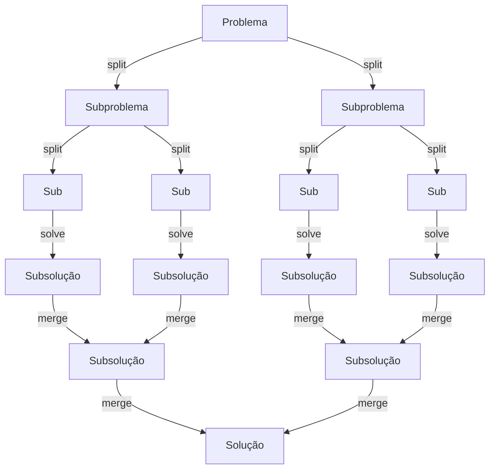

> **O que observar:** cada *split* **dobra** o paralelismo disponível (1 → 2 → 4). Mas o *split* inicial e o *merge* final são **sequenciais**. Pela **Lei de Amdahl**, essas partes seriais limitam o *speedup*.

Pseudocódigo do livro (Fig. 4.6), escrito em estilo Java:

```java
Solucao resolver(Problema p) {
    if (casoBase(p))                    // pequeno o suficiente?
        return resolverDireto(p);       // resolve sequencialmente
    Problema[] sub = dividir(p);        // split
    Solucao[] parciais = new Solucao[sub.length];
    for (int i = 0; i < sub.length; i++)
        parciais[i] = resolver(sub[i]); // ← cada chamada pode virar uma TAREFA paralela
    return combinar(parciais);          // merge
}
```

**Pontos importantes:**
- **Limiar (*threshold*)**: abaixo de um certo tamanho, criar nova tarefa custa mais que o trabalho. Vale resolver sequencialmente. O livro recomenda deixar esse **"botão de granularidade" fácil de mudar**. Na Aula 08 ele vira o `LIMIAR` do `BuscaMaiorValorTask`.
- **Em memória distribuída** (slide p.27):
  1. **Custo de comunicação:** um subproblema pode ser criado num nó e executado em outro, e é preciso transferir entrada e resultado. Prefira subproblemas com **pouca entrada e pouca saída**.
  2. **Balanceamento dinâmico:** os subproblemas surgem **durante a execução**, e a estrutura pode ser irregular e dependente dos dados. Por isso o balanceamento deve ser **dinâmico**, via **Fork/Join** ou **Master/Slave** (Aulas 07 e 08).
- Exemplos clássicos: **mergesort**, FFT, busca do maior valor.

### 4.3 Organização por dados

> **[P2] Cai:** Decomposição Geométrica (estruturas lineares; exemplo da imagem dividida em regiões) × Dados Recursivos (árvores, grafos).

> **Regra da aula (slide p.29):** se a computação em cada partição é **estritamente local** (não precisa de informação de outras partições), o problema é **embaraçosamente paralelo** e o padrão adequado é o **paralelismo por tarefas**, não decomposição geométrica.

Também do slide: atualizar dados particionados geralmente é uma tarefa à parte e exige **cautela**, porque gera **tempo de sincronização**.

#### 4.3.1 Decomposição Geométrica (*Geometric Decomposition*)

**Quando:** estruturas de dados **lineares** (vetores, matrizes, grades, imagens).

- Dividir o domínio em **regiões** (*chunks*) processadas concorrentemente;
- cada região é atribuída a uma tarefa ou unidade de processamento;
- regiões podem precisar **trocar informações com as vizinhas** (fronteiras);
- a decomposição deve equilibrar **trabalho** e **comunicação**.

Imagem dividida em 4 regiões (2 × 2):

| | coluna 0 … W/2 | ‖ | coluna W/2 … W |
|---|:---:|:---:|:---:|
| **linha 0 … H/2** | 🟦 Região 1 → Thread 1 | ‖ | 🟩 Região 2 → Thread 2 |
| | ═══ fronteira ═══ | ╬ | ═══ fronteira ═══ |
| **linha H/2 … H** | 🟨 Região 3 → Thread 3 | ‖ | 🟥 Região 4 → Thread 4 |

> **O que observar:** as linhas `‖` e `═` são as **fronteiras**. Contar pixels de uma cor não precisa delas (é estritamente local, portanto *task parallelism*). Já **detectar um objeto** (ex.: um semáforo) que pode **cruzar a fronteira** exige trocar dados com a região vizinha. Esse é o caso típico de decomposição geométrica.

**Considerações (slide p.32):**

| Aspecto | Efeito |
|---|---|
| **Comunicação** | Vizinhas trocam dados nas fronteiras; quanto mais dado compartilhado, mais comunicação |
| **Balanceamento** | Regiões devem ter quantidades **semelhantes** de trabalho; senão há processadores ociosos |
| **Granularidade** | Regiões muito **pequenas** → mais comunicação. Muito **grandes** → menos paralelismo |

**Objetivo:** equilibrar computação, comunicação e paralelismo.

> 💡 **Formato do bloco importa** (livro, §4.6). Numa matriz N×N dividida em 4: com 4 **faixas de colunas** (N × N/4), a fronteira total é ≈ **5N/2**; com 4 **quadrados** (N/2 × N/2), é ≈ **2N**. Blocos "mais quadrados" trocam menos dados. Técnica comum: **células fantasma** (*ghost cells*), cópias locais das bordas das vizinhas.

#### 4.3.2 Dados Recursivos (*Recursive Data*)

**Quando:** operações sobre estruturas **recursivas**, como árvores, grafos e listas.

- A estrutura é formada por **partes com a mesma organização** da estrutura original (uma subárvore também é uma árvore);
- essas partes podem ser processadas de forma **independente**, e o processamento é aplicado **recursivamente**;
- é comum decompor até o nível de **unidade** (um nó da árvore).

**Ideia central:** identificar subestruturas → processar → combinar resultados.

**Exemplo da aula: tamanho de uma pasta**

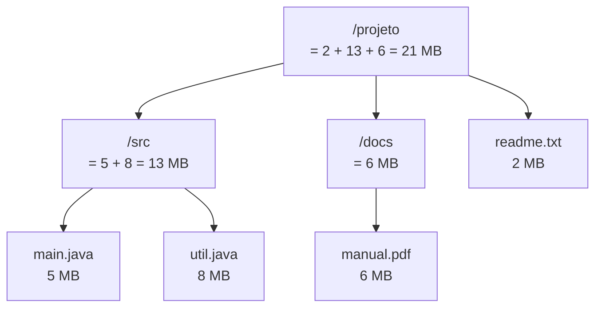

> **O que observar:** `/src` e `/docs` são calculados **em paralelo** (subárvores independentes), e o pai **soma** os resultados dos filhos. Na Aula 08, o exercício "contar nós de uma árvore com Fork/Join" é exatamente esse padrão.

**Considerações (slide p.34):**
- **Paralelismo irregular:** partes diferentes geram quantidades diferentes de trabalho; o grafo de tarefas **depende dos dados**.
- **Balanceamento de carga:** uma subárvore pode ser muito maior que outra. A distribuição estática deixa processadores ociosos, e o **balanceamento dinâmico** ajuda.
- **Overhead:** criar tarefas para estruturas **muito pequenas** custa mais que o trabalho. É preciso escolher uma **granularidade adequada**.

> **Para ir além** (livro, §4.7): às vezes o livro **reformula** o problema para expor mais paralelismo. A técnica *pointer jumping* encontra a raiz de cada nó de uma floresta em O(log N) passos paralelos, à custa de **mais trabalho total** (O(N log N) contra O(N)).

### 4.4 Organização por fluxo de dados

> **[P2] Não cai:** ela disse explicitamente que não vai cobrar Pipeline nem Event-Based ("só por tarefa e por dados").

#### 4.4.1 Pipeline

**Quando:** uma **série de operações** é aplicada a um **fluxo de itens de dados**, e o fluxo é **regular, num só sentido e fixo**.

- O processamento é dividido em **estágios**, cada um fazendo uma parte do trabalho;
- **estágios diferentes trabalham ao mesmo tempo sobre itens diferentes**;
- a **saída de um estágio é a entrada do próximo**.

Analogia do livro: **linha de montagem** de carros. Exemplo concreto: o comando Unix `cat arquivo | grep "palavra" | wc` forma um pipeline de 3 estágios.

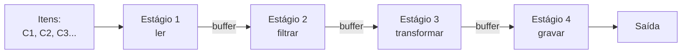

Como os itens avançam no tempo (livro, Fig. 4.24):

| Tempo → | t1 | t2 | t3 | t4 | t5 | t6 |
|---|---|---|---|---|---|---|
| **Estágio 1** | C1 | C2 | C3 | C4 | C5 | C6 |
| **Estágio 2** | | C1 | C2 | C3 | C4 | C5 |
| **Estágio 3** | | | C1 | C2 | C3 | C4 |
| **Estágio 4** | | | | C1 | C2 | C3 |

> **O que observar:** em t1–t3 o pipeline está **enchendo** (*filling*) e há estágios ociosos. A partir de t4 todos trabalham ao mesmo tempo. No fim ele **esvazia** (*draining*). Vale a pena quando há **muito mais itens do que estágios**.

**Considerações (slide p.37):**

| Aspecto | Efeito |
|---|---|
| **Balanceamento entre estágios** | O desempenho é limitado pelo **estágio mais lento**, que vira **gargalo** |
| **Comunicação** | Estágios transferem dados entre si; **buffers** desacoplam os estágios |
| **Granularidade** | Estágios muito pequenos → mais overhead de comunicação. Muito grandes → menos paralelismo |

**Objetivo:** manter os estágios ocupados e minimizar o gargalo.

> **Vazão × latência** (livro, §4.8). A **vazão** (*throughput*) é quantos itens o pipeline completa por unidade de tempo. A **latência** é quanto tempo um item leva do início ao fim. Rodar vários pipelines em paralelo aumenta a vazão, mas **não** reduz a latência de um item.

#### 4.4.2 Coordenação Baseada em Eventos (*Event-Based Coordination*)

**Quando:** o fluxo de dados é **irregular, dinâmico ou imprevisível**.

- Entidades **semi-independentes** que trabalham de forma relativamente autônoma;
- a comunicação ocorre **em resposta a eventos**, em intervalos **irregulares e imprevisíveis**;
- **não há estrutura linear** nem fluxo fixo: uma entidade pode enviar e receber de várias outras.

Exemplo do livro (§4.9): **simulação de um lava-rápido**. Os carros chegam em horários aleatórios, um atendente encaminha cada carro para uma máquina livre ou para a fila, e cada máquina avisa quando termina.

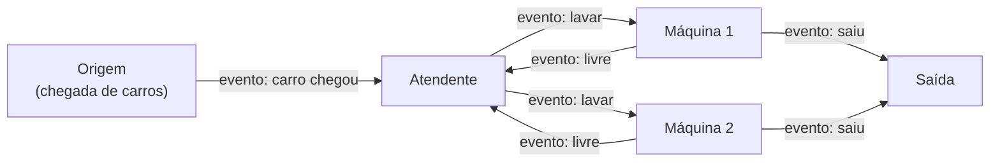

> **O que observar:** diferente do pipeline, o fluxo **vai e volta** (as máquinas avisam o atendente) e acontece em instantes imprevisíveis.

Como paralelizar (slide p.39): executar entidades **simultaneamente**; **distribuir** entidades entre processadores; **processamento orientado a eventos** (o evento ativa a tarefa correspondente); **comunicação assíncrona** (enviar sem esperar); **sincronizar só quando necessário**.

Estrutura de cada tarefa (livro, Fig. 4.32): `inicializar → enquanto não terminar { receber evento → processar → enviar eventos } → finalizar`.

**Considerações (slide p.40):**

| Aspecto | Efeito |
|---|---|
| **Desacoplamento** | Tarefas são coordenadas **sem se conhecerem diretamente**; o evento é o meio de comunicação |
| **Paralelismo** | Um mesmo evento pode habilitar **várias tarefas** concorrentes |
| **Overhead** | Eventos precisam ser detectados, armazenados e processados; **muitos eventos** aumentam o custo de coordenação |

**Ideia central:** a ocorrência de um evento determina **quando** uma tarefa pode prosseguir.

> ⚠️ **Ordem dos eventos** (livro): eventos podem chegar **fora de ordem**. Se isso importa (ex.: "abrir portão" e "fechar portão"), é preciso garantir a ordem. Abordagens **pessimistas** esperam até ser seguro; **otimistas** executam e desfazem se necessário.

### 4.5 Quadro-resumo dos 6 padrões

| Padrão | Princípio | Estrutura | Exemplo | Risco principal |
|---|---|---|---|---|
| **Task Parallelism** | Tarefas | Linear | Processar 1000 arquivos independentes | Desbalanceamento de carga |
| **Divide and Conquer** | Tarefas | Recursiva | Mergesort, maior valor | Partes seriais (split/merge), overhead de tarefas pequenas |
| **Geometric Decomposition** | Dados | Linear | Imagem/matriz em blocos | Comunicação nas fronteiras |
| **Recursive Data** | Dados | Recursiva | Tamanho de pasta, árvore | Irregularidade, granularidade |
| **Pipeline** | Fluxo | Regular | Ler → filtrar → transformar → gravar | Estágio mais lento = gargalo |
| **Event-Based** | Fluxo | Irregular | Simulação de eventos discretos | Overhead e ordem de eventos |

---

## 5. Discussões da aula resolvidas

> Essas questões não têm resposta única. O que vale na prova é **justificar** com os conceitos (princípio organizador, dependências, granularidade, balanceamento).

### 5.1 Decomposição por tarefas: como paralelizar?

| Problema | Padrão sugerido | Justificativa |
|---|---|---|
| **Ler 4 arquivos diferentes** | *Task Parallelism* (embaraçosamente paralelo) | 4 tarefas **independentes**. É I/O-bound, então até mais threads que núcleos ajudam (Aula 07). Se os arquivos têm tamanhos muito diferentes, o tempo total = o maior arquivo |
| **Processar uma requisição web** | *Task Parallelism* entre requisições; *Pipeline* ou *Event-Based* dentro de uma | Requisições de clientes diferentes são **independentes** (um thread pool atende várias). Dentro de uma requisição: receber → autenticar → consultar BD → montar resposta tem **ordem** (pipeline). Se depende de eventos externos, a coordenação é por eventos |
| **Maior valor de um vetor** | *Decomposição de dados* + **redução** (ou *Divide and Conquer*) | Cada parte calcula o máximo local e os máximos são combinados (`max` é associativo). Em versão recursiva vira D&C → `BuscaMaiorValorTask` (Aula 08) |
| **Ordenar um vetor** | *Divide and Conquer* (mergesort) | Dividir ao meio → ordenar cada metade em paralelo → **intercalar** (merge). O merge final é sequencial e limita o *speedup* |

### 5.2 Como paralelizar o KNN?

O KNN classifica um ponto de consulta `q` olhando os `k` vizinhos mais próximos no conjunto de treino. O custo dominante é **calcular a distância de `q` a todos os N pontos**.

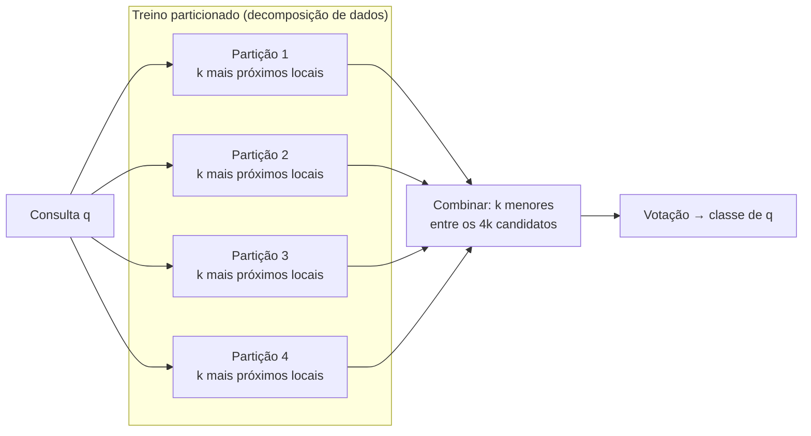

- **Uma consulta:** **decomposição de dados** sobre o conjunto de treino. Cada partição devolve seus `k` candidatos (dado **efetivamente local**) e uma **redução** escolhe os `k` globais. O treino é **somente leitura**, então não há sincronização durante a busca.
- **Muitas consultas:** cada consulta é independente, então dá para usar *task parallelism* sobre as consultas (embaraçosamente paralelo).
- **Combinação:** em memória distribuída, mandar só os `k` candidatos de cada partição (não as N distâncias) reduz a comunicação.

### 5.3 Ensemble de classificadores (cada um pode ser um modelo diferente)

- **Padrão:** *Task Parallelism*. Treinar ou predizer com cada classificador é uma **tarefa independente**; os dados de treino são **somente leitura** (ou replicados).
- **Dependência isolada no fim:** a **votação/média** final combina as predições (padrão "replicar → resolver → combinar").
- **Atenção ao balanceamento:** modelos diferentes têm **custos muito diferentes** (ex.: uma árvore × uma SVM). Uma divisão estática "1 modelo por thread" pode deixar threads ociosas; o **balanceamento dinâmico** (Aula 07) é melhor.
- **Combinação de padrões:** dentro de um modelo caro (ex.: Random Forest), cada árvore pode ser outra tarefa (hierarquia de *task parallelism*).

### 5.4 Consulta SQL com JOIN

```sql
SELECT * FROM (SELECT * FROM clientes WHERE idade > 30) C
JOIN (SELECT * FROM pedidos WHERE valor > 100) P
ON C.id = P.cliente_id;
```

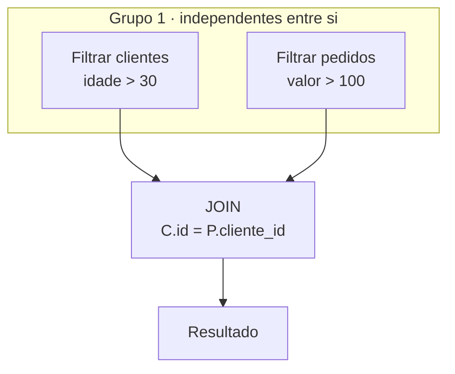

- **Grafo de tarefas / *Order Tasks*:** os dois filtros são **independentes** e rodam em paralelo. O JOIN **depende de ambos**: é o mesmo formato T1, T2 → T3.
- **Dentro de cada filtro:** **decomposição de dados**. Cada thread filtra um bloco de linhas da tabela, e cada linha é avaliada de forma independente.
- **No JOIN:** pode-se particionar **pela chave** (`id` / `cliente_id`), colocando chaves iguais na mesma partição. É exatamente a ideia do **shuffle** do MapReduce (Aula 08).
- **Pipeline:** em vez de esperar o filtro terminar por completo, as linhas filtradas podem ir sendo **enviadas ao JOIN** à medida que são produzidas.

---

## 6. Pontos de implementação em Java

> **[P2]** Não vai pedir para programar; código aparece só para ler e interpretar.

> A Aula 06 não teve código. Os trechos abaixo mostram **como os conceitos aparecem no código** e preparam as Aulas 07 e 08. Todos foram compilados e executados (JDK 24); as saídas mostradas são reais.

### 6.1 Calcular `inicio` e `fim` de cada chunk (decomposição de dados)

Esse cálculo aparece em **toda** decomposição de dados. O erro clássico é **esquecer o resto da divisão**.

```java
int n = 10, numChunks = 3;
int tam = n / numChunks;                              // 10 / 3 = 3 (divisão inteira!)

// ❌ Versão ingênua: ignora o resto
for (int c = 0; c < numChunks; c++) {
    int ini = c * tam, fim = ini + tam;               // [0,3) [3,6) [6,9) → o índice 9 nunca é processado!
}

// ✅ Versão correta: o último chunk vai até n
for (int c = 0; c < numChunks; c++) {
    int ini = c * tam;
    int fim = (c == numChunks - 1) ? n : ini + tam;   // [0,3) [3,6) [6,10)
}

// ✅ Versão balanceada (sugerida no livro, §5.10): os primeiros (n % p) chunks ganham +1
int base = n / numChunks, resto = n % numChunks, ini = 0;
for (int c = 0; c < numChunks; c++) {
    int t = base + (c < resto ? 1 : 0);               // [0,4) [4,7) [7,10)
    ini += t;
}
```

**Saída real:**
```
ingenuo chunk 0: [0, 3)     correto chunk 0: [0, 3)     balanceado chunk 0: [0, 4)
ingenuo chunk 1: [3, 6)     correto chunk 1: [3, 6)     balanceado chunk 1: [4, 7)
ingenuo chunk 2: [6, 9)     correto chunk 2: [6, 10)    balanceado chunk 2: [7, 10)
```

| Ponto | Explicação |
|---|---|
| Convenção `[inicio, fim)` | `inicio` **inclusivo**, `fim` **exclusivo**. É o mesmo padrão do `BuscaMaiorValorTask` (`for (i = inicio; i < fim; i++)`) |
| `n / numChunks` | Divisão **inteira**: o resto se perde se você não tratar |
| "Correta" × "balanceada" | Ambas corretas; a balanceada distribui o resto melhor (tamanhos 4,3,3 em vez de 3,3,4). Com muitos chunks a diferença some |
| Parametrização | `numChunks` é o **botão de granularidade**: trocar o número não exige reescrever o algoritmo (= **flexibilidade**) |

### 6.2 Laço de uma passada: mínimo, máximo e média

```java
int min = Integer.MAX_VALUE, max = Integer.MIN_VALUE;
long soma = 0;
for (int i = inicio; i < fim; i++) {        // percorre a partição UMA vez
    if (dados[i] < min) min = dados[i];
    if (dados[i] > max) max = dados[i];
    soma += dados[i];
}
// devolver (min, max, soma, contagem = fim - inicio) para a combinação
```

**Por que é um bom candidato a decomposição de dados?**
- A **mesma operação** é aplicada a cada elemento, e os elementos são independentes (só leitura).
- `min`, `max` e `soma` são **acumulações associativas**: cada partição calcula a sua e o resultado global sai combinando os parciais. É a **redução**, o caso *accumulate* do *Data Sharing*.
- As três operações cabem **numa única passada**. Esse fato será importante na discussão "4 threads × 12 threads" da Aula 07.

### 6.3 Reconhecer dependências em laços (livro, §4.4)

```java
// Laço A — dependência REMOVÍVEL
int ii = 0, jj = 0;
for (int i = 0; i < N; i++) {
    ii = ii + 1;                          // ii depende da iteração anterior...
    d[ii] = trabalhoPesado(ii);
    jj = jj + i;                          // jj também...
    a[jj] = outroCalculo(jj);
}

// Mesmo laço sem a dependência: fórmulas fechadas, cada iteração independente
for (int i = 0; i < N; i++) {
    d[i + 1] = trabalhoPesado(i + 1);                  // ii = i + 1
    a[(i * i + i) / 2] = outroCalculo((i * i + i) / 2); // jj = 0 + 1 + ... + i
}

// Laço B — dependência SEPARÁVEL (redução)
for (int i = 0; i < N; i++)
    soma = soma + f[i];                   // cada parte soma localmente e depois combina
```

> **O que observar:** no laço A original, cada iteração precisa do `ii` e do `jj` da anterior, então elas não podem rodar em paralelo. Mas é uma dependência **aparente**: com fórmulas fechadas, cada iteração calcula seu índice sozinha. No laço B, a dependência é real, porém **separável**: vira redução.
>
> *Nota:* no livro, o laço transformado aparece como `d[i]`. Aqui o índice foi escrito como `d[i + 1]` para preservar exatamente o comportamento do original, em que `ii` já vale `i + 1` quando é usado.

---

## 7. Treino de leitura de código

> Tente responder antes de abrir o gabarito.

**Q1 — Qual padrão?** Para cada trecho, diga o padrão de estrutura de algoritmo mais adequado.

```java
// (a)
for (Arquivo arq : arquivos) processar(arq);          // processar() não acessa nada compartilhado

// (b)
int contar(No no) {
    int total = 1;
    for (No filho : no.filhos) total += contar(filho);
    return total;
}

// (c)
while (temItens()) { Item x = ler(); x = limpar(x); x = transformar(x); gravar(x); }

// (d)
for (int i = 1; i < N - 1; i++)
    novo[i] = (velho[i - 1] + velho[i] + velho[i + 1]) / 3;   // suavização de um sinal
```

<details><summary><b>Gabarito Q1</b></summary>

- **(a) Task Parallelism**, embaraçosamente paralelo: iterações independentes, sem dados compartilhados.
- **(b) Recursive Data** (ou D&C): cada subárvore é uma subestrutura independente e o pai soma os filhos. Vira `RecursiveTask` na Aula 08.
- **(c) Pipeline**: há uma sequência fixa de estágios (ler → limpar → transformar → gravar) sobre um fluxo de itens. Estágios diferentes podem trabalhar em itens diferentes ao mesmo tempo.
- **(d) Geometric Decomposition**: o vetor é dividido em blocos, mas cada elemento precisa dos **vizinhos**. Os elementos das bordas de cada bloco dependem do bloco vizinho (fronteira e células fantasma). Note que lê de `velho` e escreve em `novo`: duas cópias evitam que uma thread leia valor já modificado por outra.
</details>

**Q2 — Este código está correto?** Quatro threads calcularam, cada uma, a média da sua partição. O programa principal combina assim:

```java
double mediaGlobal = (media[0] + media[1] + media[2] + media[3]) / 4;
```

<details><summary><b>Gabarito Q2</b></summary>

**Só está correto se as 4 partições tiverem exatamente o mesmo tamanho.** Contraexemplo: partição A = {1, 2, 3} (média 2) e partição B = {10} (média 10). A média das médias dá (2 + 10) / 2 = **6**, mas a média real é 16 / 4 = **4**.

**Correção:** cada partição devolve `(soma, contagem)` e a combinação faz `Σsomas / Σcontagens`. Isso é comum quando `n` não é divisível pelo número de threads (ver 6.1).
</details>

**Q3 — Este código está correto?** Dividir um vetor de `n` posições entre `p` threads:

```java
int tam = n / p;
for (int t = 0; t < p; t++) {
    int ini = t * tam;
    int fim = ini + tam;
    processar(vetor, ini, fim);
}
```

<details><summary><b>Gabarito Q3</b></summary>

**Incorreto quando `n % p != 0`:** os últimos `n % p` elementos nunca são processados. Ex.: n = 10, p = 3 → [0,3) [3,6) [6,9); o índice 9 fica de fora.

**Correção:** `int fim = (t == p - 1) ? n : ini + tam;` ou a versão balanceada da seção 6.1.
</details>

**Q4 — Onde está a dependência?** As iterações deste laço podem executar em paralelo?

```java
for (int i = 1; i < N; i++)
    v[i] = v[i - 1] + x[i];
```

<details><summary><b>Gabarito Q4</b></summary>

**Não diretamente.** A iteração `i` lê `v[i-1]`, que foi **escrito pela iteração anterior**. É uma dependência entre iterações (a soma de prefixos). Diferente do `soma += f[i]` (seção 6.3, laço B), aqui **cada** valor intermediário é necessário, não só o total.

Para ir além: o livro (§4.7, "partial sums") mostra que esse cálculo **pode** ser reformulado para executar em O(log N) passos paralelos (*prefix scan*), à custa de mais trabalho total.
</details>

**Q5 — Grafo de tarefas.** Um programa tem as tarefas: `L` (ler dados), `N` (normalizar, precisa de L), `E1` e `E2` (extrair dois atributos diferentes, ambos precisam de N), `T` (treinar modelo, precisa de E1 e E2). Desenhe o grafo e diga o que pode rodar em paralelo.

<details><summary><b>Gabarito Q5</b></summary>

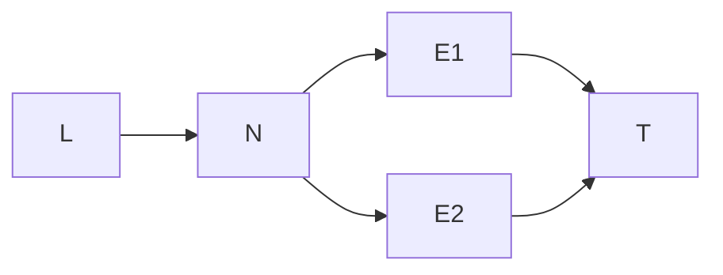

Só **E1 e E2** podem rodar em paralelo. L → N → {E1 ∥ E2} → T. O tempo mínimo é `L + N + max(E1, E2) + T`. Para ganhar mais paralelismo, seria preciso decompor **dentro** de cada tarefa (ex.: normalizar por blocos de dados).
</details>

---

## 8. Erros comuns / o que cai em prova

1. **Confundir decomposição de tarefas com de dados.** Tarefas = dividir o **trabalho** (o que fazer); dados = dividir a **estrutura** (sobre o que fazer). Lembre que elas andam juntas.
2. **Escolher Decomposição Geométrica para algo estritamente local.** Se uma partição não precisa da vizinha, é *Task Parallelism* (slide p.29).
3. **Achar que "ordenar tarefas" = deixar tudo serial.** A ideia é impor **só** a ordem necessária.
4. **Esquecer que *split* e *merge* do D&C são seriais.** Eles limitam o *speedup* (Amdahl).
5. **Pipeline com estágios desbalanceados.** A vazão é a do estágio **mais lento**.
6. **Média das médias** com partições de tamanhos diferentes (Q2).
7. **Divisão inteira sem tratar o resto** ao calcular chunks (Q3).
8. **Granularidade:** tarefas pequenas demais geram overhead; grandes demais, pouco paralelismo e balanceamento ruim. Isso vale para os 6 padrões.
9. **Classificar dados compartilhados:** saber dizer se um dado é *read-only*, *effectively-local*, *read-write* ou *accumulate*, e o tratamento de cada um.

---

## 9. Fontes

- **Slides da aula:** Shimomura, L. C. *Computação Escalável — Aula 6 (12/09)*.
- **Mattson, T.; Sanders, B.; Massingill, B.** *Patterns for Parallel Programming*. Addison-Wesley, 2004. As páginas do PDF estão entre parênteses (página impressa = PDF − 15).
  - Cap. 2, §2.2: Flynn, SMP/NUMA, memória distribuída, p. 8–12 (PDF 23–27)
  - Cap. 3: *Finding Concurrency*: Task/Data Decomposition, Group Tasks, Order Tasks, Data Sharing, Design Evaluation, p. 24–56 (PDF 39–71)
  - Cap. 4: *Algorithm Structure*: árvore de decisão (Fig. 4.2, p. 61), Task Parallelism (p. 64), Divide and Conquer (p. 73), Geometric Decomposition (p. 79), Recursive Data (p. 97), Pipeline (p. 103), Event-Based Coordination (p. 114) (PDF 72–135)
  - §5.10 Distributed Array: tratamento do resto na distribuição em blocos, p. 201 (PDF 216)
- **Stanford CS149** (figura-guia citada no slide): <https://gfxcourses.stanford.edu/cs149/fall25/lecture/>

---

## 10. Conclusão para revisão

### 10.1 Resumo em 10 pontos

1. Paralelizar segue **4 passos**: identificar o paralelismo → estruturar o algoritmo → estruturas de suporte → mecanismos de implementação.
2. **Memória compartilhada** (threads Java) comunica por variáveis; **passagem de mensagens** (MPI, clusters) comunica por mensagens.
3. **SIMD** favorece decomposição de dados; **MIMD** permite qualquer padrão.
4. **Decomposição de tarefas** divide o trabalho; **de dados** divide a estrutura. São duas faces da mesma decomposição.
5. Boa decomposição = **flexível** (parametrizável), **eficiente** (trabalho ≫ overhead, carga equilibrada) e **simples**.
6. Dependências vêm de **dados compartilhados** e de **restrições de ordem**. São analisadas com *Group Tasks*, *Order Tasks* e *Data Sharing*.
7. O **grafo de dependências** mostra o que pode rodar em paralelo: tarefas sem caminho entre si.
8. A **árvore de decisão** leva a 6 padrões: por tarefas (Task Parallelism, D&C), por dados (Geometric, Recursive Data) e por fluxo (Pipeline, Event-Based).
9. **Granularidade** é o trade-off presente em todos os padrões: pequeno demais → overhead; grande demais → pouco paralelismo.
10. Se cada partição é estritamente local, o problema é **embaraçosamente paralelo** → *Task Parallelism*.

### 10.2 Tabela de conceitos-chave

| Termo | Definição em uma linha | Quando usar / lembrar |
|---|---|---|
| Decomposição de tarefas | Dividir o fluxo de instruções em tarefas concorrentes | Funções independentes, iterações de laço |
| Decomposição de dados | Dividir os dados em chunks processados de forma independente | Grande estrutura + mesma operação em todas as partes |
| Granularidade | Tamanho de cada unidade de trabalho | Sempre: equilibrar overhead × paralelismo |
| Group Tasks | Agrupar tarefas com restrições em comum | Simplificar a análise de dependências |
| Order Tasks | Definir a ordem mínima necessária entre grupos | Quando um grupo produz dados que outro consome |
| Data Sharing | Classificar como cada dado é lido/escrito | Decidir se há proteção, cópia local ou redução |
| Redução | Combinar resultados parciais com operação associativa | Soma, mín, máx, contagem |
| Grafo de tarefas | Vértices = tarefas, arestas = dependências | Ver o que é paralelo e o caminho crítico |
| Embaraçosamente paralelo | Tarefas sem nenhuma dependência | Foco em escalonamento e balanceamento |
| Divide and Conquer | Dividir → resolver → combinar, recursivamente | Mergesort, maior valor, Fork/Join |
| Geometric Decomposition | Dividir dados lineares em regiões com troca nas fronteiras | Imagens, matrizes, grades |
| Recursive Data | Processar subestruturas de árvores/grafos | Tamanho de pasta, contar nós |
| Pipeline | Estágios em sequência sobre um fluxo de itens | Fluxo regular; cuidado com o gargalo |
| Event-Based | Entidades reagem a eventos assíncronos | Fluxo irregular e imprevisível |

### 10.3 Perguntas de autoavaliação

<details><summary><b>1. Por que o livro recomenda identificar o máximo de tarefas na primeira passada?</b></summary>

Porque é muito mais fácil **juntar** tarefas depois (agrupando para reduzir overhead) do que **separar** tarefas grandes demais. Muitas tarefas também dão flexibilidade para balancear a carga.
</details>

<details><summary><b>2. Qual a diferença entre Task Parallelism e Divide and Conquer?</b></summary>

Ambos se organizam por tarefas. Em **Task Parallelism** as tarefas são enumeradas de forma **linear** (ex.: um laço). Em **D&C** elas surgem **recursivamente** (dividir → resolver → combinar), e a quantidade de paralelismo varia ao longo da execução.
</details>

<details><summary><b>3. Quando escolher Pipeline e quando escolher Event-Based Coordination?</b></summary>

Ambos se organizam por fluxo de dados. **Pipeline** quando o fluxo é **regular, num só sentido e fixo**. **Event-Based** quando é **irregular, dinâmico ou imprevisível**, possivelmente com idas e voltas entre entidades.
</details>

<details><summary><b>4. Por que o desempenho de um pipeline é limitado pelo estágio mais lento?</b></summary>

Porque cada item precisa passar por todos os estágios. Se um estágio leva mais tempo, os itens se acumulam no buffer anterior a ele, e os estágios seguintes ficam ociosos esperando. A vazão do pipeline inteiro passa a ser a vazão desse estágio.
</details>

<details><summary><b>5. Cite as três considerações da decomposição geométrica e explique o trade-off de granularidade.</b></summary>

**Comunicação** (troca nas fronteiras), **balanceamento** (regiões com trabalho semelhante) e **granularidade**. Regiões muito pequenas geram mais comunicação, porque há mais fronteira em relação ao interior; regiões muito grandes geram menos paralelismo.
</details>

<details><summary><b>6. Um dado é lido por todas as tarefas e nunca escrito. Como tratá-lo?</b></summary>

É **somente leitura**: não precisa de sincronização. Em memória distribuída, pode ser **replicado** em cada nó (ex.: o conjunto de treino no KNN ou o modelo do corpo no exemplo de imagem médica).
</details>

<details><summary><b>7. O que significa "a decomposição de dados é o princípio organizador do algoritmo"?</b></summary>

Que a forma como os dados são divididos **determina** as tarefas, e não o contrário. Ex.: no maior valor do vetor, dividir o vetor ao meio definiu a estrutura recursiva da solução.
</details>

<details><summary><b>8. Qual é o papel do Design Evaluation?</b></summary>

Verificar, antes de implementar, se o design é **simples, flexível e eficiente**; o quanto de gerenciamento de dependências ele exige; e se o custo de particionar e manter o particionamento compensa. Se não, volta-se à decomposição.
</details>

### 10.4 Checklist

**Sei explicar…**
- [ ] os 4 passos para paralelizar um programa e o que cada um produz
- [ ] a diferença entre decomposição de tarefas e de dados, com o exemplo de 1 milhão de registros
- [ ] Group Tasks, Order Tasks e Data Sharing, e as categorias de dados compartilhados
- [ ] o que um grafo de dependências mostra
- [ ] a árvore de decisão e quando usar cada um dos 6 padrões
- [ ] as considerações de cada padrão (comunicação, balanceamento, granularidade, gargalo, overhead)

**Sei reconhecer no código…**
- [ ] o cálculo de `inicio`/`fim` de chunks e o bug do resto da divisão
- [ ] uma redução (soma, mín, máx) e o erro da média das médias
- [ ] uma dependência entre iterações de laço (removível × separável × real)
- [ ] qual padrão um trecho de código ou pseudocódigo está usando

### 10.5 Ligação com a próxima aula

Na **Aula 07**, o foco sai do "*onde* está o paralelismo" para o "**como executá-lo**":
- **quantas threads** usar e de que **tamanho** devem ser as tarefas (granularidade);
- como distribuir o trabalho: **balanceamento estático** (blocos, cíclico) e **dinâmico** (Master/Worker);
- por que a **localidade de dados** importa;
- como tudo isso se implementa em Java com **`ExecutorService`, `Callable` e `Future`**.
