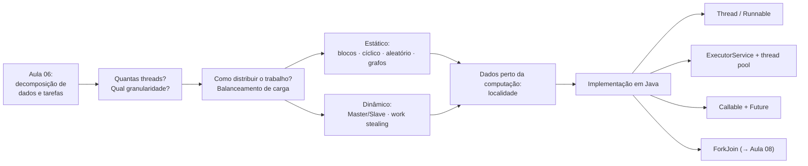
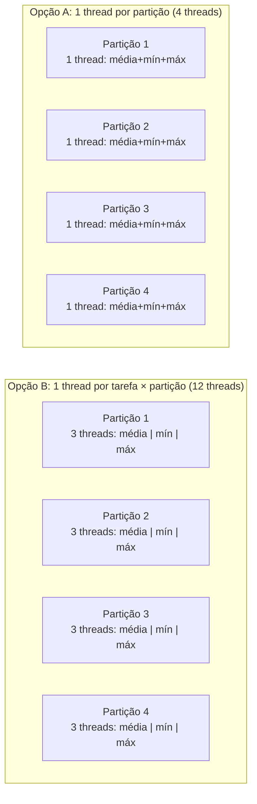
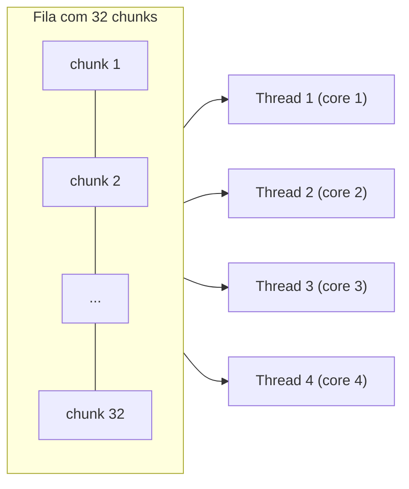
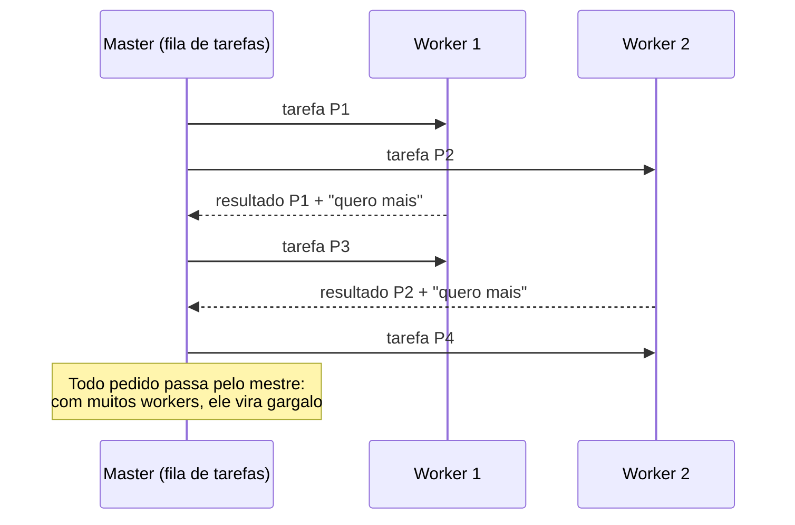
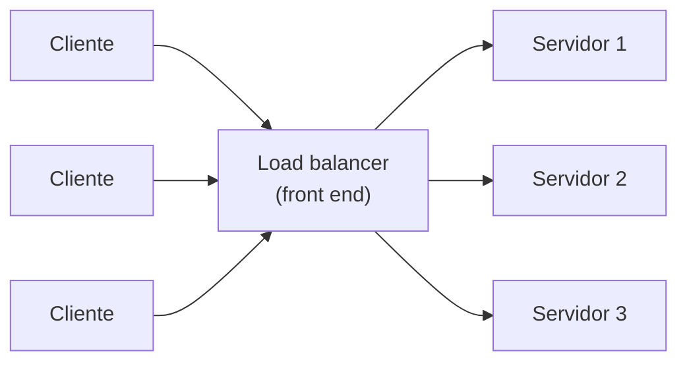

# Aula 07 — De decomposição para threads: granularidade, balanceamento de carga, localidade e `ExecutorService`

> **Computação Escalável (2COP022)** · Profa. Larissa C. Shimomura · Aula de **25/09**
> **Tópicos:** task × thread × chunk · granularidade · número de threads · balanceamento estático e dinâmico · mapeamento (blocos, cíclico, aleatório, grafos, Master/Slave) · load balancer · localidade de dados · `Thread`/`Runnable` · `ExecutorService` · `Callable` · `Future` · introdução ao `ForkJoin`
> **Pré-requisitos:** [Aula 06](06_padroes_de_paralelismo.md) (decomposição de tarefas e dados, padrões)
> **Tempo estimado de estudo:** 3 h

> **[P2] O que cai** ([orientações da 2ª revisão](12c_orientacoes_prova2_revisao2.md); a 2ª revisão prevalece sobre a 1ª)
> - **Só a parte conceitual:** "o que é um balanceamento de carga estático, dinâmico, qual a **vantagem** de um, qual a **desvantagem** do outro". *Work stealing* é **dinâmico** (Fork/Join).
> - Trade-off **granularidade × número de threads** (exercício conceitual da 1ª revisão).
> - **Não cai código Java:** "nada de compilar no papel, nem Scala, nem Java"; e ela não vai cobrar o exercício de "quantas tarefas/threads e qual decomposição" sobre código. Por isso as seções 8 a 13 (Thread/Runnable, ExecutorService, Callable/Future, ForkJoin, exercício e treino de código) foram **cortadas** desta versão (estão no histórico do git).

---

## Sumário

1. [Mapa da aula](#mapa-da-aula)
2. [De decomposição para threads](#1-de-decomposição-para-threads)
3. [Task, thread e chunk](#2-task-thread-e-chunk)
4. [Granularidade, número de tasks e de threads](#3-granularidade-número-de-tasks-e-número-de-threads)
5. [Balanceamento de carga: estático × dinâmico](#4-balanceamento-de-carga-estático--dinâmico)
6. [Mapeamento estático](#5-mapeamento-estático-como-dividir-os-dados)
7. [Mapeamento dinâmico e load balancer](#6-mapeamento-dinâmico-e-load-balancer)
8. [Localidade de dados](#7-localidade-de-dados-data-locality)
15. [Erros comuns / o que cai em prova](#14-erros-comuns--o-que-cai-em-prova)
16. [Fontes](#15-fontes)
17. [Conclusão para revisão](#16-conclusão-para-revisão)

---

## Mapa da aula



> **O que observar:** a aula sai do "*onde* está o paralelismo" (Aula 06) para o "**como executá-lo** de forma eficiente". No fim, os conceitos viram classes Java concretas.

---

## 1. De decomposição para threads

Retomando o exemplo da Aula 06: **1 milhão de registros**, calcular **média, mínimo e máximo**, com os dados divididos em 4 partições de 250 mil.



### Para discutir: qual é mais rápido?

**Resposta da aula: "teria que testar…, e depende da arquitetura do computador".** O raciocínio que importa:

| Opção A: 4 threads (1 por partição) | Opção B: 12 threads (1 por operação × partição) |
|---|---|
| Cada thread passa **uma única vez** pela partição e calcula as 3 operações juntas | Os mesmos dados são lidos **3 vezes**, uma por thread |
| Menos threads → menos criação, troca de contexto e sincronização | Mais paralelismo potencial, mas só ajuda se houver núcleos sobrando |
| **Provavelmente melhor aqui**, porque mín, máx e média são **baratas** e podem ser calculadas "juntas" | Pode ser melhor se as operações fossem **muito custosas** e independentes |

> 💡 **Lição:** "mais threads" não é sinônimo de "mais rápido". A decisão depende do **custo de cada operação**, de **quantas vezes os dados são percorridos** (memória e cache!) e do **hardware**.

---

## 2. Task, thread e chunk

| Termo | O que é | Analogia |
|---|---|---|
| **Task** (tarefa) | **Unidade de trabalho** que precisa ser executada | Um pedido na lanchonete |
| **Chunk** (pedaço) | **Porção de dados** processada como uma unidade de trabalho | Os ingredientes de um pedido |
| **Thread** | **Recurso de execução**: quem executa as tarefas | O cozinheiro |

⚠️ **Task e thread não são a mesma coisa.** Podemos (e geralmente devemos) ter **mais tasks do que threads**. Exemplo do slide: **4 cores, 4 threads, 32 chunks**. As threads vão pegando os chunks à medida que ficam livres.



> **O que observar:** é exatamente esse modelo que o `ExecutorService` do Java implementa: uma **fila de tarefas** consumida por um **conjunto fixo de threads**.

---

## 3. Granularidade, número de tasks e número de threads

> **[P2] Cai:** "explique o trade-off entre granularidade das tarefas e número de threads" (balanceamento × overhead). Ver o exemplo A/B/C discutido em aula nas [orientações](12b_orientacoes_prova2.md#24-exercício-granularidade--número-de-threads).

### 3.1 Granularidade

A **granularidade** determina o **tamanho das unidades de trabalho**.

| | Tasks **muito grandes** (granularidade grossa) | Tasks **muito pequenas** (granularidade fina) |
|---|---|---|
| Overhead de gerenciamento | ✅ Baixo | ❌ Alto: criação, escalonamento, sincronização |
| Balanceamento de carga | ❌ Poucas oportunidades | ✅ Muitas oportunidades |

**Trade-off:** granularidade × balanceamento × overhead. O objetivo é **trabalho suficiente para manter os processadores ocupados, sem overhead excessivo**.

### 3.2 Número de tasks

- **Não existe número universalmente ótimo.** É preciso ter tasks **suficientes para ocupar os processadores e permitir o balanceamento**. Por isso o nº de tasks/chunks costuma ser **maior** que o de threads.
- Tasks **em excesso** também aumentam o overhead.
- O tamanho ideal depende de: **custo de cada operação**, **quantidade de dados**, **variabilidade do custo** das tarefas, **número de processadores** e **overhead do mecanismo de execução**.

> O livro (*Patterns*, §4.6) dá uma regra prática para distribuição cíclica: algo como **10× mais tasks do que unidades de execução** costuma bastar para balancear estatisticamente.

### 3.3 Número de threads

| Tipo de aplicação | Ponto de partida | Por quê |
|---|---|---|
| **CPU-bound** (cálculo intenso) | ≈ número de **cores** | Mais threads que cores só geram **troca de contexto**; não há mais CPU para usar |
| **I/O-bound** (espera disco/rede) | **Mais** threads que cores | Enquanto uma thread espera I/O, outra usa a CPU, e o núcleo não fica parado |

Em Java, o número de núcleos lógicos sai de:

```java
int cores = Runtime.getRuntime().availableProcessors();   // na máquina de teste: 8
ExecutorService pool = Executors.newFixedThreadPool(cores);
```

- Deixe o valor **parametrizável**, para adaptar o programa a outras máquinas.
- Ajuste **experimentalmente** para encontrar a melhor configuração.

### 3.4 Threads não são gratuitas

- **Criar e gerenciar** uma thread tem custo; cada uma consome **memória** (pilha) e recursos do SO.
- **Troca de contexto** entre threads gera overhead. O livro *Distributed Systems* (§3.1, Nota 3.1) mostra que o custo **direto** da troca é pequeno (≈ 0,5–1 µs), mas o custo **indireto**, a "bagunça" que ela causa no **cache**, pode ser muito maior.
- **Sincronização** entre threads também custa.

➡️ **Não crie uma thread por unidade de trabalho.** Para processar milhões de elementos, use **poucas threads** e divida o trabalho entre elas.

### 3.5 Objetivo da programação paralela

> **O objetivo não é maximizar o número de threads.** É **maximizar o trabalho útil feito em paralelo**, mantendo os recursos ocupados e minimizando: ociosidade · sincronização · comunicação · troca de contexto · gerenciamento de tasks · outros overheads do paralelismo.

Na prática, a escolha de nº de threads e granularidade combina **análise da arquitetura + características do algoritmo + experimentação**.

---

## 4. Balanceamento de carga: estático × dinâmico

> **[P2] Cai:** estático (decidido antes da execução, em geral pelo programador) × dinâmico (durante a execução, conforme as threads terminam).

| | **Estático** | **Dinâmico** |
|---|---|---|
| Quando a divisão é feita | **Antes** de executar (compilação ou inicialização) | **Durante** a execução |
| Tamanho do bloco por thread | **Fixo** | Variável: as threads **pedem** trabalho ao terminar o anterior |
| Comunicação sobre o andamento | Nenhuma | Há coordenação (fila, mestre, roubo de trabalho) |

### 4.1 Estático

No exemplo de mín/máx/média, **pré-definimos** o tamanho da partição e cada partição recebe uma thread no próprio código. Não há comunicação entre as threads sobre o status do trabalho.

**Problema: carga heterogênea.** E se a Partição 1 tiver dados muito mais "pesados"?
- As threads 2, 3 e 4 terminam em milissegundos e **ficam ociosas** ("de braços cruzados");
- a thread 1 continua trabalhando sozinha por muito tempo;
- **no modelo estático, o tempo total é ditado pela thread mais lenta.**

| ✅ Vantagem | ❌ Desvantagem |
|---|---|
| **Custo de sincronização reduzido.** Ótimo quando o problema é bem conhecido ou embaraçosamente paralelo | Se as tarefas têm **custos diferentes**, gera **ociosidade** e atrasa o tempo total |

### 4.2 Dinâmico: exemplo do slide (8 tarefas, 4 threads)

O slide dá os custos **por thread** na divisão estática: T1 → P1+P2 = 20 ms, T2 → P3+P4 = 20 ms, T3 → P5+P6 = 100 ms, T4 → P7+P8 = 100 ms.
**Suposição para calcular** (o slide não dá o custo individual): P1…P4 = **10 ms** cada e P5…P8 = **50 ms** cada.

```mermaid
gantt
    title ESTÁTICO: cada thread recebe 2 tarefas fixas (total = 100 ms)
    dateFormat x
    axisFormat %L
    section Thread 1
    P1 :0, 10
    P2 :10, 20
    ociosa :crit, 20, 100
    section Thread 2
    P3 :0, 10
    P4 :10, 20
    ociosa :crit, 20, 100
    section Thread 3
    P5 :0, 50
    P6 :50, 100
    section Thread 4
    P7 :0, 50
    P8 :50, 100
```

```mermaid
gantt
    title DINÂMICO: quem termina pega a próxima tarefa da fila (total = 60 ms)
    dateFormat x
    axisFormat %L
    section Thread 1
    P1 :0, 10
    P5 :10, 60
    section Thread 2
    P2 :0, 10
    P6 :10, 60
    section Thread 3
    P3 :0, 10
    P7 :10, 60
    section Thread 4
    P4 :0, 10
    P8 :10, 60
```





> **O que observar:** no estático, T1 e T2 ficam **80 ms ociosas** (vermelho) e o total é 100 ms. No dinâmico, a distribuição **se adapta ao andamento**: cada thread pega P5…P8 assim que termina sua primeira tarefa, e o total cai para **60 ms**. A ordem P1→P5, P2→P6… é exatamente a do slide.

| ✅ Vantagens do dinâmico | ❌ Desvantagens do dinâmico |
|---|---|
| Melhor aproveitamento dos recursos | Custo de **gerenciamento** das tarefas |
| Adapta-se a **custos diferentes** | Custo de **comunicação/coordenação** |
| | Tasks **muito pequenas** geram overhead |

### 4.3 Qual escolher?

| Situação | Escolha |
|---|---|
| Custo de cada tarefa **conhecido e aproximadamente uniforme** | **Estático** |
| Custo **não uniforme**, imprevisível ou problema **recursivo** | **Dinâmico** |

O livro (*Patterns*, §4.4) reforça: **escalonamentos estáticos têm o menor overhead e devem ser usados sempre que possível**. O dinâmico entra quando o custo das tarefas (ou a capacidade das máquinas) **varia muito e de forma imprevisível**.

---

## 5. Mapeamento estático: como dividir os dados

> **[P2]** Possível pergunta conceitual citada por ela: "diferença entre decomposição em blocos e decomposição geométrica" (blocos = forma de distribuir os dados; geométrica = padrão de estrutura, Aula 06).

Problemas com balanceamento estático costumam usar **decomposição de dados**. Mapear uma parte dos dados para um processo equivale a mapear uma tarefa para esse processo. As formas mais comuns de representar dados são **vetores (arrays)** e **grafos**.

### 5.1 As distribuições em um vetor de 16 posições e 4 threads

Saída real de um programa que imprime **qual thread fica com cada índice**:

| Índice → | 0 | 1 | 2 | 3 | 4 | 5 | 6 | 7 | 8 | 9 | 10 | 11 | 12 | 13 | 14 | 15 |
|---|---|---|---|---|---|---|---|---|---|---|---|---|---|---|---|---|
| **Bloco** `i / (n/p)` | 0 | 0 | 0 | 0 | 1 | 1 | 1 | 1 | 2 | 2 | 2 | 2 | 3 | 3 | 3 | 3 |
| **Cíclico** `i % p` | 0 | 1 | 2 | 3 | 0 | 1 | 2 | 3 | 0 | 1 | 2 | 3 | 0 | 1 | 2 | 3 |
| **Bloco-cíclico** (blocos de 2) `(i/2) % p` | 0 | 0 | 1 | 1 | 2 | 2 | 3 | 3 | 0 | 0 | 1 | 1 | 2 | 2 | 3 | 3 |

```java
int dono_bloco         = i / (n / p);      // entradas contínuas
int dono_ciclico       = i % p;            // round robin elemento a elemento
int dono_bloco_ciclico = (i / b) % p;      // blocos de tamanho b distribuídos em round robin
```

### 5.2 Distribuição em blocos

- Particiona o vetor em **blocos de entradas contínuas**, um por processo.
- Útil quando a computação precisa interagir com elementos **"perto"** (vizinhos), e tem **ótima localidade** (seção 7).
- **Matriz n × n:**
  - **1 dimensão:** cada processo recebe uma **faixa de linhas** (ou de colunas);
  - **múltiplas dimensões (2D):** cada processo recebe um **sub-bloco retangular**. Os blocos ficam mais "quadrados", e há menos fronteira para trocar (Aula 06, §4.3.1).

| Matriz 4×4, 4 processos: blocos 1D (por linhas) | Matriz 4×4, 4 processos: blocos 2D |
|---|---|
| `P0 P0 P0 P0`<br/>`P1 P1 P1 P1`<br/>`P2 P2 P2 P2`<br/>`P3 P3 P3 P3` | `P0 P0 P1 P1`<br/>`P0 P0 P1 P1`<br/>`P2 P2 P3 P3`<br/>`P2 P2 P3 P3` |

### 5.3 Blocos cíclicos

- Particiona o vetor em **muito mais blocos do que processos**;
- distribui os blocos em **round robin** (de forma rotativa), e cada processo recebe **vários blocos não adjacentes**;
- assim, **cada processo recebe uma amostra de todas as partes do vetor**, o que **balanceia** a carga.

> 💡 **Quando ajuda:** se o custo **varia ao longo do vetor**. O livro (*Patterns*, §3.3) cita a eliminação em uma matriz, que limpa as colunas da esquerda para a direita. Com distribuição em blocos de colunas, quem tem as primeiras colunas termina cedo e fica ocioso. Com a cíclica, todos ficam com partes "caras" e "baratas". A analogia do livro é **distribuir cartas de um baralho**.

### 5.4 Blocos aleatórios

- A distribuição cíclica pode falhar se o vetor tiver **padrões especiais**. Exemplo: se os elementos caros estão justamente nas posições múltiplas de `p`, todos caem no mesmo processo.
- Solução: muitos mais blocos que processos (como antes), mas com **elementos aleatórios** em cada bloco, em vez de adjacentes.
- Com valores aleatórios, o balanceamento fica **mais uniforme dentro de cada bloco**.

### 5.5 Particionamento de grafos

- Para algoritmos sobre **estruturas esparsas e interação irregular**: malhas (*mesh*), dados espaciais, simulação de eventos.
- Mesmo que cada ponto tenha custo parecido, o ideal é que **pontos próximos fiquem na mesma partição**.
- Particionar **por região**, de modo que: (1) cada partição tenha **aproximadamente o mesmo número de pontos** (balanceamento); (2) as arestas **entre partições** sejam **mínimas** (pouca comunicação).

### 5.6 Outros tipos de mapeamento

- **Por tarefa:** usar o **grafo de dependências** (Aula 06) para identificar as tarefas independentes e distribuí-las.
- **Hierárquico:** mapear tarefas em **subtarefas** de acordo com a necessidade de execução (ex.: tarefas grandes divididas em níveis).

---

## 6. Mapeamento dinâmico e load balancer

O mapeamento dinâmico entra quando (1) o mapeamento estático fica **muito desbalanceado**, ou (2) as tarefas surgem **dinamicamente**, ou seja, o **grafo de dependências é dinâmico**. Ele pode ser **centralizado** ou **distribuído**.

### 6.1 Centralizado: Master/Slave

- Todas as tarefas executáveis ficam numa **estrutura de dados central** (ex.: uma lista ou fila) ou são mantidas por um **processo especial**, o **mestre** (*master*).
- Os processos que dependem do mestre para obter trabalho são os **escravos** (*slaves*), também chamados *workers*.
- Uma nova tarefa criada durante a execução é **adicionada à estrutura** ou **reportada ao mestre**.



| ✅ Vantagem | ❌ Desvantagem |
|---|---|
| Em geral **fácil de implementar**; balanceia **automaticamente** (quem termina antes pega mais) | **Limite de escalabilidade**: o acesso ao mestre/estrutura central vira **gargalo** (*bottleneck*) |

O livro (*Patterns*, §5.5) acrescenta: Master/Worker escala bem **enquanto o nº de tarefas for muito maior que o de workers**. Ele observa ainda que o `ThreadPoolExecutor` do Java **implementa o padrão Master/Worker** com um pool fixo de threads. É o `newFixedThreadPool` da seção 9.

### 6.2 Distribuído: roubo de trabalho (*work stealing*)

> **[P2]** Perguntado em aula: *work stealing* é balanceamento **dinâmico** e está implementado no Fork/Join do Java.

Para fugir do gargalo central, **cada unidade tem sua própria fila**. Quando a fila esvazia, ela **rouba** tarefas da fila de outra (escolhida aleatoriamente). Segundo o livro, o roubo é feito do **final** da fila da vítima, onde estão as tarefas **maiores** (criadas primeiro), enquanto as pequenas ficam com quem as criou. É o algoritmo do **`ForkJoinPool`** do Java.

### 6.3 Load balancer em sistemas distribuídos

Atenção, é **outro conceito com o mesmo nome**:
- Numa aplicação **cliente-servidor**, o *load balancer* é um componente do **middleware** que distribui as **conexões ativas** entre vários nós (servidores) do sistema distribuído.
- O livro *Distributed Systems* (§3.4.4) o chama de **switch / front end** do cluster: um **único ponto de acesso** que esconde do cliente a existência de vários servidores.



| Algoritmo | Tipo | Como funciona |
|---|---|---|
| **Round Robin** | **Estático** | Distribui as conexões entre os servidores numa **ordem fixa e sequencial** (1, 2, 3, 1, 2, 3…). O livro o chama de "a política mais simples" |
| **Least Connection** | **Dinâmico** | Envia cada nova requisição ao servidor com o **menor número de conexões ativas** no momento |

> **Paralelo com a programação paralela:** round robin ↔ distribuição **cíclica** (estática); least connection ↔ **fila dinâmica** (quem está mais livre recebe).

---

## 7. Localidade de dados (*data locality*)

Uma boa distribuição do trabalho **não basta**. Também é preciso garantir que os **dados de cada thread/processo estejam perto da computação**.

- **Data locality** = proximidade entre o processamento e os dados de que ele precisa.
- **Ideia:** trazer a computação para perto dos dados. Quanto mais perto, menor o custo de acesso.
- Dados **próximos**: acesso rápido e melhor uso das **caches**. Dados **distantes**: acesso caro e mais tráfego.
- **Objetivo:** evitar movimentação e acesso caro aos dados.


> **O que observar:** da esquerda para a direita, cada nível é **maior e mais lento**. Um bom programa paralelo faz a maior parte dos acessos nos níveis da esquerda.

| Tipo | Definição | Exemplo |
|---|---|---|
| **Localidade espacial** | Se acessamos um dado, é provável que **dados próximos** também sejam acessados | Percorrer um vetor em ordem: a cache traz uma "linha" inteira de elementos vizinhos |
| **Localidade temporal** | Se acessamos um dado, é provável que ele seja acessado **de novo em breve** | Uma variável acumuladora (`soma`) usada a cada iteração |

**No exemplo de mín/máx/média** com mapeamento estático em blocos, cada thread trabalha numa **região contínua**. Ela não acessa a partição de outra, então há menos acessos desnecessários e boa localidade espacial.

> **Na Aula 08:** o Hadoop leva essa ideia para o cluster. Em vez de mover terabytes pela rede até o programa, **leva o código até o nó onde o dado está**.

**Para ir além: medindo a localidade em Java.** Em Java, uma matriz `int[][]` é um vetor de linhas, e os elementos de **uma linha** ficam contíguos na memória:

```java
for (int i = 0; i < n; i++)          // por LINHA: acesso sequencial (localidade espacial)
    for (int j = 0; j < n; j++) s += m[i][j];

for (int j = 0; j < n; j++)          // por COLUNA: salta de linha em linha
    for (int i = 0; i < n; i++) s += m[i][j];
```

Medido na máquina de teste (matriz 4000 × 4000, JDK 24): **por linha ≈ 3–14 ms · por coluna ≈ 187 ms**, para o **mesmo resultado**. Os números exatos variam por máquina; a diferença de uma ordem de grandeza é o que importa.

---

## Treino conceitual

**Q1 — Balanceamento.** Um vetor tem custo de processamento crescente com o índice (o elemento `i` custa `i` unidades). Com 4 threads, qual distribuição estática balanceia melhor: blocos ou cíclica? Por quê?

<details><summary><b>Gabarito Q1</b></summary>

**Cíclica** (ou bloco-cíclica). Em blocos, a última thread fica com todos os elementos mais caros e define o tempo total. Na cíclica, cada thread recebe elementos de **todas as regiões** do vetor (baratos e caros), e as cargas ficam parecidas. É a ideia de "distribuir cartas" do livro.
</details>

**Q2 — Estático ou dinâmico?** (a) Somar um vetor enorme de inteiros. (b) Processar 1000 consultas de tempos muito diferentes. (c) Percorrer uma árvore desbalanceada recursivamente.

<details><summary><b>Gabarito Q2</b></summary>

(a) **Estático**: custo uniforme e conhecido; menor overhead. (b) **Dinâmico**: custos variáveis; com estático, a thread mais carregada dita o tempo. (c) **Dinâmico** (ex.: *work stealing* do Fork/Join): as tarefas surgem durante a execução e as subárvores têm tamanhos diferentes.
</details>

---

## 14. Erros comuns / o que cai em prova

1. **Confundir task com thread.** Task = trabalho; thread = quem executa. Use **mais tasks que threads**.
2. **"Mais threads = mais rápido".** Falso: depende do custo das operações, de quantas vezes os dados são percorridos e do hardware (discussão 4 × 12 threads).
3. **CPU-bound com threads ≫ cores.** Só gera troca de contexto. I/O-bound é a exceção.
4. **Estático com carga heterogênea.** O tempo total = a thread mais lenta. Use dinâmico (fila) ou cíclico.
5. **Master/Slave escala até certo ponto.** O mestre (estrutura central) vira gargalo.
6. **Load balancer de SD ≠ balanceamento de carga em programação paralela.** O primeiro distribui **conexões** entre **servidores**.

---

## 15. Fontes

- **Slides da aula:** Shimomura, L. C. *Computação Escalável — Aula 7 (25/09)*.
- **Código da professora:** `fontes/códigos/ExemploExecutorService/Main.java`.
- **Mattson, T.; Sanders, B.; Massingill, B.** *Patterns for Parallel Programming*. Addison-Wesley, 2004. As páginas do PDF estão entre parênteses (página impressa = PDF − 15).
  - §3.3, eficiência e distribuição *block-cyclic*, p. 36 (PDF 51)
  - §4.4, escalonamento estático × dinâmico, fila de tarefas, *work stealing*, p. 68–69 (PDF 83–84)
  - §4.6, distribuição cíclica e regra de ~10 tarefas por UE, p. 85 (PDF 100)
  - §5.5, Master/Worker; `ThreadPoolExecutor` implementa o padrão, p. 143–151 (PDF 158–166)
  - §5.10, Distributed Array: blocos 1D/2D, bloco-cíclico, p. 198–202 (PDF 213–217)
- **van Steen, M.; Tanenbaum, A. S.** *Distributed Systems*, 4ª ed. (versão 4.02).
  - §3.1, threads, custo da troca de contexto (Nota 3.1), servidor *dispatcher/worker*, p. 112–126 (PDF 128–142)
  - §3.4.4, server clusters, switch/front end, *round robin*, p. 161–164 (PDF 177–180)
- **Documentação oficial do Java (JDK 21):**
  - `Executors`: <https://docs.oracle.com/en/java/javase/21/docs/api/java.base/java/util/concurrent/Executors.html>
  - `ExecutorService`: <https://docs.oracle.com/en/java/javase/21/docs/api/java.base/java/util/concurrent/ExecutorService.html>
  - `Future`: <https://docs.oracle.com/en/java/javase/21/docs/api/java.base/java/util/concurrent/Future.html>

---

## 16. Conclusão para revisão

### 16.1 Resumo em 10 pontos

1. **Task** é trabalho, **chunk** é porção de dados, **thread** é recurso de execução. Normalmente há **mais tasks que threads**.
2. **Granularidade** é um trade-off: tasks grandes têm pouco overhead e balanceiam mal; tasks pequenas balanceiam bem e têm muito overhead.
3. **Nº de threads:** ≈ cores para **CPU-bound**; **mais** que cores para **I/O-bound**. Deixe parametrizável e meça.
4. Threads **não são gratuitas**: criação, memória, troca de contexto (que também afeta o cache) e sincronização.
5. **Balanceamento estático** tem baixo overhead, mas a thread mais lenta dita o tempo. O **dinâmico** se adapta a custos diferentes, com custo de coordenação.
6. **Mapeamento estático:** blocos (localidade), cíclico (balanceia custo variável), aleatório (evita padrões), grafos (região + poucas arestas cortadas).
7. **Mapeamento dinâmico:** centralizado (**Master/Slave**, fácil mas com gargalo) ou distribuído (**work stealing**).
8. **Load balancer** de SD distribui conexões: **Round Robin** (estático) × **Least Connection** (dinâmico).
9. **Localidade de dados:** espacial e temporal. Leve a computação para perto dos dados.

### 16.2 Tabela de conceitos-chave

| Termo | Definição em uma linha | Quando usar / lembrar |
|---|---|---|
| Granularidade | Tamanho de cada unidade de trabalho | Ajuste entre overhead e balanceamento |
| CPU-bound / I/O-bound | Limitado por cálculo / por espera de E/S | Threads ≈ cores / threads > cores |
| Balanceamento estático | Divisão fixa definida antes de executar | Custos conhecidos e uniformes |
| Balanceamento dinâmico | Threads pedem trabalho durante a execução | Custos variáveis, problemas recursivos |
| Bloco | Faixas contínuas, uma por processo | Localidade; vizinhos próximos |
| Cíclico / bloco-cíclico | Elementos ou blocos distribuídos em round robin | Custo varia ao longo dos dados |
| Master/Slave | Mestre mantém a fila e distribui tarefas | Fácil; atenção ao gargalo |
| Work stealing | Cada thread tem sua fila e rouba das outras | `ForkJoinPool` |
| Round Robin / Least Connection | Ordem fixa / servidor com menos conexões | Load balancer (estático / dinâmico) |
| Localidade espacial / temporal | Vizinhos serão acessados / o mesmo dado de novo | Percorrer por linha; acumuladores |

### 16.3 Perguntas de autoavaliação

<details><summary><b>1. Por que 4 threads (1 por partição) podem ser mais rápidas que 12 para mín/máx/média?</b></summary>

Porque as três operações são baratas e podem ser calculadas **numa única passada** pelos dados. Com 12 threads, cada partição é lida 3 vezes (mais acesso à memória e cache) e há mais overhead de threads. Se as operações fossem muito custosas, 12 poderia valer a pena. Depende da arquitetura: é preciso testar.
</details>

<details><summary><b>2. Por que, no balanceamento estático, o tempo total é o da thread mais lenta?</b></summary>

Porque o programa só termina quando **todas** as partições terminam, e no estático ninguém ajuda ninguém: as threads que terminam cedo ficam ociosas enquanto a sobrecarregada continua.
</details>

<details><summary><b>3. Qual a desvantagem do Master/Slave e como o work stealing a contorna?</b></summary>

O mestre (ou a fila central) vira **gargalo**: todos os workers disputam o mesmo ponto. No *work stealing* **cada thread tem sua própria fila** e só acessa a fila de outra quando a sua esvazia, o que distribui a coordenação.
</details>

<details><summary><b>7. Qual distribuição estática preserva melhor a localidade e qual balanceia melhor um custo crescente?</b></summary>

**Blocos** preservam melhor a localidade espacial (faixas contínuas). **Cíclica** balanceia melhor um custo que varia ao longo do vetor. A bloco-cíclica é um meio-termo.
</details>

### 16.4 Checklist

**Sei explicar…**
- [ ] task × thread × chunk e por que ter mais tasks que threads
- [ ] o trade-off de granularidade e como escolher o nº de threads (CPU × I/O-bound)
- [ ] balanceamento estático × dinâmico, com o exemplo de 8 tarefas e 4 threads
- [ ] distribuição em blocos, cíclica, aleatória e de grafos
- [ ] Master/Slave (e seu gargalo) e o work stealing
- [ ] Round Robin × Least Connection
- [ ] localidade espacial × temporal

### 16.5 Ligação com a próxima aula

Na **[Aula 08](08_forkjoin_bigdata_hadoop.md)**:
- e o salto de **um nó** para **um cluster**: Big Data, **HDFS** (blocos e replicação), **MapReduce** (map → shuffle → reduce) e **Spark**. Ali, o *Master/Worker*, o *particionamento* e a *localidade de dados* desta aula reaparecem em escala de datacenter.
