# Aula 08 — Fork/Join em Java e introdução a Big Data: Hadoop, HDFS, MapReduce e Spark

> **Computação Escalável (2COP022)** · Profa. Larissa C. Shimomura · Aula de **09/10**
> **Tópicos:** **Bloco A:** `ForkJoinPool`, `RecursiveTask`, `RecursiveAction`, `fork`/`compute`/`join`/`invoke`, limiar, *work stealing*, exercícios. **Bloco B:** Big Data e os 5 Vs, Hadoop, HDFS (NameNode/DataNode, blocos, replicação), MapReduce (map → shuffle → reduce), Apache Spark
> **Pré-requisitos:** [Aula 06](06_padroes_de_paralelismo.md) (Divide and Conquer, Recursive Data) e [Aula 07](07_threads_balanceamento_executor.md) (`ExecutorService`, `Callable`, balanceamento, localidade)
> **Tempo estimado de estudo:** 3 h

> **[P2] O que a Larissa disse na revisão** ([orientações completas](12b_orientacoes_prova2.md))
> - **Cai:** os **5 Vs** e a definição de cada um.
> - **Cai (ela disse explicitamente):** explicar **NameNode**, **DataNode** e a arquitetura geral do Hadoop. O NameNode **gerencia, não armazena**.
> - **Cai como exercício:** particionamento em **blocos** do HDFS + **replicação**, respeitando a capacidade dos workers.
> - **Cai como exercício:** entradas e saídas de **Map → Shuffle/Sort → Reduce** (chave-valor), e as **vantagens/desvantagens** do MapReduce.
> - Fork/Join: código só para **leitura** (não vai pedir para programar); *work stealing* foi lembrado como balanceamento dinâmico.

---

## Sumário

**Bloco A — Fork/Join em Java**
1. [Mapa da aula](#mapa-da-aula)
2. [Conceito: dividir para conquistar](#a1-conceito-dividir-para-conquistar)
3. [Classes do framework](#a2-classes-do-framework)
4. [Passo a passo do `BuscaMaiorValorTask`](#a3-passo-a-passo-do-buscamaiorvalortask)
5. [Decisões de projeto: limiar, fork × compute, ordem dos joins](#a4-decisões-de-projeto)
6. [Exercícios da aula resolvidos](#a5-exercícios-da-aula-resolvidos-para-leitura)
7. [Quadro "onde usar"](#a6-quadro-onde-usar)
8. [Treino de leitura (Fork/Join)](#a7-treino-de-leitura-de-código-forkjoin)

**Bloco B — Big Data**
9. [Por que Big Data?](#b1-introdução-a-big-data)
10. [Hadoop](#b2-o-ecossistema-hadoop)
11. [HDFS](#b3-hdfs-hadoop-distributed-file-system)
12. [MapReduce](#b4-mapreduce)
13. [Apache Spark](#b5-apache-spark)
14. [Treino (Big Data)](#b6-treino-de-leitura-big-data)

**Fechamento**
15. [Erros comuns / o que cai em prova](#erros-comuns--o-que-cai-em-prova)
16. [Fontes](#fontes)
17. [Conclusão para revisão](#conclusão-para-revisão)

---

## Mapa da aula


> **O que observar:** os dois blocos são o **mesmo princípio**, dividir para conquistar, em escalas diferentes. No Bloco A, as subtarefas vão para threads de um computador. No Bloco B, vão para os computadores de um cluster, e os dados já estão espalhados entre eles.

---

# Bloco A — Fork/Join em Java

## A1. Conceito: dividir para conquistar

- **`ForkJoinPool`:** framework voltado para **acelerar tarefas pesadas** que podem ser quebradas em **subtarefas menores executadas em paralelo**.
- **Fork (dividir):** quebra uma tarefa grande em menores, **recursivamente**, até ficarem simples o suficiente (o **caso base**).
- **Join (juntar):** **aguarda** cada subtarefa terminar e **combina** os resultados na resposta final.

Recriando o slide p.4:

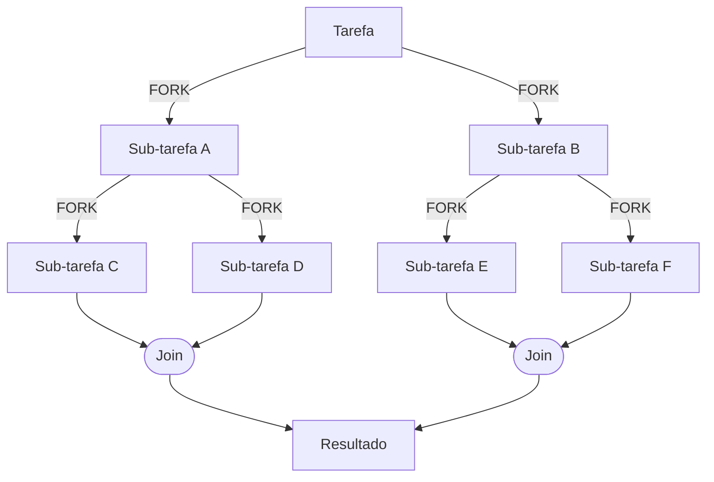

> **O que observar:** é a árvore do *Divide and Conquer* da Aula 06. O livro *Patterns* (§4.5) diz que esse padrão "segue conceitualmente uma abordagem fork/join": uma tarefa divide o problema, faz *fork* das subtarefas, espera e faz *join* para combinar.

### O diferencial: *work stealing* (roubo de trabalho)

Se a thread A terminar suas tarefas antes da thread B, **A "rouba" trabalho do final da fila de B**.

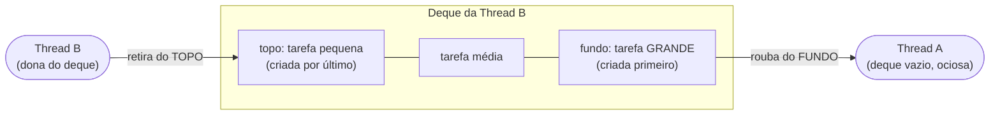

> **Por que roubar do "outro lado"?** (livro *Patterns*, §5.5): cada thread tem sua **própria fila de duas pontas** (*deque*). O dono insere e retira tarefas na frente; o ladrão retira **do fundo**, onde estão as tarefas **mais antigas**. No Divide and Conquer, as mais antigas são **subproblemas maiores**. Assim, quem rouba leva um bom pedaço de trabalho, e as tarefas pequenas, criadas mais fundo na recursão, ficam com quem as criou. Isso balanceia a carga **sem uma fila central**, evitando o gargalo do Master/Slave (Aula 07).

---

## A2. Classes do framework

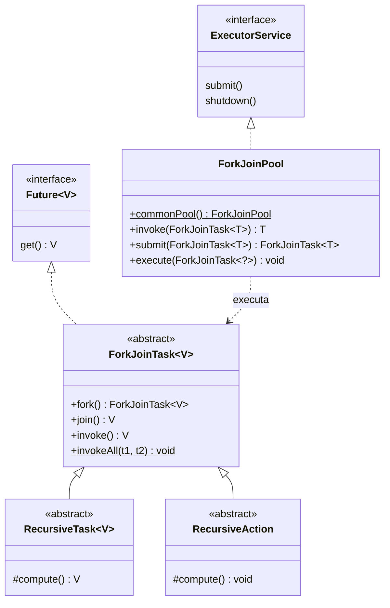

| Classe | Papel | Você implementa |
|---|---|---|
| **`ForkJoinPool`** | O **gerenciador** de threads e execução. É um `ExecutorService` especializado em *work stealing* | Nada: só cria ou usa o `commonPool()` |
| **`ForkJoinTask<V>`** | A **tarefa** invocada no pool. Também é um `Future` | Não diretamente: estenda uma das duas abaixo |
| **`RecursiveTask<V>`** | Tarefa que **retorna um valor** do tipo `V` | `protected V compute()` |
| **`RecursiveAction`** | Tarefa que **não retorna valor** (`void`) | `protected void compute()` |

> A lógica da tarefa vai **sempre no método `compute()`**.

---

## A3. Passo a passo do `BuscaMaiorValorTask`

O código da professora (`fontes/códigos/ExemploExecutorService/BuscaMaiorValorTask.java`), com a numeração dos passos do slide:

```java
public class BuscaMaiorValorTask extends RecursiveTask<Integer> {   // retorna Integer
    private static final int LIMIAR = 5_000_000;                     // tamanho do caso base
    private final int[] array;
    private final int inicio;                                        // inclusivo
    private final int fim;                                           // exclusivo

    public BuscaMaiorValorTask(int[] array, int inicio, int fim) {
        this.array = array;
        this.inicio = inicio;
        this.fim = fim;
    }

    @Override
    protected Integer compute() {
        // Passo 3 (slide "1."): Caso Base (Processamento Sequencial)
        if ((fim - inicio) <= LIMIAR) {
            int max = array[inicio];
            for (int i = inicio + 1; i < fim; i++) {
                if (array[i] > max) {
                    max = array[i];
                }
            }
            return max;
        }
        // Passo 4 (slide "2."): Divisão em Subtarefas
        int meio = inicio + (fim - inicio) / 2;
        BuscaMaiorValorTask esquerda = new BuscaMaiorValorTask(array, inicio, meio);
        BuscaMaiorValorTask direita  = new BuscaMaiorValorTask(array, meio, fim);
        // slide "3.": Dispara a tarefa da esquerda assincronamente
        esquerda.fork();
        // Processa a tarefa da direita na thread atual
        int maxDireita = direita.compute();
        // slide "4.": Aguarda a tarefa da esquerda e combina os resultados
        int maxEsquerda = esquerda.join();
        return Math.max(maxEsquerda, maxDireita);
    }

    public static void main(String[] args) {
        int[] dados = new int[50_000_000];
        for (int i = 0; i < dados.length; i++)
            dados[i] = ThreadLocalRandom.current().nextInt(1, 100_000_000);
        // Passo 5: Execução no ForkJoinPool
        ForkJoinPool pool = ForkJoinPool.commonPool();
        BuscaMaiorValorTask tarefaPrincipal = new BuscaMaiorValorTask(dados, 0, dados.length);
        long tempoInicio = System.currentTimeMillis();
        int maiorValor = pool.invoke(tarefaPrincipal);
        long tempoFim = System.currentTimeMillis();
        System.out.println("Maior valor encontrado: " + maiorValor);
        System.out.println("Tempo de execução: " + (tempoFim - tempoInicio) + " ms");
    }
}
```

### Interpretação linha a linha

| Trecho | O que faz | Conceito |
|---|---|---|
| `extends RecursiveTask<Integer>` | A tarefa **devolve** um `Integer` (o máximo) | Tarefa com retorno |
| `array`, `inicio`, `fim` (`final`) | Cada tarefa olha só a **faixa `[inicio, fim)`** do **mesmo** vetor; nada é copiado | Dados *read-only*, faixa *effectively-local* |
| `LIMIAR` | Abaixo desse tamanho **não divide mais**, resolve sequencialmente | **Granularidade** (o "botão" da Aula 06) |
| `if ((fim - inicio) <= LIMIAR)` | **Caso base**: o laço comum de máximo | Resolver direto |
| `meio = inicio + (fim - inicio) / 2` | Ponto de divisão. Esta forma evita *overflow*, ao contrário de `(inicio + fim) / 2` com índices enormes | Split |
| `new BuscaMaiorValorTask(..., inicio, meio)` e `(..., meio, fim)` | Cria as **duas metades** sem sobreposição (`meio` pertence só à direita) | Decomposição de dados |
| `esquerda.fork()` | Coloca a esquerda na **fila da thread atual**: ela será executada **assincronamente** (por esta thread depois, ou **roubada** por outra) | Fork |
| `direita.compute()` | Processa a direita **na própria thread atual**, uma chamada recursiva comum | Aproveitar a thread que já está rodando |
| `esquerda.join()` | **Espera** a esquerda terminar e pega o resultado | Join |
| `Math.max(maxEsquerda, maxDireita)` | **Combina** os resultados | Merge / redução |
| `ForkJoinPool.commonPool()` | **Pool comum** da aplicação, **gerenciado pela JVM** | Não precisa criar nem dar `shutdown` |
| `pool.invoke(tarefaPrincipal)` | **Inicia** a tarefa raiz e **espera** o resultado final | Ponto de entrada |

### Árvore de recursão para um vetor pequeno

Exemplo com `[3, 9, 1, 7, 4, 8, 2, 6]` e **`LIMIAR = 2`**:

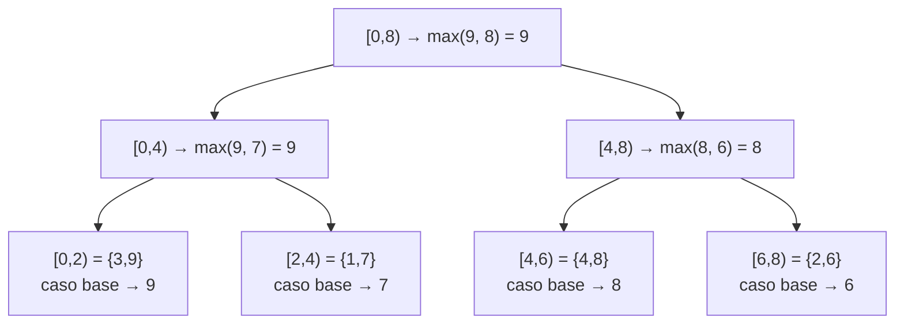

> **O que observar:** as setas para baixo são os *forks*/*computes* (divisão); os valores sobem pelo `Math.max` (*join* + combinação). Com 8 elementos e limiar 2, há **4 casos base**, que podem rodar em 4 threads diferentes.

### Sequência de execução de um nível

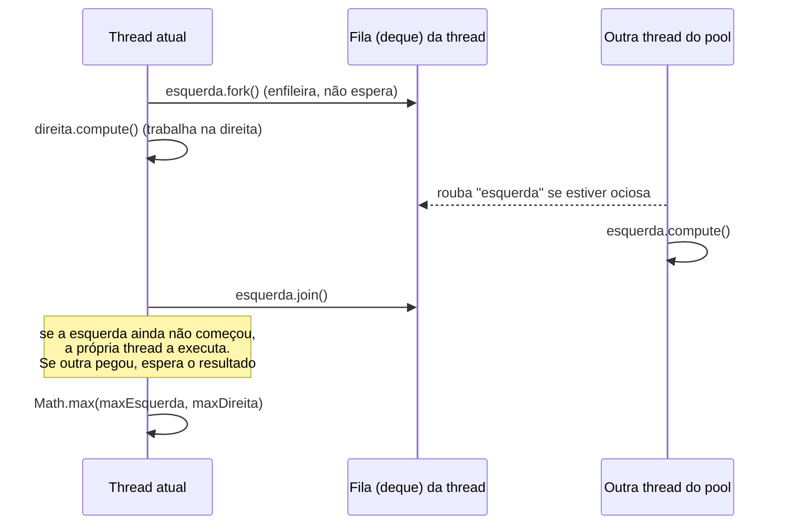

### `commonPool()` e `invoke()`

- **Common Pool:** um pool de threads **comum para a aplicação Java**, **gerenciado pela JVM** (slide p.7). Toda `ForkJoinTask` que não é submetida explicitamente a um pool usa o `commonPool()`.
- **Paralelismo do common pool:** por padrão, **nº de processadores − 1**. Medido na máquina de teste: `availableProcessors() = 8` e `ForkJoinPool.getCommonPoolParallelism() = 7`. A "vaga" que sobra é ocupada pela própria thread que chamou `invoke`, que também trabalha. Na saída real do exercício (seção A5) aparece `main caso base [9,12)`: **a `main` executou um caso base**.
- **`shutdown()` não tem efeito** no `commonPool()` (Javadoc). As threads dele são *daemon*, e o programa termina normalmente. Não há a pegadinha do "esqueci o shutdown" da Aula 07, **desde que você use o common pool**. Um `new ForkJoinPool()` criado por você deve ser encerrado.
- **`invoke(task)`:** inicia a tarefa e **bloqueia até o resultado**. É o método para chamar **de fora** do framework (ex.: no `main`).

| Modo (Javadoc do `ForkJoinPool`) | Chamada **de fora** (ex.: `main`) | Chamada **de dentro** de um `compute()` |
|---|---|---|
| Disparar assíncrono | `pool.execute(task)` | `task.fork()` |
| Esperar e obter o resultado | `pool.invoke(task)` | `task.invoke()` (ou `fork` + `join`) |
| Disparar e obter um `Future` | `pool.submit(task)` | `task.fork()` (a própria task é um `Future`) |

---

## A4. Decisões de projeto

### A4.1 O limiar: `500` (slide) × `5_000_000` (código)

O slide mostra `LIMIAR = 500`; o arquivo da professora usa `5_000_000`. **Os dois funcionam.** O limiar é um **parâmetro de granularidade**: quanto mais barato o trabalho por elemento, maior pode ser o limiar.

**Experimento real** (máximo de um vetor de 50 milhões de `int`, 8 núcleos, JDK 24, 2 rodadas):

| Configuração | Tempo medido | Leitura |
|---|---|---|
| Sequencial (um `for` simples) | 22 ms / 87 ms | Referência (variação de medição entre rodadas) |
| `LIMIAR = 10` | **258 ms / 125 ms** | **Mais lento que o sequencial**: milhões de tarefas minúsculas, o overhead domina |
| `LIMIAR = 500` (slide) | 18 ms / 18 ms | Bom |
| `LIMIAR = 100_000` | 10 ms / 12 ms | Bom |
| `LIMIAR = 5_000_000` (código) | 10 ms / 12 ms | Bom: ~10 casos base, suficiente para 8 núcleos |
| `LIMIAR = 50_000_000` (= vetor inteiro) | 34 ms / 34 ms | **Não divide nunca**: vira sequencial dentro do pool |

> **O que observar:** os dois extremos são ruins. Limiar **pequeno demais** gera **overhead** de criar e escalonar tarefas. Limiar **grande demais** gera **pouco paralelismo**, e no limite nenhum. Entre eles há uma faixa larga que funciona bem. Os números dependem da máquina; o **formato** da curva é o que importa.
>
> A documentação do `ForkJoinTask` dá uma "regra de bolso muito aproximada": cada tarefa deveria executar **entre 100 e 10.000 passos computacionais básicos**. Para uma operação baratíssima como comparar inteiros, o experimento mostra que limiares bem maiores também vão bem. **Na dúvida, meça.**

### A4.2 Por que `fork()` de um lado e `compute()` do outro?

```java
esquerda.fork();                       // ✅ idiomático
int maxDireita  = direita.compute();
int maxEsquerda = esquerda.join();
```

- A thread atual **já está rodando**. Em vez de criar e enfileirar **duas** tarefas e ficar esperando, ela **trabalha numa metade** enquanto a outra fica disponível para roubo.
- São **metade das tarefas** enfileiradas, ou seja, menos overhead.
- O exemplo oficial do Javadoc (`RecursiveTask`, fatorial) faz exatamente isso: `leftTask.fork(); ... new FactorialTask(mid + 1, to).compute().multiply(leftTask.join())`, com o comentário "*perform about half the work locally*".

Alternativas e seus efeitos:

| Código | Funciona? | Comentário |
|---|---|---|
| `e.fork(); d.compute(); e.join();` | ✅ | **Idiomático** (o da aula) |
| `invokeAll(e, d); e.join() + d.join()` | ✅ | Equivalente e conciso; o framework decide |
| `e.fork(); d.fork(); d.join(); e.join();` | ✅ | Funciona. O Javadoc recomenda fazer os *joins* "**de dentro para fora**": juntar primeiro a **última** tarefa bifurcada |
| `e.fork(); e.join(); d.compute();` | ⚠️ resultado certo, **paralelismo perdido** | Espera a esquerda **antes** de começar a direita (ver Q2 da seção A7) |
| `e.fork(); return d.compute();` | ❌ resultado **errado** | Esqueceu o `join`: ignora metade dos dados (ver Q1) |

### A4.3 Regras práticas para tarefas Fork/Join (Javadoc)

- **Evitar `synchronized` e bloqueios** dentro de `compute()`, exceto o próprio `join()`.
- **Não fazer I/O bloqueante** em tarefas subdivisíveis.
- Idealmente, cada tarefa acessa **variáveis independentes** das outras: só a sua faixa, como no `BuscaMaiorValorTask`.
- **Não dar `fork()` duas vezes na mesma tarefa** (é "erro de uso"), a menos que ela tenha terminado e sido reinicializada.

---

## A5. Exercícios da aula resolvidos (para leitura)

> **Exercício 1 (slide p.8):** dado `[1,70,40,20,89,34,71,56,2,6,30,23]`, some os valores usando 3 threads com **`ExecutorService` + `Callable`** e, depois, o mesmo com **ForkJoin**.
> **Exercício 2 (slide p.9):** (a) somar todos os elementos de uma **matriz** com **decomposição de dados em blocos** e ForkJoin; (b) contar os **nós de uma árvore** com Fork/Join.

### Exercício 1, versão `ExecutorService` + `Callable`

Resolvido na [Aula 07, §12](07_threads_balanceamento_executor.md#12-exercício-1-resolvido-para-leitura). Lá a divisão é **estática** (3 blocos de 4) e a combinação é feita pela main somando os `Future`s.

### Exercício 1, versão ForkJoin

```java
public class SomaVetorTask extends RecursiveTask<Integer> {
    private static final int LIMIAR = 4;
    private final int[] vetor; private final int inicio, fim;

    SomaVetorTask(int[] vetor, int inicio, int fim) {
        this.vetor = vetor; this.inicio = inicio; this.fim = fim;
    }

    @Override
    protected Integer compute() {
        if (fim - inicio <= LIMIAR) {                  // caso base
            int soma = 0;
            for (int i = inicio; i < fim; i++) soma += vetor[i];
            return soma;
        }
        int meio = inicio + (fim - inicio) / 2;
        SomaVetorTask esquerda = new SomaVetorTask(vetor, inicio, meio);
        SomaVetorTask direita  = new SomaVetorTask(vetor, meio, fim);
        esquerda.fork();
        int somaDireita  = direita.compute();
        int somaEsquerda = esquerda.join();
        return somaEsquerda + somaDireita;              // a única diferença para o máximo: + em vez de Math.max
    }

    public static void main(String[] args) {
        int[] vetor = {1, 70, 40, 20, 89, 34, 71, 56, 2, 6, 30, 23};
        int total = ForkJoinPool.commonPool().invoke(new SomaVetorTask(vetor, 0, vetor.length));
        System.out.println("Soma total = " + total);
    }
}
```

**Saída real** (com um `println` extra no caso base):
```
ForkJoinPool.commonPool-worker-2 caso base [0,3) = 111
main caso base [9,12) = 59
ForkJoinPool.commonPool-worker-3 caso base [6,9) = 129
ForkJoinPool.commonPool-worker-1 caso base [3,6) = 143
Soma total = 442
```

> **O que observar:** 12 → [0,6) e [6,12) → cada um em 2 blocos de 3, dando **4 casos base**. A `main` também executou um caso base, porque a thread que chama `invoke` participa do trabalho.

| | Versão `ExecutorService` (Aula 07) | Versão ForkJoin |
|---|---|---|
| Quem decide a divisão | O programador, **antes** (3 blocos fixos) | A **recursão**, guiada pelo `LIMIAR` |
| Balanceamento | Estático (bloco), com fila do pool | Dinâmico (*work stealing*) |
| Combinação | A main soma os `Future`s | Cada nível soma os dois filhos |
| Encerrar o pool | `shutdown()` obrigatório | `commonPool()` não precisa |

### Exercício 2a: soma de matriz por blocos de linhas

```java
public class SomaMatrizTask extends RecursiveTask<Long> {
    private static final int LIMIAR_LINHAS = 2;
    private final int[][] m; private final int linIni, linFim;   // faixa de LINHAS [linIni, linFim)

    @Override
    protected Long compute() {
        if (linFim - linIni <= LIMIAR_LINHAS) {                  // bloco pequeno: soma direto
            long soma = 0;
            for (int i = linIni; i < linFim; i++)
                for (int j = 0; j < m[i].length; j++)            // percorre a linha: localidade espacial
                    soma += m[i][j];
            return soma;
        }
        int meio = linIni + (linFim - linIni) / 2;               // divide o BLOCO DE LINHAS ao meio
        SomaMatrizTask cima  = new SomaMatrizTask(m, linIni, meio);
        SomaMatrizTask baixo = new SomaMatrizTask(m, meio, linFim);
        cima.fork();
        long somaBaixo = baixo.compute();
        return cima.join() + somaBaixo;
    }
}
// matriz 8x8 com valores 1..64 → saída real: "Soma matriz = 2080 (esperado 2080)"
```

**O que muda em relação ao vetor:** a faixa é de **linhas**, ou seja, uma **decomposição em blocos 1D** da matriz (Aula 07, §5.2), e o caso base tem um laço duplo. Percorrer `m[i][j]` com `j` no laço de dentro respeita a **localidade**. O tipo de retorno é `Long`, para evitar *overflow* em matrizes grandes.

### Exercício 2b: contar os nós de uma árvore

```java
class No {
    int valor; List<No> filhos = new ArrayList<>();
}

public class ContaNosTask extends RecursiveTask<Integer> {
    private final No raiz;

    @Override
    protected Integer compute() {
        if (raiz == null) return 0;
        List<ContaNosTask> subtarefas = new ArrayList<>();
        for (No filho : raiz.filhos) {          // uma subtarefa por SUBÁRVORE
            ContaNosTask t = new ContaNosTask(filho);
            t.fork();
            subtarefas.add(t);
        }
        int total = 1;                          // o próprio nó
        for (ContaNosTask t : subtarefas) total += t.join();
        return total;
    }
}
```

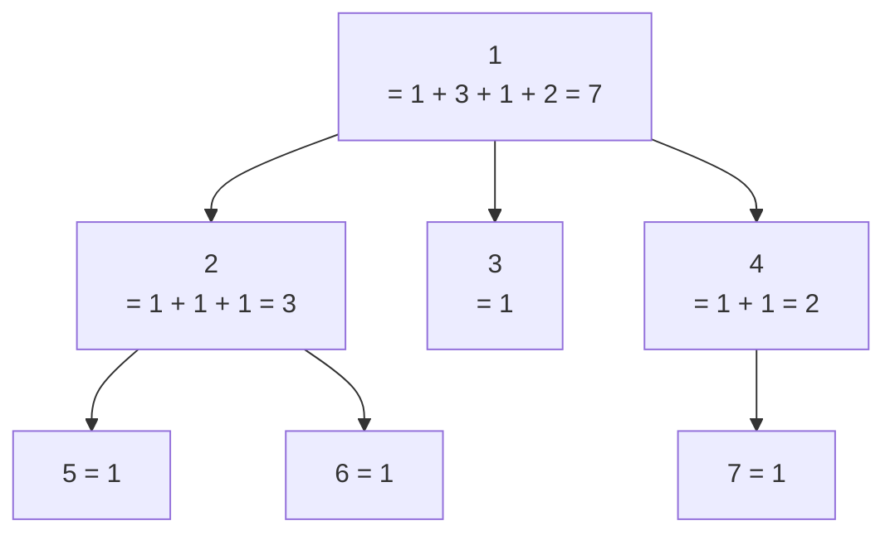

Saída real: `Nos = 7`.

| Ponto de leitura | Resposta |
|---|---|
| Qual padrão da Aula 06? | **Recursive Data**: cada subárvore tem a mesma estrutura da árvore |
| Onde está o caso base? | Implícito: uma **folha** não tem filhos, o laço não cria subtarefas e ela devolve `1` |
| Por que não há `LIMIAR`? | Por simplicidade. Numa árvore real enorme, criar uma tarefa por nó gera **overhead** (Aula 06: "criar tarefas para estruturas muito pequenas custa mais que o trabalho"). Na prática, se a subárvore é pequena, conta-se sequencialmente |
| A árvore é balanceada? | Não necessariamente: subárvores de tamanhos diferentes = **paralelismo irregular**. O *work stealing* ajuda justamente aí |

### Extra: `RecursiveAction` (sem retorno)

```java
public class DobraAction extends RecursiveAction {
    private static final int LIMIAR = 3;
    private final int[] v; private final int ini, fim;

    @Override
    protected void compute() {                               // void: modifica o vetor "no lugar"
        if (fim - ini <= LIMIAR) { for (int i = ini; i < fim; i++) v[i] *= 2; return; }
        int meio = ini + (fim - ini) / 2;
        invokeAll(new DobraAction(v, ini, meio), new DobraAction(v, meio, fim));
    }
}
// {1,2,3,4,5,6,7,8} → saída real: [2, 4, 6, 8, 10, 12, 14, 16]
```

Use `RecursiveAction` quando a tarefa **altera os dados** e não há nada a combinar. Cada subtarefa escreve só na sua faixa (*effectively-local*), então não há condição de corrida. `invokeAll(a, b)` faz *fork* das duas e espera ambas.

---

## A6. Quadro "onde usar"

| Situação | Use | Não use |
|---|---|---|
| Problema **recursivo** / divide-and-conquer (máximo, soma, mergesort, árvores) | `ForkJoinPool` + `RecursiveTask`/`RecursiveAction` | Criar uma `Thread` por subproblema (o livro mostra essa "versão direta" e alerta para o custo) |
| Lista **plana** de tarefas independentes (processar N arquivos) | `ExecutorService` (`newFixedThreadPool`) | — (ForkJoin também funciona, mas não traz vantagem) |
| Tarefa recursiva **com resultado** | `RecursiveTask<V>` | `RecursiveAction` (não retorna) |
| Tarefa recursiva que **só modifica dados** | `RecursiveAction` | — |
| Disparar uma subtarefa **dentro** do `compute()` | `sub.fork()` | `pool.invoke(sub)` dentro de `compute()` |
| Resolver uma metade **na thread atual** | `sub.compute()` | `fork()` nas duas metades sem necessidade |
| Esperar o resultado de uma subtarefa | `sub.join()` | `sub.get()` (funciona, mas lança exceções verificadas; `join` é o idiomático) |
| Iniciar a tarefa raiz **no `main`** | `ForkJoinPool.commonPool().invoke(raiz)` ou `raiz.invoke()` | — |
| Duas subtarefas de uma vez | `invokeAll(a, b)` | — |

> **`join()` × `get()`** (Javadoc): `join()` lança exceções **não verificadas** (`RuntimeException`) e não é interrompido por `InterruptedException`. `get()` segue a interface `Future` e lança `ExecutionException` e `InterruptedException`.

---

## A7. Treino de leitura de código (Fork/Join)

> Todos os resultados abaixo foram **testados** (JDK 24) com o vetor `{1, 70, 40, 20, 89, 34, 71, 56, 2, 6, 30, 23}`, cuja soma correta é **442**.

**Q1 — Está correto?**

```java
protected Integer compute() {
    if (fim - ini <= 2) { int s = 0; for (int i = ini; i < fim; i++) s += v[i]; return s; }
    int meio = ini + (fim - ini) / 2;
    SemJoin esq = new SemJoin(v, ini, meio), dir = new SemJoin(v, meio, fim);
    esq.fork();
    return dir.compute();
}
```

<details><summary><b>Gabarito Q1</b></summary>

**Incorreto.** Faltou `esq.join()` e a combinação: a cada nível, o resultado da esquerda é **descartado**. Saída real: **53** em vez de 442. 53 = 30 + 23, só o último pedaço da direita. **Correção:** `int d = dir.compute(); return esq.join() + d;`
</details>

**Q2 — Está correto?**

```java
esq.fork();
int se = esq.join();
int sd = dir.compute();
return se + sd;
```

<details><summary><b>Gabarito Q2</b></summary>

O **resultado está correto** (442), mas o **paralelismo foi perdido**: o `join()` logo após o `fork()` faz a thread **esperar a esquerda terminar** antes de começar a direita. Na prática a execução fica sequencial. É o mesmo erro do "`get()` dentro do laço de `submit`" da Aula 07. **Correção:** `compute()` da direita **antes** do `join()` da esquerda.
</details>

**Q3 — O que acontece?**

```java
protected Integer compute() {
    int meio = ini + (fim - ini) / 2;
    SemCasoBase esq = new SemCasoBase(v, ini, meio), dir = new SemCasoBase(v, meio, fim);
    esq.fork();
    return dir.compute() + esq.join();
}
```

<details><summary><b>Gabarito Q3</b></summary>

**Não há caso base**: a recursão nunca para. As faixas chegam a tamanho 0 e continuam sendo divididas. Resultado real: **`java.lang.StackOverflowError`**. Todo `compute()` precisa de um `if` de caso base, com um limiar.
</details>

**Q4 — Por que este programa é mais lento que a versão sequencial?**

```java
private static final int LIMIAR = 10;   // vetor de 50 milhões de elementos
```

<details><summary><b>Gabarito Q4</b></summary>

Granularidade fina demais: são criadas **milhões de tarefas** de 10 elementos, e o custo de criá-las, enfileirá-las e juntá-las supera o trabalho útil (comparar 10 inteiros). Medido: **125–258 ms** contra **22–87 ms** do sequencial e **10–12 ms** com limiar adequado. **Correção:** aumentar o limiar e medir.
</details>

**Q5 — Está correto?** Queremos o máximo do vetor:

```java
public class MaxAction extends RecursiveAction {
    @Override
    protected void compute() {
        // ...
        return Math.max(e.join(), d.compute());
    }
}
```

<details><summary><b>Gabarito Q5</b></summary>

**Não compila.** `RecursiveAction.compute()` é `void`: não pode retornar valor e `join()` devolve `null` (`Void`). Para ter retorno, use **`RecursiveTask<Integer>`** com `protected Integer compute()`.
</details>

**Q6 — Interprete.** No `main`, em vez de `pool.invoke(tarefa)`, alguém escreveu `int r = tarefa.compute();`. Compila? Há paralelismo?

<details><summary><b>Gabarito Q6</b></summary>

**Compila** se o `main` estiver na **mesma classe ou no mesmo pacote** (`compute()` é `protected`) **e funciona**: o resultado é correto. A primeira chamada roda na `main`, que não pertence a nenhum pool. Os `fork()` feitos fora de um pool vão para o **`commonPool()`** (Javadoc do `fork`), então ainda pode haver paralelismo. Teste real: com `compute()` direto, a `main` executou quase tudo e só 1 subtarefa foi para um worker; com `invoke`, o trabalho se espalhou por 2 workers + main.

**Mesmo assim, use `invoke()`**: é o ponto de entrada documentado, propaga exceções corretamente e deixa claro que a tarefa raiz pertence ao pool.
</details>

**Q7 — Qual padrão e qual classe?** (a) Ordenar um vetor com mergesort. (b) Aplicar um filtro a cada pixel de uma imagem, alterando a própria imagem. (c) Calcular o tamanho total de uma pasta com subpastas.

<details><summary><b>Gabarito Q7</b></summary>

(a) Divide and Conquer → `RecursiveAction`: ordena no lugar; o merge é feito após os dois `join`s. (b) Decomposição de dados → `RecursiveAction` dividindo a imagem em blocos, cada bloco escrevendo só na sua região. (c) Recursive Data → `RecursiveTask<Long>`, uma subtarefa por subpasta, somando os tamanhos.
</details>

---

# Bloco B — Arquivos distribuídos e introdução a Big Data

## B1. Introdução a Big Data

**Motivação:** até agora programamos em **um único nó**. Mas e se os dados forem **grandes demais e não couberem na memória**? A ideia é usar um **sistema distribuído**, em que **cada nó contém parte dos dados**. É a forma mais usada nas soluções de Big Data.

**Definição (Oracle, citada no slide):** "*big data é um conjunto de dados maior e mais complexo, especialmente de novas fontes de dados. Esses conjuntos de dados são tão volumosos que o software tradicional de processamento de dados simplesmente não consegue gerenciá-los. No entanto, esses grandes volumes de dados podem ser usados para resolver problemas de negócios que você não conseguiria resolver antes.*"

### Os 5 Vs

> **[P2] Cai:** os 5 Vs e a definição de cada um.

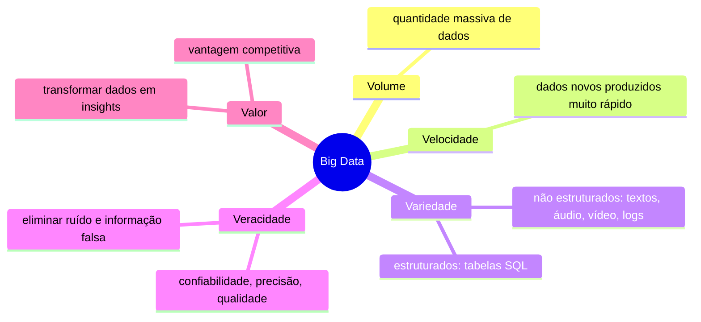

| V | Significado |
|---|---|
| **Volume** | Quantidade **massiva** de dados gerados a todo momento |
| **Velocidade** | Rapidez extrema com que **novos dados são produzidos** |
| **Variedade** | Diversidade de dados: de **estruturados** (tabelas SQL) a **não estruturados** (textos, áudios, vídeos, logs) |
| **Veracidade** | Grau de **confiabilidade, precisão e qualidade** dos dados, eliminando ruídos e informações falsas |
| **Valor** | Capacidade de transformar os dados tratados em **insights práticos** e vantagem competitiva |

### *Scale up* × *scale out* (contexto do livro *Distributed Systems*, §1.2.6)

- **Scale up** (escalar verticalmente): **melhorar a máquina**, com mais memória, CPU mais rápida e rede melhor. Tem limite físico e custo alto.
- **Scale out** (escalar horizontalmente): **adicionar mais máquinas**. Segundo o livro, há basicamente três técnicas: **esconder latência de comunicação**, **distribuição do trabalho** (particionamento) e **replicação**.

O Hadoop é *scale out* puro: **particiona** os dados em blocos (HDFS), **distribui** o processamento (MapReduce) e **replica** os blocos para tolerar falhas.

---

## B2. O ecossistema Hadoop

O **Hadoop** é um **framework para processamento em grande escala** em clusters. Características do slide:

| Característica | O que significa |
|---|---|
| **Hardware "barato"** (*commodity hardware*) | Agrupa computadores simples de mercado, em vez de supercomputadores |
| **Tolerância a falhas** | Se um computador do cluster queimar no meio do trabalho, o Hadoop usa **outra cópia do dado** e continua a tarefa em outra máquina, sem interromper nada |
| **Levar o código aos dados** (*data locality*) | Em vez de transferir terabytes pela rede até o programa, o **código é executado no servidor onde o dado já está** |
| **Arquitetura *shared-nothing*** | Cada máquina tem sua **própria CPU, memória e disco**; nada é compartilhado. É memória **distribuída** (Aula 06) |

> A documentação oficial resume a filosofia: falha de hardware **"é a norma, e não a exceção"**. Por isso o próprio software detecta e trata falhas, em vez de depender de hardware confiável.

**Módulos do projeto Apache Hadoop** (site oficial):

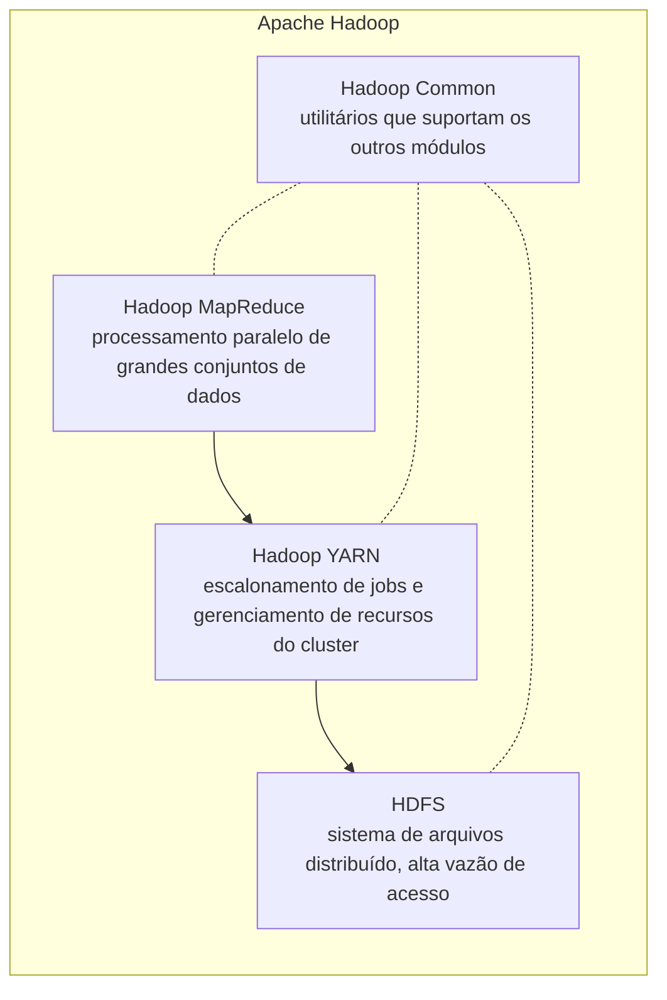

---

## B3. HDFS (*Hadoop Distributed File System*)

### B3.1 Arquitetura mestre/escravo

> **[P2] Cai (explícito):** explicar NameNode (gerencia: abre, fecha, renomeia; **não armazena**) e DataNode (armazena os blocos; é onde o *map* executa).

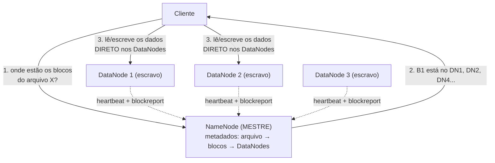

| | **NameNode** (mestre) | **DataNode** (escravo) |
|---|---|---|
| Quantos | **Um** por cluster HDFS | Em geral, **um por nó** do cluster |
| Função | **Gerencia o acesso aos arquivos**: abre, fecha, renomeia… Guarda os **metadados** e decide o **mapeamento dos blocos** para os DataNodes | **Armazena** os blocos daquele nó e atende as **leituras e escritas** pedidas pelo cliente. Cria, apaga e replica blocos sob instrução do NameNode |
| Guarda dados do usuário? | **Não**: segundo a documentação, os dados do usuário **nunca passam** pelo NameNode | **Sim** |

- NameNode e DataNodes são **implementados em Java**, o que dá **portabilidade**: rodam em qualquer máquina com JVM.
- **Heartbeat:** cada DataNode envia sinais periódicos ao NameNode dizendo que está vivo. **Blockreport:** a lista de todos os blocos que ele guarda.
- Se um DataNode **para de enviar heartbeats**, o NameNode o considera morto, para de mandar requisições a ele e **re-replica** os blocos que ficaram com menos cópias que o desejado.

> **Ligação com a Aula 07:** o HDFS é um **Master/Slave**. E, como lá, o mestre é um ponto sensível. Por isso os dados não passam por ele: o cliente fala **direto** com os DataNodes.

### B3.2 Blocos de tamanho fixo

> **[P2] Cai como exercício:** particione **na ordem das linhas** (leitura por offset); o último bloco ocupa só o necessário. Cuidado com pegadinhas na contagem de linhas. Modelo: [Aula 12, ex. 5](12_joins_spark_revisao_prova.md#exercício-5--hdfs-blocos-e-replicação).

- O arquivo é dividido internamente em **um ou mais blocos**, armazenados num conjunto de DataNodes.
- Tamanho **padrão: 128 MB** (`dfs.blocksize = 134217728` bytes), **alterável** por parâmetro.
- O particionamento é **automático, por *byte offset***, sem olhar o conteúdo. ⚠️ É particionamento **de infraestrutura**, não lógico.

**Exemplo do slide: arquivo de 300 MB**

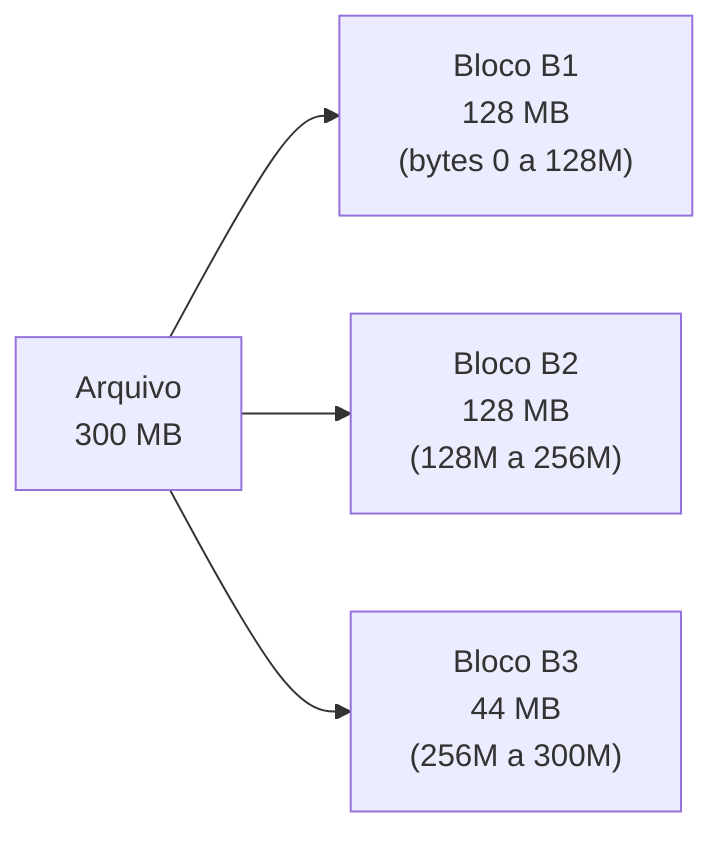

> 300 = 128 + 128 + **44**. O último bloco ocupa só os 44 MB de que precisa, não 128.

### B3.3 Replicação

> **[P2] Cai como exercício:** fator de replicação = **total** de cópias (fator 2 = original + 1 réplica), sempre em workers **diferentes**, sem **estourar a capacidade** de cada worker, e de modo que a queda de qualquer worker não perca nenhum bloco.

- Cada bloco é **replicado** em uma ou mais máquinas. O número de cópias é o **fator de replicação**, **padrão 3** (`dfs.replication = 3`), configurável por arquivo.
- **Duas réplicas do mesmo bloco nunca ficam no mesmo DataNode.** Se ficassem, perder aquele nó perderia as duas.
- Quando possível, **2 blocos do mesmo arquivo** são armazenados num **mesmo DataNode** (slide).

Exemplo ilustrativo (arquivo de 300 MB, fator 3, 4 DataNodes):

| | DataNode 1 | DataNode 2 | DataNode 3 | DataNode 4 |
|---|---|---|---|---|
| B1 (128 MB) | ✅ | ✅ | | ✅ |
| B2 (128 MB) | ✅ | | ✅ | ✅ |
| B3 (44 MB) | | ✅ | ✅ | ✅ |

> **O que observar:** cada bloco aparece **3 vezes**, sempre em DataNodes **diferentes**. Se o DataNode 4 queimar, todos os blocos ainda têm 2 cópias, e o NameNode manda criar uma terceira em outro nó.
>
> **Para ir além** (documentação oficial do HDFS): com fator 3, a política padrão leva em conta os **racks**. A 1ª réplica fica no nó do escritor (ou num nó do mesmo rack), a 2ª num nó de **outro rack** e a 3ª num nó **diferente desse mesmo rack remoto**. Assim o sistema sobrevive até à queda de um rack inteiro.

**Ligação com *Distributed Systems* (§1.2.6):** replicar aumenta a **disponibilidade** e ajuda a **balancear a carga**, porque há mais lugares de onde ler. O preço são os problemas de **consistência** entre as cópias. O HDFS os simplifica com o modelo ***write-once-read-many***: um arquivo, depois de escrito e fechado, não é alterado no meio, só pode receber *append* ou *truncate*.

### B3.4 Particionamento lógico × físico

- É possível implementar um **particionamento lógico** sobre o Hadoop (ex.: "um arquivo por mês").
- Mas o **armazenamento físico** continua em **blocos de 128 MB**, e o Hadoop usa **ponteiros** para seguir o particionamento lógico.
- Para **"forçar"** o físico a ficar próximo do lógico:
  - usar **pastas e diretórios** (ex.: `/vendas/ano=2025/mes=10/`);
  - usar outro **formato de serialização**, como o **Parquet** (formato colunar que organiza os dados internamente em grupos).

---

## B4. MapReduce

> **[P2] Cai como exercício:** responder com saída do Map → entrada de cada Reducer → saída de cada Reducer. Sempre chave-valor; o **Map não conta**, só emite `(chave, 1)`. Também cai: vantagens/desvantagens do MapReduce. Modelo: [Aula 12, ex. 6](12_joins_spark_revisao_prova.md#exercício-6--mapreduce-contagem-de-códigos-de-status).

### B4.1 Ideia

- **Modelo de programação e processamento distribuído.**
- **Processa os blocos no próprio nó** em que estão armazenados, evitando tráfego de grandes volumes pela rede. É a **localidade de dados** da Aula 07, em escala de cluster.
- **Ideia central: Dividir para Conquistar.** Em vez de carregar um arquivo gigante na memória de uma máquina, a tarefa é quebrada em **centenas de pequenas tarefas paralelas**.
- O **programador implementa apenas `map` e `reduce`**. O framework cuida de escalonar, monitorar e **reexecutar tarefas que falharem** (documentação oficial).

### B4.2 As fases

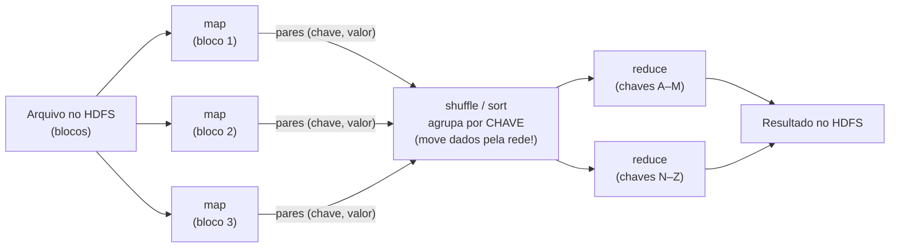

| Fase | O que faz | Analogia D&C |
|---|---|---|
| **Map** | Aplica a função do programador **a cada bloco**, no nó onde ele está, e emite pares **(chave, valor)** | **Dividir** e resolver as partes |
| **Shuffle / sort** | **Reorganiza** os pares para que **todas as ocorrências da mesma chave vão para o mesmo reducer**; agrupa e ordena por chave | Preparar a combinação |
| **Reduce** | Para cada chave, recebe **a lista de valores** e produz o resultado final | **Conquistar** (combinar) |

**Tipos (documentação oficial):**
```
(entrada) <k1, v1>  →  map  →  <k2, v2>  →  [combine]  →  shuffle/sort  →  <k2, lista(v2)>  →  reduce  →  <k3, v3> (saída)
```

- Os **tipos de chave e de valor são definidos pelo programador**.
- **O Reduce é opcional:** muitas vezes só o Map é usado (ex.: filtrar ou transformar registros). Com zero reducers, a saída do map vai **direto** para o HDFS, **sem ordenação** (documentação oficial).

### B4.3 Por que o shuffle é caro

- Durante o shuffle **pode haver movimentação de dados entre os nós**, para que cada chave seja agrupada num mesmo nó.
- Essa movimentação é **MUITO custosa** em alguns casos e **afeta diretamente a performance**. É comunicação, o maior inimigo da Aula 06.
- Além disso, o Hadoop **grava resultados intermediários em DISCO**: no fim do map, no shuffle/sort e no fim do reduce. Disco é muito mais lento que memória, e esse é o principal motivo para o Spark existir (B5).

> **Combiner** (documentação oficial): um "mini-reduce" opcional executado **localmente** na saída de cada map, **antes** do shuffle. No word count, em vez de enviar `(Apple,1)` duas vezes pela rede, o nó envia `(Apple,2)`. Isso reduz o volume do shuffle. Só é válido quando a operação é **associativa e comutativa** (soma, mín, máx).

### B4.4 Exemplo: contagem de palavras (slide p.29)

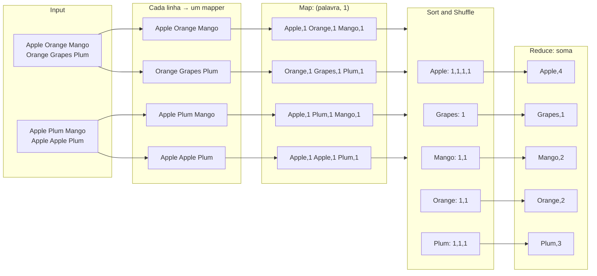

### B4.5 O WordCount na API Java do Hadoop (para leitura)

> Código do **tutorial oficial do Apache Hadoop** (WordCount v1.0, Apache License 2.0), com comentários em português. **Não foi executado localmente**: exige um cluster ou instalação Hadoop. Foi incluído para **interpretação**.

```java
public class WordCount {

  // MAP: Mapper<tipoChaveEntrada, tipoValorEntrada, tipoChaveSaída, tipoValorSaída>
  public static class TokenizerMapper
       extends Mapper<Object, Text, Text, IntWritable> {

    private final static IntWritable one = new IntWritable(1);   // o valor "1"
    private Text word = new Text();

    // chamado UMA VEZ POR LINHA do bloco: key = offset da linha, value = texto da linha
    public void map(Object key, Text value, Context context)
        throws IOException, InterruptedException {
      StringTokenizer itr = new StringTokenizer(value.toString());
      while (itr.hasMoreTokens()) {
        word.set(itr.nextToken());
        context.write(word, one);                 // emite (palavra, 1)
      }
    }
  }

  // REDUCE: recebe (palavra, [1, 1, 1, ...]) DEPOIS do shuffle
  public static class IntSumReducer
       extends Reducer<Text, IntWritable, Text, IntWritable> {
    private IntWritable result = new IntWritable();

    public void reduce(Text key, Iterable<IntWritable> values, Context context)
        throws IOException, InterruptedException {
      int sum = 0;
      for (IntWritable val : values) {
        sum += val.get();                          // soma todos os 1s da palavra
      }
      result.set(sum);
      context.write(key, result);                  // emite (palavra, total)
    }
  }

  public static void main(String[] args) throws Exception {
    Configuration conf = new Configuration();
    Job job = Job.getInstance(conf, "word count");
    job.setJarByClass(WordCount.class);
    job.setMapperClass(TokenizerMapper.class);     // quem faz o map
    job.setCombinerClass(IntSumReducer.class);     // combiner: soma local antes do shuffle
    job.setReducerClass(IntSumReducer.class);      // quem faz o reduce
    job.setOutputKeyClass(Text.class);             // tipo da chave de saída
    job.setOutputValueClass(IntWritable.class);    // tipo do valor de saída
    FileInputFormat.addInputPath(job, new Path(args[0]));    // entrada no HDFS
    FileOutputFormat.setOutputPath(job, new Path(args[1]));  // saída no HDFS
    System.exit(job.waitForCompletion(true) ? 0 : 1);
  }
}
```

| Pergunta de leitura | Resposta |
|---|---|
| O que o programador **não** escreveu? | O **shuffle/sort**, a divisão em blocos, a distribuição entre nós, a reexecução de falhas. **O framework faz** |
| Para a linha `"Apple Apple Plum"`, o que o `map` emite? | `(Apple,1)`, `(Apple,1)`, `(Plum,1)` |
| O que o `reduce` recebe para `Apple`? | `key = Apple`, `values = [1, 1, 1, 1]` (sem combiner) → emite `(Apple, 4)` |
| Por que `IntSumReducer` pode ser o **combiner**? | Porque a **soma é associativa e comutativa**: somar parciais localmente e depois somar de novo dá o mesmo resultado |
| Por que `Text`/`IntWritable` e não `String`/`int`? | Chaves e valores precisam ser **serializáveis** pelo Hadoop (`Writable`) para trafegar e ir para o disco. Chaves também precisam ser **ordenáveis** (para o sort) |

**Simulação em Java puro** (sem Hadoop), só para *ver* o fluxo, com saída real:

```java
// MAP: cada linha → pares (palavra, 1)
List<Map.Entry<String, Integer>> pares = linhas.stream()
    .flatMap(l -> Arrays.stream(l.split(" ")))
    .map(p -> Map.entry(p, 1))
    .collect(Collectors.toList());
// SHUFFLE/SORT: agrupa os valores pela chave (TreeMap = ordenado por chave)
Map<String, List<Integer>> agrupado = new TreeMap<>();
for (Map.Entry<String, Integer> par : pares)
    agrupado.computeIfAbsent(par.getKey(), k -> new ArrayList<>()).add(par.getValue());
// REDUCE: soma os valores de cada chave
Map<String, Integer> resultado = new TreeMap<>();
agrupado.forEach((palavra, uns) -> resultado.put(palavra, uns.stream().mapToInt(Integer::intValue).sum()));
```
```
MAP     -> [Apple=1, Orange=1, Mango=1, Orange=1, Grapes=1, Plum=1, Apple=1, Plum=1, Mango=1, Apple=1, Apple=1, Plum=1]
SHUFFLE -> {Apple=[1, 1, 1, 1], Grapes=[1], Mango=[1, 1], Orange=[1, 1], Plum=[1, 1, 1]}
REDUCE  -> {Apple=4, Grapes=1, Mango=2, Orange=2, Plum=3}
```

---

## B5. Apache Spark

| Característica (slide) | O que significa |
|---|---|
| **Framework de computação distribuída open source** | Como o Hadoop MapReduce, processa dados em clusters |
| **Processamento em memória** (*in-memory*) | **Diferente do Hadoop**, mantém os dados na **RAM entre as etapas** da computação, reduzindo o custo de I/O de disco |
| **Tolerância a falhas com RDDs** | *Resilient Distributed Datasets* **reconstroem automaticamente** os dados perdidos se um nó falhar |
| **Arquitetura Master/Worker** | Um nó principal, o **Driver**, coordena as tarefas; vários nós de execução, os **Executors**, processam os dados em paralelo |
| **Multilinguagem** | APIs em **Java, Scala, Python e R**, além de SQL. Integra com o Hadoop (pode ler do HDFS e rodar sobre o YARN) |

### B5.1 Arquitetura

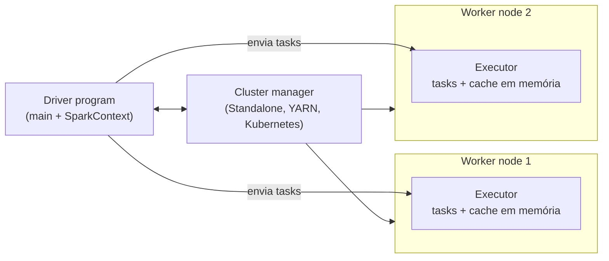

Pela documentação oficial:
- **Driver:** o processo que roda o `main()` e cria o **SparkContext**; ele **escalona** as tarefas.
- **Cluster manager:** aloca recursos do cluster (o próprio *Standalone* do Spark, **YARN** do Hadoop ou Kubernetes).
- **Executor:** processo num *worker node* que **executa tarefas e mantém dados em memória ou disco** entre elas.
- **Task:** unidade de trabalho enviada a **um** executor.

> **Ligação com a Aula 07:** é de novo um **Master/Worker**: o Driver é o mestre e os Executors são os workers.

### B5.2 Por que "em memória" faz diferença

O artigo original do Spark (Zaharia et al., NSDI 2012) explica que os RDDs foram motivados por dois tipos de aplicação que os frameworks da época (como o MapReduce) tratavam mal: **algoritmos iterativos** e **mineração de dados interativa**. Nos dois casos, **manter os dados em memória pode melhorar o desempenho em uma ordem de grandeza**.

Isso é muito relevante para Ciência de Dados. Um k-means, por exemplo, percorre **os mesmos dados várias vezes**. No MapReduce, cada iteração lê do disco e grava no disco; no Spark, os dados ficam em memória entre as iterações.

### B5.3 RDD e tolerância a falhas

- **RDD** = coleção de elementos **particionada entre os nós** do cluster que pode ser operada **em paralelo** (documentação oficial).
- **Como se recupera de falhas sem replicar tudo?** O Spark **guarda as transformações** que geraram cada RDD. Se uma partição se perde, ela é **recalculada** a partir dessas transformações. É uma estratégia diferente da replicação de blocos do HDFS.

> **Prévia da próxima aula (documentação oficial):** as operações sobre RDDs são **transformações** (`map`, `filter`, `reduceByKey`…), que criam um novo RDD e são **preguiçosas** (*lazy*, só são calculadas quando necessário), e **ações** (`count`, `collect`, `reduce`…), que devolvem um valor ao Driver e disparam a computação.

### B5.4 Módulos do Spark (slide p.31, livro *Learning Spark*)

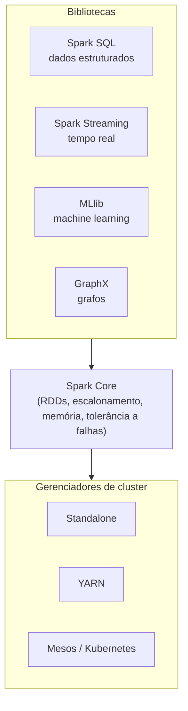

> A documentação atual cita Spark SQL, *pandas API on Spark*, MLlib, GraphX e **Structured Streaming** (o sucessor do Spark Streaming). O *Learning Spark* de 2015 lista o Mesos como gerenciador; versões recentes do Spark usam Standalone, YARN e Kubernetes.

### B5.5 Hadoop MapReduce × Spark

| | **Hadoop MapReduce** | **Apache Spark** |
|---|---|---|
| Resultados intermediários | Gravados em **disco** | Mantidos em **memória** (RAM) |
| Tolerância a falhas | Réplicas dos blocos no HDFS + reexecução de tarefas | **RDD**: recalcula partições perdidas a partir das transformações |
| Modelo de programação | Só `map` e `reduce` | Muitas operações (`map`, `filter`, `join`, `reduceByKey`…), além de SQL, ML e grafos |
| Arquitetura | Master/Slave (NameNode/DataNodes; YARN) | Master/Worker (Driver/Executors) |
| Forte em | Processamento em lote de volumes enormes com 1 passada | **Algoritmos iterativos** (ML) e análise interativa |
| Linguagens | Principalmente Java | Java, **Scala**, Python, R, SQL |

---

## B6. Treino de leitura (Big Data)

**Q1 — Blocos.** Um arquivo de **1 GB** (= 1024 MB) é gravado no HDFS com configuração padrão. Quantos blocos ele ocupa e quanto espaço bruto consome no cluster?

<details><summary><b>Gabarito Q1</b></summary>

1024 / 128 = **8 blocos** de 128 MB. Com **fator de replicação 3**, são 24 cópias de blocos, ocupando **≈ 3 GB** de disco no cluster. (Para 300 MB seriam 3 blocos, 128 + 128 + 44, e ≈ 900 MB de espaço bruto.)
</details>

**Q2 — Falha.** O DataNode que guardava uma cópia do bloco B2 queimou. O job que estava lendo B2 para?

<details><summary><b>Gabarito Q2</b></summary>

**Não.** Há outras 2 réplicas de B2 em DataNodes diferentes (2 réplicas nunca ficam no mesmo nó), e a tarefa é reexecutada sobre outra cópia. O NameNode percebe a falta de *heartbeats*, marca o nó como morto e **re-replica** B2 para voltar a 3 cópias.
</details>

**Q3 — Map e Reduce.** Queremos a **temperatura máxima por cidade** a partir de linhas `"cidade,temperatura"`. Defina o que o `map` emite e o que o `reduce` faz. O `reduce` pode ser usado como combiner?

<details><summary><b>Gabarito Q3</b></summary>

`map`: para cada linha, emite `(cidade, temperatura)`. `reduce`: recebe `(cidade, [t1, t2, …])` e emite `(cidade, max(t1, t2, …))`. **Sim, pode ser combiner**: `max` é associativo e comutativo (o máximo dos máximos locais é o máximo global).
</details>

**Q4 — Pegadinha do combiner.** E se quiséssemos a **temperatura média** por cidade? Podemos usar o mesmo reducer de média como combiner?

<details><summary><b>Gabarito Q4</b></summary>

**Não diretamente.** A média das médias parciais **não** é a média global se os grupos tiverem tamanhos diferentes. É o mesmo erro da Aula 06, Q2. **Correção:** o map/combiner emite `(cidade, (soma, contagem))` e o reducer calcula `Σsoma / Σcontagem`.
</details>

**Q5 — Desempenho.** Por que um algoritmo de ML que faz 20 iterações sobre os mesmos dados costuma ser bem mais rápido no Spark do que em MapReduce?

<details><summary><b>Gabarito Q5</b></summary>

No MapReduce, cada iteração é um job que **lê do disco e grava no disco** os resultados intermediários. No Spark os dados ficam **em memória** entre as iterações (*in-memory*). O artigo original cita até uma **ordem de grandeza** de ganho para algoritmos iterativos.
</details>

**Q6 — Conceitos.** Associe: (a) NameNode, (b) Driver, (c) shuffle, (d) Executor, (e) DataNode.
(1) Processo que roda tarefas e guarda dados em memória · (2) Guarda os metadados e o mapeamento de blocos · (3) Agrupa os pares pela chave entre map e reduce · (4) Armazena blocos e atende leituras/escritas · (5) Roda o `main` e escalona as tarefas do Spark.

<details><summary><b>Gabarito Q6</b></summary>

(a)–2 · (b)–5 · (c)–3 · (d)–1 · (e)–4.
</details>

---

## Erros comuns / o que cai em prova

**Fork/Join**
1. **Esquecer o `join()`**: resultado errado (perde metade dos dados).
2. **`join()` logo após o `fork()`**: resultado certo, sem paralelismo.
3. **Sem caso base**: `StackOverflowError`.
4. **Limiar pequeno demais**: overhead maior que o trabalho (pode ficar mais lento que o sequencial). **Grande demais**: pouco ou nenhum paralelismo.
5. **`RecursiveAction` quando se precisa de retorno**: não compila. Use `RecursiveTask<V>`.
6. **Confundir onde usar `invoke` (de fora, no `main`) e `fork`/`join` (de dentro do `compute`).**
7. **Esquecer que `commonPool()` é compartilhado e gerenciado pela JVM**: não precisa de `shutdown()` (e ele não tem efeito).

**Big Data**
8. **"O NameNode guarda os dados."** Falso: guarda **metadados**; os dados ficam nos DataNodes.
9. **Bloco padrão = 128 MB; replicação padrão = 3**; duas réplicas do mesmo bloco **nunca** no mesmo DataNode.
10. **O último bloco não ocupa 128 MB obrigatoriamente** (300 MB → 128 + 128 + 44).
11. **Particionamento do HDFS é físico (por bytes)**, não lógico.
12. **O Reduce é opcional.** O **shuffle** é a fase cara (rede + disco).
13. **Combiner só vale para operações associativas e comutativas** (soma, máx…), e não para média direta.
14. **Spark ≠ "Hadoop mais rápido em tudo".** O ganho vem de **manter dados em memória**, especialmente em processamento **iterativo**.

---

## Fontes

- **Slides da aula:** Shimomura, L. C. *Computação Escalável — Aula 8 (09/10)*.
- **Código da professora:** `fontes/códigos/ExemploExecutorService/BuscaMaiorValorTask.java`.
- **Mattson, T.; Sanders, B.; Massingill, B.** *Patterns for Parallel Programming*. Addison-Wesley, 2004. As páginas do PDF estão entre parênteses (página impressa = PDF − 15).
  - §4.5 Divide and Conquer: limiar como "botão de granularidade", mapeamento fork/join, p. 73–79 (PDF 88–94)
  - §5.5 Master/Worker: variação com *random work stealing* e deques, p. 146 (PDF 161)
  - §5.7 Fork/Join: mapeamento direto × indireto (thread pool), mergesort em Java, p. 167–172 (PDF 182–187)
- **van Steen, M.; Tanenbaum, A. S.** *Distributed Systems*, 4ª ed., §1.2.6 *Scalability*: *scale up* × *scale out*, particionamento, replicação, p. 24–32 (PDF 40–48).
- **Documentação oficial Java (JDK 21):**
  - `ForkJoinPool`: <https://docs.oracle.com/en/java/javase/21/docs/api/java.base/java/util/concurrent/ForkJoinPool.html>
  - `ForkJoinTask`: <https://docs.oracle.com/en/java/javase/21/docs/api/java.base/java/util/concurrent/ForkJoinTask.html>
  - `RecursiveTask`: <https://docs.oracle.com/en/java/javase/21/docs/api/java.base/java/util/concurrent/RecursiveTask.html>
- **Apache Hadoop:**
  - Visão geral e módulos: <https://hadoop.apache.org/>
  - HDFS Architecture: <https://hadoop.apache.org/docs/stable/hadoop-project-dist/hadoop-hdfs/HdfsDesign.html>
  - Valores padrão (`dfs.blocksize`, `dfs.replication`): <https://hadoop.apache.org/docs/stable/hadoop-project-dist/hadoop-hdfs/hdfs-default.xml>
  - MapReduce Tutorial (WordCount): <https://hadoop.apache.org/docs/stable/hadoop-mapreduce-client/hadoop-mapreduce-client-core/MapReduceTutorial.html>
- **Apache Spark:**
  - Visão geral: <https://spark.apache.org/docs/latest/index.html>
  - Cluster Mode Overview: <https://spark.apache.org/docs/latest/cluster-overview.html>
  - RDD Programming Guide: <https://spark.apache.org/docs/latest/rdd-programming-guide.html>
- **Artigos originais:**
  - Dean, J.; Ghemawat, S. *MapReduce: Simplified Data Processing on Large Clusters*. OSDI 2004. <https://research.google/pubs/pub62/>
  - Zaharia, M. et al. *Resilient Distributed Datasets: A Fault-Tolerant Abstraction for In-Memory Cluster Computing*. NSDI 2012. <https://www.usenix.org/conference/nsdi12/technical-sessions/presentation/zaharia>
- **Oracle Brasil:** *O que é Big Data?* <https://www.oracle.com/br/big-data/what-is-big-data/>
- **Karau, H. et al.** *Learning Spark*. O'Reilly, 2015 (figura dos módulos, slide p.31).

---

## Conclusão para revisão

### Resumo em 10 pontos

1. **ForkJoin** implementa **Divide and Conquer** em Java: dividir recursivamente até o **caso base** (fork) e combinar os resultados (join).
2. **`RecursiveTask<V>`** retorna valor; **`RecursiveAction`** não retorna. A lógica fica em **`compute()`**.
3. Padrão idiomático: **`esquerda.fork(); direita.compute(); esquerda.join();`** e combinar. A thread atual trabalha numa metade enquanto a outra fica disponível para roubo.
4. **Work stealing:** cada thread tem sua fila; a ociosa rouba do **fundo** da fila de outra (tarefas maiores). É balanceamento **dinâmico distribuído**.
5. O **limiar** é o botão de granularidade: pequeno demais gera overhead (pode ficar mais lento que o sequencial); grande demais gera pouco paralelismo. **Meça.**
6. **`commonPool()`** é o pool da JVM (paralelismo padrão = cores − 1) e se inicia com **`invoke()`**; não precisa de `shutdown()`.
7. **Big Data** = dados que não cabem ou não são processáveis em um nó. São caracterizados pelos **5 Vs** (Volume, Velocidade, Variedade, Veracidade, Valor). A solução é ***scale out***.
8. **Hadoop:** hardware barato, tolerância a falhas, **levar o código aos dados**, *shared-nothing*. Módulos: Common, **HDFS**, **YARN**, **MapReduce**.
9. **HDFS:** **NameNode** (mestre, metadados) + **DataNodes** (escravos, dados); blocos de **128 MB**; **replicação 3**, nunca 2 réplicas no mesmo nó.
10. **MapReduce:** map → **shuffle/sort** (caro: rede + disco) → reduce (opcional), com pares (chave, valor). **Spark** mantém os dados **em memória** (RDDs, recálculo em falhas), com Driver/Executors, e é forte em algoritmos **iterativos**.

### Tabela de conceitos-chave

| Termo | Definição em uma linha | Quando usar / lembrar |
|---|---|---|
| `ForkJoinPool` | `ExecutorService` com *work stealing* | Tarefas recursivas |
| `RecursiveTask<V>` / `RecursiveAction` | Tarefa com / sem retorno; lógica em `compute()` | Retorno → Task; só modifica → Action |
| `fork()` | Agenda a subtarefa de forma assíncrona | Dentro do `compute()` |
| `compute()` | Executa a lógica na thread atual | Uma das metades |
| `join()` | Espera a subtarefa e devolve o resultado | Depois do `compute()` da outra metade |
| `invoke()` | Inicia e espera a tarefa raiz | No `main` |
| Limiar | Tamanho a partir do qual se resolve sequencialmente | Granularidade; meça |
| Work stealing | Thread ociosa rouba do fundo da fila de outra | Balanceamento dinâmico sem fila central |
| 5 Vs | Volume, Velocidade, Variedade, Veracidade, Valor | Caracterizar Big Data |
| NameNode / DataNode | Mestre de metadados / escravo que guarda blocos | HDFS (Master/Slave) |
| Bloco HDFS | Pedaço fixo do arquivo (padrão 128 MB) | Particionamento físico |
| Fator de replicação | Nº de cópias de cada bloco (padrão 3) | Tolerância a falhas |
| Map / Shuffle / Reduce | Processar blocos → agrupar por chave → combinar | MapReduce (D&C distribuído) |
| Combiner | Reduce local antes do shuffle | Só para operações associativas/comutativas |
| RDD | Coleção distribuída, em memória, tolerante a falhas | Spark |
| Driver / Executor | Coordenador / processos que executam tasks | Spark (Master/Worker) |

### Perguntas de autoavaliação

<details><summary><b>1. Descreva os 4 passos do <code>compute()</code> de um <code>RecursiveTask</code>.</b></summary>

(1) **Caso base:** se a faixa é menor ou igual ao limiar, resolver sequencialmente e retornar. (2) **Dividir** em duas subtarefas (esquerda/direita). (3) **`fork()`** em uma e **`compute()`** na outra. (4) **`join()`** na primeira e **combinar** os dois resultados.
</details>

<details><summary><b>2. Qual a diferença entre o balanceamento do <code>newFixedThreadPool</code> e o do <code>ForkJoinPool</code>?</b></summary>

O `FixedThreadPool` usa **uma fila central** compartilhada por todas as threads (Master/Worker). O `ForkJoinPool` dá **uma fila (deque) para cada thread**, e as ociosas **roubam** do fundo das filas das outras (*work stealing*). Isso evita o gargalo da fila única e é ideal para tarefas que geram subtarefas.
</details>

<details><summary><b>3. O slide usa <code>LIMIAR = 500</code> e o código usa <code>5_000_000</code>. Qual está certo?</b></summary>

Ambos. O limiar é um parâmetro de granularidade. Para operações baratíssimas como comparar inteiros, limiares grandes ainda geram tarefas suficientes para ocupar os núcleos (50M / 5M ≈ 10 casos base para 8 núcleos). Limiares pequenos demais (ex.: 10) geram overhead e ficam mais lentos que o sequencial. O valor ideal se encontra **medindo**.
</details>

<details><summary><b>4. Por que o NameNode não lê nem grava os dados dos arquivos?</b></summary>

Para não virar **gargalo**: ele é um só. Ele apenas informa **onde** estão os blocos, e o cliente lê e grava **diretamente** nos DataNodes. É o mesmo problema de escalabilidade do Master/Slave da Aula 07.
</details>

<details><summary><b>5. Explique "levar o código aos dados" e relacione com a Aula 07.</b></summary>

Em vez de mover terabytes de blocos pela rede até o programa, o Hadoop executa a tarefa **map no próprio nó que guarda o bloco**. É a **localidade de dados** da Aula 07 em escala de cluster: quanto mais perto o dado está da computação, menor o custo de acesso.
</details>

<details><summary><b>6. Por que o shuffle é a fase mais cara do MapReduce?</b></summary>

Porque é preciso **mover dados entre os nós pela rede**, para que todas as ocorrências de cada chave cheguem ao mesmo reducer. No Hadoop, os resultados intermediários também são **gravados em disco**. Rede e disco são ordens de grandeza mais lentos que a memória.
</details>

<details><summary><b>7. Como o Spark tolera falhas sem gravar tudo em disco?</b></summary>

Cada **RDD** guarda as **transformações** que o originaram. Se uma partição se perde com a falha de um nó, o Spark a **recalcula** a partir dessas transformações e dos dados de origem.
</details>

<details><summary><b>8. Um arquivo de 300 MB no HDFS padrão: quantos blocos, de que tamanhos, e quantas cópias de cada?</b></summary>

**3 blocos**: 128 MB + 128 MB + **44 MB**. Cada um com **3 réplicas** em DataNodes diferentes.
</details>

### Checklist

**Sei explicar…**
- [ ] fork, join, caso base, limiar e *work stealing*
- [ ] a diferença entre `ExecutorService` e `ForkJoinPool` (e quando usar cada um)
- [ ] os 5 Vs e por que Big Data exige *scale out*
- [ ] as 4 características do Hadoop e seus módulos
- [ ] NameNode × DataNode, blocos de 128 MB, replicação 3 e o que acontece numa falha
- [ ] particionamento físico × lógico (pastas, Parquet)
- [ ] as fases do MapReduce, por que o shuffle é caro, e o papel do combiner
- [ ] o que o Spark muda em relação ao Hadoop (memória, RDD, Driver/Executors)

**Sei ler e corrigir código com…**
- [ ] `RecursiveTask`, `RecursiveAction`, `fork`, `compute`, `join`, `invoke`, `invokeAll`, `commonPool`
- [ ] os bugs: sem `join`, `join` cedo, sem caso base, limiar minúsculo, `RecursiveAction` com retorno
- [ ] um Mapper/Reducer do Hadoop: o que entra, o que sai, o que o framework faz sozinho

### Ligação com a próxima aula

Os slides anunciam: **Apache Spark** em funcionamento, **introdução rápida a Scala** e **programação map-reduce sobre o Spark**. Chegue sabendo bem:
- o **word count** em MapReduce (ele será reescrito com `flatMap` → `map` → `reduceByKey`);
- a diferença **disco × memória** entre Hadoop e Spark;
- **Driver/Executors** e **RDD** (transformações *lazy* × ações).

Continua em: [Aula 09 — NoSQL, CAP/BASE, programação funcional e o Spark por dentro](09_nosql_cap_spark_rdd.md) → [09b — Scala](09b_programacao_scala.md) → [Aula 10 — Spark na prática e SparkSQL](10_spark_pratica_sparksql.md).
