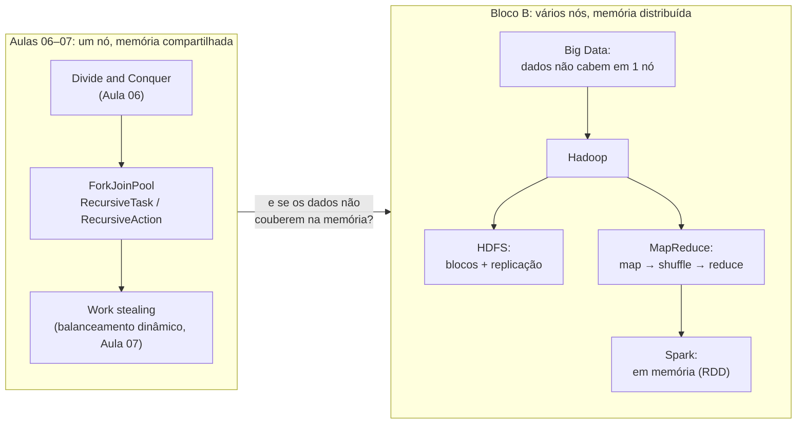
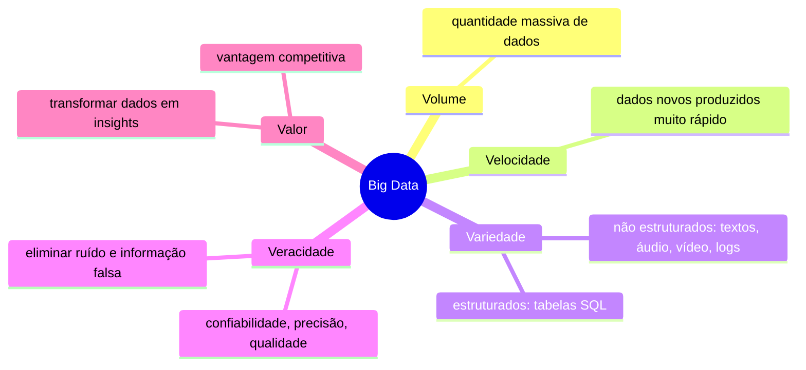
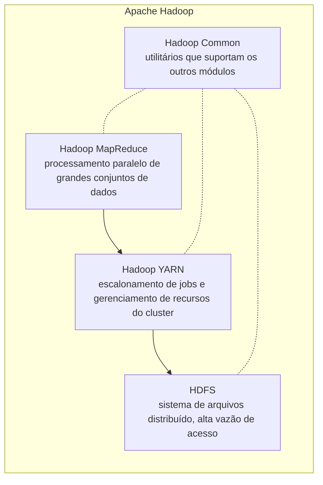
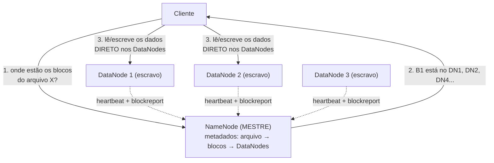
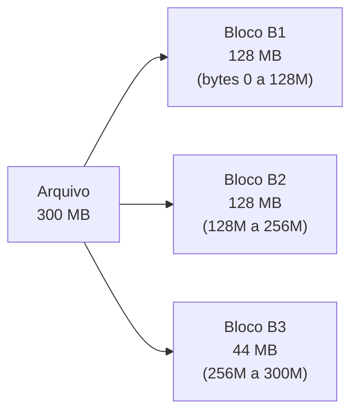
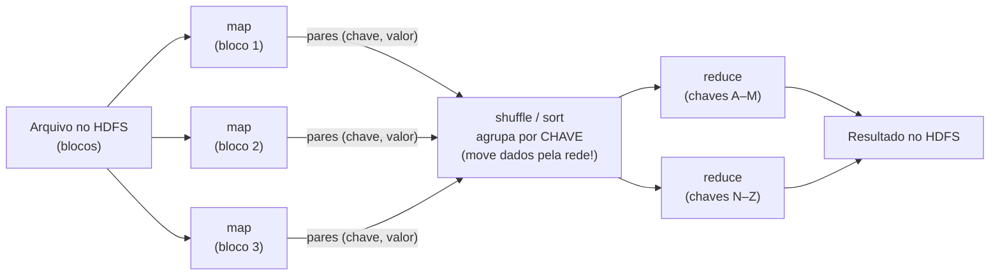
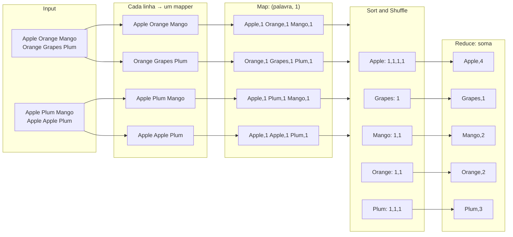
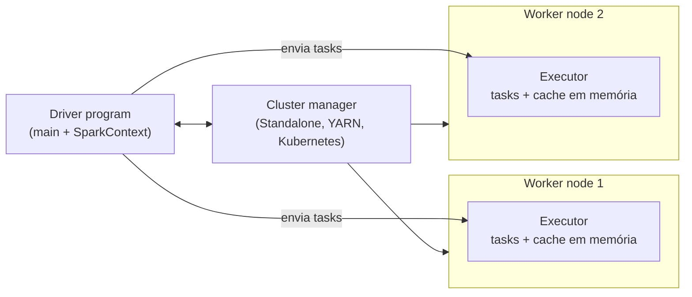
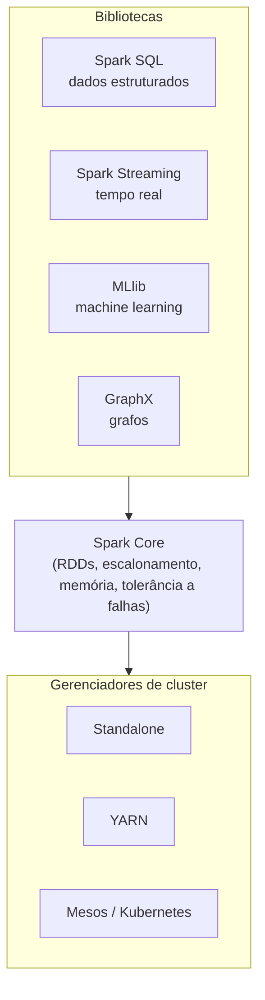

# Aula 08 — Fork/Join em Java e introdução a Big Data: Hadoop, HDFS, MapReduce e Spark

> **Computação Escalável (2COP022)** · Profa. Larissa C. Shimomura · Aula de **09/10**
> **Tópicos:** **Bloco A:** `ForkJoinPool`, `RecursiveTask`, `RecursiveAction`, `fork`/`compute`/`join`/`invoke`, limiar, *work stealing*, exercícios. **Bloco B:** Big Data e os 5 Vs, Hadoop, HDFS (NameNode/DataNode, blocos, replicação), MapReduce (map → shuffle → reduce), Apache Spark
> **Pré-requisitos:** [Aula 06](06_padroes_de_paralelismo.md) (Divide and Conquer, Recursive Data) e [Aula 07](07_threads_balanceamento_executor.md) (`ExecutorService`, `Callable`, balanceamento, localidade)
> **Tempo estimado de estudo:** 3 h

> **[P2] O que cai** ([orientações da 2ª revisão](12c_orientacoes_prova2_revisao2.md); a 2ª revisão não citou Big Data, então vale a 1ª — [12b](12b_orientacoes_prova2.md))
> - **5 Vs** com definição; **NameNode × DataNode**; **exercício de HDFS** (blocos + replicação); **exercício de MapReduce** (saída do map, entrada/saída de cada reducer); **vantagens e desvantagens do MapReduce**.
> - Lista P2: **Ex. 5** (HDFS com replicação 3, resolvido em B3.3) e **Ex. 4** (recuperação de falhas Hadoop × Spark, em B5.5).
> - **Não cai código Java.** Por isso o **Bloco A (Fork/Join)** e o WordCount na API Java do Hadoop foram **cortados** desta versão. Do Fork/Join, fica a ideia: é **Divisão e Conquista** com balanceamento **dinâmico** por *work stealing* ([07, §6.2](07_threads_balanceamento_executor.md)). A versão completa está no histórico do git.

---

## Sumário

1. [Mapa da aula](#mapa-da-aula)

**Bloco B — Big Data**
2. [Por que Big Data?](#b1-introdução-a-big-data)
3. [Hadoop](#b2-o-ecossistema-hadoop)
4. [HDFS](#b3-hdfs-hadoop-distributed-file-system)
5. [MapReduce](#b4-mapreduce)
6. [Apache Spark](#b5-apache-spark)
7. [Treino (Big Data)](#b6-treino-de-leitura-big-data)

**Fechamento**
8. [Erros comuns / o que cai em prova](#erros-comuns--o-que-cai-em-prova)
9. [Fontes](#fontes)
10. [Conclusão para revisão](#conclusão-para-revisão)

---

## Mapa da aula



> **O que observar:** os dois blocos são o **mesmo princípio**, dividir para conquistar, em escalas diferentes. Nas Aulas 06–07 (e no Fork/Join, cortado desta versão), as subtarefas vão para threads de um computador. No Bloco B, vão para os computadores de um cluster, e os dados já estão espalhados entre eles.

---

# Bloco B — Arquivos distribuídos e introdução a Big Data

## B1. Introdução a Big Data

**Motivação:** até agora programamos em **um único nó**. Mas e se os dados forem **grandes demais e não couberem na memória**? A ideia é usar um **sistema distribuído**, em que **cada nó contém parte dos dados**. É a forma mais usada nas soluções de Big Data.

**Definição (Oracle, citada no slide):** "*big data é um conjunto de dados maior e mais complexo, especialmente de novas fontes de dados. Esses conjuntos de dados são tão volumosos que o software tradicional de processamento de dados simplesmente não consegue gerenciá-los. No entanto, esses grandes volumes de dados podem ser usados para resolver problemas de negócios que você não conseguiria resolver antes.*"

### Os 5 Vs

> **[P2] Cai:** os 5 Vs e a definição de cada um.



| V | Significado |
|---|---|
| **Volume** | Quantidade **massiva** de dados gerados a todo momento |
| **Velocidade** | Rapidez extrema com que **novos dados são produzidos** |
| **Variedade** | Diversidade de dados: de **estruturados** (tabelas SQL) a **não estruturados** (textos, áudios, vídeos, logs) |
| **Veracidade** | Grau de **confiabilidade, precisão e qualidade** dos dados, eliminando ruídos e informações falsas |
| **Valor** | Capacidade de transformar os dados tratados em **insights práticos** e vantagem competitiva |

### *Scale up* × *scale out* (contexto do livro *Distributed Systems*, §1.2.6)

- **Scale up** (escalar verticalmente): **melhorar a máquina**, com mais memória, CPU mais rápida e rede melhor. Tem limite físico e custo alto.
- **Scale out** (escalar horizontalmente): **adicionar mais máquinas**. Segundo o livro, há basicamente três técnicas: **esconder latência de comunicação**, **distribuição do trabalho** (particionamento) e **replicação**.

O Hadoop é *scale out* puro: **particiona** os dados em blocos (HDFS), **distribui** o processamento (MapReduce) e **replica** os blocos para tolerar falhas.

---

## B2. O ecossistema Hadoop

O **Hadoop** é um **framework para processamento em grande escala** em clusters. Características do slide:

| Característica | O que significa |
|---|---|
| **Hardware "barato"** (*commodity hardware*) | Agrupa computadores simples de mercado, em vez de supercomputadores |
| **Tolerância a falhas** | Se um computador do cluster queimar no meio do trabalho, o Hadoop usa **outra cópia do dado** e continua a tarefa em outra máquina, sem interromper nada |
| **Levar o código aos dados** (*data locality*) | Em vez de transferir terabytes pela rede até o programa, o **código é executado no servidor onde o dado já está** |
| **Arquitetura *shared-nothing*** | Cada máquina tem sua **própria CPU, memória e disco**; nada é compartilhado. É memória **distribuída** (Aula 06) |

> A documentação oficial resume a filosofia: falha de hardware **"é a norma, e não a exceção"**. Por isso o próprio software detecta e trata falhas, em vez de depender de hardware confiável.

**Módulos do projeto Apache Hadoop** (site oficial):



---

## B3. HDFS (*Hadoop Distributed File System*)

### B3.1 Arquitetura mestre/escravo

> **[P2] Cai (explícito):** explicar NameNode (gerencia: abre, fecha, renomeia; **não armazena**) e DataNode (armazena os blocos; é onde o *map* executa).



| | **NameNode** (mestre) | **DataNode** (escravo) |
|---|---|---|
| Quantos | **Um** por cluster HDFS | Em geral, **um por nó** do cluster |
| Função | **Gerencia o acesso aos arquivos**: abre, fecha, renomeia… Guarda os **metadados** e decide o **mapeamento dos blocos** para os DataNodes | **Armazena** os blocos daquele nó e atende as **leituras e escritas** pedidas pelo cliente. Cria, apaga e replica blocos sob instrução do NameNode |
| Guarda dados do usuário? | **Não**: segundo a documentação, os dados do usuário **nunca passam** pelo NameNode | **Sim** |

- NameNode e DataNodes são **implementados em Java**, o que dá **portabilidade**: rodam em qualquer máquina com JVM.
- **Heartbeat:** cada DataNode envia sinais periódicos ao NameNode dizendo que está vivo. **Blockreport:** a lista de todos os blocos que ele guarda.
- Se um DataNode **para de enviar heartbeats**, o NameNode o considera morto, para de mandar requisições a ele e **re-replica** os blocos que ficaram com menos cópias que o desejado.

> **Ligação com a Aula 07:** o HDFS é um **Master/Slave**. E, como lá, o mestre é um ponto sensível. Por isso os dados não passam por ele: o cliente fala **direto** com os DataNodes.

### B3.2 Blocos de tamanho fixo

> **[P2] Cai como exercício:** particione **na ordem das linhas** (leitura por offset); o último bloco ocupa só o necessário. Cuidado com pegadinhas na contagem de linhas. Modelo: [Aula 12, ex. 5](12_joins_spark_revisao_prova.md#exercício-5--hdfs-blocos-e-replicação).

- O arquivo é dividido internamente em **um ou mais blocos**, armazenados num conjunto de DataNodes.
- Tamanho **padrão: 128 MB** (`dfs.blocksize = 134217728` bytes), **alterável** por parâmetro.
- O particionamento é **automático, por *byte offset***, sem olhar o conteúdo. ⚠️ É particionamento **de infraestrutura**, não lógico.

**Exemplo do slide: arquivo de 300 MB**



> 300 = 128 + 128 + **44**. O último bloco ocupa só os 44 MB de que precisa, não 128.

### B3.3 Replicação

> **[P2] Cai como exercício:** fator de replicação = **total** de cópias (fator 2 = original + 1 réplica), sempre em workers **diferentes**, sem **estourar a capacidade** de cada worker, e de modo que a queda de qualquer worker não perca nenhum bloco.

- Cada bloco é **replicado** em uma ou mais máquinas. O número de cópias é o **fator de replicação**, **padrão 3** (`dfs.replication = 3`), configurável por arquivo.
- **Duas réplicas do mesmo bloco nunca ficam no mesmo DataNode.** Se ficassem, perder aquele nó perderia as duas.
- Quando possível, **2 blocos do mesmo arquivo** são armazenados num **mesmo DataNode** (slide).

Exemplo ilustrativo (arquivo de 300 MB, fator 3, 4 DataNodes):

| | DataNode 1 | DataNode 2 | DataNode 3 | DataNode 4 |
|---|---|---|---|---|
| B1 (128 MB) | ✅ | ✅ | | ✅ |
| B2 (128 MB) | ✅ | | ✅ | ✅ |
| B3 (44 MB) | | ✅ | ✅ | ✅ |

> **O que observar:** cada bloco aparece **3 vezes**, sempre em DataNodes **diferentes**. Se o DataNode 4 queimar, todos os blocos ainda têm 2 cópias, e o NameNode manda criar uma terceira em outro nó.
>
> **Para ir além** (documentação oficial do HDFS): com fator 3, a política padrão leva em conta os **racks**. A 1ª réplica fica no nó do escritor (ou num nó do mesmo rack), a 2ª num nó de **outro rack** e a 3ª num nó **diferente desse mesmo rack remoto**. Assim o sistema sobrevive até à queda de um rack inteiro.

**Ligação com *Distributed Systems* (§1.2.6):** replicar aumenta a **disponibilidade** e ajuda a **balancear a carga**, porque há mais lugares de onde ler. O preço são os problemas de **consistência** entre as cópias. O HDFS os simplifica com o modelo ***write-once-read-many***: um arquivo, depois de escrito e fechado, não é alterado no meio, só pode receber *append* ou *truncate*.

#### Lista P2, Ex. 5 — HDFS com replicação 3

> *5 Workers/DataNodes (W1–W5), bloco máximo de **10 MB**, cada DataNode com **20 MB**. Cada linha = 1 MB. Clientes: 15 linhas (15 MB); Pedidos: 10 linhas (10 MB). (a) Particionamento inicial? (b) Com fator de replicação **3**, uma distribuição possível?*

**(a)** Cada bloco comporta 10 linhas, e **cada relação é dividida separadamente**:

| Bloco | Conteúdo | Tamanho |
|---|---|---|
| **BC1** | Clientes, linhas 1–10 | 10 MB |
| **BC2** | Clientes, linhas 11–15 | **5 MB** (bloco residual: ocupa só o tamanho real) |
| **BP1** | Pedidos, linhas 1–10 | 10 MB |

**(b)** 3 cópias de cada bloco, **nunca duas no mesmo nó**, e nenhum nó acima de 20 MB. Uma distribuição válida (gabarito):

| W1 (20/20 MB) | W2 (15/20) | W3 (15/20) | W4 (15/20) | W5 (10/20) |
|---|---|---|---|---|
| BC1 + BP1 | BC1 + BC2 | BC1 + BC2 | BP1 + BC2 | BP1 |

> **Conferência:** BC1 em W1, W2, W3; BC2 em W2, W3, W4; BP1 em W1, W4, W5 → 3 cópias em nós distintos. Total = 25 MB × 3 = 75 MB de 100 MB. Se qualquer worker cair, todo bloco ainda tem 2 cópias.

### B3.4 Particionamento lógico × físico

- É possível implementar um **particionamento lógico** sobre o Hadoop (ex.: "um arquivo por mês").
- Mas o **armazenamento físico** continua em **blocos de 128 MB**, e o Hadoop usa **ponteiros** para seguir o particionamento lógico.
- Para **"forçar"** o físico a ficar próximo do lógico:
  - usar **pastas e diretórios** (ex.: `/vendas/ano=2025/mes=10/`);
  - usar outro **formato de serialização**, como o **Parquet** (formato colunar que organiza os dados internamente em grupos).

---

## B4. MapReduce

> **[P2] Cai como exercício:** responder com saída do Map → entrada de cada Reducer → saída de cada Reducer. Sempre chave-valor; o **Map não conta**, só emite `(chave, 1)`. Também cai: vantagens/desvantagens do MapReduce. Modelo: [Aula 12, ex. 6](12_joins_spark_revisao_prova.md#exercício-6--mapreduce-contagem-de-códigos-de-status).

### B4.1 Ideia

- **Modelo de programação e processamento distribuído.**
- **Processa os blocos no próprio nó** em que estão armazenados, evitando tráfego de grandes volumes pela rede. É a **localidade de dados** da Aula 07, em escala de cluster.
- **Ideia central: Dividir para Conquistar.** Em vez de carregar um arquivo gigante na memória de uma máquina, a tarefa é quebrada em **centenas de pequenas tarefas paralelas**.
- O **programador implementa apenas `map` e `reduce`**. O framework cuida de escalonar, monitorar e **reexecutar tarefas que falharem** (documentação oficial).

### B4.2 As fases



| Fase | O que faz | Analogia D&C |
|---|---|---|
| **Map** | Aplica a função do programador **a cada bloco**, no nó onde ele está, e emite pares **(chave, valor)** | **Dividir** e resolver as partes |
| **Shuffle / sort** | **Reorganiza** os pares para que **todas as ocorrências da mesma chave vão para o mesmo reducer**; agrupa e ordena por chave | Preparar a combinação |
| **Reduce** | Para cada chave, recebe **a lista de valores** e produz o resultado final | **Conquistar** (combinar) |

**Tipos (documentação oficial):**
```
(entrada) <k1, v1>  →  map  →  <k2, v2>  →  [combine]  →  shuffle/sort  →  <k2, lista(v2)>  →  reduce  →  <k3, v3> (saída)
```

- Os **tipos de chave e de valor são definidos pelo programador**.
- **O Reduce é opcional:** muitas vezes só o Map é usado (ex.: filtrar ou transformar registros). Com zero reducers, a saída do map vai **direto** para o HDFS, **sem ordenação** (documentação oficial).

### B4.3 Por que o shuffle é caro

- Durante o shuffle **pode haver movimentação de dados entre os nós**, para que cada chave seja agrupada num mesmo nó.
- Essa movimentação é **MUITO custosa** em alguns casos e **afeta diretamente a performance**. É comunicação, o maior inimigo da Aula 06.
- Além disso, o Hadoop **grava resultados intermediários em DISCO**: no fim do map, no shuffle/sort e no fim do reduce. Disco é muito mais lento que memória, e esse é o principal motivo para o Spark existir (B5).

> **Combiner** (documentação oficial): um "mini-reduce" opcional executado **localmente** na saída de cada map, **antes** do shuffle. No word count, em vez de enviar `(Apple,1)` duas vezes pela rede, o nó envia `(Apple,2)`. Isso reduz o volume do shuffle. Só é válido quando a operação é **associativa e comutativa** (soma, mín, máx).

### B4.4 Exemplo: contagem de palavras (slide p.29)



## B5. Apache Spark

| Característica (slide) | O que significa |
|---|---|
| **Framework de computação distribuída open source** | Como o Hadoop MapReduce, processa dados em clusters |
| **Processamento em memória** (*in-memory*) | **Diferente do Hadoop**, mantém os dados na **RAM entre as etapas** da computação, reduzindo o custo de I/O de disco |
| **Tolerância a falhas com RDDs** | *Resilient Distributed Datasets* **reconstroem automaticamente** os dados perdidos se um nó falhar |
| **Arquitetura Master/Worker** | Um nó principal, o **Driver**, coordena as tarefas; vários nós de execução, os **Executors**, processam os dados em paralelo |
| **Multilinguagem** | APIs em **Java, Scala, Python e R**, além de SQL. Integra com o Hadoop (pode ler do HDFS e rodar sobre o YARN) |

### B5.1 Arquitetura



Pela documentação oficial:
- **Driver:** o processo que roda o `main()` e cria o **SparkContext**; ele **escalona** as tarefas.
- **Cluster manager:** aloca recursos do cluster (o próprio *Standalone* do Spark, **YARN** do Hadoop ou Kubernetes).
- **Executor:** processo num *worker node* que **executa tarefas e mantém dados em memória ou disco** entre elas.
- **Task:** unidade de trabalho enviada a **um** executor.

> **Ligação com a Aula 07:** é de novo um **Master/Worker**: o Driver é o mestre e os Executors são os workers.

### B5.2 Por que "em memória" faz diferença

O artigo original do Spark (Zaharia et al., NSDI 2012) explica que os RDDs foram motivados por dois tipos de aplicação que os frameworks da época (como o MapReduce) tratavam mal: **algoritmos iterativos** e **mineração de dados interativa**. Nos dois casos, **manter os dados em memória pode melhorar o desempenho em uma ordem de grandeza**.

Isso é muito relevante para Ciência de Dados. Um k-means, por exemplo, percorre **os mesmos dados várias vezes**. No MapReduce, cada iteração lê do disco e grava no disco; no Spark, os dados ficam em memória entre as iterações.

### B5.3 RDD e tolerância a falhas

- **RDD** = coleção de elementos **particionada entre os nós** do cluster que pode ser operada **em paralelo** (documentação oficial).
- **Como se recupera de falhas sem replicar tudo?** O Spark **guarda as transformações** que geraram cada RDD. Se uma partição se perde, ela é **recalculada** a partir dessas transformações. É uma estratégia diferente da replicação de blocos do HDFS.

> **Prévia da próxima aula (documentação oficial):** as operações sobre RDDs são **transformações** (`map`, `filter`, `reduceByKey`…), que criam um novo RDD e são **preguiçosas** (*lazy*, só são calculadas quando necessário), e **ações** (`count`, `collect`, `reduce`…), que devolvem um valor ao Driver e disparam a computação.

### B5.4 Módulos do Spark (slide p.31, livro *Learning Spark*)



> A documentação atual cita Spark SQL, *pandas API on Spark*, MLlib, GraphX e **Structured Streaming** (o sucessor do Spark Streaming). O *Learning Spark* de 2015 lista o Mesos como gerenciador; versões recentes do Spark usam Standalone, YARN e Kubernetes.

### B5.5 Hadoop MapReduce × Spark

| | **Hadoop MapReduce** | **Apache Spark** |
|---|---|---|
| Resultados intermediários | Gravados em **disco** | Mantidos em **memória** (RAM) |
| Tolerância a falhas | Réplicas dos blocos no HDFS + reexecução de tarefas | **RDD**: recalcula partições perdidas a partir das transformações |
| Modelo de programação | Só `map` e `reduce` | Muitas operações (`map`, `filter`, `join`, `reduceByKey`…), além de SQL, ML e grafos |
| Arquitetura | Master/Slave (NameNode/DataNodes; YARN) | Master/Worker (Driver/Executors) |
| Forte em | Processamento em lote de volumes enormes com 1 passada | **Algoritmos iterativos** (ML) e análise interativa |
| Linguagens | Principalmente Java | Java, **Scala**, Python, R, SQL |

---

#### Lista P2, Ex. 4 — recuperação de falhas: Hadoop × Spark

> *Explique a diferença do processo de recuperação de falhas entre o Hadoop e o Spark, citando a diferença principal entre os dois sistemas.*

**Gabarito:** a diferença principal está em **como gerenciam os dados durante o processamento**: o **Hadoop** (HDFS/MapReduce) baseia-se em **armazenamento em disco com replicação física**; o **Spark** executa **em memória** e usa a **linhagem lógica**. Na recuperação, o Hadoop recorre às **cópias dos blocos replicados** em outros DataNodes (e às saídas intermediárias gravadas em disco) para **reiniciar as tarefas perdidas**; o Spark usa o **grafo de dependências (DAG)** das transformações aplicadas aos RDDs para **recomputar em memória apenas as partições afetadas** a partir dos dados originais, evitando o custo de replicação e escrita constante em disco.

---

## B6. Treino de leitura (Big Data)

**Q1 — Blocos.** Um arquivo de **1 GB** (= 1024 MB) é gravado no HDFS com configuração padrão. Quantos blocos ele ocupa e quanto espaço bruto consome no cluster?

<details><summary><b>Gabarito Q1</b></summary>

1024 / 128 = **8 blocos** de 128 MB. Com **fator de replicação 3**, são 24 cópias de blocos, ocupando **≈ 3 GB** de disco no cluster. (Para 300 MB seriam 3 blocos, 128 + 128 + 44, e ≈ 900 MB de espaço bruto.)
</details>

**Q2 — Falha.** O DataNode que guardava uma cópia do bloco B2 queimou. O job que estava lendo B2 para?

<details><summary><b>Gabarito Q2</b></summary>

**Não.** Há outras 2 réplicas de B2 em DataNodes diferentes (2 réplicas nunca ficam no mesmo nó), e a tarefa é reexecutada sobre outra cópia. O NameNode percebe a falta de *heartbeats*, marca o nó como morto e **re-replica** B2 para voltar a 3 cópias.
</details>

**Q3 — Map e Reduce.** Queremos a **temperatura máxima por cidade** a partir de linhas `"cidade,temperatura"`. Defina o que o `map` emite e o que o `reduce` faz. O `reduce` pode ser usado como combiner?

<details><summary><b>Gabarito Q3</b></summary>

`map`: para cada linha, emite `(cidade, temperatura)`. `reduce`: recebe `(cidade, [t1, t2, …])` e emite `(cidade, max(t1, t2, …))`. **Sim, pode ser combiner**: `max` é associativo e comutativo (o máximo dos máximos locais é o máximo global).
</details>

**Q4 — Pegadinha do combiner.** E se quiséssemos a **temperatura média** por cidade? Podemos usar o mesmo reducer de média como combiner?

<details><summary><b>Gabarito Q4</b></summary>

**Não diretamente.** A média das médias parciais **não** é a média global se os grupos tiverem tamanhos diferentes. É o mesmo erro da Aula 06, Q2. **Correção:** o map/combiner emite `(cidade, (soma, contagem))` e o reducer calcula `Σsoma / Σcontagem`.
</details>

**Q5 — Desempenho.** Por que um algoritmo de ML que faz 20 iterações sobre os mesmos dados costuma ser bem mais rápido no Spark do que em MapReduce?

<details><summary><b>Gabarito Q5</b></summary>

No MapReduce, cada iteração é um job que **lê do disco e grava no disco** os resultados intermediários. No Spark os dados ficam **em memória** entre as iterações (*in-memory*). O artigo original cita até uma **ordem de grandeza** de ganho para algoritmos iterativos.
</details>

**Q6 — Conceitos.** Associe: (a) NameNode, (b) Driver, (c) shuffle, (d) Executor, (e) DataNode.
(1) Processo que roda tarefas e guarda dados em memória · (2) Guarda os metadados e o mapeamento de blocos · (3) Agrupa os pares pela chave entre map e reduce · (4) Armazena blocos e atende leituras/escritas · (5) Roda o `main` e escalona as tarefas do Spark.

<details><summary><b>Gabarito Q6</b></summary>

(a)–2 · (b)–5 · (c)–3 · (d)–1 · (e)–4.
</details>

---

## Erros comuns / o que cai em prova

1. **"O NameNode guarda os dados."** Falso: guarda **metadados**; os dados ficam nos DataNodes.
2. **Bloco padrão = 128 MB; replicação padrão = 3**; duas réplicas do mesmo bloco **nunca** no mesmo DataNode.
3. **O último bloco não ocupa 128 MB obrigatoriamente** (300 MB → 128 + 128 + 44).
4. **Particionamento do HDFS é físico (por bytes)**, não lógico.
5. **O Reduce é opcional.** O **shuffle** é a fase cara (rede + disco).
6. **Combiner só vale para operações associativas e comutativas** (soma, máx…), e não para média direta.
7. **Spark ≠ "Hadoop mais rápido em tudo".** O ganho vem de **manter dados em memória**, especialmente em processamento **iterativo**.

---

## Fontes

- **Slides da aula:** Shimomura, L. C. *Computação Escalável — Aula 8 (09/10)*.
- **Mattson, T.; Sanders, B.; Massingill, B.** *Patterns for Parallel Programming*. Addison-Wesley, 2004. As páginas do PDF estão entre parênteses (página impressa = PDF − 15).
  - §4.5 Divide and Conquer: limiar como "botão de granularidade", mapeamento fork/join, p. 73–79 (PDF 88–94)
  - §5.5 Master/Worker: variação com *random work stealing* e deques, p. 146 (PDF 161)
  - §5.7 Fork/Join: mapeamento direto × indireto (thread pool), mergesort em Java, p. 167–172 (PDF 182–187)
- **van Steen, M.; Tanenbaum, A. S.** *Distributed Systems*, 4ª ed., §1.2.6 *Scalability*: *scale up* × *scale out*, particionamento, replicação, p. 24–32 (PDF 40–48).
- **Apache Hadoop:**
  - Visão geral e módulos: <https://hadoop.apache.org/>
  - HDFS Architecture: <https://hadoop.apache.org/docs/stable/hadoop-project-dist/hadoop-hdfs/HdfsDesign.html>
  - Valores padrão (`dfs.blocksize`, `dfs.replication`): <https://hadoop.apache.org/docs/stable/hadoop-project-dist/hadoop-hdfs/hdfs-default.xml>
  - MapReduce Tutorial (WordCount): <https://hadoop.apache.org/docs/stable/hadoop-mapreduce-client/hadoop-mapreduce-client-core/MapReduceTutorial.html>
- **Apache Spark:**
  - Visão geral: <https://spark.apache.org/docs/latest/index.html>
  - Cluster Mode Overview: <https://spark.apache.org/docs/latest/cluster-overview.html>
  - RDD Programming Guide: <https://spark.apache.org/docs/latest/rdd-programming-guide.html>
- **Artigos originais:**
  - Dean, J.; Ghemawat, S. *MapReduce: Simplified Data Processing on Large Clusters*. OSDI 2004. <https://research.google/pubs/pub62/>
  - Zaharia, M. et al. *Resilient Distributed Datasets: A Fault-Tolerant Abstraction for In-Memory Cluster Computing*. NSDI 2012. <https://www.usenix.org/conference/nsdi12/technical-sessions/presentation/zaharia>
- **Oracle Brasil:** *O que é Big Data?* <https://www.oracle.com/br/big-data/what-is-big-data/>
- **Karau, H. et al.** *Learning Spark*. O'Reilly, 2015 (figura dos módulos, slide p.31).

---

## Conclusão para revisão

### Resumo

1. **Big Data** = dados que não cabem ou não são processáveis em um nó. São caracterizados pelos **5 Vs** (Volume, Velocidade, Variedade, Veracidade, Valor). A solução é ***scale out***.
2. **Hadoop:** hardware barato, tolerância a falhas, **levar o código aos dados**, *shared-nothing*. Módulos: Common, **HDFS**, **YARN**, **MapReduce**.
3. **HDFS:** **NameNode** (mestre, metadados) + **DataNodes** (escravos, dados); blocos de **128 MB**; **replicação 3**, nunca 2 réplicas no mesmo nó.
4. **MapReduce:** map → **shuffle/sort** (caro: rede + disco) → reduce (opcional), com pares (chave, valor). **Spark** mantém os dados **em memória** (RDDs, recálculo em falhas), com Driver/Executors, e é forte em algoritmos **iterativos**.

### Tabela de conceitos-chave

| Termo | Definição em uma linha | Quando usar / lembrar |
|---|---|---|
| 5 Vs | Volume, Velocidade, Variedade, Veracidade, Valor | Caracterizar Big Data |
| NameNode / DataNode | Mestre de metadados / escravo que guarda blocos | HDFS (Master/Slave) |
| Bloco HDFS | Pedaço fixo do arquivo (padrão 128 MB) | Particionamento físico |
| Fator de replicação | Nº de cópias de cada bloco (padrão 3) | Tolerância a falhas |
| Map / Shuffle / Reduce | Processar blocos → agrupar por chave → combinar | MapReduce (D&C distribuído) |
| Combiner | Reduce local antes do shuffle | Só para operações associativas/comutativas |
| RDD | Coleção distribuída, em memória, tolerante a falhas | Spark |
| Driver / Executor | Coordenador / processos que executam tasks | Spark (Master/Worker) |

### Perguntas de autoavaliação

<details><summary><b>1. Por que o NameNode não lê nem grava os dados dos arquivos?</b></summary>

Para não virar **gargalo**: ele é um só. Ele apenas informa **onde** estão os blocos, e o cliente lê e grava **diretamente** nos DataNodes. É o mesmo problema de escalabilidade do Master/Slave da Aula 07.
</details>

<details><summary><b>2. Explique "levar o código aos dados" e relacione com a Aula 07.</b></summary>

Em vez de mover terabytes de blocos pela rede até o programa, o Hadoop executa a tarefa **map no próprio nó que guarda o bloco**. É a **localidade de dados** da Aula 07 em escala de cluster: quanto mais perto o dado está da computação, menor o custo de acesso.
</details>

<details><summary><b>3. Por que o shuffle é a fase mais cara do MapReduce?</b></summary>

Porque é preciso **mover dados entre os nós pela rede**, para que todas as ocorrências de cada chave cheguem ao mesmo reducer. No Hadoop, os resultados intermediários também são **gravados em disco**. Rede e disco são ordens de grandeza mais lentos que a memória.
</details>

<details><summary><b>4. Como o Spark tolera falhas sem gravar tudo em disco?</b></summary>

Cada **RDD** guarda as **transformações** que o originaram. Se uma partição se perde com a falha de um nó, o Spark a **recalcula** a partir dessas transformações e dos dados de origem.
</details>

<details><summary><b>5. Um arquivo de 300 MB no HDFS padrão: quantos blocos, de que tamanhos, e quantas cópias de cada?</b></summary>

**3 blocos**: 128 MB + 128 MB + **44 MB**. Cada um com **3 réplicas** em DataNodes diferentes.
</details>

### Checklist

**Sei explicar…**
- [ ] os 5 Vs e por que Big Data exige *scale out*
- [ ] as 4 características do Hadoop e seus módulos
- [ ] NameNode × DataNode, blocos de 128 MB, replicação 3 e o que acontece numa falha
- [ ] particionamento físico × lógico (pastas, Parquet)
- [ ] as fases do MapReduce, por que o shuffle é caro, e o papel do combiner
- [ ] o que o Spark muda em relação ao Hadoop (memória, RDD, Driver/Executors)

**Sei resolver…**
- [ ] o exercício de HDFS (blocos na ordem, bloco residual, replicação sem repetir nó nem estourar capacidade)
- [ ] o exercício de MapReduce (saída do map, entrada e saída de cada reducer)
- [ ] os Ex. 4 e 5 da lista P2

### Ligação com a próxima aula

Os slides anunciam: **Apache Spark** em funcionamento, **introdução rápida a Scala** e **programação map-reduce sobre o Spark**. Chegue sabendo bem:
- o **word count** em MapReduce (ele será reescrito com `flatMap` → `map` → `reduceByKey`);
- a diferença **disco × memória** entre Hadoop e Spark;
- **Driver/Executors** e **RDD** (transformações *lazy* × ações).

Continua em: [Aula 09 — NoSQL, CAP/BASE, programação funcional e o Spark por dentro](09_nosql_cap_spark_rdd.md) → [09b — Scala](09b_programacao_scala.md) → [Aula 10 — Spark na prática e SparkSQL](10_spark_pratica_sparksql.md).
