# Aula 09 — Além do MapReduce: NoSQL, CAP/BASE, programação funcional e o Spark por dentro

> **Computação Escalável (2COP022)** · Profa. Larissa C. Shimomura · Aula de **20/10**
> **Tópicos:** **Bloco A:** limites do MapReduce/Hadoop e do modelo relacional, bancos NoSQL (chave-valor, documentos, grafos, colunares), teorema CAP, BASE × ACID. **Bloco B:** programação funcional (imutabilidade, lambdas, funções puras, funções de ordem superior) e por que ela combina com processamento distribuído. **Bloco C:** Spark por dentro: Driver/Executors/Cluster Manager, RDD, particionamento, DAG e *lineage*, *lazy evaluation*, `cache`/`persist`, Pair RDDs e shuffle
> **Pré-requisitos:** [Aula 08](08_forkjoin_bigdata_hadoop.md) — Bloco B (HDFS, MapReduce, visão geral do Spark em §B5)
> **Tempo estimado de estudo:** 2 h 30
> **Sintaxe de Scala** (estrutura de um programa, `val`/`var`, `class`/`trait`, "tudo é objeto") está no arquivo da aula seguinte: [09b — Programação em Scala](09b_programacao_scala.md).

> **[P2] O que cai** ([orientações da 2ª revisão](12c_orientacoes_prova2_revisao2.md); a 2ª revisão prevalece sobre a 1ª)
> - **Tipos de NoSQL** (chave-valor, documentos, grafos, colunares) e a ideia de cada um.
> - **ACID × BASE** e a **desvantagem do BASE** (lista P2, Ex. 1, em A4). **CAP**: "lembra aí das **nomenclaturas**" — **BASE ≈ AP**, **ACID ≈ CP**. Não pede o significado letra a letra das siglas.
> - **DAG de um RDD** a partir de código Spark e **para que o DAG serve** (lista P2, Ex. 3, em C4). "Em que linha executa de fato?": **indefinido** (ela disse "vou pensar").
> - Código: **só Spark** (em sintaxe Scala), para **ler**. Programação funcional não foi citada em nenhuma revisão; fica como apoio para entender o Spark.

---

## Sumário

**Bloco A — Por que ir além do Hadoop (e do relacional)**
1. [Mapa da aula](#mapa-da-aula)
2. [Recapitulando o MapReduce](#a1-recapitulando-o-mapreduce)
3. [Bancos NoSQL](#a2-bancos-de-dados-nosql)
4. [Teorema CAP](#a3-teorema-cap-teorema-de-brewer)
5. [BASE e ACID × BASE](#a4-base-e-acid--base)

**Bloco B — Programação funcional**
6. [O paradigma](#b1-o-paradigma-funcional)
7. [Imutabilidade, lambdas e funções como valores](#b2-imutabilidade-lambdas-e-funções-como-valores)
8. [Funções puras](#b3-funções-puras)
9. [Funções de ordem superior](#b4-funções-de-ordem-superior-higher-order)
10. [Por que isso serve para processamento distribuído](#b5-por-que-funcional-combina-com-distribuído)
11. [De Scala para o Spark](#b6-de-scala-para-o-spark)

**Bloco C — Spark por dentro**
12. [Arquitetura: Driver, Executors, Cluster Manager](#c1-arquitetura)
13. [RDD](#c2-rdd-resilient-distributed-dataset)
14. [Particionamento](#c3-particionamento-dos-rdds)
15. [Transformações, DAG e *lineage*](#c4-transformações-dag-e-data-lineage)
16. [*Lazy evaluation* e `cache`](#c5-lazy-evaluation)
17. [Pair RDDs](#c6-pair-rdds-rdds-chave-valor)
18. [Shuffle e transformações largas](#c7-shuffle-no-spark)
19. [Vantagens e desvantagens do Spark](#c8-vantagens-e-desvantagens-do-spark)

**Código e fechamento**
20. [Código: pontos de leitura](#código-scalaspark--pontos-de-leitura)
21. [Treino de leitura](#treino-de-leitura)
22. [Erros comuns / o que cai em prova](#erros-comuns--o-que-cai-em-prova)
23. [Fontes](#fontes)
24. [Conclusão para revisão](#conclusão-para-revisão)

---

## Mapa da aula

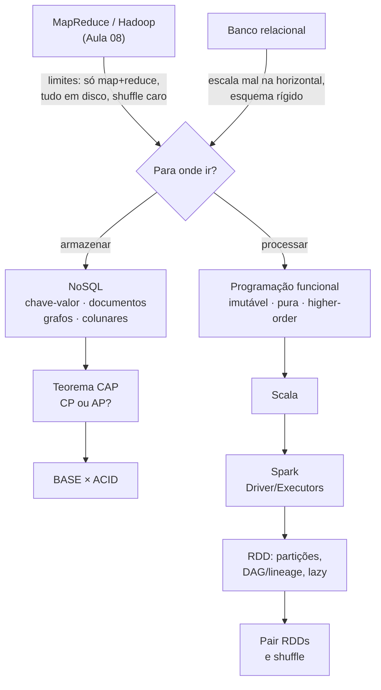

> **O que observar:** a aula parte de **um problema** (o MapReduce e os bancos relacionais não bastam para tudo) e segue **dois caminhos**: um para **armazenar** dados em escala (NoSQL, com o preço cobrado pelo CAP) e outro para **processar** dados em escala (Spark, construído sobre ideias de programação funcional).

---

# Bloco A — Por que ir além do Hadoop (e do relacional)

## A1. Recapitulando o MapReduce

> **[P2] Cai:** vantagens (só 2 funções) e desvantagens (nem todo algoritmo cabe, disco, shuffle) do MapReduce.

O modelo foi visto em detalhe na [Aula 08, §B4](08_forkjoin_bigdata_hadoop.md#b4-mapreduce). O que esta aula acrescenta é o **balanço**:

| Vantagens | Desvantagens |
|---|---|
| Simples: só **duas fases**, Map e Reduce | **Nem todo algoritmo** se traduz bem em map + reduce (ex.: algoritmos iterativos, como k-means, viram uma cadeia de jobs) |
| Dá suporte a processamento de dados em **grande escala** | **Todos os resultados intermediários vão para o disco** |
| | O **shuffle/sort** afeta diretamente o desempenho (rede + disco) |

**Considerações sobre o Hadoop:**
- É ótimo para aplicações **específicas**, que se descrevem bem com MapReduce.
- O HDFS segue o modelo **WORM** (*Write Once, Read Many* — "grava uma vez, lê muitas"): ideal para gravar uma vez e ler várias, **ruim para modificações ou escritas constantes**.

**E os bancos relacionais?** Têm o problema oposto:
- **Escalam mal horizontalmente** (distribuir uma base relacional em rede é difícil, porque junções e transações atravessam máquinas);
- Têm **esquemas rígidos**, ruins para dados **semi-estruturados ou não estruturados**, muito comuns em Big Data (JSON de APIs, logs, textos, grafos sociais).

> **Ideia-chave:** nem o Hadoop (processamento em lote, só leitura) nem o relacional (esquema fixo, escala vertical) atendem tudo. Daí surgem os **bancos NoSQL** (armazenar) e o **Spark** (processar).

---

## A2. Bancos de dados NoSQL

> **[P2] Cai:** "cite os principais tipos de NoSQL e a ideia de cada um".

**NoSQL = "*Not only SQL*"**: bancos projetados para **escalar horizontalmente** e/ou representar dados **semi e não estruturados** de forma mais eficiente que o modelo relacional.

> "Not only" e não "No": não é anti-SQL. Vários NoSQL têm linguagens de consulta parecidas com SQL; a diferença está no **modelo de dados** e na forma de distribuir.

### As 4 famílias da aula

| Família | Como representa os dados | Exemplo (slide) | Aplicação típica (slide) |
|---|---|---|---|
| **Chave-valor** | Um grande conjunto de pares (chave, valor), como um **dicionário**; a chave é um ID único usado para otimizar a consulta | **Redis**, DynamoDB | **Gerenciamento de sessões de usuário** |
| **Documentos** | Registros **semi-estruturados e flexíveis**, em **JSON** ou **BSON** (*Binary JSON*); cada documento é **autocontido** e agrupa dados relacionados | **MongoDB** | Catálogos, perfis, dados com campos variáveis |
| **Grafos** | **Nós** e **arestas** (relacionamentos) | **Neo4j**, Amazon Neptune | Consultas por **caminhos/relacionamentos**: redes sociais, sistemas de recomendação |
| **Colunares** | Dados armazenados **por coluna** em vez de por linha/tupla | **Cassandra**, HBase | **Consultas analíticas** |

Dois detalhes que os slides destacam:
- **Neo4j, apesar de ser NoSQL, é implementado como ACID.** Ou seja, "NoSQL" não significa automaticamente "sem garantias transacionais".
- **Documento autocontido:** em vez de espalhar um pedido em três tabelas (pedido, itens, cliente) e juntar depois, guarda-se tudo num documento só. A leitura fica barata; a contrapartida é **duplicação** de dados.

**Exemplo — o mesmo dado em dois modelos:**

```text
Relacional (3 tabelas, juntadas na consulta)
  Cliente(id=7, nome="Ana")
  Pedido(id=101, cliente_id=7, total=150)
  Item(pedido_id=101, produto="Livro", qtd=2)

Documento (1 registro autocontido, JSON)
  { "_id": 101, "cliente": {"id": 7, "nome": "Ana"},
    "total": 150, "itens": [ {"produto": "Livro", "qtd": 2} ] }

Chave-valor (sessão de usuário)
  "sessao:9f3a"  ->  { usuario: 7, carrinho: [101], expira: "20:15" }
```

**Por que linha × coluna importa para análise?** Uma consulta analítica típica (`SELECT AVG(valor) FROM vendas`) lê **uma coluna de milhões de linhas**. Num armazenamento por coluna, os valores de `valor` estão **contíguos no disco** (é a localidade espacial da [Aula 07](07_threads_balanceamento_executor.md)): lê-se só o que interessa, e valores parecidos lado a lado comprimem melhor. Num armazenamento por linha, seria preciso ler todas as colunas de todas as linhas. (Mesma ideia do formato **Parquet**, citado na Aula 08.)

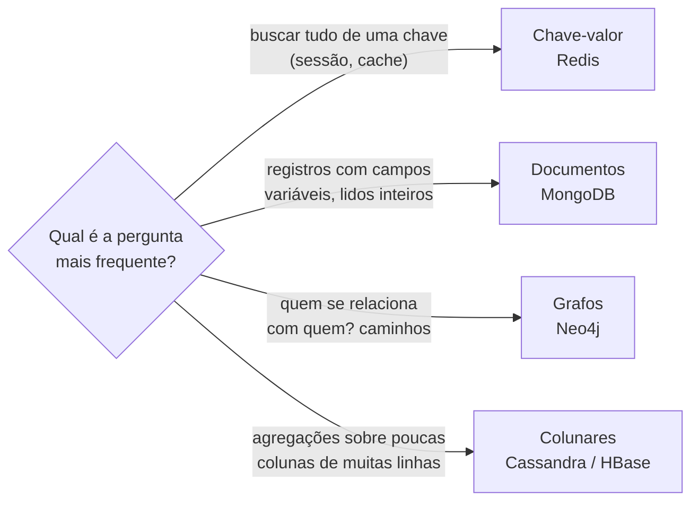

> **O que observar:** a escolha da família vem do **padrão de acesso** (qual consulta mais se repete), não do volume de dados. Todas as quatro escalam horizontalmente.

---

## A3. Teorema CAP (Teorema de Brewer)

> **[P2] Cai.** Na 2ª revisão ela reexplicou e pediu: "lembra aí das **nomenclaturas**, por favor". P é obrigatório (falhas de rede são inevitáveis) → **CP ou AP**. **BASE ≈ AP** (disponível, eventualmente consistente); **ACID ≈ CP** (consistente). O CAP é falado para **sistemas distribuídos em geral**; o BASE vem do lado dos **bancos de dados**, como contraponto ao ACID ("bastante parecidos"). Atenção: o **P é tolerância a particionamento**, não "persistência".

> **Enunciado (slide):** em sistemas distribuídos, é **impossível garantir simultaneamente** os três pilares abaixo; escolhe-se **no máximo dois**.

| Letra | Propriedade | Definição (slide) |
|---|---|---|
| **C** | Consistência (*Consistency*) | Todos os nós retornam **exatamente a mesma informação atualizada** no mesmo instante |
| **A** | Disponibilidade (*Availability*) | **Toda requisição recebe uma resposta (não-erro)**, mesmo que o dado não seja a versão mais recente |
| **P** | Tolerância a particionamento (*Partition tolerance*) | O sistema **continua funcionando** mesmo com falhas de comunicação entre os nós |

### Por que, na prática, a escolha é "CP ou AP"

**Falhas de rede são inevitáveis**, então o **P é obrigatório**: um sistema distribuído que "abre mão" de P simplesmente para de funcionar quando a rede falha. Sobra decidir **o que fazer durante a partição**:

- **CP (Consistência + Particionamento):** prefere **recusar** a responder do que responder errado.
- **AP (Disponibilidade + Particionamento):** prefere **responder** com o que tem, mesmo que desatualizado.

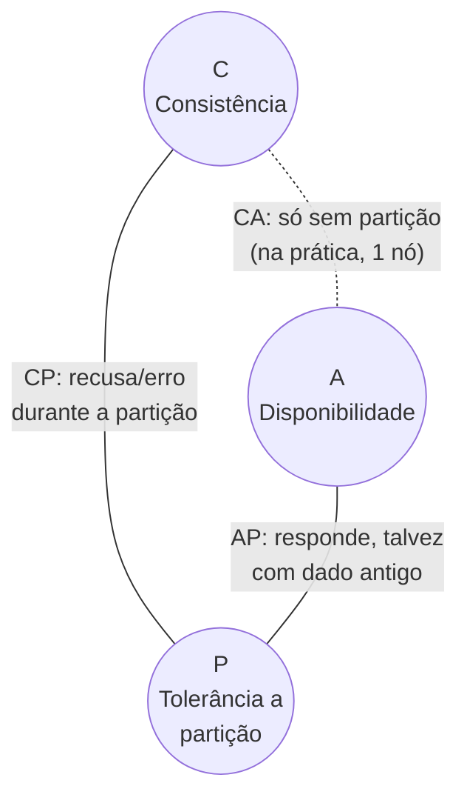

> **O que observar:** a aresta pontilhada (CA) só existe se a rede nunca falhar, o que não acontece em sistemas distribuídos reais. Por isso a pergunta prática é sempre "**CP ou AP?**".

**Intuição com dois nós (livro *Distributed Systems*, §8.2):** imagine dois processos que **não conseguem se comunicar** por causa de uma falha de rede. Se um deles aceitar atualizações, os dois ficam **inconsistentes** → só se tem {A, P}. Se for preciso manter a ilusão de consistência, um dos dois tem de **fingir estar indisponível** → só se tem {C, P}. O livro conclui que o CAP é um ***trade-off* entre segurança e progresso**, e que **a escolha depende da aplicação**: chaves duplicadas num banco podem ser corrigidas depois (tolera-se inconsistência), mas transferências duplicadas de dinheiro não.

### Exemplo do slide: transferência bancária

O cliente A transfere X para o cliente B e depois consulta o próprio saldo. **Durante a transação, um nó falha** (partição).

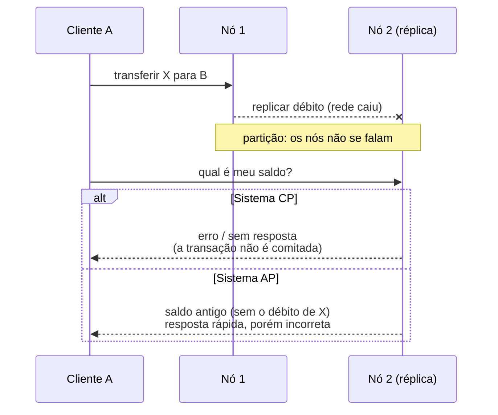

> **O que observar:** o slide resume: **CP** → a transação **não é comitada** e o cliente fica **sem resposta** (ou recebe erro); **AP** → o cliente **recebe resposta, mas o saldo está incorreto**. Para um banco, normalmente se escolhe CP; para um "curtir" numa rede social, AP é aceitável.

---

## A4. BASE e ACID × BASE

> **[P2] Cai:** ACID × BASE e a **desvantagem do BASE** (não garante que a consulta devolva o dado correto). **Não vai pedir o significado de cada letra.** Neo4j é ACID porque garante as propriedades da transação (não "porque usa SQL").

Muitos bancos NoSQL (**não todos**; depende do banco e de como foi implementado) seguem o modelo **BASE**:

| Letra | Significado | Explicação (slide) |
|---|---|---|
| **BA** | ***Basically Available*** | O sistema responde às requisições **na maior parte do tempo**, priorizando a continuidade do negócio em vez de falhar por segurança |
| **S** | ***Soft state*** | O estado pode **mudar com o tempo sem nova interação do usuário**, por causa da **replicação em segundo plano** entre os nós |
| **E** | ***Eventually consistent*** | Não garante que o dado esteja igual em todos os nós no mesmo instante, mas, **se não houver novas atualizações, todos eventualmente convergem** para o mesmo valor |

> **Nota de terminologia:** o slide chama de "teorema BASE". BASE é um **modelo** (ou filosofia de projeto) de consistência, não um teorema: não há nada a provar. O teorema é o **CAP**; o BASE é a **resposta de projeto** de quem escolhe o lado **AP**. Na prova, use o termo que a professora usar, mas saiba a diferença.

**Consistência eventual no livro (§7.2.2):** é o modelo típico de sistemas em que **quase todos os processos só leem** e poucos escrevem (ex.: redes de distribuição de conteúdo). As atualizações se propagam devagar, e assume-se que os clientes raramente percebem a inconsistência.

### ACID × BASE

| | **ACID** | **BASE** |
|---|---|---|
| Garante | Dados **corretos**, mesmo que isso signifique **reportar falha** | **Disponibilidade**; o dado pode estar **incorreto** dependendo do momento da consulta |
| Durante falha de rede | Pode ficar **indisponível** | Continua respondendo |
| Lado do CAP | Tende a **CP** | Tende a **AP** |
| Exemplos | Bancos relacionais (PostgreSQL), **Neo4j** | Cassandra, muitos chave-valor e de documentos (conforme configuração) |
| Bom para | Dinheiro, estoque, matrícula | Feeds, contadores de visualização, carrinho, sessões |

> Lembrete do que é ACID (Banco de Dados): **A**tomicidade (tudo ou nada), **C**onsistência (respeita as regras do esquema), **I**solamento (transações concorrentes não se enxergam pela metade), **D**urabilidade (o que foi comitado não se perde). Note que o "C" de ACID **não é o mesmo** "C" do CAP: no ACID, é respeitar restrições do esquema; no CAP, é todas as réplicas mostrarem o mesmo valor.

### Críticas (indicações do slide)

A professora indica a crítica de **Michael Stonebraker** (MIT, criador do Postgres) ao MapReduce, incluindo o texto "*MapReduce: a major step backwards*" (DeWitt & Stonebraker, 2008). O argumento central: o MapReduce **reinventou mal** coisas que os bancos de dados já resolviam (esquemas, índices, otimização de consultas). Essa discussão reaparece nas Aulas 10 e 11: o SparkSQL e o otimizador **Catalyst** são justamente a volta dessas ideias para o mundo do Big Data.

---

### Lista P2, Ex. 1 — BASE × ACID

> *Bancos relacionais são ACID, muitos bancos NoSQL são BASE. Explique a ideia do BASE e as desvantagens dos sistemas BASE em comparação ao ACID.*

**Gabarito:** a ideia do BASE é **abrir mão da consistência imediata** em favor da **alta disponibilidade** e da **escalabilidade horizontal**. Em vez de bloquear os dados e exigir que todas as réplicas sejam atualizadas de forma síncrona antes de confirmar uma operação, o banco **responde rapidamente** e **sincroniza as cópias em segundo plano**. Vantagem: continua operacional mesmo com falhas parciais. **Desvantagem:** tolera **divergências temporárias** entre os nós; só garante que, após a propagação, as réplicas **acabarão convergindo**. Nessa janela, consultas feitas **antes da sincronização completa** podem retornar dados **desatualizados ou inconsistentes**.

> Como a professora disse na 2ª revisão: "Eu vou estar sempre disponível para responder; mas, quando você comitar, pode ser que eu não atualize na hora. Eu te mando a resposta e continuo atualizando em background." O problema: "faço uma consulta e o background ainda não terminou" → dado inconsistente momentaneamente.

---

# Bloco B — Programação funcional

## B1. O paradigma funcional

Toda vez que se fala de MapReduce, ou de como paralelizar tarefas, fala-se em **aplicar funções** sobre dados. A pergunta do slide: **por que não usar uma linguagem funcional para processamento em larga escala?** Resposta: **Scala**.

**Programação funcional** é um paradigma em que:
- o processamento é expresso como **transformações de dados por meio de funções**, e não como uma sequência de comandos que **modificam o estado** do programa;
- **funções são cidadãs de primeira classe** (*first-class citizens*): podem ser guardadas em variáveis, passadas como argumento e retornadas por outras funções;
- vale a **imutabilidade**: os dados não mudam depois de criados; as operações **produzem novos valores**.

**Mesmo problema nos dois estilos** — dobrar todos os valores de uma lista:

```java
// Java, estilo imperativo: COMO fazer, passo a passo, mudando estado
List<Integer> resultado = new ArrayList<>();
for (int x : numeros) {
    resultado.add(x * 2);      // altera a lista 'resultado' a cada volta
}
```

```scala
// Scala, estilo funcional: O QUE fazer — "aplique x*2 a cada elemento"
val resultado = numeros.map(x => x * 2)
```

> **O que muda:** no Java, o programador controla o laço, o índice e a lista que cresce. No Scala, só diz **qual transformação** quer; **como** percorrer fica com o `map`. É exatamente essa separação que permite a um framework distribuído (Spark) decidir **onde e em paralelo** aplicar a função.

---

## B2. Imutabilidade, lambdas e funções como valores

### Imutabilidade

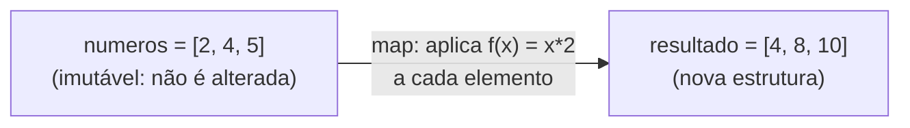

> **O que observar:** a seta **não** modifica `numeros`; ela **gera** `resultado`. Depois do `map` existem as duas listas.

### Função lambda (anônima)

```scala
x => x * 2
//  ^      ^
//  |      └── como calcular a saída
//  └── entrada
```

Uma lambda é uma **função sem nome**. É útil quando se quer passar uma operação **diretamente como argumento** para outra função, sem definir uma função nomeada separada.

### Função como valor

```scala
val dobrar = (x: Int) => x * 2        // a função é guardada numa variável
val resultado = numeros.map(dobrar)   // e passada ao map como se fosse um dado
// numeros = List(2, 4, 5)  ->  resultado = List(4, 8, 10)
```

---

## B3. Funções puras

Uma **função pura** (a base da programação funcional):
1. **Sempre produz o mesmo resultado para as mesmas entradas** (não depende de estado externo mutável);
2. **Não provoca efeitos colaterais**: não altera estado externo nem faz ações observáveis fora do cálculo (não modifica a entrada, não escreve em variável global, não imprime, não grava arquivo).

**Exemplo do slide (juros):**

```java
// PURA: recebe o saldo, devolve os juros. Não muda nada fora dela.
double calcularJuros(double saldo) {
    return saldo * 0.05;
}

// IMPURA: altera a variável externa 'saldo' (efeito colateral).
double saldo = 1000.0;
void calcularJuros() {
    saldo = saldo * 1.05;
}
```

Chamando cada uma duas vezes (executado em Scala, mesma lógica):

```text
pura:   50.0 50.0          <- mesma entrada, mesma saída, sempre
impura: 1050.0 1102.5      <- cada chamada muda 'saldo'; o resultado depende do histórico
```

> **Por que isso importa no distribuído:** se uma partição se perder, o Spark **reexecuta** as funções sobre os dados de origem (ver [C4](#c4-transformações-dag-e-data-lineage)). Isso só dá o mesmo resultado se as funções forem **puras**. Uma função impura reexecutada pode, por exemplo, contar duas vezes.

---

## B4. Funções de ordem superior (*higher-order*)

Uma **função de ordem superior** **recebe uma função como argumento** ou **retorna uma função**.

- `map`, `reduce`, `filter` **recebem** funções:

```scala
val resultado = numeros.map(x => x * 2)
```

- Também é possível **retornar** uma função:

```scala
def criarMultiplicador(fator: Int): Int => Int = {
  x => x * fator              // devolve uma função que "lembra" do fator
}

val dobrar    = criarMultiplicador(2)
val triplicar = criarMultiplicador(3)
println(dobrar(5))     // 10
println(triplicar(5))  // 15
```

> **Leitura do tipo:** `Int => Int` é "função que recebe `Int` e devolve `Int`". Então `criarMultiplicador` recebe um `Int` (o fator) e **devolve uma função**. A função devolvida "captura" o valor de `fator` (isso se chama *closure*).

---

## B5. Por que funcional combina com distribuído

| Propriedade | Consequência para processamento distribuído (slide) |
|---|---|
| **Imutabilidade** | Os dados originais não são modificados. **Cada tarefa trabalha na própria partição sem disputar a alteração do mesmo dado** → não há condição de corrida, não há *locks* (o problema de sincronização das Aulas 07–08 some) |
| **Funções puras** | Para as mesmas entradas, o mesmo resultado, sem alterar estado externo → é seguro **executar em qualquer nó, em qualquer ordem, e reexecutar** depois de uma falha |
| **Funções de ordem superior** | Permitem **expressar transformações**: o programador **descreve** a transformação (`map(f)`), e o framework decide **onde** e **em paralelo** aplicá-la |

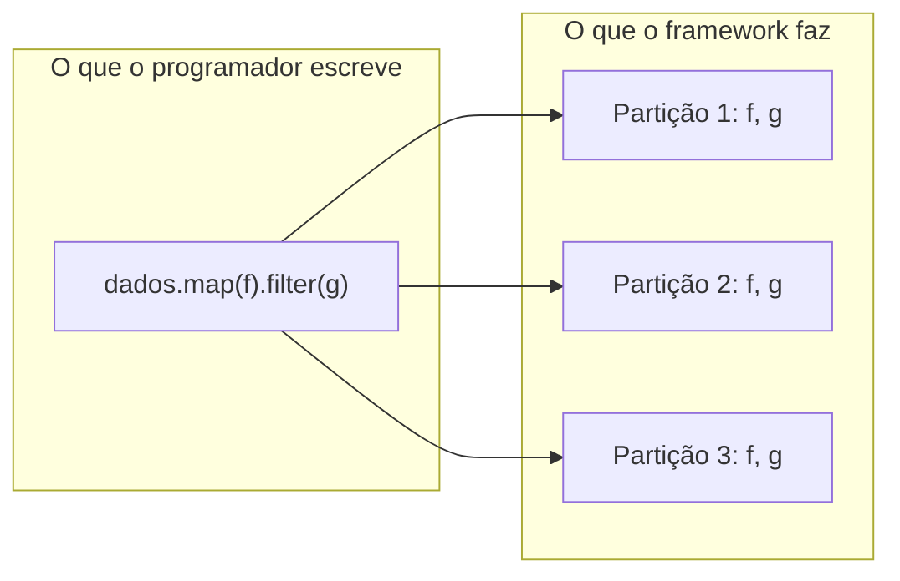

> **O que observar:** como `f` e `g` são puras e os dados são imutáveis, as três partições são processadas **independentemente**, sem comunicação. É a **decomposição de dados** da [Aula 06](06_padroes_de_paralelismo.md), feita automaticamente.

---

## B6. De Scala para o Spark

- **Scala** foi criada em **2001**, na **EPFL** (Lausanne, Suíça), pelo prof. **Martin Odersky**. Ideia: juntar **programação funcional** e **orientação a objetos**, mantendo **interoperabilidade com bibliotecas Java**. É **compilada para bytecode da JVM** e tem sintaxe menos verbosa que Java. (Detalhes de sintaxe: [09b](09b_programacao_scala.md).)
- **O Scala não foi feito para o Spark.** Foi **Matei Zaharia** (hoje CTO da Databricks e professor na UC Berkeley) e colaboradores que escreveram o Spark **principalmente em Scala**, pelo suporte a características funcionais.
- O Spark tem APIs para outras linguagens (ex.: **PySpark**), mas **alguns recursos só existem em Scala**. Exemplo do slide: **incluir regras novas no Catalyst**, o otimizador de consultas do SparkSQL (assunto das Aulas 10–11).

---

# Bloco C — Spark por dentro

> A visão geral (em memória, RDD, Master/Worker, módulos, Hadoop × Spark) já está na [Aula 08, §B5](08_forkjoin_bigdata_hadoop.md#b5-apache-spark). Aqui o foco é **como** o Spark organiza e executa o trabalho.

## C1. Arquitetura

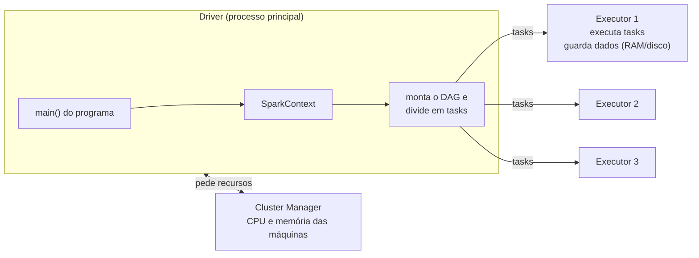

| Componente | Papel (slides) |
|---|---|
| **Driver** | Processo principal, num dos nós do cluster. **Executa o `main`** do programa, **define os conjuntos de dados distribuídos e as operações**, e **organiza, distribui e agenda as tarefas** entre os executors. Usa o **`SparkContext`** para se conectar ao ambiente e acessar as funcionalidades do Spark |
| **Executors** | Processos que **executam as tarefas** enviadas pelo Driver, **em paralelo**. Podem **armazenar dados em memória ou em disco** para reutilização |
| **Cluster Manager** | Gerencia os **recursos computacionais** do cluster (CPU, memória das máquinas) e **aloca** recursos para as aplicações Spark |

> **Em uma frase (slide):** o **Driver define** as operações que devem ser feitas sobre os dados e os **Executors executam** essas operações em paralelo. A pergunta seguinte é: **como o Spark organiza essas operações e decide quando executá-las?** A resposta passa pelo RDD.

---

## C2. RDD (*Resilient Distributed Dataset*)

Os RDDs são "**o coração do Spark**":

- **Estrutura de dados imutável e distribuída.** Um RDD nunca é alterado; operações geram **novos** RDDs.
- **API parecida com as coleções do Scala**: `map`, `filter`, `reduce`… funcionam de forma semelhante a uma `List`.
- **As operações dos RDDs são de ordem superior**: recebem funções (`rdd.map(x => x * 2)`).
- **O RDD é o objeto que representa todo o dataset** no Spark; internamente, ele é dividido em **partições**.

> **Hadoop × Spark (slide):** a grande diferença é que o **Hadoop é um sistema de arquivos distribuído** (HDFS, mais o MapReduce), enquanto o **Spark é um framework de processamento paralelo**. O Spark **não precisa** do HDFS, mas pode ler dele (ou do S3, de um CSV local…).

O nome resume as três propriedades:

| Letra | Significa | Como o Spark garante |
|---|---|---|
| **R**esilient | Tolerante a falhas | Reconstrói partições perdidas pelo ***lineage*** ([C4](#c4-transformações-dag-e-data-lineage)) |
| **D**istributed | Particionado entre os nós | Partições espalhadas pelos executors ([C3](#c3-particionamento-dos-rdds)) |
| **D**ataset | Coleção de registros | API de coleções (`map`, `filter`…) |

---

## C3. Particionamento dos RDDs

**Regra:** as partições do RDD **seguem o particionamento da camada de armazenamento**. Se **não houver** camada de armazenamento (ex.: dados criados no próprio programa), o Spark usa um **particionamento padrão em memória**, que é **lógico**.

**Camada de armazenamento = HDFS (infraestrutura, físico):** blocos de tamanho fixo, padrão **128 MB** (configurável). Um arquivo de **300 MB** vira **128 + 128 + 44 MB**, gravados **fisicamente** no disco dos nós ([Aula 08, §B3](08_forkjoin_bigdata_hadoop.md#b3-hdfs-hadoop-distributed-file-system)).

**Como o Spark lê esse arquivo (slide):**

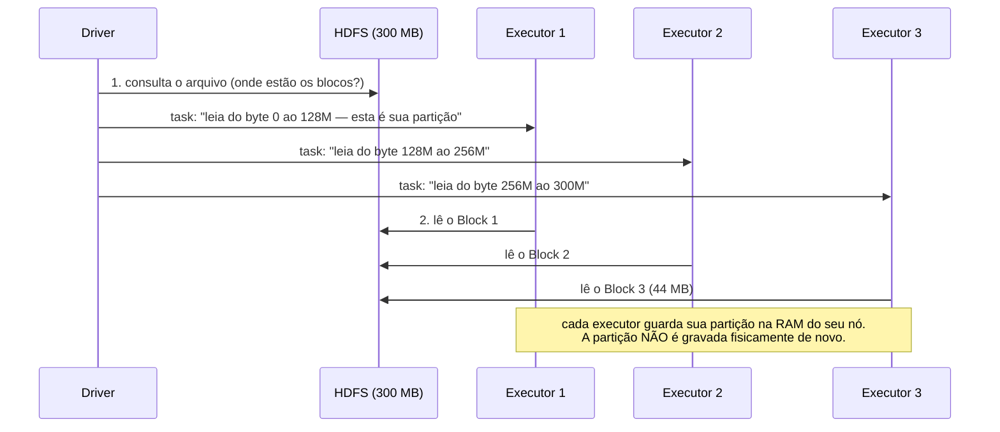

> **O que observar:**
> 1. O **Driver não lê os dados**: só atribui a cada executor **uma faixa de bytes** ("você vai ler do byte X ao Y, esta é sua partição") e a task correspondente.
> 2. O **Executor** lê do arquivo original os bytes da sua partição e os **mantém na RAM** do nó. Nada é copiado para outro disco.
> 3. Com o HDFS, 1 bloco ≈ 1 partição.

**Físico × lógico:**

| | Particionamento do **HDFS** | Particionamento do **RDD** |
|---|---|---|
| Nível | **Infraestrutura** (armazenamento) | **Processamento** |
| Onde existe | Gravado no disco de cada nó, com réplicas | Na RAM dos executors |
| Como é definido | Tamanho fixo de bloco (128 MB) | Segue a fonte (HDFS, S3, CSV…) **ou** uma função de particionamento |
| Pode mudar? | Só regravando o arquivo | **Sim**: como não é físico, dá para **implementar funções de particionamento lógico** (ex.: por chave — ver [C6](#c6-pair-rdds-rdds-chave-valor)) |

---

## C4. Transformações, DAG e *data lineage*

O RDD é a abstração do dataset inteiro. Para processar, **aplicamos funções** sobre ele; cada aplicação **calcula uma transformação** e **devolve um novo RDD** (o original não muda, pois é imutável).

**Problema:** se as partições ficam em memória e **não há réplicas físicas** (a não ser que o HDFS esteja por baixo), **como ser tolerante a falhas?**

**Solução:** **registrar toda transformação.** Quando o RDD 2 é produzido aplicando um `filter` sobre o RDD 1, o Spark anota: "*RDD 2 = filter(RDD 1)*". Esses registros formam um **grafo de dependências**, o **DAG**.

### DAG

**DAG** (*Directed Acyclic Graph* — grafo direcionado acíclico) é uma estrutura muito usada para representar **sequências e dependências** — aqui, das transformações sobre os RDDs. (É o mesmo **grafo de dependência de tarefas** da [Aula 06](06_padroes_de_paralelismo.md).)

**Exemplo do slide (logs):**

```scala
val linhas = sc.textFile("logs.txt")              // RDD 1: uma linha do arquivo por elemento
val mensagens = linhas
  .filter(x => x.contains("ERRO"))               // RDD 2: só as linhas com "ERRO"
  .map(x => x.split("-")(1))                      // RDD 3: o texto depois do "-"
```

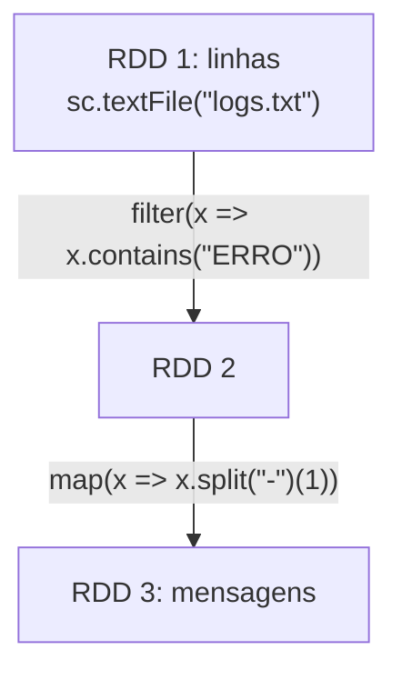

> **Leitura de `x.split("-")(1)`:** `split("-")` quebra a linha num array de pedaços separados por `-`; `(1)` pega o **segundo** pedaço (índices começam em 0; em Scala, acessa-se com parênteses, não colchetes). Para `"ERRO - Falha de leitura"`, o resultado é `" Falha de leitura"`.

### *Data lineage*

O registro das transformações é o ***data lineage*** (linhagem dos dados): **o histórico de todas as transformações que levam do dado original ao resultado final**.

**Por que é importante?**
1. O Spark processa **em memória** e **não mantém réplicas** para tolerância a falhas.
2. Se um **Executor falhar**, o *lineage* diz **qual partição se perdeu** e **quais transformações recalcular** — e só elas, só para aquela partição.

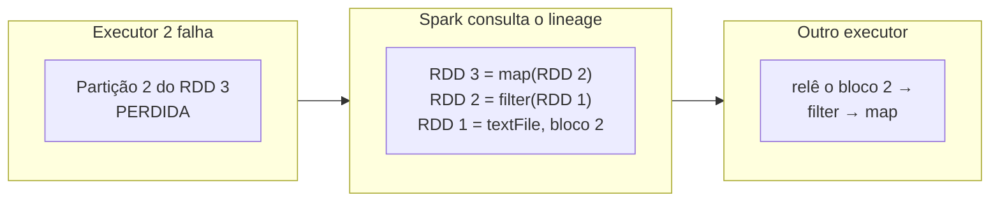

> **O que observar:** em vez de **guardar 3 cópias** de cada dado (como o HDFS), o Spark guarda a **receita**. É barato em armazenamento, mas a recuperação custa **recomputação**. E só funciona porque as transformações são **determinísticas** (funções puras, [B3](#b3-funções-puras)).

---

### Para que serve o DAG (lista P2, Ex. 3)

> *Considere o programa abaixo: represente visualmente o DAG esperado e explique para que o DAG é utilizado no ambiente Spark.*

```scala
val linhas = sc.textFile("logs.txt")
val erros = linhas
   .filter(linha => linha.contains("ERROR"))
   .map(linha => (linha.split(";")(1), 1))
   .reduceByKey((a, b) => a + b)
val resultado = erros.collect()
```

**DAG:** `textFile → filter → map → reduceByKey → collect()`. Na prova, desenhe **só as operações** (ela: "a gente pede só as operações que estão sendo escritas"; não precisa desenhar os dados de cada RDD).

**Para que serve (gabarito):**
1. ***Lazy evaluation*** — o Spark registra a sequência de transformações **antes** de executar, o que permite **otimizar o plano** e **encadear as operações em memória** quando uma ação (ex.: `collect()`) é chamada, **sem gravar resultados intermediários em disco**.
2. **Tolerância a falhas** — o grafo mantém a **linhagem**; se houver falha, o Spark **recomputa apenas as partições perdidas** a partir das etapas anteriores do DAG. (No Hadoop, a tolerância vem da **replicação de blocos**.)

> **DAG × árvore de consulta (2ª revisão):** a árvore de consulta só tem operadores relacionais (seleção, projeção, junção); o DAG do Spark registra **todos os passos do código**, inclusive o `parallelize`/`textFile`.

---

## C5. *Lazy evaluation*

> **[P2]** "Qual o DAG?" **cai** (resolvido na 2ª revisão: [Aula 12, ex. 7](12_joins_spark_revisao_prova.md#exercício-7--spark-dag-e-quando-executa)). "Em que linha começa a executar de fato?" ficou **indefinido**: ela disse que não cobraria o `.collect()`, alguém sugeriu que seria "uma boa para cobrar" e ela respondeu "vou pensar". Resposta, se cair: a linha da **primeira ação** (o `collect()` é o "gatilho" que puxa os dados de todas as partições para o driver).

**Problema:** se cada transformação criasse imediatamente um RDD novo em memória, haveria **muito tempo gasto criando RDDs intermediários**.

**Solução:** o Spark usa **avaliação preguiçosa** (*lazy evaluation*): as operações **não são executadas quando são "lidas" no código**. Enquanto o código roda, o Spark **só constrói o DAG**. A execução de verdade só acontece quando é **necessária**, isto é, quando há uma **ação** sobre os dados: escrita de dados, amostragem no console, contagem, etc.

```scala
val linhas = sc.textFile("logs.txt")      // só anota no DAG
val mensagens = linhas
  .filter(x => x.contains("ERRO"))       // só anota no DAG
  .map(x => x.split("-")(1))              // só anota no DAG

mensagens.take(100).foreach(println)      // AÇÃO: aqui o Driver envia as tasks aos Executors
```

> **Nota sobre o slide:** o slide usa `mensagens.show(100)`. O método `show` existe em **DataFrames** (Aula 10), não em RDDs; com RDD, as ações equivalentes são `take(n)`, `collect()`, `count()`, `foreach(...)`. A **ideia** do slide não muda: nada executa até a ação.

**Execução real** (Spark 3.5.0, `local[2]`, com um `println` dentro do `filter` para mostrar **quando** ele roda):

```text
>>> DAG montado, nada executou ainda
>>> acao take(100):
  [filter executando] INFO - Conexao estabelecida
  [filter executando] ERRO - Falha de leitura no disco
  ...
Falha de leitura no disco
Timeout no executor 3
```

> **O que observar:** a mensagem "DAG montado" aparece **antes** de qualquer `[filter executando]`. O `filter` só roda depois que a ação é chamada.

### Vantagens e o problema do recálculo

**Vantagens (slide):**
- Permite **otimizar o DAG**: o Spark vê **todas** as transformações antes de executar e pode evitar computação desnecessária (ex.: juntar `filter` e `map` numa só passada pelos dados, em vez de criar o RDD 2 inteiro).
- **Decisões dinâmicas** sobre o que executar e quando.

**Problema (slide):** quando **vários RDDs derivam de um mesmo RDD**, a parte comum pode ser **calculada mais de uma vez**, pois cada ação percorre o DAG desde o início.

**Solução:** analisar o código e decidir quais RDDs **guardar temporariamente**, com **`persist()`** ou **`cache()`**, para serem reutilizados.

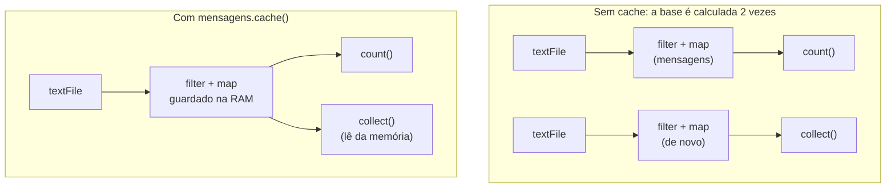

> **O que observar:** sem `cache`, duas ações sobre `mensagens` refazem a leitura e o `filter` duas vezes. Com `cache`, a **primeira** ação calcula e guarda; a segunda reaproveita. `cache()` também é **preguiçoso**: só guarda quando a primeira ação roda.

| | `cache()` | `persist(nível)` |
|---|---|---|
| O que faz | Guarda em **memória** | Guarda no **nível escolhido**: memória, disco, memória + disco, serializado… |
| Relação | `cache()` = `persist()` com o nível padrão (só memória, para RDD) | Versão configurável |
| Quando usar | RDD reutilizado por **2 ou mais ações** (ex.: algoritmos iterativos como k-means) | Idem, quando não cabe tudo em memória |

---

## C6. Pair RDDs (RDDs chave-valor)

Os RDDs podem ser de **qualquer tipo**, mas RDDs de **pares (chave, valor)** são muito comuns:
- É a representação do **modelo MapReduce**, que também pode ser usado no Spark;
- Assim como no Hadoop, a chave ajuda no **particionamento**: dá para pedir que **todos os dados do mesmo mês sejam processados na mesma partição**, por exemplo.

Esses RDDs chave-valor se chamam **Pair RDDs** e oferecem (slide):
1. **Ação por chave em paralelo:** operações e transformações agrupadas **por chave**, de forma independente para cada chave.
2. **Reagrupamento de dados pela rede:** facilitam o **shuffle**, reorganizando os dados entre os nós com base nas chaves.
3. **Métodos exclusivos:** o Spark adiciona automaticamente métodos só para pares, como **`reduceByKey`**, **`groupByKey`**, **`join`**, **`sortByKey`**, entre outros.

```scala
val vendas = sc.parallelize(Seq(("jan",10), ("fev",5), ("jan",7), ("mar",1), ("fev",3)), 2)
//                                ^chave ^valor                                         ^2 partições
val porMes = vendas.reduceByKey(_ + _)   // soma os valores de cada chave
porMes.collect()                          // (fev,8), (jan,17), (mar,1)
```

> **Ligação com a Aula 08:** é o WordCount de novo. `reduceByKey(_ + _)` faz o papel de **shuffle + reduce** do MapReduce numa única chamada.

---

## C7. Shuffle no Spark

**Shuffle** é o mecanismo do Spark para **redistribuir (reorganizar) os dados entre partições e nós** do cluster.

- **Normalmente**, as operações do Spark rodam **de forma paralela e independente dentro de cada partição**, num único nó.
- **Algumas operações** exigem que **dados com a mesma chave, espalhados por vários nós, se encontrem no mesmo lugar**. O shuffle entra para juntar esses dados.
- Ele ocorre nas **transformações largas** (*wide transformations*): aquelas em que **uma partição de saída pode depender de registros de várias partições de entrada**.

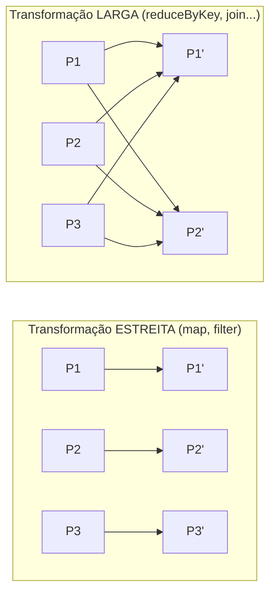

> **O que observar:** na **estreita**, cada partição de saída depende de **uma só** partição de entrada: tudo roda localmente, sem rede. Na **larga**, as setas **se cruzam**: cada partição de saída precisa de pedaços de **todas** as entradas, e esses pedaços viajam pela rede. Esse cruzamento é o shuffle.

**Operações que provocam shuffle (slide):**

| Grupo | Operações |
|---|---|
| Métodos de Pair RDDs por chave | `reduceByKey`, `groupByKey`, `aggregateByKey` |
| Junções | `join`, `cogroup` (quando os RDDs **não estão co-particionados**, isto é, não foram particionados pela mesma chave e da mesma forma) |
| Remoção de duplicatas / reordenação | `distinct`, `sortByKey` |

**Não** provocam shuffle (estreitas): `map`, `filter`, `flatMap`, `mapValues`, `union`.

**Como confirmar na prática:** `rdd.toDebugString` mostra o *lineage*; um `ShuffledRDD` indica shuffle. Saída real:

```text
>>> reduceByKey lineage:
(2) ShuffledRDD[5] at reduceByKey ...
 +-(2) ParallelCollectionRDD[4] at parallelize ...
>>> mapValues lineage:
(2) MapPartitionsRDD[6] at mapValues ...
 |  ParallelCollectionRDD[4] at parallelize ...
```

> **Leitura:** o `(2)` é o nº de partições. O recuo com `+-` marca uma **fronteira de shuffle** (o Spark divide o trabalho em ***stages*** nesses pontos); o `|` indica que a transformação continua no **mesmo** stage, sem shuffle.

**Por que o shuffle é caro?** Pelo mesmo motivo da Aula 08: **rede** (e escrita em disco dos dados intermediários a serem enviados). Por isso, "ainda temos problemas de shuffle" aparece nas desvantagens do Spark.

---

## C8. Vantagens e desvantagens do Spark

| Vantagens | Desvantagens |
|---|---|
| **Muito flexível**: serve a vários tipos de aplicação (lote, SQL, ML, streaming, grafos) | **Gerenciamento de memória**: tudo em RAM exige dimensionar bem; dados que não cabem degradam o desempenho |
| **Resolve (em parte)** o problema de desempenho do Hadoop (memória em vez de disco entre etapas) | **Curva de aprendizado**: muitos parâmetros de inicialização; tirar o melhor desempenho leva tempo |
| | **O shuffle continua caro** |

---

## Código Scala/Spark — pontos de leitura

> A aula é conceitual; os trechos abaixo são os dos slides. Todos foram executados (Scala 2.12.18 + Spark 3.5.0, `local[2]`, JDK 17); as saídas mostradas são reais.

### Quadro "onde usar"

| Construção | O que é | Onde usar | Cuidado |
|---|---|---|---|
| `colecao.map(f)` | Aplica `f` a cada elemento, devolve **nova** coleção | Transformar todos os elementos | Não altera a coleção original |
| `(x: Int) => x * 2` | Lambda | Passar uma operação curta como argumento | — |
| `def f(...): A => B` | Função que **retorna** função | Fábrica de funções (`criarMultiplicador`) | — |
| `sc.textFile(caminho)` | Cria o RDD de linhas de um arquivo | Leitura de texto | Lazy: nem abre o arquivo até a ação |
| `rdd.filter` / `rdd.map` | **Transformações estreitas** | Filtrar/transformar por elemento | Lazy, sem shuffle |
| `take(n)`, `collect()`, `count()`, `foreach` | **Ações** | Disparar a execução e obter o resultado | `collect()` traz **tudo** para o Driver |
| `rdd.cache()` / `persist()` | Guardar o RDD para reuso | RDD usado por **2+ ações** | Também lazy; consome memória |
| `reduceByKey(f)` | Agrega por chave (Pair RDD) | Somar/contar por chave | **Shuffle** (transformação larga) |
| `groupByKey()` | Junta todos os valores de cada chave numa lista | Quando se precisa da **lista inteira** de valores | Shuffle de **todos** os valores; para agregar, prefira `reduceByKey` (Para ir além, abaixo) |
| `rdd.toDebugString` | Mostra o *lineage* | Ver onde há shuffle | — |

> **Para ir além — `reduceByKey` × `groupByKey`:** a documentação oficial (*RDD Programming Guide*) recomenda `reduceByKey` ou `aggregateByKey` quando o objetivo é **agregar** (somar, contar), porque eles **combinam localmente em cada partição antes do shuffle** (como o *combiner* do Hadoop, Aula 08). `groupByKey` envia **todos** os valores pela rede.

---

## Treino de leitura

**Q1 — Quando executa?** Em que linha o Spark realmente lê o arquivo?

```scala
1  val linhas = sc.textFile("vendas.csv")
2  val validas = linhas.filter(l => !l.isEmpty)
3  val valores = validas.map(l => l.split(",")(2).toDouble)
4  val total = valores.reduce(_ + _)
5  println(total)
```

<details><summary><b>Gabarito Q1</b></summary>

Na **linha 4**. As linhas 1–3 são `textFile` e **transformações** (lazy): só montam o DAG. `reduce` é uma **ação** (devolve um valor ao Driver), então dispara a leitura, o `filter` e o `map`. A linha 5 apenas imprime um `Double` que já está no Driver.
</details>

**Q2 — Causa shuffle?** Classifique como **estreita** ou **larga**: `map`, `filter`, `reduceByKey`, `distinct`, `flatMap`, `join` (RDDs não co-particionados), `sortByKey`, `mapValues`, `groupByKey`.

<details><summary><b>Gabarito Q2</b></summary>

- **Estreitas (sem shuffle):** `map`, `filter`, `flatMap`, `mapValues`. Cada partição de saída depende de uma só partição de entrada.
- **Largas (com shuffle):** `reduceByKey`, `groupByKey`, `distinct`, `join`, `sortByKey`. Precisam reunir registros da mesma chave (ou ordenar globalmente) vindos de várias partições.
</details>

**Q3 — Esta função é pura?** Para cada uma, diga se é pura e por quê.

```scala
def a(x: Int): Int = x * x
var total = 0
def b(x: Int): Int = { total += x; x }
def c(x: Int): Int = x + scala.util.Random.nextInt(10)
def d(s: String): String = { println(s); s.toUpperCase }
```

<details><summary><b>Gabarito Q3</b></summary>

- `a`: **pura**. Mesma entrada → mesma saída; sem efeitos colaterais.
- `b`: **impura**. Altera a variável externa `total` (efeito colateral).
- `c`: **impura**. Para a mesma entrada, pode devolver valores diferentes (depende de um gerador aleatório, estado externo).
- `d`: **impura**. O retorno é determinístico, mas **imprime** no console (ação observável fora do cálculo).

No Spark, `b` e `c` são problemáticas: se uma partição for **recalculada pelo lineage**, `c` produz outro resultado, e `b` soma de novo.
</details>

**Q4 — CP ou AP?** Para cada cenário, qual escolha faz mais sentido durante uma partição de rede?
(a) saldo bancário; (b) contador de "curtidas"; (c) reserva do **último** assento de um voo; (d) carrinho de compras.

<details><summary><b>Gabarito Q4</b></summary>

(a) **CP**: melhor recusar do que mostrar saldo errado ou permitir saque duplo. (b) **AP**: um número de curtidas atrasado por alguns segundos não causa dano. (c) **CP**: vender o mesmo assento duas vezes é pior que pedir para tentar de novo. (d) **AP** costuma ser a escolha (manter o cliente comprando); conflitos são resolvidos depois (consistência eventual). Em todos os casos, a decisão depende **da aplicação**, como diz o livro.
</details>

**Q5 — Quantas vezes o arquivo é lido?**

```scala
val linhas = sc.textFile("logs.txt")
val erros = linhas.filter(_.contains("ERRO"))
println(erros.count())
println(erros.first())
erros.cache()
println(erros.count())
println(erros.take(5).mkString(","))
```

<details><summary><b>Gabarito Q5</b></summary>

- `count()` (1ª ação) → lê o arquivo.
- `first()` (2ª ação) → **lê de novo** (ainda sem cache). (`first` pode parar cedo, mas recomeça do arquivo.)
- `cache()` → só **marca**; não executa nada.
- `count()` (3ª ação) → lê o arquivo **e guarda** `erros` na memória.
- `take(5)` (4ª ação) → usa a versão em memória, **não** relê.

Total: **3 leituras** do arquivo. Para que fossem só 1, o `cache()` deveria vir **antes** da primeira ação.
</details>

**Q6 — Este código está correto?** O objetivo é contar quantas linhas têm "ERRO".

```scala
var contador = 0
val linhas = sc.textFile("logs.txt")
linhas.foreach(l => if (l.contains("ERRO")) contador += 1)
println(s"Erros: $contador")
```

<details><summary><b>Gabarito Q6</b></summary>

**Incorreto.** A função passada ao `foreach` é **impura**: tenta alterar a variável `contador` do Driver. No Spark, essa função é **serializada e enviada aos Executors**, e cada um recebe a **sua cópia** de `contador`. O `contador` do Driver não é atualizado: em cluster, imprime **`Erros: 0`**. (Em modo local o comportamento não é garantido; a documentação oficial avisa que esse código é indefinido.)

**Correção funcional:** expressar como transformação + ação, sem estado externo:

```scala
val erros = linhas.filter(_.contains("ERRO")).count()
```

É exatamente a lição do [B5](#b5-por-que-funcional-combina-com-distribuído): funções puras e dados imutáveis.
</details>

**Q7 — Este código está correto?**

```scala
val linhas = sc.textFile("logs.txt")
val mensagens = linhas.filter(x => x.contains("ERRO")).map(x => x.split("-")(1))
mensagens.show(100)
```

<details><summary><b>Gabarito Q7</b></summary>

**Não compila**: `mensagens` é um `RDD[String]`, e **RDD não tem `show`** (esse método é de **DataFrame**, Aula 10). Use uma ação de RDD: `mensagens.take(100).foreach(println)`. Atenção também ao `split("-")(1)`: se alguma linha com "ERRO" não tiver `-`, `(1)` lança `ArrayIndexOutOfBoundsException` **na hora da ação** (e não na linha do `map`, por causa da avaliação preguiçosa).
</details>

**Q8 — Leitura de arquitetura.** Um arquivo de 300 MB no HDFS padrão é lido por `sc.textFile`. Quantas partições o RDD terá, quem decide isso, e quem lê os bytes?

<details><summary><b>Gabarito Q8</b></summary>

**3 partições** (128 + 128 + 44 MB), seguindo os **blocos do HDFS**. O **Driver** decide e atribui a cada task uma faixa de bytes; os **Executors** leem os bytes da própria partição do arquivo original e os mantêm na **RAM**. O Driver não lê os dados.
</details>

---

## Erros comuns / o que cai em prova

1. **"No CAP, dá para escolher CA."** Num sistema distribuído real, partições acontecem; **P é obrigatório**, e a escolha é **CP ou AP**.
2. **Confundir o "C" do CAP com o "C" do ACID.** CAP: réplicas iguais. ACID: respeitar as regras do esquema.
3. **"NoSQL = sem garantias."** Depende do banco: **Neo4j é ACID**. O slide diz "muitos, **não todos**, seguem BASE".
4. **BASE é um modelo**, não um teorema. Consistência **eventual** ≠ inconsistência permanente: sem novas escritas, as réplicas **convergem**.
5. **"O Spark é um sistema de arquivos."** Não: o **HDFS** é o sistema de arquivos; o Spark **processa**.
6. **"O Driver lê os dados e distribui."** Não: o Driver atribui **faixas de bytes**; cada **Executor lê** a sua partição.
7. **Particionamento do RDD é lógico**; o do HDFS é **físico**.
8. **Transformação não executa nada.** Só **ações** (`collect`, `count`, `take`, `reduce`, escrita) disparam o DAG.
9. **`cache()` também é preguiçoso**, e precisa vir **antes** das ações que devem reutilizar o RDD.
10. **Tolerância a falhas do Spark = *lineage* (recomputação)**, não réplicas. Só funciona com funções **determinísticas**.
11. **Shuffle acontece em transformações largas** (`reduceByKey`, `groupByKey`, `join`, `distinct`, `sortByKey`). `map`/`filter` **não** causam shuffle.
12. **Alterar variável do Driver dentro de `map`/`foreach`** não funciona no cluster (Q6).
13. **`show()` é de DataFrame**, não de RDD.

---

## Fontes

- **Slides da aula:** Shimomura, L. C. *Computação Escalável — Apache Spark e Introdução a Programação em Scala, Aula 9 (20/10)*.
- **van Steen, M.; Tanenbaum, A. S.** *Distributed Systems*, 4ª ed. (páginas do PDF entre parênteses; página impressa = PDF − 16):
  - §7.2.2 *Eventual consistency*, p. 406 (PDF 422)
  - §8.2 *Process resilience*, teorema CAP e a interpretação com dois processos, p. 505–506 (PDF 521–522)
- **Apache Spark — documentação oficial:**
  - RDD Programming Guide (transformações × ações, *lazy*, `persist`/`cache`, *Understanding closures*, operações que causam shuffle, `reduceByKey` × `groupByKey`): <https://spark.apache.org/docs/latest/rdd-programming-guide.html>
  - Cluster Mode Overview (Driver, Executors, Cluster Manager): <https://spark.apache.org/docs/latest/cluster-overview.html>
- **Artigo original do RDD:** Zaharia, M. et al. *Resilient Distributed Datasets: A Fault-Tolerant Abstraction for In-Memory Cluster Computing*. NSDI 2012 (indicado no slide de recomendações). <https://www.usenix.org/conference/nsdi12/technical-sessions/presentation/zaharia>
- **Indicações do slide (Para ir além):**
  - DeWitt, D.; Stonebraker, M. *MapReduce: a major step backwards* (2008), cópia indicada: <https://homes.cs.washington.edu/~billhowe/mapreduce_a_major_step_backwards.html>
  - *The Internals of Apache Spark*: <https://books.japila.pl/apache-spark-internals/>
  - Podcasts/palestras de Stonebraker, Odersky e Zaharia (links nos slides).
- **Figuras dos slides:** appmaster.io (Redis), CS186 Berkeley (documentos), AWS (grafos × relacional), *Learning Spark* (módulos).

---

## Conclusão para revisão

### Resumo em 10 pontos

1. **MapReduce** é simples e escala, mas **nem todo algoritmo cabe** em map+reduce, **tudo vai para o disco** e o **shuffle** pesa. O HDFS é **WORM**.
2. O **relacional** escala mal na horizontal e tem esquema rígido. **NoSQL** ("*not only SQL*") escala horizontalmente e lida com dados semi/não estruturados.
3. **Quatro famílias NoSQL:** **chave-valor** (Redis, sessões), **documentos** (MongoDB, JSON/BSON), **grafos** (Neo4j — que é ACID), **colunares** (Cassandra/HBase, análise).
4. **CAP:** no máximo 2 de {C, A, P}. Como **P é obrigatório**, escolhe-se **CP** (recusa/erro) ou **AP** (responde, talvez desatualizado).
5. **BASE** (*Basically Available, Soft state, Eventually consistent*) é o modelo de muitos NoSQL (lado AP). **ACID** garante correção ao custo da disponibilidade.
6. **Programação funcional:** funções como valores, **imutabilidade**, **lambdas**, **funções puras** (mesma entrada → mesma saída, sem efeito colateral) e **funções de ordem superior** (`map`, `reduce`).
7. Isso combina com o distribuído: **partições independentes sem disputa**, **reexecução segura** em falhas, e o programador **descreve** a transformação enquanto o framework distribui. O Spark foi escrito em **Scala** por isso.
8. **Arquitetura:** **Driver** (`main`, `SparkContext`, agenda tasks), **Executors** (executam, guardam dados), **Cluster Manager** (recursos). **RDD** = coleção imutável, distribuída, em partições que seguem o armazenamento (HDFS: 1 bloco ≈ 1 partição) ou são lógicas.
9. Toda transformação vira um nó no **DAG**; o histórico é o ***lineage***, usado para **recalcular só a partição perdida**. Com ***lazy evaluation***, nada executa até uma **ação**; RDDs reutilizados pedem **`cache`/`persist`**.
10. **Pair RDDs** (chave, valor) trazem `reduceByKey`, `groupByKey`, `join`, `sortByKey`. **Shuffle** = redistribuir dados entre nós, nas **transformações largas**; continua sendo o ponto caro do Spark.

### Tabela de conceitos-chave

| Termo | Definição em uma linha | Quando usar / lembrar |
|---|---|---|
| WORM | *Write once, read many* | Modelo do HDFS: ruim para escritas frequentes |
| NoSQL | Bancos "*not only SQL*", escaláveis e flexíveis | Dados semi/não estruturados, escala horizontal |
| Chave-valor | Dicionário gigante (chave → valor) | Sessões, cache (Redis) |
| Documentos | Registros JSON/BSON autocontidos | Campos variáveis (MongoDB) |
| Grafos | Nós e arestas | Relacionamentos, caminhos (Neo4j) |
| Colunar | Armazena por coluna | Consultas analíticas (Cassandra, HBase) |
| CAP | No máximo 2 de Consistência, Disponibilidade, Tolerância a partição | Na prática: CP ou AP |
| BASE | *Basically Available, Soft state, Eventually consistent* | Modelo AP de muitos NoSQL |
| ACID | Atomicidade, Consistência, Isolamento, Durabilidade | Correção acima de disponibilidade |
| Função pura | Mesma entrada → mesma saída, sem efeito colateral | Base da reexecução segura |
| Ordem superior | Recebe ou devolve função | `map`, `reduce`, `criarMultiplicador` |
| Driver | Processo com o `main` e o `SparkContext`; agenda tasks | Coordenação |
| Executor | Processo que executa tasks e guarda dados | Trabalho em paralelo |
| RDD | Coleção imutável, distribuída, resiliente | Abstração base do Spark |
| DAG / *lineage* | Grafo / histórico das transformações | Otimização e tolerância a falhas |
| *Lazy evaluation* | Executa só na ação | Transformação ≠ execução |
| `cache` / `persist` | Guarda RDD para reuso | RDD usado por 2+ ações |
| Pair RDD | RDD de (chave, valor) | `reduceByKey`, `join`… |
| Shuffle | Redistribuir dados entre nós | Transformações largas; caro |
| Estreita / larga | Saída depende de 1 / de várias partições de entrada | `map` / `reduceByKey` |

### Perguntas de autoavaliação

<details><summary><b>1. Cite duas desvantagens do MapReduce que motivaram o Spark.</b></summary>

(1) **Resultados intermediários sempre em disco**, o que torna lentas as cadeias de jobs e os algoritmos iterativos; (2) o modelo restrito a **map + reduce**, em que nem todo algoritmo se encaixa bem. (Também vale: o shuffle/sort pesa no desempenho.)
</details>

<details><summary><b>2. Por que o "P" do CAP é considerado obrigatório?</b></summary>

Porque **falhas de rede são inevitáveis** em sistemas distribuídos. Um sistema que não tolera partições simplesmente para quando a rede falha. Então a escolha real é o que fazer **durante** a partição: preservar a **consistência** (CP, recusando responder) ou a **disponibilidade** (AP, respondendo com dado possivelmente antigo).
</details>

<details><summary><b>3. Explique cada letra de BASE e dê um exemplo de aplicação adequada.</b></summary>

***Basically Available***: responde quase sempre, priorizando a continuidade. ***Soft state***: o estado muda sozinho com o tempo, pela replicação em segundo plano. ***Eventually consistent***: sem novas escritas, todos os nós convergem para o mesmo valor. Exemplo: contador de visualizações ou feed de rede social.
</details>

<details><summary><b>4. Qual família NoSQL você escolheria para (a) sessões de usuário, (b) recomendação "amigos de amigos", (c) média de vendas por região em bilhões de linhas?</b></summary>

(a) **Chave-valor** (Redis): acesso direto pela chave da sessão. (b) **Grafos** (Neo4j): consulta por caminhos/relacionamentos. (c) **Colunar** (Cassandra/HBase): agrega poucas colunas de muitas linhas.
</details>

<details><summary><b>5. Por que funções puras são essenciais para a tolerância a falhas do Spark?</b></summary>

Porque o Spark recupera partições perdidas **reexecutando** as transformações registradas no *lineage*. Se as funções forem puras, a reexecução produz **exatamente** o mesmo resultado. Se forem impuras (aleatoriedade, estado externo), o resultado recalculado pode ser diferente, ou efeitos colaterais podem se repetir.
</details>

<details><summary><b>6. O que é <i>lazy evaluation</i>, qual a vantagem e qual o problema que ela cria?</b></summary>

As transformações só montam o **DAG**; nada executa até uma **ação**. **Vantagem:** o Spark vê o plano inteiro e pode otimizá-lo (evitar computação desnecessária, juntar etapas). **Problema:** RDDs usados por várias ações são **recalculados** a cada ação. Solução: `cache()`/`persist()`.
</details>

<details><summary><b>7. Diferencie o particionamento do HDFS do particionamento de um RDD.</b></summary>

O do **HDFS** é **físico**, no nível da infraestrutura: blocos de tamanho fixo (128 MB) gravados no disco dos nós, com réplicas. O do **RDD** é **lógico**, no nível do processamento: segue a fonte (1 bloco ≈ 1 partição) ou uma **função de particionamento** (ex.: por chave); fica na RAM dos executors e pode ser alterado sem regravar nada.
</details>

<details><summary><b>8. O que é shuffle e por que ele acontece em <code>reduceByKey</code>, mas não em <code>map</code>?</b></summary>

Shuffle é a **redistribuição dos dados entre partições/nós**. No `map`, cada elemento é transformado **dentro da própria partição** (transformação estreita). No `reduceByKey`, todos os valores de uma mesma chave, que podem estar em **várias partições**, precisam ser reunidos para serem somados (transformação larga), e isso exige mover dados pela rede.
</details>

### Checklist

**Sei explicar…**
- [ ] as vantagens e desvantagens do MapReduce e o que é WORM
- [ ] por que o relacional escala mal horizontalmente
- [ ] as 4 famílias NoSQL, com exemplo e aplicação de cada
- [ ] o CAP, por que P é obrigatório, CP × AP, e o exemplo do banco
- [ ] BASE (as 3 letras) e ACID × BASE
- [ ] imutabilidade, lambda, função pura, função de ordem superior — e por que servem ao distribuído
- [ ] o papel de Driver, Executors e Cluster Manager
- [ ] o que é um RDD e como ele é particionado (HDFS × lógico)
- [ ] DAG, *lineage*, *lazy evaluation*, `cache`/`persist`
- [ ] Pair RDDs, shuffle, estreita × larga

**Sei ler e corrigir código com…**
- [ ] `map` com lambda, função como valor, função que retorna função
- [ ] um pipeline `textFile` → `filter` → `map` → ação, apontando **onde executa**
- [ ] qual operação causa shuffle
- [ ] os bugs: ação ausente, `cache` depois da ação, variável do Driver alterada em `foreach`, `show` em RDD

### Ligação com a próxima aula

A [aula de Scala (09b)](09b_programacao_scala.md) põe a mão na massa com a **linguagem**: `val`/`var`, `case class`, `Option`, coleções e as funções `map`, `flatMap`, `filter`, `reduce` e `groupBy` — as **mesmas** que os RDDs oferecem. Depois, a [Aula 10](10_spark_pratica_sparksql.md) leva tudo para o Spark de verdade e apresenta os **DataFrames** e o **SparkSQL** (onde mora o `show()`), com o otimizador **Catalyst**.
