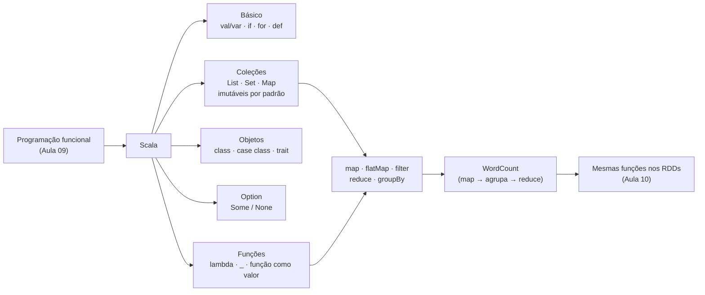
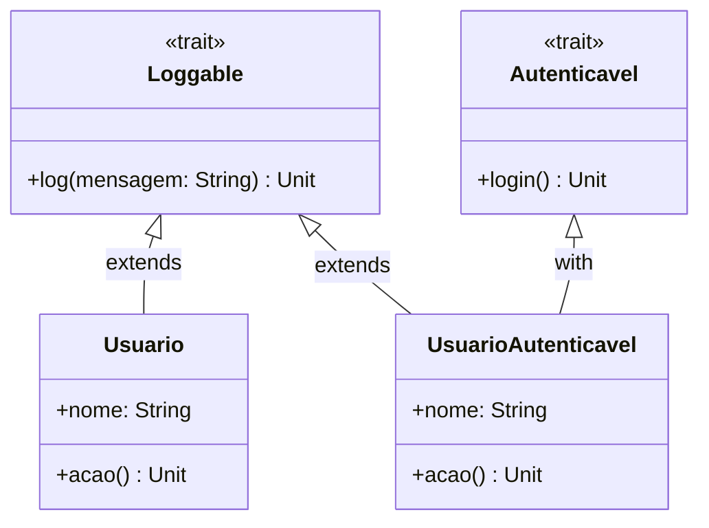
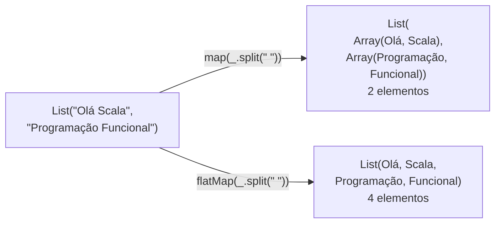
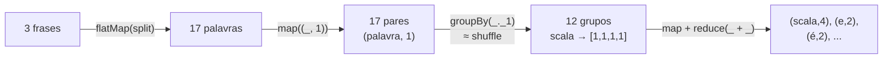

# Aula 09b — Programação em Scala

> **Computação Escalável (2COP022)** · Profa. Larissa C. Shimomura · Aula de **21/10** (mesma semana da Aula 9)
> **Tópicos:** estrutura de um programa Scala, `val` × `var`, `if` como expressão, `for` (`to`/`until`/filtro), `def`, lambdas e o atalho `_`, `class`, `case class`, `trait`, `Option` (adeus `null`), coleções imutáveis × mutáveis (`List`, `Set`, `Map`, `ListBuffer`), funções de ordem superior (`map`, `flatMap`, `filter`, `reduce`, `groupBy`), WordCount com coleções, 4 exercícios da aula
> **Pré-requisitos:** [Aula 09](09_nosql_cap_spark_rdd.md), Bloco B (programação funcional: imutabilidade, lambdas, funções puras, funções de ordem superior)
> **Base de código:** slides + notebook da professora `fontes/códigos/ExemploExecutorService/CodigosScala.ipynb`
> **Tempo estimado de estudo:** 2 h

> **Como usar este arquivo:** a prova não pede para escrever Scala do zero, e sim para **ler** código: dizer o que imprime, onde usar cada função, e se está correto. Por isso cada trecho vem com **o que faz** e **o que sai**. Os conceitos de programação funcional (o "porquê") estão na [Aula 09, Bloco B](09_nosql_cap_spark_rdd.md#bloco-b--programação-funcional); aqui o foco é a **sintaxe** (o "como").

> **[P2] O que a Larissa disse na revisão** ([orientações completas](12b_orientacoes_prova2.md))
> - "Introdução a programação funcional com Scala" está na **lista de tópicos** da prova.
> - **Não vai pedir para programar**: o foco é entender os conceitos e **ler** código (map, flatMap, reduce, imutabilidade).
> - Esta parte não chegou a ser revisada em aula (a revisão parou antes); os exercícios de Spark ficaram para a aula extra.

---

## Sumário

1. [Mapa da aula](#mapa-da-aula)
2. [Scala em uma página](#1-scala-em-uma-página)
3. [Estrutura de um programa](#2-estrutura-de-um-programa)
4. [Variáveis: `val` × `var`](#3-variáveis-val--var)
5. [`if` e `for`](#4-if-e-for)
6. [Funções: `def` e lambdas](#5-funções-def-e-lambdas)
7. [Orientação a objetos: `class`, `case class`, `trait`](#6-orientação-a-objetos)
8. [`Option`: como o Scala evita o `null`](#7-option-como-o-scala-evita-o-null)
9. [Coleções](#8-coleções)
10. [Funções de ordem superior](#9-funções-de-ordem-superior)
11. [WordCount com coleções (o "MapReduce" do notebook)](#10-wordcount-com-coleções)
12. [Exercícios da aula resolvidos](#11-exercícios-da-aula-resolvidos-para-leitura)
13. [Quadro "onde usar"](#12-quadro-onde-usar)
14. [Treino de leitura](#13-treino-de-leitura)
15. [Erros comuns / o que cai em prova](#erros-comuns--o-que-cai-em-prova)
16. [Fontes](#fontes)
17. [Conclusão para revisão](#conclusão-para-revisão)

---

## Mapa da aula



> **O que observar:** tudo converge para as **funções de ordem superior sobre coleções**. É o ponto mais importante da aula, porque o Spark ([Aula 10](10_spark_pratica_sparksql.md)) usa **os mesmos nomes** (`map`, `flatMap`, `filter`, `reduce`…), só que sobre dados distribuídos.

---

## 1. Scala em uma página

| Característica | Detalhe (slides) |
|---|---|
| Origem | Criada em **2001** na **EPFL** (Lausanne, Suíça) pelo prof. **Martin Odersky** |
| Ideia principal | Unir **programação funcional** e **orientação a objetos**, mantendo a **interoperabilidade com bibliotecas Java** |
| Execução | Compilada para **bytecode da JVM**, executado pela máquina virtual Java |
| Comparação com Java | Bastante parecida, porém com **sintaxe menos verbosa** |
| Tipagem | **Estática** (o tipo é conhecido na compilação), mas com **inferência**: muitas vezes não é preciso escrever o tipo |

**Instalação (slide):** <https://www.scala-lang.org/download/>. Quem não conseguir instalar pode usar o **Scastie** (<https://scastie.scala-lang.org/>), que roda Scala no navegador.

---

## 2. Estrutura de um programa

```scala
object MeuPrograma {                          // object = singleton (uma única instância)
  def main(args: Array[String]): Unit = {      // ponto de entrada; Unit ≈ void
    val nome = "Scala"                         // val = variável imutável
    println(s"Olá, $nome!")                    // s"..." = interpolação de string
    val resultado = dobrar(5)
    println(resultado)
  }

  def dobrar(x: Int): Int = {                  // def = definição de função
    x * 2                                      // parâmetro Int, retorno Int
  }
}
```

**Saída:**
```text
Olá, Scala!
10
```

| Elemento | Significado | Equivalente em Java |
|---|---|---|
| `object` | **Singleton**: classe com uma única instância, criada automaticamente | Classe com membros `static` |
| `def` | Define uma função/método | Declaração de método |
| `Unit` | "Não retorna nada útil" | `void` |
| `args: Array[String]` | Nome **antes**, tipo **depois**, separados por `:` | `String[] args` |
| `Array[String]` | Genéricos com **colchetes** | `String[]` / `List<String>` |
| `s"Olá, $nome!"` | Interpolação: `$nome` (ou `${expr}`) vira o valor | `"Olá, " + nome + "!"` |
| Sem `;` | Ponto e vírgula é opcional | Obrigatório |

---

## 3. Variáveis: `val` × `var`

```scala
val idade = 20
// idade = 21          // ERRO de compilação: val não permite reatribuição

var pontuacao = 10
pontuacao = 15         // Correto: var permite reatribuição
```

| | `val` | `var` |
|---|---|---|
| Reatribuição | **Não** | Sim |
| Equivale em Java a | `final` | variável comum |
| Estilo funcional | **Preferido** | Evitar (estado mutável) |

**Tipo inferido ou explícito** (notebook):

```scala
val nome1 = "Alice"           // tipo inferido: String
val nome2: String = "Bob"     // tipo explícito (depois do nome, com ":")
val lista = List("A", "B", "C")   // List[String]
```

> **Pegadinha:** `val` impede **reatribuir a variável**, não necessariamente mudar o **objeto**. `val buffer = ListBuffer(1, 2)` seguido de `buffer += 3` **funciona**, porque o `ListBuffer` é mutável. A variável continua apontando para o mesmo objeto (ver [§8](#8-coleções)).

---

## 4. `if` e `for`

### `if` é uma expressão (devolve valor)

```scala
val hora = 14
val saudacao = if (hora < 12) {
  "Bom dia"
} else {
  "Boa tarde"
}
println(saudacao)    // Boa tarde
```

> Em Java, `if` é um **comando**; para devolver valor usa-se o ternário `cond ? a : b`. Em Scala, o próprio `if` **tem valor**: o da última expressão do ramo escolhido. Por isso dá para atribuí-lo a um `val`.

### `for` com `to`, `until` e filtro

```scala
for (i <- 1 to 5)    println(s"Número: $i")          // 1, 2, 3, 4, 5  (inclui o 5)
for (i <- 1 until 5) println(s"Até 5 (exclusivo): $i") // 1, 2, 3, 4    (exclui o 5)
for (i <- 1 to 10 if i % 2 == 0) println(s"Par: $i")   // 2, 4, 6, 8, 10 (com filtro/guarda)
```

| Forma | Intervalo | Equivalente em Java |
|---|---|---|
| `1 to 5` | 1, 2, 3, 4, **5** (fechado) | `for (int i = 1; i <= 5; i++)` |
| `1 until 5` | 1, 2, 3, 4 (aberto no fim) | `for (int i = 1; i < 5; i++)` |
| `if` dentro do `for` | Só executa o corpo quando a condição é verdadeira | `if` dentro do laço |

> **Dica:** `0 until vetor.length` é o jeito idiomático de percorrer índices (não passa do último).

---

## 5. Funções: `def` e lambdas

### `def` — sem `return`

```scala
def multiplicar(a: Int, b: Int) = a * b
println(multiplicar(4, 2))   // 8
```

- O valor devolvido é a **última expressão** do corpo; **não precisa de `return`**.
- O tipo de retorno pode ser **inferido** (aqui, `Int`). Escrevê-lo (`def multiplicar(a: Int, b: Int): Int = a * b`) é recomendável em funções públicas.
- Corpo de uma linha dispensa as chaves.

### Lambdas (funções anônimas)

```scala
// Lambda atribuída a um val, com tipo explícito
val duplicar: Int => Int = (x: Int) => x * 2
println(duplicar(5))     // 10

// Tipo inferido pelo compilador
val somarDois = (a: Int, b: Int) => a + b
println(somarDois(3, 4)) // 7

// Atalho com underscore: só quando o parâmetro aparece UMA vez
val dobro: Int => Int = _ * 2       // igual a x => x * 2
val cubo = (x: Int) => x * x * x
println(cubo(3))         // 27
println(dobro(2))        // 4
```

> **Atenção ao notebook:** lá a lambda `_ * 2` se chama **`quadrado`**, mas ela **dobra** (o comentário da célula já avisa: "ou `x => x * x`, ajustando a lógica"). `quadrado(2)` imprime 4 **por coincidência** (2·2 = 2²). Com `quadrado(3)` sairia **6**, não 9. Aqui ela foi renomeada para `dobro`.

**Regra do `_`:** cada `_` é um **parâmetro diferente**, na ordem em que aparecem.

| Escrita com `_` | Equivale a | Observação |
|---|---|---|
| `_ * 2` | `x => x * 2` | 1 parâmetro |
| `_ + _` | `(a, b) => a + b` | **2 parâmetros**: útil no `reduce` |
| `_ > 5` | `x => x > 5` | Bom para `filter` |
| `_._1` | `t => t._1` | Primeiro elemento de uma tupla |
| `x => x * x` | **não** dá para escrever com `_` | `_ * _` seria `(a, b) => a * b` |

### Tipos de função

`Int => Int` lê-se "**função que recebe `Int` e devolve `Int`**". `(Int, Int) => Int` recebe dois `Int`.

### "Tudo é um objeto": funções também

Funções em Scala são **objetos**, instâncias da trait `Function1` (1 parâmetro), `Function2` (2 parâmetros), etc., geradas automaticamente pelo compilador. Chamar `dobro(5)` é açúcar sintático para **`dobro.apply(5)`**.

```scala
// Como o slide mostra (ordem dos parâmetros de tipo: [R, A])
trait Function1[R, A] {
  def apply(x: A): R
}
```

> **Nota:** na biblioteca real, a declaração é **`trait Function1[-T1, +R]`**: o tipo da **entrada vem primeiro** e o da saída depois (é por isso que `Int => String` corresponde a `Function1[Int, String]`). O slide usa outra ordem de letras, mas a ideia é a mesma: existe um método **`apply`** que recebe a entrada e devolve a saída. O slide também observa que, ao estender ou modificar um método, é comum **sobrescrever o `apply`**.

---

## 6. Orientação a objetos

### `class` — muito menos verbosa que Java

```java
// Java
public class Person {
    public final String name;
    public final int age;
    Person(String name, int age) {
        this.name = name;
        this.age = age;
    }
}
```

```scala
// Scala: construtor e atributos na própria declaração
class Person(val name: String, val age: Int)
```

Com método (notebook):

```scala
class Aluno(val nome: String, var nota: Double) {   // nome: imutável; nota: mutável
  def status(): String = {
    if (nota >= 6.0) "Aprovado" else "Reprovado"     // if como expressão = retorno
  }
}

val aluno1 = new Aluno("Bob", 7.5)                   // class precisa de "new"
println(s"${aluno1.nome} está ${aluno1.status()}")   // Bob está Aprovado
```

| Parâmetro do construtor | Vira | Pode alterar? |
|---|---|---|
| `val nome: String` | Atributo público, só leitura | Não |
| `var nota: Double` | Atributo público, leitura e escrita | Sim (`aluno1.nota = 5.0`) |
| `nome: String` (sem `val`/`var`) | Só parâmetro do construtor, **não** é atributo acessível de fora | — |

### `case class` — a classe "de dados" da programação funcional

```scala
case class Professor(nome: String, email: String)

val p = Professor("Larissa", "lshimomura@uel.br")   // sem "new"
println(p.nome)    // Larissa
println(p)         // Professor(Larissa,lshimomura@uel.br)
```

O que a `case class` dá de graça (notebook + documentação):

| Recurso | `class` | `case class` |
|---|---|---|
| Atributos | Precisa escrever `val`/`var` | **Todos `val` automaticamente** (imutáveis) |
| Instanciar | `new Aluno(...)` | `Professor(...)` (**sem `new`**) |
| `toString` legível | Não (`Aluno@2f65a84f`) | Sim (`Professor(Larissa,...)`) |
| Comparação `==` | Compara **referência** | Compara **conteúdo** (campo a campo) |
| Cópia alterando um campo | Manual | `p.copy(email = "novo@uel.br")` |
| *Pattern matching* | Não direto | Sim (`case Professor(n, e) => ...`) |

> **Quando usar:** `case class` para **representar registros de dados** (uma venda, um usuário, um pedido). É o que se usa nos exercícios e no Spark para dar tipo a cada linha (os **Datasets** da Aula 10). `class` comum para objetos com **comportamento e estado**.

### `trait` — parecido com `interface` do Java

```java
// Java
interface Animal { String som(); }
class Cachorro implements Animal {
    public String som() { return "Au au"; }
}
```

```scala
// Scala
trait Animal { def som(): String }
class Cachorro extends Animal {
  def som(): String = "Au au"
}
```

Uma `trait` pode ter **métodos já implementados**, e uma classe pode **misturar várias** com `extends … with …` (notebook):

```scala
trait Loggable {
  def log(mensagem: String): Unit = println(s"[LOG]: $mensagem")
}
trait Autenticavel {
  def login(): Unit = println("Usuário autenticado com sucesso!")
}

class Usuario(val nome: String) extends Loggable {
  def acao(): Unit = log(s"O usuário $nome realizou uma operação.")
}
class UsuarioAutenticavel(val nome: String) extends Loggable with Autenticavel {
  def acao(): Unit = log(s"O usuário $nome autenticado realizou uma operação.")
}

val user = new Usuario("Ana")
user.acao()                   // [LOG]: O usuário Ana realizou uma operação.
val user2 = new UsuarioAutenticavel("Alice")
user2.login()                 // Usuário autenticado com sucesso!
user2.acao()                  // [LOG]: O usuário Alice autenticado realizou uma operação.
```



> **O que observar:** `Usuario` herda só o `log`; `UsuarioAutenticavel` herda `log` **e** `login`. A primeira trait vem depois de `extends`, as demais depois de `with`.

---

## 7. `Option`: como o Scala evita o `null`

Em Java, um valor ausente costuma ser `null`, e esquecer de testar gera `NullPointerException`. Em Scala, a ideia é **banir o `null`** e usar o tipo **`Option[T]`**, que deixa **explícito** que o valor pode não existir:

| Valor | Significa |
|---|---|
| `Some(valor)` | Existe, e é `valor` |
| `None` | Não existe |

```scala
val usuarios = Map(1 -> "Alice", 2 -> "Bob")

val resultado1 = usuarios.get(1)    // Some(Alice)  — get de Map devolve Option[String]
val resultado2 = usuarios.get(99)   // None

println(resultado1)        // Some(Alice)
println(resultado1.get)    // Alice
println(resultado2)        // None
```

**Formas de "abrir" um `Option`:**

```scala
// 1. Pattern matching (notebook): trata os dois casos explicitamente
usuarios.get(2) match {
  case Some(nome) => println(s"Encontrado: $nome")     // Encontrado: Bob
  case None       => println("Usuário não encontrado!")
}

// 2. getOrElse: valor padrão se for None
usuarios.get(99).getOrElse("desconhecido")             // "desconhecido"

// 3. .get: só se você TEM CERTEZA de que é Some
usuarios.get(99).get     // ERRO em execução: NoSuchElementException (None.get)
```

> **Regra:** `.get` num `Option` desfaz toda a proteção: é o equivalente a não testar o `null`. Prefira `match` ou `getOrElse`. O `match … case` é o ***pattern matching*** do Scala: parecido com um `switch`, mas capaz de "desmontar" valores (`Some(nome)` extrai o conteúdo para a variável `nome`).

---

## 8. Coleções

Scala tem coleções **mutáveis** e **imutáveis**. **Por padrão, as coleções são imutáveis** (pacote `scala.collection.immutable`): "alterar" uma coleção **cria outra**, e a original fica intacta.

### `List` (sequência ordenada, imutável)

```scala
val frutas = List("maçã", "banana", "laranja")

val novasFrutas = "morango" :: frutas      // INÍCIO com :: (cons)
// List(morango, maçã, banana, laranja)
val maisFrutas = "kiwi" +: frutas          // INÍCIO com +:
// List(kiwi, maçã, banana, laranja)
val frutasNoFim = frutas :+ "abacaxi"      // FIM com :+
// List(maçã, banana, laranja, abacaxi)
val combinada = List(1, 2) ++ List(3, 4)   // concatenação (++ ou :::)
// List(1, 2, 3, 4)

println(frutas)                            // List(maçã, banana, laranja) — NÃO mudou
```

> **Macete do `:`**: o lado do **dois-pontos fica do lado da coleção**. `elem +: lista` (coleção à direita → início); `lista :+ elem` (coleção à esquerda → fim).

### `Set` (sem repetição) e `Map` (chave → valor)

```scala
val numerosUnicos = Set(1, 2, 3)
val comNovoNumero = numerosUnicos + 4      // Set(1, 2, 3, 4)
val duplicado = comNovoNumero + 2          // Set(1, 2, 3, 4) — o 2 já existia: ignorado, sem erro

val idades = Map("Ana" -> 25, "Bruno" -> 30)          // "chave" -> valor
val novasIdades = idades + ("Carlos" -> 22)            // Map(Ana -> 25, Bruno -> 30, Carlos -> 22)
val idadesAtualizadas = novasIdades + ("Ana" -> 26)    // chave existente: valor ATUALIZADO
// Map(Ana -> 26, Bruno -> 30, Carlos -> 22)
```

### Coleção mutável: `ListBuffer`

```scala
import scala.collection.mutable.ListBuffer

val listaMutavel = ListBuffer(1, 2, 3)
listaMutavel += 4           // modifica a PRÓPRIA lista
listaMutavel.append(5)
println(listaMutavel)       // ListBuffer(1, 2, 3, 4, 5)
```

| | Imutável (`List`, `Set`, `Map`) | Mutável (`ListBuffer`, `mutable.Map`…) |
|---|---|---|
| Pacote | `scala.collection.immutable` (**padrão**) | `scala.collection.mutable` (precisa `import`) |
| "Adicionar" | Cria **nova** coleção (`:+`, `+`) | Altera a **mesma** (`+=`, `append`) |
| Seguro entre threads/partições | **Sim** (ninguém altera) | Não sem sincronização |
| Estilo | Funcional (recomendado) | Imperativo; usar localmente, quando necessário |

> **Ligação com a Aula 09:** a imutabilidade é o que permite a cada partição ser processada **sem disputa** pelo mesmo dado. Os RDDs do Spark são imutáveis pelo mesmo motivo.

---

## 9. Funções de ordem superior

São o centro da aula. Todas **recebem uma função** e **devolvem uma coleção nova** (ou um valor), sem alterar a original.

| Função | Recebe | Faz | Entra → sai (exemplo) |
|---|---|---|---|
| `map(f)` | `A => B` | Aplica `f` a **cada** elemento | `List(1,2,3,4)` → `List(10,20,30,40)` com `n => n * 10` |
| `flatMap(f)` | `A => coleção de B` | Aplica `f` e **achata** (tira um nível de aninhamento) | `List("Olá Scala", "Programação Funcional")` → `List(Olá, Scala, Programação, Funcional)` com `_.split(" ")` |
| `filter(p)` | `A => Boolean` | Mantém só os elementos com `p` verdadeiro | `1 to 10` → `List(2,4,6,8,10)` com `_ % 2 == 0` |
| `reduce(op)` | `(A, A) => A` | Combina tudo em **um valor**, dois a dois | `List(1,2,3,4,5)` → `15` com `_ + _` |
| `groupBy(k)` | `A => K` | Agrupa num `Map[K, List[A]]` pela chave `k` | palavras → `Map(m -> List(maçã, manga, melancia), b -> List(banana), p -> List(pera))` com `_.head` |
| `foreach(f)` | `A => Unit` | Executa `f` em cada elemento (efeito, ex.: imprimir) | — devolve `Unit` |
| `mapValues(f)` | `V => W` | Em um `Map`, transforma só os **valores** | `Map(a -> List(1,2))` → `Map(a -> 3)` com `_.sum` |

### `map` × `flatMap` — a diferença que mais cai

```scala
val frases = List("Olá Scala", "Programação Funcional")

val palavrasMap = frases.map(frase => frase.split(" "))
// List[Array[String]] = List(Array(Olá, Scala), Array(Programação, Funcional))   ← lista DE arrays

val palavras = frases.flatMap(frase => frase.split(" "))
// List[String] = List(Olá, Scala, Programação, Funcional)                         ← lista achatada
```



> **O que observar:** o `split` devolve um **array por frase**. O `map` mantém essa estrutura (uma lista de arrays, com o mesmo nº de elementos da entrada). O `flatMap` "desembrulha" os arrays numa lista só.
>
> **Correção de um comentário do notebook:** a célula diz que o `.map` "quebraria a frase em lista de **caracteres**". Não é isso: ele gera uma lista de **arrays de palavras**. O `println(palavrasMap)` mostra `List([Ljava.lang.String;@161cdac1, ...)` porque arrays Java **não têm `toString` legível**: aquilo é o endereço do array, não caracteres.

### `reduce` passo a passo

```scala
val numeros = List(1, 2, 3, 4, 5)
val somaTotal = numeros.reduce((acumulador, elemento) => acumulador + elemento)   // ou reduce(_ + _)
// ((((1 + 2) + 3) + 4) + 5) = 15
```

| Passo | acumulador | elemento | resultado |
|---|---|---|---|
| 1 | 1 | 2 | 3 |
| 2 | 3 | 3 | 6 |
| 3 | 6 | 4 | 10 |
| 4 | 10 | 5 | **15** |

> **Cuidado:** `reduce` em **lista vazia** lança exceção (`UnsupportedOperationException`): não há primeiro elemento. Em sistemas distribuídos (Spark), a operação deve ser **associativa e comutativa** (soma, máximo), pois cada partição reduz a sua parte e depois os resultados parciais são combinados em ordem imprevisível.

### `filter` e `groupBy`

```scala
val numeros = List(1, 2, 3, 4, 5, 6, 7, 8, 9, 10)
numeros.filter(n => n % 2 == 0)        // List(2, 4, 6, 8, 10)
numeros.filter(_ > 5)                  // List(6, 7, 8, 9, 10)
List("Ana", "Bruno", "Amanda", "Carlos", "Alice").filter(_.startsWith("A"))
                                       // List(Ana, Amanda, Alice)

val palavras = List("maçã", "banana", "manga", "pera", "melancia")
palavras.groupBy(p => p.head)          // p.head = primeiro caractere
// Map(m -> List(maçã, manga, melancia), b -> List(banana), p -> List(pera))
```

> A **ordem das chaves** num `Map` vindo de `groupBy` **não é garantida** (o notebook imprimiu `m, b, p`). Se a ordem importa, ordene depois (ex.: `.toList.sortBy(_._1)`).

---

## 10. WordCount com coleções

O notebook implementa o WordCount da [Aula 08](08_forkjoin_bigdata_hadoop.md#b4-mapreduce) **em memória**, com coleções Scala, imitando as fases do MapReduce.

```scala
val linhas = List(
  "scala é maravilhoso e scala é rápido",
  "programação funcional com scala",
  "big data e scala combinam perfeitamente"
)

// --- FASE 1: MAP ---
val mapiado = linhas
  .flatMap(linha => linha.split(" "))   // todas as palavras numa lista só
  .map(palavra => (palavra, 1))          // cada palavra vira o par (palavra, 1)
// List((scala,1), (é,1), (maravilhoso,1), (e,1), (scala,1), ...)

// --- FASE 2: AGRUPAMENTO (o "shuffle") ---
val agrupado = mapiado.groupBy(_._1)     // agrupa pela chave = 1º elemento do par
// Map(scala -> List((scala,1), (scala,1), (scala,1), (scala,1)), e -> List((e,1), (e,1)), ...)

// --- FASE 3: REDUCE ---
val reduzido = agrupado.map { case (palavra, listaPares) =>
  val apenasOsValores = listaPares.map(par => par._2)   // List(1, 1, 1, 1)
  val total = apenasOsValores.reduce(_ + _)             // 4
  (palavra, total)
}
reduzido.foreach(println)
// (scala,4) (e,2) (é,2) (programação,1) (maravilhoso,1) ... — ordem não garantida
```



**Elementos novos de sintaxe nesse trecho:**

| Sintaxe | Significa |
|---|---|
| `(palavra, 1)` | **Tupla** de 2 elementos |
| `par._1`, `par._2` | 1º e 2º elementos da tupla (começa em **1**, não 0) |
| `groupBy(_._1)` | Agrupar pela chave da tupla |
| `.map { case (palavra, listaPares) => ... }` | Lambda com ***pattern matching***: "desmonta" cada par `(chave, valor)` do `Map` em duas variáveis com nome |
| Encadear `.flatMap(...).map(...)` | Cada chamada devolve uma coleção nova, à qual se aplica a próxima |

> **Ligação com o MapReduce e com o Spark:** a FASE 1 é o **map** (gera pares chave-valor), o `groupBy` faz o papel do **shuffle** (reúne valores da mesma chave), e a FASE 3 é o **reduce**. No Spark ([Aula 10](10_spark_pratica_sparksql.md)), as fases 2 e 3 viram uma chamada só: `.reduceByKey(_ + _)`.
>
> **Versão curta equivalente** (para reconhecer na prova): `linhas.flatMap(_.split(" ")).groupBy(identity).map { case (p, ocorrencias) => (p, ocorrencias.size) }`.

---

## 11. Exercícios da aula resolvidos (para leitura)

> Os enunciados são os dos slides. As soluções usam só o que foi visto na aula. Leia procurando **qual função de ordem superior resolve cada parte**. Na [Aula 10](10_spark_pratica_sparksql.md) os mesmos exercícios são refeitos em Spark.

### Exercício 1 — Filtrar logs de erro

> *Lista de logs em string, cada uma com nível e mensagem separados por espaço. Filtre os que começam com `ERROR`, extraia a mensagem (sem a palavra `ERROR`) e imprima a lista final.*

```scala
val logs = List("INFO Conexão estabelecida", "ERROR Falha de leitura", "INFO Dados carregados")

val mensagensDeErro = logs
  .filter(log => log.startsWith("ERROR"))     // 1. só as linhas de erro
  .map(log => log.stripPrefix("ERROR "))      // 2. tira o prefixo "ERROR "

println(mensagensDeErro)                      // List(Falha de leitura)
```

| Etapa | Função | Por quê |
|---|---|---|
| Selecionar linhas | `filter` + `startsWith` | Mantém só o que satisfaz a condição |
| Extrair mensagem | `map` + `stripPrefix` | Transforma cada linha mantida |

> **Alternativa:** `.map(log => log.split(" ", 2)(1))`. O `2` limita o `split` a **2 pedaços** (nível e o resto). Sem ele, `"ERROR Falha de leitura".split(" ")(1)` devolveria só `"Falha"`.

### Exercício 2 — Faturamento por categoria

> *`case class Venda(id, categoria, valor, regiao)`; lista com ≥ 6 vendas; com `groupBy`, `mapValues` etc., calcule o faturamento total por categoria e retorne um mapa ordenado do menor para o maior.*

```scala
case class Venda(id: Int, categoria: String, valor: Double, regiao: String)

val vendas = List(
  Venda(1, "Eletrônicos", 1200.0, "Sul"),
  Venda(2, "Livros",        80.0, "Sudeste"),
  Venda(3, "Eletrônicos",  300.0, "Norte"),
  Venda(4, "Roupas",       150.0, "Sul"),
  Venda(5, "Livros",        45.0, "Nordeste"),
  Venda(6, "Roupas",       220.0, "Sudeste")
)

val faturamento = vendas
  .groupBy(v => v.categoria)                   // Map[String, List[Venda]]
  .mapValues(lista => lista.map(_.valor).sum)  // Map[String, Double]: soma por categoria
  .toList                                      // List[(String, Double)], para poder ordenar
  .sortBy { case (_, total) => total }         // crescente pelo total

val ordenado = scala.collection.immutable.ListMap(faturamento: _*)   // Map que preserva a ordem
println(ordenado)
// ListMap(Livros -> 125.0, Roupas -> 370.0, Eletrônicos -> 1500.0)
```

| Etapa | Resultado intermediário |
|---|---|
| `groupBy(_.categoria)` | `Eletrônicos -> List(Venda 1, Venda 3)`, `Livros -> List(Venda 2, Venda 5)`, `Roupas -> List(Venda 4, Venda 6)` |
| `mapValues(_.map(_.valor).sum)` | `Eletrônicos -> 1500.0`, `Livros -> 125.0`, `Roupas -> 370.0` |
| `toList.sortBy(total)` | `List((Livros,125.0), (Roupas,370.0), (Eletrônicos,1500.0))` |
| `ListMap(...)` | Um `Map` que **mantém** essa ordem |

> **Por que `toList` e `ListMap`?** Um `Map` comum **não tem ordem garantida**, então não adianta "ordenar um Map". Converte-se para lista de pares, ordena-se a lista e, se for preciso devolver um `Map`, usa-se `ListMap` (que preserva a ordem de inserção). O `: _*` "espalha" a lista como argumentos.
>
> **Versões do Scala:** `mapValues` funciona no 2.12 (versão do projeto da professora); no 2.13 ele foi **depreciado** e se escreve `.view.mapValues(...).toMap`, ou `.map { case (cat, lista) => (cat, lista.map(_.valor).sum) }`, que funciona em ambas.

### Exercício 3 — Limpeza de dados

> *`dadosBrutos = List("1,Alice,30", "2,Bob,idade_invalida", "corrompido_sem_virgula", "3,Charlie,25", "", "4,Diana,22")`. Crie uma classe só com usuários válidos e limpe a lista, imprimindo só os registros válidos.*

```scala
import scala.util.Try

case class Usuario(id: Int, nome: String, idade: Int)

def parseUsuario(linha: String): Option[Usuario] =
  linha.split(",") match {
    case Array(id, nome, idade) =>                   // exatamente 3 campos
      Try(Usuario(id.toInt, nome, idade.toInt)).toOption   // falha na conversão → None
    case _ => None                                   // vazio, sem vírgula, campos a mais/menos
  }

val dadosBrutos = List("1,Alice,30", "2,Bob,idade_invalida", "corrompido_sem_virgula",
                       "3,Charlie,25", "", "4,Diana,22")

val validos = dadosBrutos.flatMap(linha => parseUsuario(linha))   // flatMap descarta os None
validos.foreach(println)
// Usuario(1,Alice,30)
// Usuario(3,Charlie,25)
// Usuario(4,Diana,22)
```

**O que acontece com cada linha:**

| Linha | `split(",")` | Caso | Resultado |
|---|---|---|---|
| `"1,Alice,30"` | 3 campos | `Array(id, nome, idade)`, conversões OK | `Some(Usuario(1,Alice,30))` |
| `"2,Bob,idade_invalida"` | 3 campos | `"idade_invalida".toInt` lança exceção → `Try` captura | `None` |
| `"corrompido_sem_virgula"` | 1 campo | `case _` | `None` |
| `"3,Charlie,25"` | 3 campos | OK | `Some(Usuario(3,Charlie,25))` |
| `""` | 1 campo (`Array("")`) | `case _` | `None` |
| `"4,Diana,22"` | 3 campos | OK | `Some(Usuario(4,Diana,22))` |

> **Truque central:** `flatMap` com uma função que devolve `Option`. Um `Option` se comporta como uma coleção de **0 ou 1 elemento**: `Some(u)` contribui com `u`, `None` não contribui com nada. Assim, **filtrar e converter** acontecem numa só passada, sem `null` e sem `if`.
>
> `Try(...)` executa a expressão e devolve `Success(valor)` ou `Failure(exceção)`; `.toOption` converte em `Some`/`None`. (No Scala 2.13 existe também `"30".toIntOption`.)

### Exercício 4 — Cruzar clientes e pedidos

> *Listas `Cliente(ID, nome)` e `Pedido(ID_cliente, valor, produto)`. Cruze pelo ID e gere `(NomeDoCliente, ValorDoPedido)`. Cliente sem pedido fica de fora; pedido sem cliente também.*

```scala
case class Cliente(id: Int, nome: String)
case class Pedido(idCliente: Int, valor: Double, produto: String)
case class ResultadoPedido(nomeCliente: String, valor: Double)

val clientes = List(Cliente(1, "Ana"), Cliente(2, "Bruno"), Cliente(3, "Carla"))
val pedidos  = List(Pedido(1, 250.0, "Teclado"), Pedido(2, 99.9, "Mouse"),
                    Pedido(1, 40.0, "Cabo"),     Pedido(9, 500.0, "Monitor"))

// Versão A — dois laços aninhados (for com filtro)
def cruzarA(cs: List[Cliente], ps: List[Pedido]): List[ResultadoPedido] =
  for {
    p <- ps
    c <- cs
    if c.id == p.idCliente
  } yield ResultadoPedido(c.nome, p.valor)

// Versão B — índice em Map (procura por chave)
def cruzarB(cs: List[Cliente], ps: List[Pedido]): List[ResultadoPedido] = {
  val nomePorId: Map[Int, String] = cs.map(c => c.id -> c.nome).toMap
  ps.flatMap(p => nomePorId.get(p.idCliente).map(nome => ResultadoPedido(nome, p.valor)))
}

cruzarA(clientes, pedidos).foreach(println)
// ResultadoPedido(Ana,250.0)
// ResultadoPedido(Bruno,99.9)
// ResultadoPedido(Ana,40.0)
```

- **Carla** (cliente sem pedido) não aparece; o pedido do cliente **9** (sem cliente) também não. É exatamente a semântica de um **INNER JOIN** de SQL.
- `for { ... } yield ...` é uma ***for-comprehension***: com `yield`, o `for` **devolve uma coleção** (por baixo, o compilador o traduz em `flatMap`/`map`/`filter`).
- Na versão B, `nomePorId.get(...)` devolve `Option`; `.map` só age se for `Some`, e o `flatMap` descarta os `None` (mesmo truque do exercício 3).

> **Ponte com a [Aula 11](11_processamento_otimizacao_consultas.md):** a versão A compara **todo pedido com todo cliente** (|pedidos| × |clientes| comparações): é o algoritmo ***nested loops join***. A versão B monta uma tabela de busca por chave com uma das relações e depois percorre a outra (|clientes| + |pedidos|): é a ideia do ***hash join***. Mesmo resultado, custos muito diferentes para listas grandes.

---

## 12. Quadro "onde usar"

| Situação | Use | Não use / cuidado |
|---|---|---|
| Valor que não muda | `val` | `var` sem necessidade |
| Escolher um valor por condição | `val x = if (...) a else b` | Declarar `var` e atribuir dentro do `if` |
| Laço de 0 a n−1 | `0 until n` | `0 to n` (passa do fim) |
| Transformar cada elemento (1 → 1) | `map` | `foreach` + lista mutável |
| Cada elemento vira **vários** (1 → N) ou pode sumir (1 → 0/1) | `flatMap` | `map` (gera lista de listas / de `Option`) |
| Manter só alguns elementos | `filter` | — |
| Juntar tudo num valor | `reduce` (lista não vazia) | `reduce` em lista possivelmente vazia |
| Agrupar por uma chave | `groupBy` | — (lembre: ordem do `Map` não é garantida) |
| Transformar só os valores de um `Map` | `mapValues` (2.12) / `.map { case (k, v) => (k, f(v)) }` | — |
| Efeito colateral (imprimir) | `foreach` | `map` (devolveria uma lista de `Unit`) |
| Registro de dados | `case class` | `class` com `toString`/`equals` manuais |
| Comportamento compartilhado entre classes | `trait` (`extends A with B`) | — |
| Valor que pode faltar | `Option` + `match` / `getOrElse` | `null`; `.get` sem certeza |
| Conversão que pode falhar | `Try(...).toOption` | Deixar a exceção derrubar o programa |
| Precisa mutar uma coleção localmente | `ListBuffer` (`+=`, `append`) | Expor coleção mutável para outras partes do código |

---

## 13. Treino de leitura

**Q1 — O que imprime?**

```scala
val xs = List(3, 1, 4, 1, 5, 9, 2, 6)
val r = xs.filter(_ % 2 == 1).map(_ * 10).reduce(_ + _)
println(r)
```

<details><summary><b>Gabarito Q1</b></summary>

`filter(_ % 2 == 1)` mantém os ímpares: `List(3, 1, 1, 5, 9)`. `map(_ * 10)`: `List(30, 10, 10, 50, 90)`. `reduce(_ + _)`: **190**.
</details>

**Q2 — `map` ou `flatMap`?** Qual é o tipo e o conteúdo de `a` e de `b`?

```scala
val frases = List("a b", "c")
val a = frases.map(_.split(" ").toList)
val b = frases.flatMap(_.split(" "))
```

<details><summary><b>Gabarito Q2</b></summary>

- `a: List[List[String]] = List(List(a, b), List(c))` — 2 elementos (uma lista por frase).
- `b: List[String] = List(a, b, c)` — 3 elementos (achatado).
</details>

**Q3 — Este código está correto?**

```scala
val total = 0
for (x <- List(1, 2, 3)) {
  total = total + x
}
println(total)
```

<details><summary><b>Gabarito Q3</b></summary>

**Não compila**: `total` é `val`, e não pode ser reatribuído (`reassignment to val`). Trocar por `var` resolveria, mas o jeito funcional é **não ter estado**: `val total = List(1, 2, 3).sum` (ou `.reduce(_ + _)`) → `6`.
</details>

**Q4 — Este código está correto?** A intenção é elevar cada número ao quadrado.

```scala
val quadrado: Int => Int = _ * _
println(List(1, 2, 3).map(quadrado))
```

<details><summary><b>Gabarito Q4</b></summary>

**Não compila.** Cada `_` é um parâmetro **diferente**: `_ * _` significa `(a, b) => a * b`, uma função de **dois** parâmetros, incompatível com o tipo `Int => Int`. Como o parâmetro aparece duas vezes, é preciso nomeá-lo: `val quadrado: Int => Int = x => x * x` → `List(1, 4, 9)`.
</details>

**Q5 — O que acontece?**

```scala
val m = Map("a" -> 1)
println(m.get("a"))
println(m.get("b").getOrElse(0))
println(m.get("b").get)
```

<details><summary><b>Gabarito Q5</b></summary>

Linha 2: `Some(1)`. Linha 3: `0` (valor padrão). Linha 4: **erro em execução**, `NoSuchElementException: None.get`: chamou `.get` num `None`. É o equivalente ao `NullPointerException` que o `Option` deveria evitar.
</details>

**Q6 — `class` ou `case class`?** O que imprime cada linha?

```scala
class P1(val nome: String)
case class P2(nome: String)

println(new P1("Ana") == new P1("Ana"))
println(P2("Ana") == P2("Ana"))
println(P2("Ana"))
```

<details><summary><b>Gabarito Q6</b></summary>

- `false`: em `class`, `==` compara **referências** (são dois objetos diferentes).
- `true`: em `case class`, `==` compara o **conteúdo** campo a campo.
- `P2(Ana)`: `toString` legível gerado automaticamente.
</details>

**Q7 — Este código está correto?** A intenção é somar os valores de uma lista que pode vir vazia de um filtro.

```scala
val valores = List(5, 8, 2).filter(_ > 10)
println(valores.reduce(_ + _))
```

<details><summary><b>Gabarito Q7</b></summary>

**Compila, mas falha em execução**: nenhum valor é > 10, a lista fica **vazia**, e `reduce` em lista vazia lança `UnsupportedOperationException` (não há elemento inicial). Correções: `valores.sum` (que dá 0 para lista vazia) ou `valores.foldLeft(0)(_ + _)`, que recebe um **valor inicial**.
</details>

**Q8 — `to` ou `until`?** Quantas vezes cada laço imprime?

```scala
val v = Array(10, 20, 30)
for (i <- 0 to v.length)    println(v(i))
for (i <- 0 until v.length) println(v(i))
```

<details><summary><b>Gabarito Q8</b></summary>

- O primeiro percorre `0, 1, 2, 3`: imprime 10, 20, 30 e, em `i = 3`, lança **`ArrayIndexOutOfBoundsException`** (o array só tem índices 0–2).
- O segundo percorre `0, 1, 2`: imprime 10, 20, 30, corretamente.

(Observe também: em Scala, acessa-se o array com **parênteses**, `v(i)`, e não colchetes.)
</details>

**Q9 — Interprete o WordCount.** Para `linhas = List("a b a", "b a")`, mostre `mapiado`, `agrupado` e `reduzido` do [§10](#10-wordcount-com-coleções).

<details><summary><b>Gabarito Q9</b></summary>

- `mapiado = List((a,1), (b,1), (a,1), (b,1), (a,1))`
- `agrupado = Map(a -> List((a,1), (a,1), (a,1)), b -> List((b,1), (b,1)))`
- `reduzido = Map(a -> 3, b -> 2)` (ordem das chaves não garantida)
</details>

**Q10 — Onde usar?** Para cada necessidade, qual função? (a) transformar `List[Venda]` em `List[Double]` com os valores; (b) obter só as vendas acima de 100; (c) total de todas as vendas; (d) vendas separadas por região; (e) a partir de `List[String]` de linhas de CSV, obter `List[Usuario]` descartando as inválidas.

<details><summary><b>Gabarito Q10</b></summary>

(a) `map(_.valor)`; (b) `filter(_.valor > 100)`; (c) `map(_.valor).sum` (ou `.reduce(_ + _)` se não puder ser vazia); (d) `groupBy(_.regiao)`; (e) `flatMap` com uma função que devolve `Option[Usuario]` (exercício 3).
</details>

---

## Erros comuns / o que cai em prova

1. **`val` não pode ser reatribuído** (erro de compilação). Mas um `val` pode apontar para uma coleção **mutável** que muda por dentro.
2. **`map` × `flatMap`:** `map` preserva a estrutura (1 → 1); `flatMap` achata (1 → N). `map(_.split(" "))` dá **lista de arrays**.
3. **Cada `_` é um parâmetro novo:** `_ + _` tem 2 parâmetros. `x => x * x` **não** se escreve com `_`.
4. **`reduce` em coleção vazia lança exceção**; use `sum` ou `foldLeft` com valor inicial.
5. **`.get` em `None`** lança `NoSuchElementException`. Use `match` ou `getOrElse`.
6. **`1 to n` inclui n; `1 until n` não inclui.**
7. **`case class`:** atributos `val`, sem `new`, `==` por conteúdo, `toString` legível. `class`: `==` por referência.
8. **Coleções são imutáveis por padrão:** `:+`, `+:`, `+` criam **nova** coleção; a original fica igual.
9. **`Map` não tem ordem garantida** (nem o resultado do `groupBy`). Para ordenar: `toList.sortBy(...)` e, se precisar, `ListMap`.
10. **Retorno de função = última expressão**; não precisa de `return`. `if` também devolve valor.
11. **Tuplas começam em `_1`**, não em `_0`. Arrays e listas começam no índice **0**, acessados com `()`.
12. **`trait` × `interface`:** uma trait pode ter métodos implementados; uma classe pode ter várias (`extends A with B`).

---

## Fontes

- **Slides da aula:** Shimomura, L. C. *Programação em Scala — Computação Escalável (21/10)*. Os slides 1–18 repetem a parte funcional da Aula 9; novos: instalação e exercícios 1–4.
- **Notebook da professora:** `fontes/códigos/ExemploExecutorService/CodigosScala.ipynb` (todos os trechos das §2–§10, com as saídas registradas no próprio notebook).
- **Documentação oficial Scala:**
  - *Tour of Scala* (classes, traits, case classes, pattern matching, funções de ordem superior): <https://docs.scala-lang.org/tour/tour-of-scala.html>
  - *Scala Book* — coleções e seus métodos: <https://docs.scala-lang.org/scala3/book/collections-methods.html>
  - `Option`: <https://www.scala-lang.org/api/2.12.18/scala/Option.html>
  - `Function1` (declaração `Function1[-T1, +R]`): <https://www.scala-lang.org/api/2.12.18/scala/Function1.html>
- **Ferramentas citadas no slide:** download <https://www.scala-lang.org/download/>; Scastie <https://scastie.scala-lang.org/>.

---

## Conclusão para revisão

### Resumo em 10 pontos

1. **Scala** (Odersky, EPFL, 2001) une funcional e orientação a objetos, roda na **JVM** e usa bibliotecas Java, com sintaxe mais enxuta.
2. Programa: **`object`** (singleton) com **`def main(args: Array[String]): Unit`**; `Unit` ≈ `void`; interpolação `s"...$x"`; tipo **depois** do nome (`x: Int`).
3. **`val`** (imutável, preferido) × **`var`** (reatribuível). Tipagem estática com inferência.
4. **`if` é expressão** (devolve valor); `for` com **`to`** (inclui o fim), **`until`** (exclui) e filtro `if`.
5. **`def`** devolve a **última expressão**; **lambdas** `x => ...`; **`_`** = um parâmetro por ocorrência; funções são objetos (`apply`).
6. **`class`** (construtor na declaração), **`case class`** (dados imutáveis, sem `new`, `==` por conteúdo), **`trait`** (como interface, mas com métodos prontos; `extends A with B`).
7. **`Option`** = `Some(v)` ou `None`, no lugar de `null`; abrir com **`match`** ou **`getOrElse`**, não com `.get`.
8. **Coleções imutáveis por padrão** (`List`, `Set`, `Map`): `:+`, `+:`, `::`, `++`, `+` criam coleções novas. Mutáveis em `scala.collection.mutable` (`ListBuffer`).
9. **Ordem superior:** `map` (1→1), **`flatMap` (1→N, achata)**, `filter`, `reduce` (não vazio; associativo), `groupBy` (→ `Map`), `mapValues`, `foreach` (efeito).
10. **WordCount:** `flatMap(split)` → `map((_, 1))` → `groupBy(_._1)` (≈ shuffle) → somar por chave (≈ reduce). No Spark, as duas últimas viram `reduceByKey(_ + _)`.

### Tabela de conceitos-chave

| Termo | Definição em uma linha | Quando usar / lembrar |
|---|---|---|
| `object` | Singleton | Ponto de entrada (`main`), utilitários |
| `val` / `var` | Imutável / reatribuível | `val` por padrão |
| `Unit` | Tipo "sem valor útil" | ≈ `void` |
| `s"..."` | Interpolação de string | `s"Olá, $nome"` |
| `to` / `until` | Intervalo fechado / aberto no fim | Índices: `until` |
| Lambda | Função anônima `x => ...` | Argumento de `map`, `filter`… |
| `_` | Atalho de parâmetro (1 por ocorrência) | `_ * 2`, `_ + _` |
| `case class` | Classe de dados imutável | Registros (Venda, Usuario) |
| `trait` | Interface com métodos possivelmente prontos | Reuso: `extends A with B` |
| `Option` | `Some(v)` / `None` | Valor que pode faltar |
| Pattern matching | `x match { case ... => ... }` | Desmontar `Option`, tuplas, arrays |
| Tupla | `(a, b)`, campos `_1`, `_2` | Pares chave-valor |
| `map` / `flatMap` | Transforma 1→1 / 1→N achatando | `flatMap` para `split` e `Option` |
| `filter` | Mantém os que satisfazem o predicado | Seleção |
| `reduce` | Combina tudo em um valor | Lista não vazia |
| `groupBy` | Agrupa em `Map[chave, List]` | Agregações por chave |
| `ListBuffer` | Lista mutável | Uso local |
| `Try` | `Success` / `Failure` | Conversões que podem falhar |
| for-comprehension | `for {...} yield` devolve coleção | Laços aninhados com filtro |

### Perguntas de autoavaliação

<details><summary><b>1. Qual a diferença entre <code>val</code> e <code>var</code>, e por que o estilo funcional prefere <code>val</code>?</b></summary>

`val` não pode ser reatribuído; `var` pode. O estilo funcional prefere `val` porque **sem estado mutável** o código é mais fácil de entender e de paralelizar: nenhuma tarefa altera um valor que outra está lendo.
</details>

<details><summary><b>2. Explique a diferença entre <code>map</code> e <code>flatMap</code> com o exemplo das frases.</b></summary>

`frases.map(_.split(" "))` devolve uma **lista de arrays** (um array de palavras por frase; mesmo nº de elementos da entrada). `frases.flatMap(_.split(" "))` aplica o `split` e **achata** o resultado numa lista única de palavras.
</details>

<details><summary><b>3. Quais vantagens a <code>case class</code> tem sobre a <code>class</code> comum?</b></summary>

Atributos `val` automaticamente (imutáveis), instanciação **sem `new`**, `toString` legível, `==` por **conteúdo**, método `copy`, e suporte a **pattern matching**. Ideal para representar registros de dados.
</details>

<details><summary><b>4. Por que o Scala usa <code>Option</code> em vez de <code>null</code>? Como se extrai o valor com segurança?</b></summary>

`Option` torna **explícito no tipo** que o valor pode faltar, forçando o programador a tratar o caso `None` e evitando `NullPointerException`. Extração segura: `match { case Some(v) => ...; case None => ... }` ou `getOrElse(padrão)`. `.get` não é seguro.
</details>

<details><summary><b>5. Como as fases do WordCount com coleções correspondem às do MapReduce?</b></summary>

`flatMap(split)` + `map((_, 1))` = fase **map** (gera pares chave-valor); `groupBy(_._1)` = **shuffle** (reúne os valores de cada chave); somar os valores de cada grupo = **reduce**.
</details>

<details><summary><b>6. No exercício 3, por que usar <code>flatMap</code> com uma função que devolve <code>Option</code>?</b></summary>

Porque `Option` se comporta como uma coleção de 0 ou 1 elemento: `flatMap` mantém o conteúdo dos `Some` e descarta os `None`. Assim, a **conversão** e o **filtro** das linhas inválidas acontecem numa única passada, sem `null` e sem `if`.
</details>

<details><summary><b>7. Por que <code>reduce</code> precisa de uma operação associativa quando usado no Spark?</b></summary>

Porque cada partição reduz a **sua parte** separadamente e depois os resultados parciais são combinados, em ordem que não é fixa. Só operações associativas (e comutativas), como soma e máximo, dão o mesmo resultado independentemente de como os elementos foram agrupados. Uma subtração, por exemplo, não dá.
</details>

### Checklist

**Sei explicar…**
- [ ] a estrutura de um programa Scala (`object`, `main`, `Unit`, `def`)
- [ ] `val` × `var`, `if` como expressão, `to` × `until`
- [ ] lambdas, o atalho `_` e funções como objetos (`apply`)
- [ ] `class` × `case class` × `trait`
- [ ] por que `Option` existe e como usar `match`/`getOrElse`
- [ ] coleções imutáveis × mutáveis e os operadores `:+`, `+:`, `::`, `++`, `+`
- [ ] `map`, `flatMap`, `filter`, `reduce`, `groupBy`, `mapValues`, `foreach`

**Sei ler e corrigir código com…**
- [ ] o WordCount com coleções, fase por fase
- [ ] os 4 exercícios da aula
- [ ] os bugs: reatribuir `val`, `map` no lugar de `flatMap`, `_ * _`, `reduce` em lista vazia, `.get` em `None`, `to` passando do fim do array

### Ligação com a próxima aula

A [Aula 10](10_spark_pratica_sparksql.md) leva essas funções para o **Spark**: `sc.parallelize(lista)` transforma uma coleção num **RDD**, sobre o qual `map`, `flatMap`, `filter` e `reduce` funcionam igual, mas **distribuídos** (e preguiçosos, como visto na [Aula 09](09_nosql_cap_spark_rdd.md#c5-lazy-evaluation)). O `groupBy` + `reduce` do WordCount vira `reduceByKey`, e as `case class` passam a dar tipo às linhas dos **Datasets**. A aula também apresenta os **DataFrames** e o **SparkSQL**, e o exercício é refazer os 4 exercícios desta aula em Spark.
