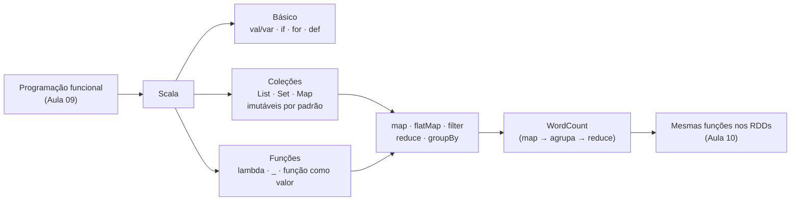
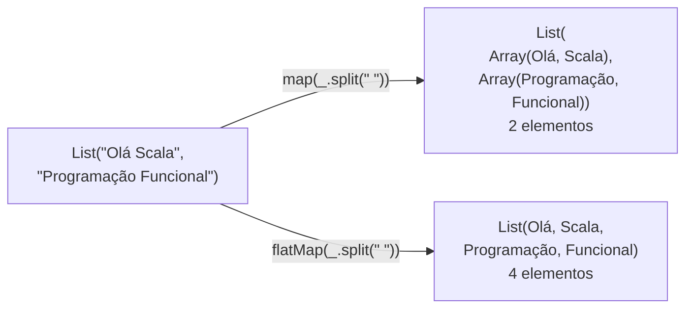
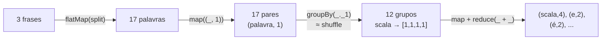

# Aula 09b — Programação em Scala

> **Computação Escalável (2COP022)** · Profa. Larissa C. Shimomura · Aula de **21/10** (mesma semana da Aula 9)
> **Tópicos:** estrutura de um programa Scala, `val` × `var`, `if` como expressão, `for` (`to`/`until`/filtro), `def`, lambdas e o atalho `_`, `class`, `case class`, `trait`, `Option` (adeus `null`), coleções imutáveis × mutáveis (`List`, `Set`, `Map`, `ListBuffer`), funções de ordem superior (`map`, `flatMap`, `filter`, `reduce`, `groupBy`), WordCount com coleções, 4 exercícios da aula
> **Pré-requisitos:** [Aula 09](09_nosql_cap_spark_rdd.md), Bloco B (programação funcional: imutabilidade, lambdas, funções puras, funções de ordem superior)
> **Base de código:** slides + notebook da professora `fontes/códigos/ExemploExecutorService/CodigosScala.ipynb`
> **Tempo estimado de estudo:** 2 h

> **Como usar este arquivo:** a prova não pede para escrever Scala do zero, e sim para **ler** código: dizer o que imprime, onde usar cada função, e se está correto. Por isso cada trecho vem com **o que faz** e **o que sai**. Os conceitos de programação funcional (o "porquê") estão na [Aula 09, Bloco B](09_nosql_cap_spark_rdd.md#bloco-b--programação-funcional); aqui o foco é a **sintaxe** (o "como").

> **[P2] O que cai** ([orientações da 2ª revisão](12c_orientacoes_prova2_revisao2.md))
> - **Cai código, mas só Spark** (que na disciplina é escrito em Scala): "o máximo que eu vou colocar é o Spark". **Não cai:** Java, nem exercícios de **Scala puro** como os desta aula ("eu não vou cobrar").
> - Este arquivo serve, então, para **conseguir ler** um código Spark: `val`, lambdas, `_`, tuplas (`._1`, `._2`), `split`, `map`/`flatMap`/`filter`/`reduce`.
> - **Cortado desta versão:** §6 (`class`/`case class`/`trait`), §7 (`Option`), §11 (os 4 exercícios da aula) e §13 (treino de leitura de Scala puro). A versão completa está no histórico do git.

---

## Sumário

1. [Mapa da aula](#mapa-da-aula)
2. [Scala em uma página](#1-scala-em-uma-página)
3. [Estrutura de um programa](#2-estrutura-de-um-programa)
4. [Variáveis: `val` × `var`](#3-variáveis-val--var)
5. [`if` e `for`](#4-if-e-for)
6. [Funções: `def` e lambdas](#5-funções-def-e-lambdas)
9. [Coleções](#8-coleções)
10. [Funções de ordem superior](#9-funções-de-ordem-superior)
11. [WordCount com coleções (o "MapReduce" do notebook)](#10-wordcount-com-coleções)
13. [Quadro "onde usar"](#12-quadro-onde-usar)
15. [Erros comuns / o que cai em prova](#erros-comuns--o-que-cai-em-prova)
16. [Fontes](#fontes)
17. [Conclusão para revisão](#conclusão-para-revisão)

---

## Mapa da aula



> **O que observar:** tudo converge para as **funções de ordem superior sobre coleções**. É o ponto mais importante da aula, porque o Spark ([Aula 10](10_spark_pratica_sparksql.md)) usa **os mesmos nomes** (`map`, `flatMap`, `filter`, `reduce`…), só que sobre dados distribuídos.

---

## 1. Scala em uma página

| Característica | Detalhe (slides) |
|---|---|
| Origem | Criada em **2001** na **EPFL** (Lausanne, Suíça) pelo prof. **Martin Odersky** |
| Ideia principal | Unir **programação funcional** e **orientação a objetos**, mantendo a **interoperabilidade com bibliotecas Java** |
| Execução | Compilada para **bytecode da JVM**, executado pela máquina virtual Java |
| Comparação com Java | Bastante parecida, porém com **sintaxe menos verbosa** |
| Tipagem | **Estática** (o tipo é conhecido na compilação), mas com **inferência**: muitas vezes não é preciso escrever o tipo |

**Instalação (slide):** <https://www.scala-lang.org/download/>. Quem não conseguir instalar pode usar o **Scastie** (<https://scastie.scala-lang.org/>), que roda Scala no navegador.

---

## 2. Estrutura de um programa

```scala
object MeuPrograma {                          // object = singleton (uma única instância)
  def main(args: Array[String]): Unit = {      // ponto de entrada; Unit ≈ void
    val nome = "Scala"                         // val = variável imutável
    println(s"Olá, $nome!")                    // s"..." = interpolação de string
    val resultado = dobrar(5)
    println(resultado)
  }

  def dobrar(x: Int): Int = {                  // def = definição de função
    x * 2                                      // parâmetro Int, retorno Int
  }
}
```

**Saída:**
```text
Olá, Scala!
10
```

| Elemento | Significado | Equivalente em Java |
|---|---|---|
| `object` | **Singleton**: classe com uma única instância, criada automaticamente | Classe com membros `static` |
| `def` | Define uma função/método | Declaração de método |
| `Unit` | "Não retorna nada útil" | `void` |
| `args: Array[String]` | Nome **antes**, tipo **depois**, separados por `:` | `String[] args` |
| `Array[String]` | Genéricos com **colchetes** | `String[]` / `List<String>` |
| `s"Olá, $nome!"` | Interpolação: `$nome` (ou `${expr}`) vira o valor | `"Olá, " + nome + "!"` |
| Sem `;` | Ponto e vírgula é opcional | Obrigatório |

---

## 3. Variáveis: `val` × `var`

```scala
val idade = 20
// idade = 21          // ERRO de compilação: val não permite reatribuição

var pontuacao = 10
pontuacao = 15         // Correto: var permite reatribuição
```

| | `val` | `var` |
|---|---|---|
| Reatribuição | **Não** | Sim |
| Equivale em Java a | `final` | variável comum |
| Estilo funcional | **Preferido** | Evitar (estado mutável) |

**Tipo inferido ou explícito** (notebook):

```scala
val nome1 = "Alice"           // tipo inferido: String
val nome2: String = "Bob"     // tipo explícito (depois do nome, com ":")
val lista = List("A", "B", "C")   // List[String]
```

> **Pegadinha:** `val` impede **reatribuir a variável**, não necessariamente mudar o **objeto**. `val buffer = ListBuffer(1, 2)` seguido de `buffer += 3` **funciona**, porque o `ListBuffer` é mutável. A variável continua apontando para o mesmo objeto (ver [§8](#8-coleções)).

---

## 4. `if` e `for`

### `if` é uma expressão (devolve valor)

```scala
val hora = 14
val saudacao = if (hora < 12) {
  "Bom dia"
} else {
  "Boa tarde"
}
println(saudacao)    // Boa tarde
```

> Em Java, `if` é um **comando**; para devolver valor usa-se o ternário `cond ? a : b`. Em Scala, o próprio `if` **tem valor**: o da última expressão do ramo escolhido. Por isso dá para atribuí-lo a um `val`.

### `for` com `to`, `until` e filtro

```scala
for (i <- 1 to 5)    println(s"Número: $i")          // 1, 2, 3, 4, 5  (inclui o 5)
for (i <- 1 until 5) println(s"Até 5 (exclusivo): $i") // 1, 2, 3, 4    (exclui o 5)
for (i <- 1 to 10 if i % 2 == 0) println(s"Par: $i")   // 2, 4, 6, 8, 10 (com filtro/guarda)
```

| Forma | Intervalo | Equivalente em Java |
|---|---|---|
| `1 to 5` | 1, 2, 3, 4, **5** (fechado) | `for (int i = 1; i <= 5; i++)` |
| `1 until 5` | 1, 2, 3, 4 (aberto no fim) | `for (int i = 1; i < 5; i++)` |
| `if` dentro do `for` | Só executa o corpo quando a condição é verdadeira | `if` dentro do laço |

> **Dica:** `0 until vetor.length` é o jeito idiomático de percorrer índices (não passa do último).

---

## 5. Funções: `def` e lambdas

### `def` — sem `return`

```scala
def multiplicar(a: Int, b: Int) = a * b
println(multiplicar(4, 2))   // 8
```

- O valor devolvido é a **última expressão** do corpo; **não precisa de `return`**.
- O tipo de retorno pode ser **inferido** (aqui, `Int`). Escrevê-lo (`def multiplicar(a: Int, b: Int): Int = a * b`) é recomendável em funções públicas.
- Corpo de uma linha dispensa as chaves.

### Lambdas (funções anônimas)

```scala
// Lambda atribuída a um val, com tipo explícito
val duplicar: Int => Int = (x: Int) => x * 2
println(duplicar(5))     // 10

// Tipo inferido pelo compilador
val somarDois = (a: Int, b: Int) => a + b
println(somarDois(3, 4)) // 7

// Atalho com underscore: só quando o parâmetro aparece UMA vez
val dobro: Int => Int = _ * 2       // igual a x => x * 2
val cubo = (x: Int) => x * x * x
println(cubo(3))         // 27
println(dobro(2))        // 4
```

> **Atenção ao notebook:** lá a lambda `_ * 2` se chama **`quadrado`**, mas ela **dobra** (o comentário da célula já avisa: "ou `x => x * x`, ajustando a lógica"). `quadrado(2)` imprime 4 **por coincidência** (2·2 = 2²). Com `quadrado(3)` sairia **6**, não 9. Aqui ela foi renomeada para `dobro`.

**Regra do `_`:** cada `_` é um **parâmetro diferente**, na ordem em que aparecem.

| Escrita com `_` | Equivale a | Observação |
|---|---|---|
| `_ * 2` | `x => x * 2` | 1 parâmetro |
| `_ + _` | `(a, b) => a + b` | **2 parâmetros**: útil no `reduce` |
| `_ > 5` | `x => x > 5` | Bom para `filter` |
| `_._1` | `t => t._1` | Primeiro elemento de uma tupla |
| `x => x * x` | **não** dá para escrever com `_` | `_ * _` seria `(a, b) => a * b` |

### Tipos de função

`Int => Int` lê-se "**função que recebe `Int` e devolve `Int`**". `(Int, Int) => Int` recebe dois `Int`.

### "Tudo é um objeto": funções também

Funções em Scala são **objetos**, instâncias da trait `Function1` (1 parâmetro), `Function2` (2 parâmetros), etc., geradas automaticamente pelo compilador. Chamar `dobro(5)` é açúcar sintático para **`dobro.apply(5)`**.

```scala
// Como o slide mostra (ordem dos parâmetros de tipo: [R, A])
trait Function1[R, A] {
  def apply(x: A): R
}
```

> **Nota:** na biblioteca real, a declaração é **`trait Function1[-T1, +R]`**: o tipo da **entrada vem primeiro** e o da saída depois (é por isso que `Int => String` corresponde a `Function1[Int, String]`). O slide usa outra ordem de letras, mas a ideia é a mesma: existe um método **`apply`** que recebe a entrada e devolve a saída. O slide também observa que, ao estender ou modificar um método, é comum **sobrescrever o `apply`**.

---

## 8. Coleções

Scala tem coleções **mutáveis** e **imutáveis**. **Por padrão, as coleções são imutáveis** (pacote `scala.collection.immutable`): "alterar" uma coleção **cria outra**, e a original fica intacta.

### `List` (sequência ordenada, imutável)

```scala
val frutas = List("maçã", "banana", "laranja")

val novasFrutas = "morango" :: frutas      // INÍCIO com :: (cons)
// List(morango, maçã, banana, laranja)
val maisFrutas = "kiwi" +: frutas          // INÍCIO com +:
// List(kiwi, maçã, banana, laranja)
val frutasNoFim = frutas :+ "abacaxi"      // FIM com :+
// List(maçã, banana, laranja, abacaxi)
val combinada = List(1, 2) ++ List(3, 4)   // concatenação (++ ou :::)
// List(1, 2, 3, 4)

println(frutas)                            // List(maçã, banana, laranja) — NÃO mudou
```

> **Macete do `:`**: o lado do **dois-pontos fica do lado da coleção**. `elem +: lista` (coleção à direita → início); `lista :+ elem` (coleção à esquerda → fim).

### `Set` (sem repetição) e `Map` (chave → valor)

```scala
val numerosUnicos = Set(1, 2, 3)
val comNovoNumero = numerosUnicos + 4      // Set(1, 2, 3, 4)
val duplicado = comNovoNumero + 2          // Set(1, 2, 3, 4) — o 2 já existia: ignorado, sem erro

val idades = Map("Ana" -> 25, "Bruno" -> 30)          // "chave" -> valor
val novasIdades = idades + ("Carlos" -> 22)            // Map(Ana -> 25, Bruno -> 30, Carlos -> 22)
val idadesAtualizadas = novasIdades + ("Ana" -> 26)    // chave existente: valor ATUALIZADO
// Map(Ana -> 26, Bruno -> 30, Carlos -> 22)
```

### Coleção mutável: `ListBuffer`

```scala
import scala.collection.mutable.ListBuffer

val listaMutavel = ListBuffer(1, 2, 3)
listaMutavel += 4           // modifica a PRÓPRIA lista
listaMutavel.append(5)
println(listaMutavel)       // ListBuffer(1, 2, 3, 4, 5)
```

| | Imutável (`List`, `Set`, `Map`) | Mutável (`ListBuffer`, `mutable.Map`…) |
|---|---|---|
| Pacote | `scala.collection.immutable` (**padrão**) | `scala.collection.mutable` (precisa `import`) |
| "Adicionar" | Cria **nova** coleção (`:+`, `+`) | Altera a **mesma** (`+=`, `append`) |
| Seguro entre threads/partições | **Sim** (ninguém altera) | Não sem sincronização |
| Estilo | Funcional (recomendado) | Imperativo; usar localmente, quando necessário |

> **Ligação com a Aula 09:** a imutabilidade é o que permite a cada partição ser processada **sem disputa** pelo mesmo dado. Os RDDs do Spark são imutáveis pelo mesmo motivo.

---

## 9. Funções de ordem superior

São o centro da aula. Todas **recebem uma função** e **devolvem uma coleção nova** (ou um valor), sem alterar a original.

| Função | Recebe | Faz | Entra → sai (exemplo) |
|---|---|---|---|
| `map(f)` | `A => B` | Aplica `f` a **cada** elemento | `List(1,2,3,4)` → `List(10,20,30,40)` com `n => n * 10` |
| `flatMap(f)` | `A => coleção de B` | Aplica `f` e **achata** (tira um nível de aninhamento) | `List("Olá Scala", "Programação Funcional")` → `List(Olá, Scala, Programação, Funcional)` com `_.split(" ")` |
| `filter(p)` | `A => Boolean` | Mantém só os elementos com `p` verdadeiro | `1 to 10` → `List(2,4,6,8,10)` com `_ % 2 == 0` |
| `reduce(op)` | `(A, A) => A` | Combina tudo em **um valor**, dois a dois | `List(1,2,3,4,5)` → `15` com `_ + _` |
| `groupBy(k)` | `A => K` | Agrupa num `Map[K, List[A]]` pela chave `k` | palavras → `Map(m -> List(maçã, manga, melancia), b -> List(banana), p -> List(pera))` com `_.head` |
| `foreach(f)` | `A => Unit` | Executa `f` em cada elemento (efeito, ex.: imprimir) | — devolve `Unit` |
| `mapValues(f)` | `V => W` | Em um `Map`, transforma só os **valores** | `Map(a -> List(1,2))` → `Map(a -> 3)` com `_.sum` |

### `map` × `flatMap` — a diferença que mais cai

```scala
val frases = List("Olá Scala", "Programação Funcional")

val palavrasMap = frases.map(frase => frase.split(" "))
// List[Array[String]] = List(Array(Olá, Scala), Array(Programação, Funcional))   ← lista DE arrays

val palavras = frases.flatMap(frase => frase.split(" "))
// List[String] = List(Olá, Scala, Programação, Funcional)                         ← lista achatada
```



> **O que observar:** o `split` devolve um **array por frase**. O `map` mantém essa estrutura (uma lista de arrays, com o mesmo nº de elementos da entrada). O `flatMap` "desembrulha" os arrays numa lista só.
>
> **Correção de um comentário do notebook:** a célula diz que o `.map` "quebraria a frase em lista de **caracteres**". Não é isso: ele gera uma lista de **arrays de palavras**. O `println(palavrasMap)` mostra `List([Ljava.lang.String;@161cdac1, ...)` porque arrays Java **não têm `toString` legível**: aquilo é o endereço do array, não caracteres.

### `reduce` passo a passo

```scala
val numeros = List(1, 2, 3, 4, 5)
val somaTotal = numeros.reduce((acumulador, elemento) => acumulador + elemento)   // ou reduce(_ + _)
// ((((1 + 2) + 3) + 4) + 5) = 15
```

| Passo | acumulador | elemento | resultado |
|---|---|---|---|
| 1 | 1 | 2 | 3 |
| 2 | 3 | 3 | 6 |
| 3 | 6 | 4 | 10 |
| 4 | 10 | 5 | **15** |

> **Cuidado:** `reduce` em **lista vazia** lança exceção (`UnsupportedOperationException`): não há primeiro elemento. Em sistemas distribuídos (Spark), a operação deve ser **associativa e comutativa** (soma, máximo), pois cada partição reduz a sua parte e depois os resultados parciais são combinados em ordem imprevisível.

### `filter` e `groupBy`

```scala
val numeros = List(1, 2, 3, 4, 5, 6, 7, 8, 9, 10)
numeros.filter(n => n % 2 == 0)        // List(2, 4, 6, 8, 10)
numeros.filter(_ > 5)                  // List(6, 7, 8, 9, 10)
List("Ana", "Bruno", "Amanda", "Carlos", "Alice").filter(_.startsWith("A"))
                                       // List(Ana, Amanda, Alice)

val palavras = List("maçã", "banana", "manga", "pera", "melancia")
palavras.groupBy(p => p.head)          // p.head = primeiro caractere
// Map(m -> List(maçã, manga, melancia), b -> List(banana), p -> List(pera))
```

> A **ordem das chaves** num `Map` vindo de `groupBy` **não é garantida** (o notebook imprimiu `m, b, p`). Se a ordem importa, ordene depois (ex.: `.toList.sortBy(_._1)`).

---

## 10. WordCount com coleções

O notebook implementa o WordCount da [Aula 08](08_forkjoin_bigdata_hadoop.md#b4-mapreduce) **em memória**, com coleções Scala, imitando as fases do MapReduce.

```scala
val linhas = List(
  "scala é maravilhoso e scala é rápido",
  "programação funcional com scala",
  "big data e scala combinam perfeitamente"
)

// --- FASE 1: MAP ---
val mapiado = linhas
  .flatMap(linha => linha.split(" "))   // todas as palavras numa lista só
  .map(palavra => (palavra, 1))          // cada palavra vira o par (palavra, 1)
// List((scala,1), (é,1), (maravilhoso,1), (e,1), (scala,1), ...)

// --- FASE 2: AGRUPAMENTO (o "shuffle") ---
val agrupado = mapiado.groupBy(_._1)     // agrupa pela chave = 1º elemento do par
// Map(scala -> List((scala,1), (scala,1), (scala,1), (scala,1)), e -> List((e,1), (e,1)), ...)

// --- FASE 3: REDUCE ---
val reduzido = agrupado.map { case (palavra, listaPares) =>
  val apenasOsValores = listaPares.map(par => par._2)   // List(1, 1, 1, 1)
  val total = apenasOsValores.reduce(_ + _)             // 4
  (palavra, total)
}
reduzido.foreach(println)
// (scala,4) (e,2) (é,2) (programação,1) (maravilhoso,1) ... — ordem não garantida
```



**Elementos novos de sintaxe nesse trecho:**

| Sintaxe | Significa |
|---|---|
| `(palavra, 1)` | **Tupla** de 2 elementos |
| `par._1`, `par._2` | 1º e 2º elementos da tupla (começa em **1**, não 0) |
| `groupBy(_._1)` | Agrupar pela chave da tupla |
| `.map { case (palavra, listaPares) => ... }` | Lambda com ***pattern matching***: "desmonta" cada par `(chave, valor)` do `Map` em duas variáveis com nome |
| Encadear `.flatMap(...).map(...)` | Cada chamada devolve uma coleção nova, à qual se aplica a próxima |

> **Ligação com o MapReduce e com o Spark:** a FASE 1 é o **map** (gera pares chave-valor), o `groupBy` faz o papel do **shuffle** (reúne valores da mesma chave), e a FASE 3 é o **reduce**. No Spark ([Aula 10](10_spark_pratica_sparksql.md)), as fases 2 e 3 viram uma chamada só: `.reduceByKey(_ + _)`.
>
> **Versão curta equivalente** (para reconhecer na prova): `linhas.flatMap(_.split(" ")).groupBy(identity).map { case (p, ocorrencias) => (p, ocorrencias.size) }`.

---

## 12. Quadro "onde usar"

| Situação | Use | Não use / cuidado |
|---|---|---|
| Valor que não muda | `val` | `var` sem necessidade |
| Escolher um valor por condição | `val x = if (...) a else b` | Declarar `var` e atribuir dentro do `if` |
| Laço de 0 a n−1 | `0 until n` | `0 to n` (passa do fim) |
| Transformar cada elemento (1 → 1) | `map` | `foreach` + lista mutável |
| Cada elemento vira **vários** (1 → N) | `flatMap` | `map` (gera lista de listas) |
| Manter só alguns elementos | `filter` | — |
| Juntar tudo num valor | `reduce` (lista não vazia) | `reduce` em lista possivelmente vazia |
| Agrupar por uma chave | `groupBy` | — (lembre: ordem do `Map` não é garantida) |
| Transformar só os valores de um `Map` | `mapValues` (2.12) / `.map { case (k, v) => (k, f(v)) }` | — |
| Efeito colateral (imprimir) | `foreach` | `map` (devolveria uma lista de `Unit`) |
| Precisa mutar uma coleção localmente | `ListBuffer` (`+=`, `append`) | Expor coleção mutável para outras partes do código |

---

## Erros comuns / o que cai em prova

1. **`val` não pode ser reatribuído** (erro de compilação). Mas um `val` pode apontar para uma coleção **mutável** que muda por dentro.
2. **`map` × `flatMap`:** `map` preserva a estrutura (1 → 1); `flatMap` achata (1 → N). `map(_.split(" "))` dá **lista de arrays**.
3. **Cada `_` é um parâmetro novo:** `_ + _` tem 2 parâmetros. `x => x * x` **não** se escreve com `_`.
4. **`reduce` em coleção vazia lança exceção**; use `sum` ou `foldLeft` com valor inicial.
5. **`1 to n` inclui n; `1 until n` não inclui.**
6. **Coleções são imutáveis por padrão:** `:+`, `+:`, `+` criam **nova** coleção; a original fica igual.
7. **`Map` não tem ordem garantida** (nem o resultado do `groupBy`). Para ordenar: `toList.sortBy(...)` e, se precisar, `ListMap`.
8. **Retorno de função = última expressão**; não precisa de `return`. `if` também devolve valor.
9. **Tuplas começam em `_1`**, não em `_0`. Arrays e listas começam no índice **0**, acessados com `()`.

---

## Fontes

- **Slides da aula:** Shimomura, L. C. *Programação em Scala — Computação Escalável (21/10)*. Os slides 1–18 repetem a parte funcional da Aula 9; novos: instalação e exercícios 1–4.
- **Notebook da professora:** `fontes/códigos/ExemploExecutorService/CodigosScala.ipynb` (todos os trechos das §2–§10, com as saídas registradas no próprio notebook).
- **Documentação oficial Scala:**
  - *Tour of Scala* (classes, traits, case classes, pattern matching, funções de ordem superior): <https://docs.scala-lang.org/tour/tour-of-scala.html>
  - *Scala Book* — coleções e seus métodos: <https://docs.scala-lang.org/scala3/book/collections-methods.html>
  - `Option`: <https://www.scala-lang.org/api/2.12.18/scala/Option.html>
  - `Function1` (declaração `Function1[-T1, +R]`): <https://www.scala-lang.org/api/2.12.18/scala/Function1.html>
- **Ferramentas citadas no slide:** download <https://www.scala-lang.org/download/>; Scastie <https://scastie.scala-lang.org/>.

---

## Conclusão para revisão

### Resumo

1. **Scala** (Odersky, EPFL, 2001) une funcional e orientação a objetos, roda na **JVM** e usa bibliotecas Java, com sintaxe mais enxuta.
2. Programa: **`object`** (singleton) com **`def main(args: Array[String]): Unit`**; `Unit` ≈ `void`; interpolação `s"...$x"`; tipo **depois** do nome (`x: Int`).
3. **`val`** (imutável, preferido) × **`var`** (reatribuível). Tipagem estática com inferência.
4. **`if` é expressão** (devolve valor); `for` com **`to`** (inclui o fim), **`until`** (exclui) e filtro `if`.
5. **`def`** devolve a **última expressão**; **lambdas** `x => ...`; **`_`** = um parâmetro por ocorrência; funções são objetos (`apply`).
6. **Coleções imutáveis por padrão** (`List`, `Set`, `Map`): `:+`, `+:`, `::`, `++`, `+` criam coleções novas. Mutáveis em `scala.collection.mutable` (`ListBuffer`).
7. **Ordem superior:** `map` (1→1), **`flatMap` (1→N, achata)**, `filter`, `reduce` (não vazio; associativo), `groupBy` (→ `Map`), `mapValues`, `foreach` (efeito).
8. **WordCount:** `flatMap(split)` → `map((_, 1))` → `groupBy(_._1)` (≈ shuffle) → somar por chave (≈ reduce). No Spark, as duas últimas viram `reduceByKey(_ + _)`.

### Tabela de conceitos-chave

| Termo | Definição em uma linha | Quando usar / lembrar |
|---|---|---|
| `object` | Singleton | Ponto de entrada (`main`), utilitários |
| `val` / `var` | Imutável / reatribuível | `val` por padrão |
| `Unit` | Tipo "sem valor útil" | ≈ `void` |
| `s"..."` | Interpolação de string | `s"Olá, $nome"` |
| `to` / `until` | Intervalo fechado / aberto no fim | Índices: `until` |
| Lambda | Função anônima `x => ...` | Argumento de `map`, `filter`… |
| `_` | Atalho de parâmetro (1 por ocorrência) | `_ * 2`, `_ + _` |
| Tupla | `(a, b)`, campos `_1`, `_2` | Pares chave-valor |
| `map` / `flatMap` | Transforma 1→1 / 1→N achatando | `flatMap` para `split` |
| `filter` | Mantém os que satisfazem o predicado | Seleção |
| `reduce` | Combina tudo em um valor | Lista não vazia |
| `groupBy` | Agrupa em `Map[chave, List]` | Agregações por chave |
| `ListBuffer` | Lista mutável | Uso local |
| for-comprehension | `for {...} yield` devolve coleção | Laços aninhados com filtro |

### Perguntas de autoavaliação

<details><summary><b>1. Qual a diferença entre <code>val</code> e <code>var</code>, e por que o estilo funcional prefere <code>val</code>?</b></summary>

`val` não pode ser reatribuído; `var` pode. O estilo funcional prefere `val` porque **sem estado mutável** o código é mais fácil de entender e de paralelizar: nenhuma tarefa altera um valor que outra está lendo.
</details>

<details><summary><b>2. Explique a diferença entre <code>map</code> e <code>flatMap</code> com o exemplo das frases.</b></summary>

`frases.map(_.split(" "))` devolve uma **lista de arrays** (um array de palavras por frase; mesmo nº de elementos da entrada). `frases.flatMap(_.split(" "))` aplica o `split` e **achata** o resultado numa lista única de palavras.
</details>

<details><summary><b>3. Como as fases do WordCount com coleções correspondem às do MapReduce?</b></summary>

`flatMap(split)` + `map((_, 1))` = fase **map** (gera pares chave-valor); `groupBy(_._1)` = **shuffle** (reúne os valores de cada chave); somar os valores de cada grupo = **reduce**.
</details>

<details><summary><b>4. Por que <code>reduce</code> precisa de uma operação associativa quando usado no Spark?</b></summary>

Porque cada partição reduz a **sua parte** separadamente e depois os resultados parciais são combinados, em ordem que não é fixa. Só operações associativas (e comutativas), como soma e máximo, dão o mesmo resultado independentemente de como os elementos foram agrupados. Uma subtração, por exemplo, não dá.
</details>

### Checklist

**Sei explicar…**
- [ ] a estrutura de um programa Scala (`object`, `main`, `Unit`, `def`)
- [ ] `val` × `var`, `if` como expressão, `to` × `until`
- [ ] lambdas, o atalho `_` e funções como objetos (`apply`)
- [ ] coleções imutáveis × mutáveis e os operadores `:+`, `+:`, `::`, `++`, `+`
- [ ] `map`, `flatMap`, `filter`, `reduce`, `groupBy`, `mapValues`, `foreach`

**Sei ler e corrigir código com…**
- [ ] o WordCount com coleções, fase por fase
- [ ] os bugs: reatribuir `val`, `map` no lugar de `flatMap`, `_ * _`, `reduce` em lista vazia, `to` passando do fim do array

### Ligação com a próxima aula

A [Aula 10](10_spark_pratica_sparksql.md) leva essas funções para o **Spark**: `sc.parallelize(lista)` transforma uma coleção num **RDD**, sobre o qual `map`, `flatMap`, `filter` e `reduce` funcionam igual, mas **distribuídos** (e preguiçosos, como visto na [Aula 09](09_nosql_cap_spark_rdd.md#c5-lazy-evaluation)). O `groupBy` + `reduce` do WordCount vira `reduceByKey`,. A aula também apresenta os **DataFrames** e o **SparkSQL**.
