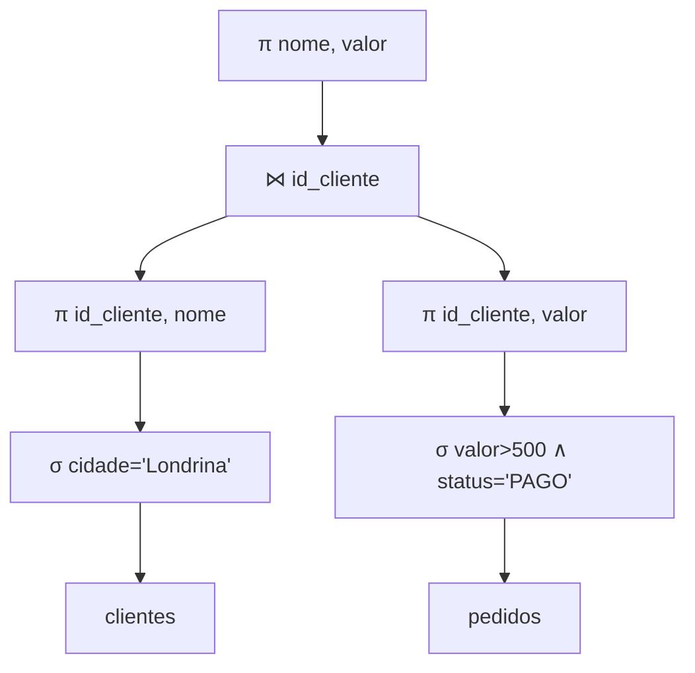

# Aula 10 — RDD × DataFrame e SparkSQL (versão P2)

> Aula de 30/10 · Profa. Larissa C. Shimomura
> **Filtro:** [12c](12c_orientacoes_prova2_revisao2.md).
> **Cai:** diferença **RDD × DataFrame** (usabilidade + Catalyst) e o exercício **código Spark/DataFrame → álgebra relacional** (Ex. 6 da lista P2, certeza).
> **Cortado desta versão** (não cai): leitura do `explain()` / saída do Catalyst, modos de execução e `master`, `SparkSession` em detalhe, `repartition`/`coalesce`, particionadores (*hash partitioning* não cai), escrita particionada, Docker/`spark-submit`, os exercícios de Scala refeitos em Spark e todo o treino de leitura de código. A versão completa está no histórico do git.

---

## 1. RDD × DataFrame (× Dataset)

| | **RDD** | **DataFrame** | **Dataset** |
|---|---|---|---|
| Nível | **Mais baixo** (base dos outros) | Alto | Alto |
| Representação | Objetos quaisquer | Tabela com **esquema** (colunas nomeadas) = `Dataset[Row]` | Objetos de uma `case class` |
| Otimizador **Catalyst** | **Não** | **Sim** | **Sim** |
| Lembra | Coleções Scala | **pandas** | `case class` + pandas |

**As duas diferenças que a professora destacou na 2ª revisão:**
1. **Usabilidade:** o DataFrame é mais fácil de ler e escrever; foi colocado no Spark para ser parecido com o que se usa no **pandas**.
2. **Otimização:** como o DataFrame faz parte do **Spark SQL**, as consultas passam pelo **Catalyst**, que as otimiza. O RDD executa exatamente o que foi escrito.

---

## 2. SparkSQL e o Catalyst (só a ideia)

- SparkSQL processa dados **com esquema**, por uma linguagem **declarativa** (diz **o que** se quer, não **como**): DSL de DataFrames ou SQL direto (`spark.sql(...)`). As duas formas passam pelo mesmo otimizador.
- As transformações formam um **plano lógico** → o **Catalyst** gera um plano **otimizado** (mesmo resultado, menor custo: ex.: empurrar filtros para baixo) → escolhe o **plano físico** (quais algoritmos, ex.: qual **algoritmo de junção**, ver [12](12_joins_spark_revisao_prova.md)).
- É o mesmo processo de um banco relacional ([11](11_processamento_otimizacao_consultas.md)).

---

## 3. Código DataFrame → álgebra relacional

| DataFrame | Álgebra relacional | Observação |
|---|---|---|
| `filter(cond)` / `where(cond)` | **σ** (seleção) | "Seleção **não é** `select`, é `filter`" |
| `select(colunas)` | **π** (projeção) | |
| `join(outro, cond)` / `join(outro, "col")` | **⋈** com a condição | |
| `&&` / `\|\|` | **∧** / **∨** | |
| `$"col" === valor` | `col = valor` | `===` é a igualdade do Spark |

**Como montar:** leia o código na ordem em que foi escrito; cada chamada envolve o resultado anterior. Na **álgebra** a consulta se lê **de dentro para fora**; na **árvore**, **de baixo para cima** (relações nas folhas, π no topo).

**Qualquer representação equivalente vale** (ela não pede para otimizar): σ antes ou depois da junção, ⋈ ou × + σ, ordem das relações trocada (a junção é comutativa). Não precisa qualificar os atributos na projeção.

### Lista P2, Ex. 6 (certeza)

```scala
val clientesFiltrados = clientes
    .filter($"cidade" === "Londrina")
    .select($"id_cliente", $"nome")

val pedidosFiltrados = pedidos
    .filter($"valor" > 500 && $"status" === "PAGO")
    .select($"id_cliente", $"valor")

val resultado = clientesFiltrados
    .join(pedidosFiltrados, "id_cliente")
    .select($"nome", $"valor")
```

**Resposta** (reconstruída do gabarito; os símbolos se perderam na extração do PDF):

> π<sub>nome, valor</sub>( π<sub>id_cliente, nome</sub>(σ<sub>cidade='Londrina'</sub>(clientes)) ⋈<sub>id_cliente</sub> π<sub>id_cliente, valor</sub>(σ<sub>valor>500 ∧ status='PAGO'</sub>(pedidos)) )



**Exemplo resolvido em aula** (pedidos × clientes): π<sub>nome, valor</sub>( σ<sub>valor>100</sub>(pedidos) ⋈<sub>id_cliente=id</sub> clientes ), em [12, Ex. 8](12_joins_spark_revisao_prova.md#exercício-8--sparksql--álgebra-relacional--otimização).

---

## 4. Checklist

- [ ] Explico RDD × DataFrame (pandas-like + Catalyst)
- [ ] Traduzo `filter` → σ, `select` → π, `join` → ⋈ e `&&` → ∧
- [ ] Escrevo a álgebra **e** desenho a árvore do Ex. 6 da lista
