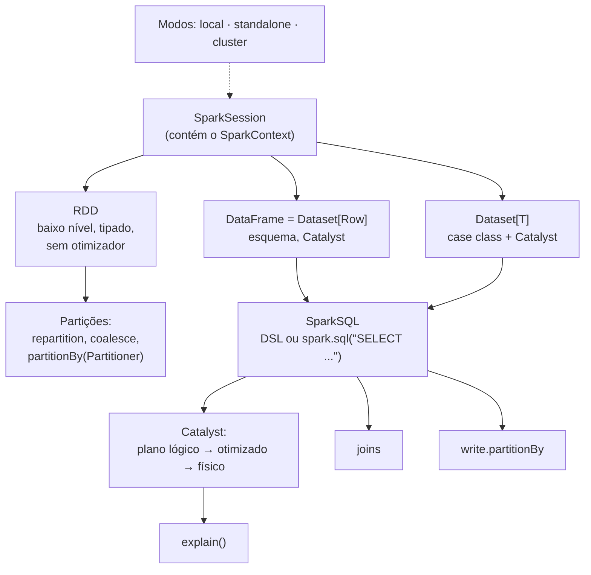
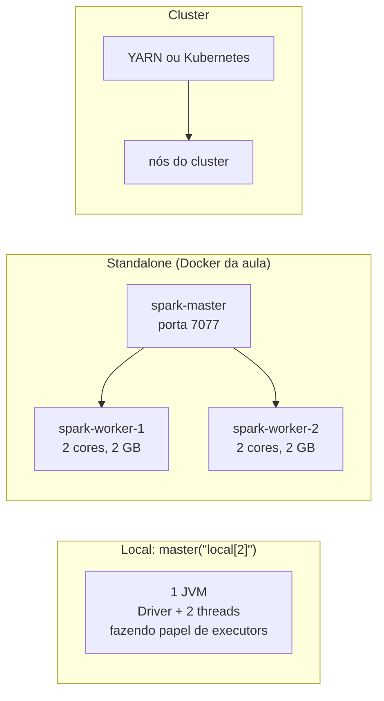
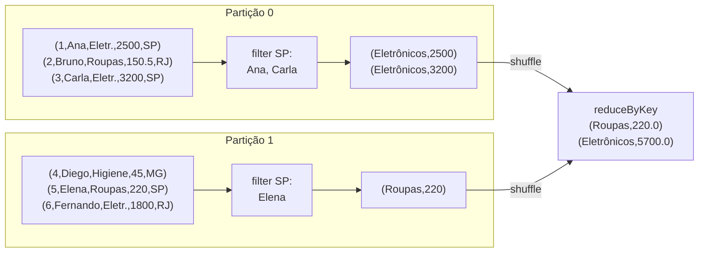
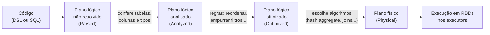
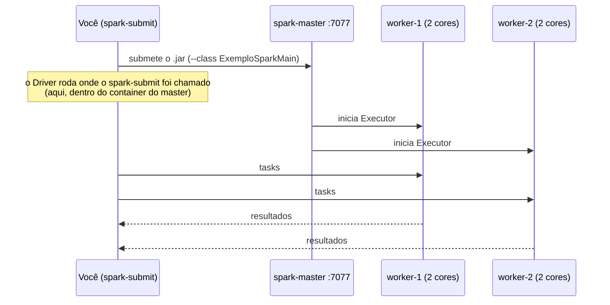

# Aula 10 — Spark na prática: modos de execução, RDDs, particionamento, DataFrames e SparkSQL

> **Computação Escalável (2COP022)** · Profa. Larissa C. Shimomura · Aula de **30/10** (a capa do PDF diz "Aula 9", mas é a aula seguinte à de Scala)
> **Tópicos:** modos de execução (local, standalone, cluster), `SparkContext` × `SparkSession`, RDDs na prática (`parallelize`, partições, `repartition` × `coalesce`, `reduceByKey`, `toDebugString`), particionadores (`HashPartitioner`, particionador próprio), as 3 APIs (RDD × DataFrame × Dataset), SparkSQL e o otimizador Catalyst, leitura/transformação/SQL/escrita com DataFrames, `explain()`, tipos de join, cluster Standalone com Docker e `spark-submit`
> **Pré-requisitos:** [Aula 09](09_nosql_cap_spark_rdd.md) (Driver/Executors, RDD, DAG, *lazy evaluation*, shuffle) e [09b](09b_programacao_scala.md) (sintaxe Scala, `case class`, `map`/`flatMap`/`filter`/`reduce`)
> **Base de código:** `fontes/códigos/ExemploExecutorService/exemplo_spark.ipynb`, `AulaSparkDemo/…/ExemploSparkMain.scala`, `spark_docker/`
> **Tempo estimado de estudo:** 2 h 30

> Os slides 12–24 deste PDF (introdução a processamento de consultas) são repetidos no início da Aula 11 e estão em [11 — Processamento e otimização de consultas](11_processamento_otimizacao_consultas.md).

> **[P2] O que a Larissa disse na revisão** ([orientações completas](12b_orientacoes_prova2.md))
> - "Spark: execução e programação" e **SparkSQL** estão na **lista de tópicos** da prova.
> - Os exercícios desta parte **ficaram para a aula extra**. Modelos dos slides: DAG/quando executa ([ex. 7](12_joins_spark_revisao_prova.md#exercício-7--spark-dag-e-quando-executa)) e **SparkSQL → álgebra relacional** ([ex. 8](12_joins_spark_revisao_prova.md#exercício-8--sparksql--álgebra-relacional--otimização)).
> - **Não vai pedir para programar**: código só para ler e interpretar.

---

## Sumário

1. [Mapa da aula](#mapa-da-aula)
2. [Modos de execução](#1-modos-de-execução)
3. [Inicializando: `SparkContext` × `SparkSession`](#2-inicializando-o-spark)
4. [RDDs na prática](#3-rdds-na-prática)
5. [Particionadores](#4-particionadores-controlando-onde-cada-chave-fica)
6. [Por que não só RDDs? → SparkSQL](#5-limitações-dos-rdds-e-o-sparksql)
7. [RDD × DataFrame × Dataset](#6-as-três-apis-rdd--dataframe--dataset)
8. [SparkSQL e o Catalyst](#7-sparksql-e-o-otimizador-catalyst)
9. [DataFrames na prática](#8-dataframes-na-prática)
10. [Lendo um `explain()`](#9-lendo-um-explain)
11. [Tipos de join](#10-tipos-de-join)
12. [Escrita e partições do SparkSQL](#11-escrita-de-dados-e-partições-no-sparksql)
13. [Programa completo e cluster com Docker](#12-programa-completo-e-cluster-standalone-com-docker)
14. [Exercício da aula: Scala → Spark](#13-exercício-da-aula-os-4-exercícios-de-scala-em-spark)
15. [Quadro "onde usar"](#14-quadro-onde-usar)
16. [Treino de leitura](#15-treino-de-leitura)
17. [Erros comuns / o que cai em prova](#erros-comuns--o-que-cai-em-prova)
18. [Fontes](#fontes)
19. [Conclusão para revisão](#conclusão-para-revisão)

---

## Mapa da aula



> **O que observar:** a mesma `SparkSession` dá acesso às **três APIs**. A grande divisão da aula é **RDD** (você controla tudo, inclusive partições, mas sem otimização automática) × **DataFrame/Dataset** (você declara **o que** quer, e o **Catalyst** decide **como**).

---

## 1. Modos de execução

O Spark é um framework de processamento **distribuído em memória** com **diferentes formas de execução** (slide):

| Modo | Quem gerencia os recursos | Como o paralelismo acontece | Uso típico |
|---|---|---|---|
| **Local** | Ninguém: tudo num único processo (JVM) | Pelos **núcleos da máquina**, via **threads** | Aprender, testar, notebooks da aula |
| **Standalone** | O **próprio Spark** gerencia o cluster (um *master* e *workers*) | Processos Executors nos workers | Cluster simples; **dá para simular em um único computador** (é o `spark_docker` da aula) |
| **Cluster** | Um gerenciador externo: **Kubernetes** ou **YARN** (do Hadoop) | Executors em containers/nós do cluster | Produção |



> **Ligação com a Aula 07:** no modo local, o Spark faz em essência o que o `ExecutorService` fazia: um pool de **threads** processando tarefas (as partições). O que muda é que o mesmo programa roda **sem alteração** num cluster de verdade, trocando só o `master`.

**A string `master`:**

| Valor | Significado |
|---|---|
| `local` | 1 thread (sem paralelismo) |
| `local[2]` | **2 threads** |
| `local[*]` | **Tantas threads quantos núcleos** lógicos a máquina tiver |
| `spark://host:7077` | Conectar a um master **Standalone** |
| `yarn` / `k8s://...` | Cluster gerenciado por YARN / Kubernetes |

> **Correção de um comentário do notebook:** na célula de particionamento de DataFrames, `.master("local[2]")` vem com o comentário "Utiliza todas as threads da CPU local". Não é isso: `local[2]` usa **2** threads; "todas" seria `local[*]`. (Na célula inicial do notebook o comentário está certo: "2 threads para simular os Workers".)

---

## 2. Inicializando o Spark

| | `SparkContext` (`sc`) | `SparkSession` (`spark`) |
|---|---|---|
| O que é | A variável que **controla toda a execução** com RDDs; "praticamente a variável que representa o Driver" (slide) | Ponto de entrada unificado, **desde o Spark 2.0** |
| Relação | — | **Contém** o `SparkContext` (`spark.sparkContext`) |
| Usado para | RDDs (`sc.parallelize`, `sc.textFile`) | DataFrames, Datasets, SQL (`spark.read`, `spark.sql`) e, via `sparkContext`, RDDs |
| Por que a mudança | — | Na maioria das vezes usamos a **API de DataFrames**, não RDDs diretamente |

**Célula inicial do notebook:**

```scala
import org.apache.spark.sql.SparkSession

val spark = SparkSession.builder()        // padrão builder: configura e depois cria
  .appName("AulaSparkScalaDemo")          // nome da aplicação (aparece na Spark UI)
  .master("local[2]")                     // modo local, 2 threads
  .getOrCreate()                          // cria a sessão, ou reaproveita se já existir

import spark.implicits._                  // habilita .toDF(), .as[T] e a sintaxe $"coluna"
spark.sparkContext.setLogLevel("ERROR")   // só mostra erros no log

val sc = spark.sparkContext               // o SparkContext, para trabalhar com RDDs

println(s"Driver App Name: ${sc.appName}")      // AulaSparkScalaDemo
println(s"Modo de Execução (Master): ${sc.master}")  // local[2]
println(s"Spark UI disponível em: ${sc.uiWebUrl.getOrElse("http://localhost:4040")}")
```

- **`getOrCreate()`** devolve a sessão existente se já houver uma (útil em notebooks, que reexecutam células).
- **`import spark.implicits._`** é importado **a partir da variável `spark`**, depois de criá-la. Sem ele, `Seq(...).toDF(...)` **não compila** ("`value toDF is not a member of Seq`").
- **Spark UI** (porta **4040** por padrão; 4041 se a 4040 já estiver ocupada): página web com os jobs, *stages*, o DAG e o shuffle. O notebook usa `Thread.sleep(...)` em algumas células só para manter a aplicação viva e dar tempo de abrir a UI.
- Ao final de um programa, **`spark.stop()`** encerra a sessão.

---

## 3. RDDs na prática

> **Lembrete do slide:** os RDDs são a representação de **"baixo nível"** dos dados. Dão **controle total sobre memória e partições**, mas transformações, leituras etc. são feitas "**na mão**".

### 3.1 Criando um RDD e vendo as partições

```scala
val dadosBrutos = Seq(
  "1,Ana,Eletrônicos,2500.00,SP",
  "2,Bruno,Roupas,150.50,RJ",
  "3,Carla,Eletrônicos,3200.00,SP",
  "4,Diego,Higiene,45.00,MG",
  "5,Elena,Roupas,220.00,SP",
  "6,Fernando,Eletrônicos,1800.00,RJ"
)
val rddLinhas = sc.parallelize(dadosBrutos)          // coleção local → RDD[String] distribuído

println(rddLinhas.getNumPartitions)                    // 2  (= local[2])

rddLinhas.mapPartitionsWithIndex { (indexParticao, iterador) =>
  iterador.map(linha => s"Partição [$indexParticao] -> Conteúdo: '$linha'")
}.collect().foreach(println)
```

**Saída (notebook):**
```text
Partição [0] -> Conteúdo: '1,Ana,Eletrônicos,2500.00,SP'
Partição [0] -> Conteúdo: '2,Bruno,Roupas,150.50,RJ'
Partição [0] -> Conteúdo: '3,Carla,Eletrônicos,3200.00,SP'
Partição [1] -> Conteúdo: '4,Diego,Higiene,45.00,MG'
Partição [1] -> Conteúdo: '5,Elena,Roupas,220.00,SP'
Partição [1] -> Conteúdo: '6,Fernando,Eletrônicos,1800.00,RJ'
```

| Elemento | O que faz |
|---|---|
| `sc.parallelize(colecao)` | Transforma uma coleção **do Driver** num RDD. Sem dizer quantas partições, usa o paralelismo padrão (aqui, 2). `sc.parallelize(dados, numSlices = 3)` força 3 |
| `getNumPartitions` | Quantas partições o RDD tem (não dispara job) |
| `mapPartitionsWithIndex { (idx, it) => ... }` | Transformação que recebe **a partição inteira** (um iterador) **e o índice** dela. O notebook usa só para **visualizar** quem está em qual partição |
| `.collect()` | **Ação**: traz todos os elementos ao Driver (aceitável aqui, 6 linhas) |

> **O que observar:** com 6 linhas e 2 partições, o `parallelize` corta a sequência em **blocos contíguos** (3 + 3). É o mapeamento **em blocos** da Aula 07.

### 3.2 `repartition` × `coalesce`

```scala
val rddComMaisParticoes = rddLinhas.repartition(3)       // 2 → 3 partições (com SHUFFLE)
val rddComMenosParticoes = rddComMaisParticoes.coalesce(1) // 3 → 1 partição (sem shuffle completo)
```

**Saídas (notebook):**
```text
repartition(3):                          coalesce(1):
Partição [0] -> 1,Ana ...                Partição [0] -> 1,Ana ...
Partição [0] -> 6,Fernando ...           Partição [0] -> 6,Fernando ...
Partição [1] -> 2,Bruno ...              Partição [0] -> 2,Bruno ...
Partição [1] -> 4,Diego ...              Partição [0] -> 4,Diego ...
Partição [2] -> 3,Carla ...              Partição [0] -> 3,Carla ...
Partição [2] -> 5,Elena ...              Partição [0] -> 5,Elena ...
```

| | `repartition(n)` | `coalesce(n)` |
|---|---|---|
| Direção | **Aumenta ou diminui** | Feito para **diminuir** |
| Shuffle | **Sim, sempre** (redistribui tudo pela rede) | **Não** faz shuffle completo: **junta** partições vizinhas |
| Distribuição resultante | Equilibrada (os registros se misturaram: Ana com Fernando) | Pode ficar desequilibrada (só concatena) |
| Custo | Alto | Baixo |
| Quando usar | Aumentar o paralelismo; equilibrar partições muito desiguais | Reduzir partições depois de um `filter` que esvaziou muitas; gerar poucos arquivos de saída |

> **O que observar:** depois do `coalesce(1)`, a **ordem** das linhas é a mesma do `repartition(3)` (partição 0, depois 1, depois 2): o `coalesce` **só emendou** as partições, sem redistribuir.

### 3.3 Pipeline de transformações e o shuffle do `reduceByKey`

Objetivo: **total vendido por categoria, só no estado de SP**.

```scala
// Transformação 1: CSV → tupla (id, cliente, categoria, valor, estado)
val rddTransacoes = rddLinhas.map(linha => {
  val c = linha.split(",")
  (c(0).toLong, c(1), c(2), c(3).toDouble, c(4))
})

// Transformação 2: só SP (o estado é o 5º campo da tupla → _5)
val rddSP = rddTransacoes.filter(tupla => tupla._5 == "SP")

// Transformação 3: Pair RDD (categoria, valor)
val rddCategoriaValor = rddSP.map(tupla => (tupla._3, tupla._4))

// Transformação 4: soma por categoria — SHUFFLE
val rddTotalPorCategoria = rddCategoriaValor.reduceByKey((v1, v2) => v1 + v2)

// AÇÃO: só aqui o Spark executa o DAG
rddTotalPorCategoria.collect().foreach(println)
// (Roupas,220.0)
// (Eletrônicos,5700.0)
```

**Como os dados caminham pelas partições (saídas do notebook):**



> **O que observar:** `map` → `filter` → `map` acontecem **dentro de cada partição**, sem trocar dados (transformações **estreitas**). Só o `reduceByKey` (**larga**) precisa juntar as chaves das duas partições. Na saída do notebook, as duas categorias apareceram na **mesma** partição depois do shuffle: o destino de cada chave é decidido pelo **hash** da chave (ver [§4](#4-particionadores-controlando-onde-cada-chave-fica)).

### 3.4 Vendo o DAG com `toDebugString`

```scala
println(rddTotalPorCategoria.toDebugString)
```

```text
(2) ShuffledRDD[20] at reduceByKey at cmd8.sc:2 []
 +-(2) MapPartitionsRDD[18] at map at cmd7.sc:20 []
    |  MapPartitionsRDD[16] at filter at cmd7.sc:13 []
    |  MapPartitionsRDD[14] at map at cmd7.sc:3 []
    |  ParallelCollectionRDD[0] at parallelize at cmd2.sc:12 []
```

**Leitura de baixo para cima** (a origem está embaixo):

| Linha | Significado |
|---|---|
| `ParallelCollectionRDD[0]` | O RDD criado por `parallelize` |
| `MapPartitionsRDD[14]`, `[16]`, `[18]` | Os resultados de `map`, `filter`, `map`. Ligados por `|` = **mesmo stage**, sem shuffle |
| `+-` | **Fronteira de shuffle**: aqui o trabalho é dividido em dois ***stages*** |
| `ShuffledRDD[20]` | O resultado do `reduceByKey` |
| `(2)` | Número de partições |

O notebook também escreve **o mesmo pipeline encadeado** numa só expressão (`rddDagCompleta = rddLinhas.map(...).filter(...).map(...).reduceByKey(...)`); o `toDebugString` sai **idêntico** (só mudam os números dos RDDs). Encadear ou guardar cada passo num `val` **não muda** o DAG.

---

## 4. Particionadores: controlando onde cada chave fica

Como o particionamento dos RDDs é **lógico** ([Aula 09, §C3](09_nosql_cap_spark_rdd.md#c3-particionamento-dos-rdds)), podemos **definir funções de particionamento**. Em Pair RDDs, isso se faz com **`partitionBy(particionador)`**.

### 4.1 Particionador próprio (notebook)

```scala
import org.apache.spark.Partitioner

class EstadoPartitioner(val numParticoes: Int) extends Partitioner {
  override def numPartitions: Int = numParticoes          // quantas partições o RDD terá

  override def getPartition(key: Any): Int = {             // CHAVE → índice da partição
    key.toString match {
      case "SP" => 0      // vendas de SP vão para a partição 0
      case "RJ" => 1      // RJ → partição 1
      case _    => 2      // qualquer outro estado → partição 2
    }
  }

  override def equals(other: Any): Boolean = other match { // usado pelo Spark para saber se
    case p: EstadoPartitioner => p.numPartitions == numPartitions  // dois RDDs estão
    case _                    => false                             // particionados igual
  }
}

val rddPairPorEstado = rddLinhas.map(linha => (linha.split(",")(4), linha))  // (estado, linha)
val rddCustomizado = rddPairPorEstado.partitionBy(new EstadoPartitioner(3))
```

**Saída (notebook):**
```text
Partição [0] -> Estado: SP | Dados: 1,Ana,...   3,Carla,...   5,Elena,...
Partição [1] -> Estado: RJ | Dados: 2,Bruno,...  6,Fernando,...
Partição [2] -> Estado: MG | Dados: 4,Diego,...
```

| Método | Obrigatório? | Papel |
|---|---|---|
| `numPartitions` | Sim | Total de partições |
| `getPartition(key)` | Sim | Para cada **chave**, devolve um índice entre `0` e `numPartitions − 1` |
| `equals` | Recomendado | Permite ao Spark perceber que dois RDDs estão **co-particionados** e evitar shuffle num `join` ([Aula 09, §C7](09_nosql_cap_spark_rdd.md#c7-shuffle-no-spark)) |

> **Observações:** `partitionBy` **causa shuffle** (o `toDebugString` mostraria um `ShuffledRDD`), pois move cada registro para a partição da sua chave. A vantagem vem **depois**: operações por chave sobre esse RDD (`reduceByKey`, `join` com outro RDD com o mesmo particionador) já encontram as chaves no lugar certo.

### 4.2 `HashPartitioner` (o padrão)

```scala
import org.apache.spark.HashPartitioner
val rddHash = rddPairPorEstado.partitionBy(new HashPartitioner(3))
```

**Saída (notebook):**
```text
Partição [0] -> Chave (Estado): RJ | Hash: 2616 | ...  (2 registros)
Partição [1] -> Chave (Estado): SP | Hash: 2653 | ...  (3 registros)
Partição [1] -> Chave (Estado): MG | Hash: 2458 | ...  (1 registro)
(partição 2 vazia)
```

**Regra:** partição = `hashCode(chave)` **módulo** `numPartitions` (ajustado para nunca ser negativo).

| Chave | `hashCode` | `mod 3` | Partição |
|---|---|---|---|
| RJ | 2616 | 2616 = 3 × 872 + **0** | **0** |
| SP | 2653 | 2653 = 3 × 884 + **1** | **1** |
| MG | 2458 | 2458 = 3 × 819 + **1** | **1** |

> **O que observar:** o hash garante que **a mesma chave vai sempre para a mesma partição**, mas **não** garante equilíbrio: SP e MG colidiram na partição 1 e a partição 2 ficou **vazia**. Com poucas chaves distintas, isso é comum. O particionador próprio da §4.1 evitou o problema porque **conhecemos** as chaves.

### 4.3 Prévia: *data skew* (assimetria de dados)

O notebook termina a parte de RDDs com **1000 vendas: 900 de SP, 50 de RJ e 50 de MG**, particionadas com `HashPartitioner(3)`:

```text
Partição [0] -> Total Registros: 50  | Detalhes: [RJ -> 50]
Partição [1] -> Total Registros: 950 | Detalhes: [SP -> 900, MG -> 50]
Partição [2] -> Total Registros: 0   | Detalhes: []
```

Uma partição tem **95%** dos dados, e a outra, **nada**. A thread/executor da partição 1 vira o gargalo: é o **balanceamento de carga** da [Aula 07](07_threads_balanceamento_executor.md), agora causado pela **distribuição dos dados**. O resultado final do `reduceByKey` está certo (`(RJ,2500.0)`, `(SP,90000.0)`, `(MG,1000.0)`); o problema é de **desempenho**. *Data skew* aparece de novo na Aula 11 (estimativa de cardinalidade) e é o tema da Aula 12.

---

## 5. Limitações dos RDDs e o SparkSQL

| RDDs (slide) | Consequência |
|---|---|
| Controle total sobre memória e partições | Ótimo quando se precisa desse controle |
| Transformações, leituras etc. feitas **"na mão"** (ex.: `split(",")` e conversão de tipos campo a campo) | Código longo e frágil |
| **Não passam por um otimizador** de transformações | O Spark executa **exatamente** o que você escreveu, na ordem que escreveu; um `filter` posto tarde demais custa caro |

Para "cobrir" essas desvantagens, usa-se o **módulo SparkSQL**:
- Processa dados com **esquema definido** (colunas com nome e tipo);
- Permite transformações **equivalentes a SQL**, ou o **próprio SQL**: execução por uma **linguagem declarativa** (diz-se **o que** se quer, não **como**);
- Usa a **API de DataFrames**, bem parecida com o **pandas**: uma estrutura distribuída, implementada **por baixo com RDDs**;
- **Otimiza com o Catalyst**: analisa o código, aplica técnicas de desempenho e gera um **plano físico eficiente**, **sem intervenção manual**.

---

## 6. As três APIs: RDD × DataFrame × Dataset

| | **RDD** | **DataFrame** | **Dataset** |
|---|---|---|---|
| Nível | **Mais baixo**; base das outras duas | Alto | Alto |
| Representação | Objetos quaisquer: `RDD[String]`, `RDD[(String, Double)]` | Tabela com **esquema** (colunas nomeadas); é um **`Dataset[Row]`** | Objetos de uma **`case class`**: `Dataset[Venda]` |
| Tipagem | **Forte** (o compilador sabe o tipo de cada elemento) | **Fraca** nas colunas: o compilador não sabe que colunas existem | **Forte** |
| Otimizador (Catalyst) | **Não** passa automaticamente | **Sim** | **Sim** |
| Erro de coluna inexistente | — | Só em **execução** (`AnalysisException`) | Em **compilação** (o código nem compila) |
| Linguagens | Todas | Todas (é o "DataFrame" do PySpark) | **Scala e Java** |
| Lembra | Coleções Scala | pandas | `case class` + pandas |

**DataFrame é um `Dataset[Row]` (notebook):**

```scala
println(s"df é um Dataset[Row]? ${dfVendas.isInstanceOf[Dataset[_]]}")   // true
println(s"Classe física: ${dfVendas.getClass.getName}")                   // org.apache.spark.sql.Dataset

val rddLinhas: RDD[Row] = df.rdd       // todo DataFrame pode ser "descido" para RDD[Row]
```

**A diferença de tipagem na prática:**

```scala
case class Venda(id: Long, cliente: String, categoria: String, valor: Double, estado: String)

val df: DataFrame    = dfVendasCriado          // colunas: id, cliente, categoria, valor, estado
val ds: Dataset[Venda] = df.as[Venda]          // mesma tabela, agora tipada

df.filter($"valr" > 1000)       // compila; FALHA AO EXECUTAR: coluna "valr" não existe
ds.filter(v => v.valr > 1000)   // NÃO COMPILA: "value valr is not a member of Venda"
ds.filter(v => v.valor > 1000)  // ok: o compilador confere o nome e o tipo do campo
```

> **Por que importa:** com DataFrame, um erro de digitação no nome da coluna só aparece **depois** que o job foi submetido (talvez após horas de processamento anterior). Com Dataset, aparece **na compilação**. Em troca, o Dataset exige definir a `case class`.

---

## 7. SparkSQL e o otimizador Catalyst

> **[P2]** Tipo de exercício dos slides: traduzir um programa SparkSQL (`filter` → `join` → `select`) para **álgebra relacional**. Modelo: [Aula 12, ex. 8](12_joins_spark_revisao_prova.md#exercício-8--sparksql--álgebra-relacional--otimização).

- **Ponto de entrada:** a `SparkSession`.
- Assim como com RDDs, aplicam-se transformações aos DataFrames. **A grande diferença:** essas transformações formam um **plano lógico** (a descrição do que se quer), e esse plano vai para o otimizador **Catalyst**.
- O Catalyst tem **duas funções principais** (slide):
  1. **Gerar um plano otimizado**, de menor custo computacional (dentro do possível), que produza **o mesmo resultado**;
  2. **Identificar quais funções físicas** serão de fato usadas para executar as transformações (ex.: qual algoritmo de agregação ou de junção).



> **O que observar:** são exatamente os 4 blocos que o `explain(extended = true)` imprime ([§9](#9-lendo-um-explain)). E é o mesmo processo de um banco de dados relacional (análise → otimização → plano de execução), estudado na [Aula 11](11_processamento_otimizacao_consultas.md).

---

## 8. DataFrames na prática

**Principais funções do SparkSQL (slide):** leitura de arquivos · transformações no estilo RDD/pandas · execução de SQL · escrita de arquivos.

### 8.1 Leitura

```scala
val dfVendas = spark.read
  .option("header", "true")        // a 1ª linha do CSV é o cabeçalho (nomes das colunas)
  .option("inferSchema", "true")   // o Spark lê os dados e deduz os tipos
  .csv("vendas.csv")

dfVendas.printSchema()
dfVendas.show()                    // mostra as 20 primeiras linhas (show(5) → 5)
```

```text
root
 |-- id_venda: integer (nullable = true)
 |-- cliente: string (nullable = true)
 |-- categoria: string (nullable = true)
 |-- valor: double (nullable = true)
 |-- estado: string (nullable = true)
 |-- data_venda: date (nullable = true)
```

> Sem `inferSchema`, **todas as colunas viriam como `string`**. Sem `header`, as colunas se chamariam `_c0`, `_c1`…

**Ou criando a partir de uma coleção** (precisa de `import spark.implicits._`):

```scala
val dfVendasCriado = Seq(
  (1L, "Ana", "Eletrônicos", 2500.00, "SP"),
  (2L, "Bruno", "Roupas", 150.50, "RJ")
  // ...
).toDF("id", "cliente", "categoria", "valor", "estado")
```

### 8.2 Transformações com a DSL

```scala
val dfOtimizadoDSL = dfVendas
  .select($"cliente", $"categoria", $"valor", $"estado")        // projeção (colunas)
  .filter($"estado" === "SP" && $"valor" >= 1000.00)            // seleção (linhas)
  .withColumn("imposto_10pct", $"valor" * 0.10)                 // nova coluna calculada
  .withColumn("valor_total", $"valor" + $"imposto_10pct")
```

```text
+--------------+----------------+------+------+-------------+-----------+
|       cliente|       categoria| valor|estado|imposto_10pct|valor_total|
+--------------+----------------+------+------+-------------+-----------+
|   Diego Alves|     Eletrônicos|2890.0|    SP|        289.0|     3179.0|
|   ...
```

| Sintaxe | Significa |
|---|---|
| `$"valor"` | Referência à coluna `valor` (vem de `spark.implicits._`) |
| `col("valor")` | Mesma coisa, via `import org.apache.spark.sql.functions.col` |
| `===` | **Igualdade entre colunas/valores** (gera uma condição para o Spark) |
| `&&`, `\|\|`, `!` | E, ou, não |
| `select` | Escolher colunas (≈ projeção π) |
| `filter` / `where` | Escolher linhas (≈ seleção σ) |
| `withColumn(nome, expr)` | Criar (ou substituir) uma coluna |

> **Por que `===` e não `==`?** `$"estado" == "SP"` compara o **objeto coluna** com a string, e dá `false` em Scala puro, sem gerar condição nenhuma para o Spark. `===` é um método da classe `Column` que monta a **expressão** "estado = 'SP'" para o Catalyst avaliar em cada linha.

### 8.3 Agrupamento e agregação

```scala
import org.apache.spark.sql.functions._

val dfAgrupadoDSL = dfVendas
  .groupBy($"categoria")
  .agg(
    sum($"valor").as("faturamento_total"),     // .as = apelido da coluna
    avg($"valor").as("ticket_medio"),
    count($"id_venda").as("qtd_vendas")
  )
  .orderBy($"faturamento_total".desc)
```

```text
+----------------+------------------+------------------+----------+
|       categoria| faturamento_total|      ticket_medio|qtd_vendas|
+----------------+------------------+------------------+----------+
|     Eletrônicos|123711.70000000001|3172.0948717948722|        39|
|Casa e Decoração|          33890.39| 996.7761764705882|        34|
|       Alimentos|            9305.3|265.86571428571426|        35|
|          ...
```

> `groupBy` + `agg` é o equivalente DataFrame do `reduceByKey` dos RDDs e do `GROUP BY` do SQL. **Causa shuffle.** (Os `…70000000001` são o erro normal de arredondamento de `double`.)

### 8.4 SQL direto

```scala
dfVendas.createOrReplaceTempView("tb_vendas")     // registra o DataFrame como "tabela" no catálogo

val dfResultadoSQL = spark.sql("""
  SELECT categoria,
         SUM(valor)      AS faturamento_total,
         AVG(valor)      AS ticket_medio,
         COUNT(id_venda) AS qtd_vendas
  FROM tb_vendas
  WHERE estado IN ('SP', 'RJ')
  GROUP BY categoria
  HAVING SUM(valor) > 500
  ORDER BY faturamento_total DESC
""")
dfResultadoSQL.show()
```

- **`createOrReplaceTempView`** cadastra o DataFrame no **catálogo da SparkSession** (temporário: some quando a sessão acaba). O SQL segue o padrão **ANSI** (`SELECT`, `WHERE`, `GROUP BY`, `HAVING`, `ORDER BY`, `JOIN`, `EXISTS`…).
- **`spark.sql(...)` devolve um DataFrame**. SQL e DSL **se misturam** à vontade e **passam pelo mesmo Catalyst**: escrever em SQL ou em DSL **não muda o desempenho**.

---

## 9. Lendo um `explain()`

`explain(extended = true)` mostra os planos do [§7](#7-sparksql-e-o-otimizador-catalyst). Para a consulta SQL acima, o **plano físico** (depois de executar) foi:

```text
== Physical Plan ==
AdaptiveSparkPlan isFinalPlan=true
+- *(3) Sort [faturamento_total DESC]                                    ⑥ ORDER BY
   +- AQEShuffleRead coalesced
      +- Exchange rangepartitioning(faturamento_total DESC, 200)         ⑤ shuffle p/ ordenar
         +- *(2) Filter (faturamento_total > 500.0)                      ④ HAVING
            +- *(2) HashAggregate(keys=[categoria], functions=[sum, avg, count])   ③ agregação final
               +- AQEShuffleRead coalesced
                  +- Exchange hashpartitioning(categoria, 200)           ② SHUFFLE por categoria
                     +- *(1) HashAggregate(keys=[categoria],
                              functions=[partial_sum, partial_avg, partial_count])   ① agregação parcial
                        +- *(1) Project [id_venda, categoria, valor]
                           +- *(1) Filter estado IN (SP,RJ)
                              +- FileScan csv [id_venda,categoria,valor,estado]
```

**Lê-se de baixo para cima:**

| Passo | Operador | O que significa | Liga com |
|---|---|---|---|
| Leitura | `FileScan csv [id_venda,categoria,valor,estado]` | Lê **só 4 das 6 colunas** (`cliente` e `data_venda` não são necessárias) | ***Projection push-down*** (Aula 11) |
| Filtro | `Filter estado IN (SP,RJ)` | Filtra **logo após ler**, antes de agregar | ***Selection push-down*** (Aula 11) |
| ① | `HashAggregate ... partial_sum` | Cada partição soma **localmente** antes de enviar | O ***combiner*** da Aula 08 |
| ② | `Exchange hashpartitioning(categoria, 200)` | **Shuffle**: cada categoria vai para uma partição, pelo hash | `HashPartitioner` ([§4.2](#42-hashpartitioner-o-padrão)) |
| ③ | `HashAggregate ... sum` | Junta os parciais de cada categoria | Fase *reduce* |
| ④ | `Filter faturamento_total > 500` | O `HAVING` | — |
| ⑤–⑥ | `Exchange rangepartitioning` + `Sort` | Mais um shuffle (por faixas de valor) para ordenar | `sortByKey` |

- **`Exchange` = shuffle.** Contar os `Exchange` de um plano diz quantos shuffles a consulta faz (aqui, 2).
- **`*(1)`, `*(2)`, `*(3)`**: operadores com o mesmo número rodam juntos, num mesmo *stage* (*whole-stage code generation*: o Spark gera código que faz filtro, projeção e agregação parcial numa passada só).
- **`AdaptiveSparkPlan` / `AQEShuffleRead coalesced`**: a **Execução Adaptativa** (AQE) reajusta o plano **durante** a execução. Aqui, juntou as 200 partições de shuffle (quase todas vazias) em poucas.

> **Ideia-chave:** você escreveu `WHERE`, `GROUP BY`, `HAVING`, `ORDER BY`; o Catalyst decidiu **ler menos colunas**, **filtrar cedo**, **pré-agregar antes do shuffle** e qual algoritmo usar. Isso é o que os RDDs **não** fazem sozinhos.

---

## 10. Tipos de join

Tipos aceitos pelo SparkSQL (notebook): **`[INNER] | CROSS | LEFT [OUTER] | [LEFT] SEMI | RIGHT [OUTER] | FULL [OUTER] | [LEFT] ANTI`**.

**Exemplo do notebook** — vendas + uma tabela pequena de metadados por categoria (tabela "dimensão"):

```scala
val dfCategoriasInfo = Seq(
  ("Eletrônicos", "Setor A", "Garantia Estendida"),
  ("Roupas",      "Setor B", "Troca 30 dias"),
  ("Higiene",     "Setor C", "Sem Troca")
).toDF("categoria", "setor", "politica")

val dfVendasComMeta = dfVendas.join(
  dfCategoriasInfo,
  Seq("categoria"),       // coluna-chave de junção (mesmo nome nas duas tabelas)
  "inner"                 // tipo do join
)
```

Resultado: só as vendas de **Eletrônicos, Roupas e Higiene** aparecem, com as colunas `setor` e `politica` acrescentadas. Vendas de *Livros*, *Alimentos* e *Casa e Decoração* **somem**, porque não têm correspondência em `dfCategoriasInfo`.

**O que cada tipo devolveria** (V = vendas, à esquerda; C = categorias, à direita):

| Tipo | Linhas no resultado | Colunas | Vendas de "Livros" (sem par em C) |
|---|---|---|---|
| `inner` | Só pares com chave igual nos dois lados | V + C | **Somem** |
| `left` / `left_outer` | **Todas** de V; colunas de C com `null` se não houver par | V + C | Ficam, com `setor = null` |
| `right` / `right_outer` | **Todas** de C; colunas de V com `null` se não houver par | V + C | Somem (uma categoria de C sem vendas apareceria com `null`) |
| `full` / `full_outer` | Todas de V **e** todas de C | V + C | Ficam, com `null` |
| `left_semi` | Linhas de V **que têm** par em C | **Só V** | Somem |
| `left_anti` | Linhas de V **que não têm** par em C | **Só V** | **Só elas aparecem** |
| `cross` | Toda linha de V com toda linha de C (produto cartesiano) | V + C | Aparecem 3× (uma por categoria de C) |

> **`semi` e `anti`** respondem perguntas de existência sem duplicar linhas: "quais vendas **têm** categoria cadastrada?" (semi = `WHERE EXISTS`) e "quais **não têm**?" (anti = `WHERE NOT EXISTS`). Cuidado: `cross` gera |V| × |C| linhas.

**E o plano físico?** O notebook chama `dfVendasComMeta.explain(extended = true)`. Como `dfCategoriasInfo` é **minúscula**, o Catalyst tende a escolher um ***broadcast hash join***: copia a tabela pequena inteira para cada executor e evita o shuffle da tabela grande. A escolha de algoritmo de junção é assunto da [Aula 11](11_processamento_otimizacao_consultas.md) (nested loops, sort-merge, hash join) e o *broadcast join* é o tema da Aula 12.

---

## 11. Escrita de dados e partições no SparkSQL

### 11.1 Escrita particionada

```scala
dfVendas.write
  .mode("overwrite")               // se a pasta existir, substitui
  .option("header", "true")
  .partitionBy("estado")           // uma SUBPASTA por valor de estado
  .csv("saida_vendas_particionada_csv")
```

**Estrutura gerada:**
```text
saida_vendas_particionada_csv/
├── estado=SP/part-00000-....csv
├── estado=RJ/part-00000-....csv
├── estado=MG/part-00000-....csv
└── ...
```

| Detalhe | Significado |
|---|---|
| `mode` | `overwrite` (substitui), `append` (acrescenta), `errorifexists` (padrão: erro se existir), `ignore` |
| A saída é uma **pasta**, não um arquivo | Cada partição do DataFrame grava **seu** arquivo `part-…`, em paralelo |
| `partitionBy("estado")` (na **escrita**) | É o **particionamento físico em pastas** da Aula 08 (§B3, Parquet/Hive). Uma leitura futura com `WHERE estado = 'SP'` lê **só** a pasta `estado=SP` |
| A coluna `estado` **não** aparece dentro dos CSVs | Ela fica codificada no **nome da pasta** |

> **Não confundir:** `rdd.partitionBy(particionador)` ([§4](#4-particionadores-controlando-onde-cada-chave-fica)) reorganiza partições **em memória**; `df.write.partitionBy("coluna")` organiza **arquivos em pastas no disco**.

### 11.2 Quantas partições um DataFrame tem?

A última seção do notebook trata disso (em cima de um DataFrame de 5 vendas, em `local[2]`):

```scala
println(dfVendas.rdd.getNumPartitions)              // 1. padrão em memória: segue o paralelismo (núcleos/threads)

val dfAgrupado = dfVendas.groupBy($"estado").sum("valor")
println(dfAgrupado.rdd.getNumPartitions)            // 2. após shuffle: padrão do SparkSQL = 200

spark.conf.set("spark.sql.shuffle.partitions", "4") // ajuste global para dados pequenos
val dfReparticionado = dfVendas.repartition($"estado")   // reparticiona em memória POR CHAVE
println(dfReparticionado.rdd.getNumPartitions)      // 3. agora usa o novo valor: 4
```

- **`spark.sql.shuffle.partitions`** (padrão **200**): quantas partições todo shuffle do SparkSQL gera (`groupBy`, `join`…). Para 5 linhas, 200 partições é desperdício (195 vazias); para terabytes, pode ser pouco. A AQE (§9) junta partições pequenas automaticamente, mas o parâmetro continua sendo o ponto de partida.
- **`repartition($"coluna")`**: versão DataFrame do particionamento por chave (hash da coluna).

> No notebook, essa última célula aparece com erro de compilação (`value toDF is not a member of Seq`), por recriar a `SparkSession` dentro da mesma sessão do notebook. É um problema do ambiente, não do conceito; os comentários da célula descrevem o comportamento esperado, resumido acima.

---

## 12. Programa completo e cluster Standalone com Docker

### 12.1 `ExemploSparkMain.scala` (projeto sbt da professora)

```scala
import org.apache.spark.sql.SparkSession

object ExemploSparkMain {
  def main(args: Array[String]): Unit = {

    val spark = SparkSession.builder()
      .appName("AulaSparkScalaDemo")
      .master("local[2]")                // 2 cores do seu computador
      .getOrCreate()

    import spark.implicits._              // necessário para .toDF() e $"coluna"

    val dados = Seq(("Ana", 25, "SP"), ("Bruno", 30, "RJ"), ("Carla", 22, "MG"))
    val df = dados.toDF("Nome", "Idade", "Estado")

    println("--- Dados do DataFrame ---")
    df.show()

    println("--- Pessoas com mais de 23 anos ---")
    df.filter($"Idade" > 23).show()       // Ana (25) e Bruno (30)

    spark.stop()                          // encerra a sessão
  }
}
```

**`build.sbt`:** Scala **2.12.18**, `spark-sql` **3.5.0** (o `%%` acrescenta automaticamente o sufixo da versão do Scala, `_2.12`, ao nome do artefato). O `spark-sql` já traz o `spark-core` (RDDs).

> **Java:** o notebook pede Java 8 ou 11; a documentação do Spark 3.5 lista Java **8, 11 e 17**. Versões mais novas (como Java 21+) não são suportadas por essa versão do Spark.

### 12.2 Cluster Standalone simulado (`spark_docker/`)

**`docker-compose.yml`** sobe 3 containers a partir da mesma imagem (Java 11 + Spark 3.5.0):

| Container | Comando | Portas | Recursos |
|---|---|---|---|
| `spark-master` | `spark-class org.apache.spark.deploy.master.Master` | **8080** (UI do master), **7077** (onde os workers e aplicações se conectam) | — |
| `spark-worker-1` | `spark-class ... worker.Worker spark://spark-master:7077` | 8081 (UI do worker) | `SPARK_WORKER_CORES=2`, `SPARK_WORKER_MEMORY=2G` |
| `spark-worker-2` | idem | 8082 → 8081 | idem |

A pasta `./submissions` do computador é montada em `/opt/spark/submissions` do master, e é por ela que o `.jar` compilado chega ao cluster.

**`spark_submit.sh`:**

```bash
docker exec -it spark-master /opt/spark/bin/spark-submit \
  --class ExemploSparkMain \                           # objeto com o main
  --master spark://spark-master:7077 \                 # Standalone, não local
  /opt/spark/submissions/aulasparkdemo_2.12-0.1.jar    # o programa compilado (sbt package)
```



> **Detalhe importante:** se o código mantiver `.master("local[2]")`, **essa configuração vence** a opção `--master` do `spark-submit` (configuração feita no código tem prioridade). Para rodar de fato no cluster, o `master` deve ser **omitido no código** e informado só no `spark-submit`. É isso que torna o mesmo `.jar` portável entre modos.

---

## 13. Exercício da aula: os 4 exercícios de Scala em Spark

> "Refaça os exercícios da aula de Scala agora utilizando RDDs ou Dataframes no Apache Spark" (slide). As versões com coleções estão no [09b, §11](09b_programacao_scala.md#11-exercícios-da-aula-resolvidos-para-leitura). O ponto de leitura é **o que muda** de uma versão para outra.

Supõe-se `spark` criada, `val sc = spark.sparkContext` e `import spark.implicits._`.

### Exercício 1 — Logs `ERROR`

```scala
val logs = Seq("INFO Conexão estabelecida", "ERROR Falha de leitura", "INFO Dados carregados")

// RDD: praticamente igual à versão com coleções
val errosRDD = sc.parallelize(logs)
  .filter(_.startsWith("ERROR"))
  .map(_.stripPrefix("ERROR "))
errosRDD.collect().foreach(println)            // Falha de leitura

// DataFrame: funções de coluna
import org.apache.spark.sql.functions._
val errosDF = logs.toDF("linha")
  .filter($"linha".startsWith("ERROR"))
  .select(regexp_replace($"linha", "^ERROR ", "").as("mensagem"))
errosDF.show()
```

### Exercício 2 — Faturamento por categoria, ordem crescente

```scala
case class Venda(id: Int, categoria: String, valor: Double, regiao: String)
val vendas = Seq(Venda(1, "Eletrônicos", 1200.0, "Sul"), Venda(2, "Livros", 80.0, "Sudeste"),
                 Venda(3, "Eletrônicos", 300.0, "Norte"), Venda(4, "Roupas", 150.0, "Sul"),
                 Venda(5, "Livros", 45.0, "Nordeste"), Venda(6, "Roupas", 220.0, "Sudeste"))

// RDD: groupBy + mapValues vira um reduceByKey (agrega antes do shuffle)
sc.parallelize(vendas)
  .map(v => (v.categoria, v.valor))
  .reduceByKey(_ + _)
  .sortBy(_._2)                                // ordena pelo total (crescente)
  .collect()                                   // Array((Livros,125.0), (Roupas,370.0), (Eletrônicos,1500.0))

// DataFrame: groupBy + agg + orderBy
vendas.toDF()
  .groupBy("categoria")
  .agg(sum("valor").as("faturamento"))
  .orderBy("faturamento")                      // crescente por padrão
  .show()
```

### Exercício 3 — Limpeza de dados

```scala
import scala.util.Try
case class Usuario(id: Int, nome: String, idade: Int)

def parseUsuario(linha: String): Option[Usuario] = linha.split(",") match {
  case Array(id, nome, idade) => Try(Usuario(id.toInt, nome, idade.toInt)).toOption
  case _                      => None
}

val dadosBrutos = Seq("1,Alice,30", "2,Bob,idade_invalida", "corrompido_sem_virgula",
                      "3,Charlie,25", "", "4,Diana,22")

// RDD: a MESMA função da versão com coleções, agora executada nos executors
val validosRDD = sc.parallelize(dadosBrutos).flatMap(l => parseUsuario(l))

// Dataset tipado: mesma ideia, resultado já com esquema (id, nome, idade)
val validosDS = dadosBrutos.toDS().flatMap(l => parseUsuario(l).toList)   // Dataset[Usuario]
validosDS.show()
// +---+-------+-----+
// | id|   nome|idade|
// +---+-------+-----+
// |  1|  Alice|   30|
// |  3|Charlie|   25|
// |  4|  Diana|   22|
// +---+-------+-----+
```

> **Observação:** `parseUsuario` é uma **função pura**, e por isso pode ser enviada aos executors e reexecutada em caso de falha sem problema ([Aula 09, §B3](09_nosql_cap_spark_rdd.md#b3-funções-puras)).

### Exercício 4 — Cruzar clientes e pedidos (inner join)

```scala
case class Cliente(id: Int, nome: String)
case class Pedido(idCliente: Int, valor: Double, produto: String)

val clientes = Seq(Cliente(1, "Ana"), Cliente(2, "Bruno"), Cliente(3, "Carla"))
val pedidos  = Seq(Pedido(1, 250.0, "Teclado"), Pedido(2, 99.9, "Mouse"),
                   Pedido(1, 40.0, "Cabo"), Pedido(9, 500.0, "Monitor"))

// RDD: os dois lados viram Pair RDDs com a MESMA chave (o id do cliente) e se usa join
val cliRDD = sc.parallelize(clientes).map(c => (c.id, c.nome))
val pedRDD = sc.parallelize(pedidos).map(p => (p.idCliente, p.valor))
cliRDD.join(pedRDD)                       // RDD[(Int, (String, Double))]: (1,(Ana,250.0)), ...
  .map { case (_, (nome, valor)) => (nome, valor) }
  .collect()                              // (Ana,250.0), (Ana,40.0), (Bruno,99.9) — ordem não garantida

// DataFrame: join com condição explícita (os nomes das colunas-chave são diferentes)
val cliDF = clientes.toDF()
val pedDF = pedidos.toDF()
cliDF.join(pedDF, cliDF("id") === pedDF("idCliente"), "inner")
  .select($"nome".as("NomeDoCliente"), $"valor".as("ValorDoPedido"))
  .show()
```

> **O que observar:** **Carla** (sem pedido) e o pedido do cliente **9** (sem cliente) ficam de fora em todas as versões: é a semântica do **inner join**. Com `"left"` no DataFrame, Carla apareceria com `ValorDoPedido = null`.

**Comparação das três versões:**

| | Coleções Scala (09b) | RDD | DataFrame/Dataset |
|---|---|---|---|
| Onde roda | Só no processo local | Distribuído | Distribuído |
| Execução | Imediata | **Lazy** (até a ação) | **Lazy** (até a ação) |
| Agregar por chave | `groupBy` + `mapValues` | **`reduceByKey`** | `groupBy().agg()` |
| Juntar duas coleções | `for`/`Map` manual | `join` em Pair RDDs | `join` com tipo e condição |
| Otimização automática | Não | Não | **Catalyst** |
| Ver o resultado | `println` | `collect()`/`take(n)` | `show()` |

---

## 14. Quadro "onde usar"

| Situação | Use | Cuidado |
|---|---|---|
| Ponto de entrada | `SparkSession.builder()...getOrCreate()` | `import spark.implicits._` **depois** de criar a sessão |
| Testar na própria máquina | `.master("local[*]")` ou `local[n]` | `local` sozinho = 1 thread |
| Rodar num cluster | Omitir o `master` no código; passar no `spark-submit --master` | `master` fixo no código vence o `spark-submit` |
| Coleção local → distribuída | `sc.parallelize` (RDD), `.toDF`/`.toDS` | Os dados começam no Driver: não serve para volumes enormes |
| Ver partições | `getNumPartitions`, `mapPartitionsWithIndex` | — |
| Aumentar partições ou equilibrar | `repartition(n)` | Shuffle completo |
| Diminuir partições | `coalesce(n)` | Pode desequilibrar |
| Agregar por chave em RDD | `reduceByKey` | Não use `groupByKey` + soma |
| Controlar onde cada chave fica | `partitionBy(new HashPartitioner(n))` ou particionador próprio | Causa shuffle; hash pode colidir/deixar partições vazias |
| Ver o DAG de um RDD | `toDebugString` | `+-` = shuffle |
| Dados com esquema / estilo pandas | **DataFrame** | Erros de coluna só em execução |
| Quer checagem de tipos na compilação | **Dataset** (`df.as[CaseClass]`) | Só Scala/Java |
| Precisa de controle fino de partições/objetos arbitrários | **RDD** | Sem Catalyst |
| Comparar coluna com valor | `===` | `==` não gera condição |
| Escrever SQL | `createOrReplaceTempView` + `spark.sql` | Mesmo desempenho da DSL |
| Ver o plano | `explain()` / `explain(extended = true)` | `Exchange` = shuffle |
| Gravar organizado por coluna | `write.partitionBy("col")` | A saída é uma pasta |
| Shuffle com dados pequenos | `spark.sql.shuffle.partitions` menor | Padrão = 200 |
| Ver resultado | DataFrame: `show(n)`; RDD: `take(n)`/`collect()` | `collect()` traz **tudo** ao Driver |

---

## 15. Treino de leitura

**Q1 — Quantas partições e onde está cada linha?**

```scala
val rdd = sc.parallelize(1 to 10, numSlices = 2)
val r = rdd.repartition(4).coalesce(2)
println(r.getNumPartitions)
```

<details><summary><b>Gabarito Q1</b></summary>

**2**. `parallelize` cria 2 partições (1–5 e 6–10, em blocos); `repartition(4)` faz um **shuffle** e redistribui em 4; `coalesce(2)` **junta** pares de partições vizinhas, sem shuffle completo, voltando a 2. Os elementos não estarão mais em blocos contíguos, por causa do shuffle do `repartition`.
</details>

**Q2 — Em qual partição?** Com `HashPartitioner(4)`, em que partição caem as chaves de hash **2616** (RJ), **2653** (SP) e **2458** (MG)? Há colisão?

<details><summary><b>Gabarito Q2</b></summary>

`2616 mod 4 = 0` → partição **0**; `2653 mod 4 = 1` → partição **1**; `2458 mod 4 = 2` → partição **2**. **Sem colisão**: cada estado numa partição, e a partição 3 fica vazia. (Com 3 partições, SP e MG colidiam, como no notebook.)
</details>

**Q3 — Quantos shuffles?** Conte os shuffles (*stages* separados por `+-`) deste RDD:

```scala
sc.textFile("vendas.csv")
  .map(l => (l.split(",")(2), l.split(",")(3).toDouble))
  .filter(_._2 > 100)
  .reduceByKey(_ + _)
  .map { case (cat, total) => (total, cat) }
  .sortByKey(ascending = false)
```

<details><summary><b>Gabarito Q3</b></summary>

**2 shuffles** (3 *stages*): um no `reduceByKey` (agrupar por categoria) e outro no `sortByKey` (ordenação global). `map` e `filter` são estreitas.
</details>

**Q4 — Este código está correto?**

```scala
val spark = SparkSession.builder().appName("x").master("local[*]").getOrCreate()
val df = Seq(("Ana", 25), ("Bruno", 30)).toDF("nome", "idade")
df.filter($"idade" > 26).show()
```

<details><summary><b>Gabarito Q4</b></summary>

**Não compila**: falta `import spark.implicits._` depois de criar `spark`. Sem ele, `toDF` não existe em `Seq` e a sintaxe `$"idade"` não está disponível. Com o import, imprime só a linha de Bruno.
</details>

**Q5 — Este código está correto?**

```scala
val sp = df.filter($"estado" == "SP")
```

<details><summary><b>Gabarito Q5</b></summary>

**Não compila.** `==` compara o **objeto** `Column` com a `String` em Scala puro e devolve um `Boolean` (`false`), não uma condição; e `filter` não aceita um `Boolean` (espera uma `Column`, uma `String` com expressão SQL ou uma função). O correto é **`$"estado" === "SP"`** (ou `df.filter("estado = 'SP'")`).
</details>

**Q6 — DataFrame ou Dataset?** O que acontece em cada linha se a coluna se chama `valor` e o programador escreveu `vlr`?

```scala
case class Venda(cliente: String, valor: Double)
val df = Seq(("Ana", 10.0)).toDF("cliente", "valor")
val ds = df.as[Venda]
df.select($"vlr").show()          // (a)
ds.map(v => v.vlr * 2).show()     // (b)
```

<details><summary><b>Gabarito Q6</b></summary>

(a) **Compila**, mas **falha em execução** com `AnalysisException` (coluna `vlr` não encontrada): DataFrame não tem checagem de colunas em compilação. (b) **Não compila**: `vlr` não é membro de `Venda`. É a vantagem do **Dataset** (tipagem forte).
</details>

**Q7 — Lendo o plano.** Num `explain()`, aparecem `HashAggregate(... partial_sum ...)` abaixo de um `Exchange hashpartitioning(categoria, 200)` e outro `HashAggregate(... sum ...)` acima dele. Por que duas agregações?

<details><summary><b>Gabarito Q7</b></summary>

A de baixo é a **agregação parcial**: cada partição soma o que tem de cada categoria **antes** do shuffle, reduzindo o volume enviado pela rede (como o *combiner* do Hadoop e o `reduceByKey`). O `Exchange` é o **shuffle** por categoria. A de cima **soma os parciais** de cada categoria, já reunidos numa mesma partição. O `200` é o `spark.sql.shuffle.partitions` padrão.
</details>

**Q8 — Qual join?** Tabelas `Alunos(id, nome)` e `Matriculas(id_aluno, disciplina)`. Qual tipo de join (e com que tabela à esquerda) responde: (a) alunos com suas disciplinas, só quem tem matrícula; (b) todos os alunos, com disciplina ou `null`; (c) alunos **sem nenhuma** matrícula; (d) alunos que têm **alguma** matrícula, uma linha por aluno, sem colunas de `Matriculas`?

<details><summary><b>Gabarito Q8</b></summary>

(a) `inner`; (b) `Alunos left Matriculas`; (c) `Alunos left_anti Matriculas`; (d) `Alunos left_semi Matriculas`. (Um `inner` em (d) repetiria o aluno uma vez por matrícula e traria as colunas de `Matriculas`.)
</details>

**Q9 — Este código está correto?** O objetivo é rodar no cluster Standalone do Docker.

```scala
val spark = SparkSession.builder().appName("Job").master("local[2]").getOrCreate()
```
```bash
spark-submit --class Job --master spark://spark-master:7077 job.jar
```

<details><summary><b>Gabarito Q9</b></summary>

**Não roda no cluster.** O `.master("local[2]")` definido **no código** tem prioridade sobre o `--master` do `spark-submit`, então o job roda em modo local dentro do container do master, e os workers ficam ociosos. Correção: remover o `.master(...)` do código e deixar o `spark-submit` definir o modo.
</details>

**Q10 — O que sai?** (Use as vendas do [§3.1](#31-criando-um-rdd-e-vendo-as-partições).)

```scala
rddLinhas.map(_.split(","))
  .filter(c => c(2) == "Eletrônicos")
  .map(c => (c(4), 1))
  .reduceByKey(_ + _)
  .collect()
```

<details><summary><b>Gabarito Q10</b></summary>

Vendas de Eletrônicos: Ana (SP), Carla (SP), Fernando (RJ). Contagem por estado: **`(SP,2)`, `(RJ,1)`** (a ordem no array pode variar).
</details>

---

## Erros comuns / o que cai em prova

1. **`local[2]` ≠ "todas as threads"**: `local[*]` usa todos os núcleos.
2. **`SparkSession` contém o `SparkContext`**; RDDs via `spark.sparkContext`.
3. **Esquecer `import spark.implicits._`**: `toDF`, `toDS`, `as[T]` e `$"col"` deixam de existir.
4. **`repartition` sempre faz shuffle; `coalesce` só junta** (e serve para diminuir).
5. **`HashPartitioner` = hash da chave mod nº de partições**: mesma chave sempre na mesma partição, mas sem garantia de equilíbrio.
6. **`partitionBy` em RDD causa shuffle**; a vantagem vem nas operações por chave seguintes.
7. **DataFrame = `Dataset[Row]`**: sem tipagem das colunas, erros só em execução. **Dataset** usa `case class`: erros na compilação. **RDD** não passa pelo Catalyst.
8. **`===` para comparar colunas**, não `==`.
9. **SQL e DSL passam pelo mesmo Catalyst**: mesmo plano, mesmo desempenho.
10. **No `explain`, `Exchange` = shuffle**; `partial_` = pré-agregação antes do shuffle; leitura de poucas colunas = *projection push-down*.
11. **`spark.sql.shuffle.partitions` = 200 por padrão.**
12. **`write.partitionBy` cria pastas no disco**; `rdd.partitionBy` reorganiza a memória.
13. **`left_semi`/`left_anti`** devolvem só colunas da esquerda; `cross` = produto cartesiano.
14. **`master` no código vence o do `spark-submit`.**
15. **`show()` é de DataFrame/Dataset**; em RDD use `take`/`collect`.

---

## Fontes

- **Slides da aula:** Shimomura, L. C. *Computação Escalável — Programação com Apache Spark (30/10)*, slides 1–11.
- **Códigos da professora:** `fontes/códigos/ExemploExecutorService/exemplo_spark.ipynb` (todas as saídas citadas vêm das saídas registradas no notebook); `AulaSparkDemo/ExemploSpark/` (`build.sbt`, `ExemploSparkMain.scala`); `spark_docker/spark_docker/` (`Dockerfile`, `docker-compose.yml`, `spark_submit.sh`).
- **Apache Spark — documentação oficial (3.5):**
  - Visão geral e requisitos (Java/Scala): <https://spark.apache.org/docs/3.5.0/>
  - RDD Programming Guide (`parallelize`, `repartition`/`coalesce`, operações de shuffle): <https://spark.apache.org/docs/3.5.0/rdd-programming-guide.html>
  - Spark SQL, DataFrames and Datasets Guide: <https://spark.apache.org/docs/3.5.0/sql-programming-guide.html>
  - Joins (sintaxe e tipos): <https://spark.apache.org/docs/3.5.0/sql-ref-syntax-qry-select-join.html>
  - Performance Tuning (`spark.sql.shuffle.partitions`, AQE, broadcast join): <https://spark.apache.org/docs/3.5.0/sql-performance-tuning.html>
  - Submitting Applications (`--master`, `local[K]`, precedência das configurações): <https://spark.apache.org/docs/3.5.0/submitting-applications.html>
  - Spark Standalone Mode: <https://spark.apache.org/docs/3.5.0/spark-standalone.html>
  - API `DataFrameReader` e `functions` (links do notebook): <https://spark.apache.org/docs/latest/api/scala/org/apache/spark/sql/DataFrameReader.html>, <https://spark.apache.org/docs/latest/api/java/org/apache/spark/sql/functions.html>
- **Para ir além:** Armbrust, M. et al. *Spark SQL: Relational Data Processing in Spark*. SIGMOD 2015 (artigo que apresenta o Catalyst).

---

## Conclusão para revisão

### Resumo em 10 pontos

1. **Modos:** **local** (threads de uma máquina; `local[n]`/`local[*]`), **standalone** (o Spark gerencia o cluster; simulável com Docker), **cluster** (YARN/Kubernetes).
2. **`SparkSession`** (desde o 2.0) é o ponto de entrada e **contém o `SparkContext`**; `import spark.implicits._` habilita `toDF`/`$"col"`.
3. **RDD:** `parallelize` cria partições (em blocos); `mapPartitionsWithIndex` mostra o conteúdo de cada uma; **`repartition`** (shuffle, aumenta/equilibra) × **`coalesce`** (junta, diminui).
4. **`reduceByKey`** é a transformação larga que separa o DAG em *stages*; `toDebugString` mostra a fronteira com `+-`.
5. **Particionadores:** `partitionBy` com **`HashPartitioner`** (hash mod n: consistente, mas pode colidir) ou um **`Partitioner` próprio** (`numPartitions`, `getPartition`). Distribuição desigual = ***data skew***.
6. **RDDs** dão controle total, mas são "na mão" e **sem otimizador** → **SparkSQL**: esquema, linguagem declarativa, **Catalyst**.
7. **3 APIs:** **RDD** (baixo nível, tipado, sem Catalyst), **DataFrame** (`Dataset[Row]`, Catalyst, erros de coluna em execução), **Dataset** (`case class`, tipado **e** otimizado; Scala/Java).
8. **Catalyst:** plano lógico (parsed → analyzed → optimized) → **plano físico**; gera um plano mais barato e escolhe os algoritmos. `explain()` mostra tudo; **`Exchange` = shuffle**.
9. **DataFrames:** `read.option(...).csv`, `select`/`filter`(`===`)/`withColumn`, `groupBy().agg()`, `orderBy`, **SQL** via `createOrReplaceTempView` + `spark.sql`, **joins** (inner, outer, semi, anti, cross), **`write.partitionBy`** (pastas). Shuffle do SQL = **200** partições por padrão.
10. **Exercícios:** coleções → RDD trocam `groupBy`+soma por **`reduceByKey`** e o "join manual" por **`join` de Pair RDDs**; DataFrames usam `groupBy().agg()` e `join` com condição; a lógica pura (ex.: `parseUsuario`) é reaproveitada.

### Tabela de conceitos-chave

| Termo | Definição em uma linha | Quando usar / lembrar |
|---|---|---|
| `local[n]` / `local[*]` | Modo local com n threads / todos os núcleos | Desenvolvimento |
| Standalone | Cluster gerenciado pelo próprio Spark | Docker da aula, porta 7077 |
| `SparkSession` | Ponto de entrada unificado (contém o `SparkContext`) | Todo programa moderno |
| `spark.implicits._` | Conversões implícitas | `toDF`, `toDS`, `$"col"` |
| `parallelize` | Coleção do Driver → RDD | Testes, dados pequenos |
| `repartition` / `coalesce` | Redistribui com shuffle / junta sem shuffle | Aumentar / diminuir partições |
| `HashPartitioner` | Partição = hash(chave) mod n | Padrão do Spark |
| `Partitioner` próprio | `getPartition(chave)` definido por você | Chaves conhecidas, evitar colisão |
| *Data skew* | Partições com tamanhos muito diferentes | Gargalo de desempenho |
| DataFrame | `Dataset[Row]` com esquema | Dados tabulares, estilo pandas |
| Dataset | Coleção tipada por `case class` | Segurança de tipos + Catalyst |
| Catalyst | Otimizador do SparkSQL | Planos lógico → físico |
| `explain()` | Mostra os planos | Encontrar shuffles (`Exchange`) |
| `createOrReplaceTempView` | Registra DataFrame como tabela | Usar `spark.sql` |
| `===` | Igualdade entre colunas | Condições de `filter`/`join` |
| `left_semi` / `left_anti` | Existe / não existe par na direita | `EXISTS` / `NOT EXISTS` |
| `spark.sql.shuffle.partitions` | Nº de partições após shuffle no SQL | Padrão 200 |
| `write.partitionBy` | Grava em subpastas por valor de coluna | Leituras filtradas futuras |
| `spark-submit` | Envia um `.jar` para execução | `--class`, `--master` |

### Perguntas de autoavaliação

<details><summary><b>1. Qual a diferença entre os modos local, standalone e cluster?</b></summary>

**Local:** tudo numa única JVM; o paralelismo vem das **threads** (`local[n]`). **Standalone:** o **próprio Spark** gerencia um cluster com master e workers (dá para simular num PC, como no Docker da aula). **Cluster:** um gerenciador externo (**YARN** ou **Kubernetes**) aloca os recursos. O código é o mesmo; muda o `master`.
</details>

<details><summary><b>2. Quando usar <code>repartition</code> e quando usar <code>coalesce</code>?</b></summary>

`repartition(n)` para **aumentar** o nº de partições ou **reequilibrar** dados desiguais: faz **shuffle completo**. `coalesce(n)` para **diminuir** partições de forma barata, **juntando** as existentes sem shuffle completo (ex.: depois de um `filter` que esvaziou muitas partições, ou antes de gravar poucos arquivos).
</details>

<details><summary><b>3. Por que, no notebook, SP e MG ficaram na mesma partição com <code>HashPartitioner(3)</code>?</b></summary>

Porque o `HashPartitioner` coloca cada chave na partição `hashCode mod 3`. `"SP".hashCode = 2653` e `"MG".hashCode = 2458` deixam **resto 1** na divisão por 3, então os dois foram para a partição 1. O hash garante que a mesma chave vá sempre ao mesmo lugar, mas não garante equilíbrio.
</details>

<details><summary><b>4. Compare RDD, DataFrame e Dataset em tipagem e otimização.</b></summary>

**RDD:** tipagem forte, **sem** Catalyst. **DataFrame** (`Dataset[Row]`): **com** Catalyst, mas sem tipagem das colunas (erro de coluna só em execução). **Dataset:** **com** Catalyst **e** tipagem forte via `case class` (erro na compilação); disponível em Scala/Java.
</details>

<details><summary><b>5. Quais as duas funções do Catalyst, segundo o slide?</b></summary>

(1) Gerar um **plano otimizado**, de menor custo, que produza o mesmo resultado; (2) **identificar quais funções físicas** serão usadas para executar as transformações (ex.: tipo de agregação ou de junção).
</details>

<details><summary><b>6. No <code>explain</code> da consulta com <code>GROUP BY</code>, que otimizações aparecem automaticamente?</b></summary>

Leitura de **só as colunas necessárias** (`FileScan` com 4 de 6 colunas: *projection push-down*); **filtro logo após a leitura** (*selection push-down*); **agregação parcial** antes do shuffle (`partial_sum`); escolha de **`HashAggregate`**; e, com a AQE, junção das 200 partições de shuffle quase vazias.
</details>

<details><summary><b>7. O que fazem <code>left_semi</code> e <code>left_anti</code>?</b></summary>

`left_semi` devolve as linhas da **esquerda que têm** correspondência na direita (sem duplicar e sem trazer colunas da direita), como `WHERE EXISTS`. `left_anti` devolve as linhas da **esquerda que não têm** correspondência, como `WHERE NOT EXISTS`.
</details>

<details><summary><b>8. Ao refazer o WordCount/faturamento em RDD, por que se usa <code>reduceByKey</code> em vez de <code>groupBy</code> + soma?</b></summary>

Porque `reduceByKey` **soma localmente em cada partição antes do shuffle**, enviando pela rede só um valor parcial por chave e partição. `groupBy`/`groupByKey` enviaria **todos** os valores. O resultado é o mesmo, mas com muito menos dados trafegando.
</details>

### Checklist

**Sei explicar…**
- [ ] os 3 modos de execução e o significado de `local[2]` × `local[*]`
- [ ] `SparkContext` × `SparkSession` e para que serve `spark.implicits._`
- [ ] `repartition` × `coalesce`
- [ ] como o `HashPartitioner` escolhe a partição e o que é *data skew*
- [ ] RDD × DataFrame × Dataset
- [ ] o papel do Catalyst e os 4 planos do `explain`
- [ ] os tipos de join
- [ ] `write.partitionBy` e `spark.sql.shuffle.partitions`
- [ ] o cluster Standalone do Docker e o `spark-submit`

**Sei ler e corrigir código com…**
- [ ] `parallelize`, `mapPartitionsWithIndex`, `map`/`filter`/`reduceByKey`, `toDebugString`
- [ ] um `Partitioner` próprio
- [ ] `read.csv`, `select`, `filter` com `===`, `withColumn`, `groupBy().agg()`, `spark.sql`, `join`, `write`
- [ ] um plano físico simples (`FileScan`, `Filter`, `HashAggregate`, `Exchange`)
- [ ] os bugs: falta de `implicits`, `==` em coluna, `master` fixo no código, coluna inexistente em DataFrame × Dataset

### Ligação com a próxima aula

O Catalyst fez, sozinho, coisas como **filtrar cedo**, **ler menos colunas** e **escolher o algoritmo de agregação/junção**. A [Aula 11](11_processamento_otimizacao_consultas.md) abre essa caixa-preta pelo lado dos bancos de dados: como uma consulta vira uma **árvore de álgebra relacional**, quais **equivalências** permitem reordená-la, as **heurísticas** (*selection/projection push-down*), a **otimização por custo** (seletividade, cardinalidade) e os algoritmos de junção (**nested loops**, **sort-merge**, **hash join**). Para a notação de álgebra relacional, veja o material complementar [11a](11a_introducao_algebra_relacional.md).
