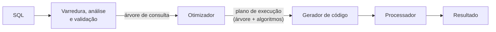
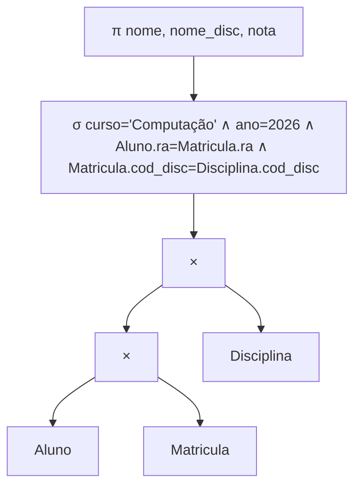
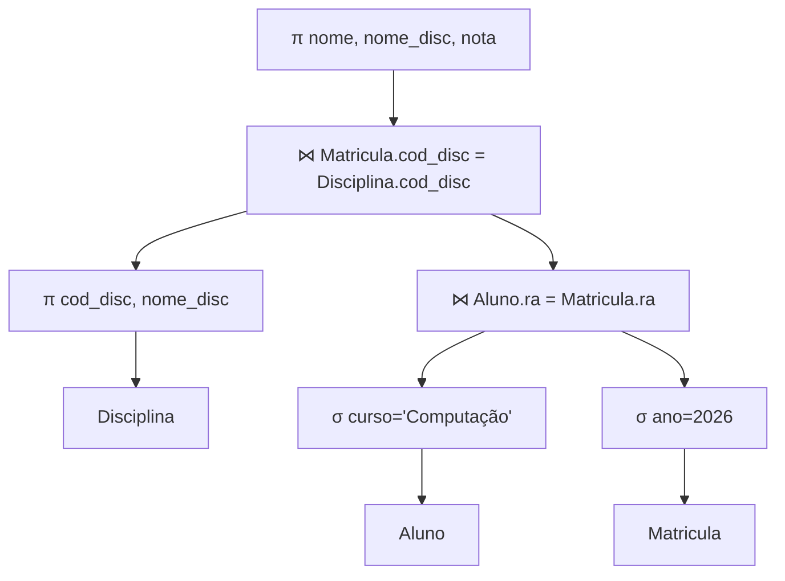

# Aula 11 — Processamento e otimização de consultas (versão P2)

> Aula de 06/11 · Profa. Larissa C. Shimomura
> **Filtro:** [12c](12c_orientacoes_prova2_revisao2.md).
> **Cai:** **árvore de consulta** (respeitando os parênteses) e **otimização baseada em regras**: "quais heurísticas aplicar e por quê" / "identifique duas otimizações e justifique" (Ex. 7 da lista P2, **certeza**). Algoritmos de junção estão em [12](12_joins_spark_revisao_prova.md).
> **Não cai em profundidade:** otimização **baseada em custo** ("matéria de mestrado"). Fica só a ideia geral (o Ex. 8 da lista pergunta isso, mas não foi trabalhado em aula).
> **Cortado desta versão:** contas de seletividade e de fator de seleção de junção, histogramas detalhados, catálogo do SGBD, gerador de código, treino de contas. A versão completa está no histórico do git.

---

## 1. Etapas do processamento de consulta

- **Varredura:** identifica os tokens. **Análise sintática:** a consulta segue a gramática? **Validação:** os nomes existem no esquema?
- **Otimizador:** gera um plano **suficientemente bom** (não necessariamente o ótimo) reordenando operadores por **equivalências algébricas**. No Spark, esse papel é do **Catalyst**.

---

## 2. Árvore de consulta

- **Folhas** = relações; **nós internos** = operadores (σ, π, ×, ⋈).
- Execução em **pós-ordem**: de baixo para cima, da esquerda para a direita.
- **Árvore inicial** (tradução direta): produtos cartesianos embaixo, **uma σ com todas as condições** acima, **π** no topo.
- **Respeite os parênteses:** `(Aluno × Matrícula) × Disciplina` → o 1º × é Aluno com Matrícula, e o resultado entra no 2º × com Disciplina. "Toma cuidado com os parênteses."
- Na prova, escreva as **condições completas** (não abrevie com "...").

| Símbolo | Operador | SQL / Spark |
|---|---|---|
| σc(R) | Seleção (linhas) | `WHERE` / `filter` |
| πa,b(R) | Projeção (colunas) | `SELECT` / `select` |
| R × S | Produto cartesiano | `FROM R, S` |
| R ⋈c S | Junção = σc(R × S) | `JOIN ... ON` / `join` |

---

## 3. Equivalências algébricas

| Equivalência | Forma | Para que serve |
|---|---|---|
| **Cascata de seleção** | σc1 ∧ c2(R) ≡ σc1(σc2(R)) | Separar as condições para cada uma descer sozinha |
| **Cascata de projeção** | πL1(πL2(R)) ≡ πL1(R), se L1 ⊆ L2 | Criar/eliminar projeções intermediárias |
| **Comutatividade de σ** | σc1(σc2(R)) ≡ σc2(σc1(R)) | Aplicar primeiro a mais restritiva |
| **Comutatividade de × e ⋈** | R × S ≡ S × R; R ⋈ S ≡ S ⋈ R | Trocar a ordem das relações (**não** vale para *outer joins*) |

> **A cascata de seleção sozinha NÃO é uma otimização.** É uma **equivalência**: a consulta executa exatamente igual. A otimização de fato é o *selection push-down* que ela permite.

---

## 4. Otimização baseada em regras (heurísticas)

Heurística = "regra que **geralmente funciona**". Ideia: aplicar primeiro o que **reduz os resultados intermediários**. O banco real usa **heurísticas + custo**; na disciplina, só heurísticas.

| Regra | O que faz | Por quê (justificativa para a prova) |
|---|---|---|
| ***Selection push-down*** | Descer cada σ até a relação que tem os atributos dela | (1) A consulta continua **equivalente**; (2) **reduz o nº de tuplas** antes da operação mais custosa (junção/×); (3) só é possível porque o **atributo do filtro pertence a uma só relação** |
| **Trocar × + σ por ⋈** | Um produto cartesiano seguido de uma σ que relaciona as duas tabelas vira junção | O × gera **todas** as combinações (\|R\| × \|S\|), quase todas inválidas e descartadas logo depois; a junção só gera os pares válidos |
| ***Projection push-down*** | Projetar só as colunas que ainda serão usadas, o mais perto das folhas | Reduz a **largura** das tuplas (memória, rede). Mantenha as colunas do resultado final, das seleções ainda não aplicadas e das junções |

**Variação da 2ª revisão:** se a σ tiver condições sobre **as duas** relações (ex.: `valor > 100 ∧ nome = 'João'`), primeiro **quebre** em cascata e depois **desça cada uma** para sua relação. Se `nome` for **chave primária**, há "mais razão ainda": sobra **uma linha só**.

**Trocar a ordem das junções** é otimização válida **só se justificada com o nº de tuplas** dos resultados intermediários. Sem os tamanhos no enunciado, não use como resposta.

### Algoritmo heurístico em 6 passos

1. **Quebrar** as seleções conjuntivas em cascata.
2. **Descer** cada seleção o mais fundo possível.
3. **Reordenar** as folhas para executar primeiro as seleções **mais restritivas**.
4. **Combinar** × + σ em **junções**.
5. **Quebrar** as projeções.
6. **Descer** as projeções, criando novas quando preciso.

---

## 5. Lista P2, Ex. 7 (certeza)

**Esquemas:** Aluno(**ra**, nome, curso) · Matricula(**ra**, **cod_disc**, ano, nota) · Disciplina(**cod_disc**, nome_disc, creditos)

**Consulta:** πnome, nome_disc, nota( σcurso='Computação' ∧ ano=2026 ∧ Aluno.ra=Matricula.ra ∧ Matricula.cod_disc=Disciplina.cod_disc( (Aluno × Matricula) × Disciplina ) )

**(a) Árvore inicial:**

**(b) Duas otimizações baseadas em regras** (gabarito da lista = 1 e 2; a 3 foi aceita pela professora em aula; "duas das três são válidas"):

1. **Selection push-down:** quebrar a σ conjuntiva em cascata e descer `curso='Computação'` para **Aluno** e `ano=2026` para **Matricula** (de onde vem `ano`). Justificativa: **reduz a cardinalidade** das relações base **antes** do produto cartesiano/junção, mantendo a consulta equivalente.
2. **× + σ → ⋈:** combinar cada × com a condição de igualdade de chaves correspondente (`Aluno.ra = Matricula.ra` e `Matricula.cod_disc = Disciplina.cod_disc`). Justificativa: o × materializa **todas as combinações** (\|R\| × \|S\|), em sua maioria inválidas, que seriam descartadas logo em seguida.
3. **Projection push-down em Disciplina:** relação por relação, ver o que é usado depois. Aluno (ra, nome, curso) e Matricula (ra, cod_disc, ano, nota) usam **tudo**; em Disciplina só `cod_disc` e `nome_disc` → πcod_disc, nome_disc(Disciplina), descartando `creditos` antes da junção.

**Árvore depois das três:**

O outro exercício resolvido em aula (pedidos × clientes, "quais heurísticas e por quê") está em [12, Ex. 8](12_joins_spark_revisao_prova.md#exercício-8--sparksql--álgebra-relacional--otimização). O exemplo clássico dos slides (Funcionario/Trabalha_em/Projeto, "Aquarius") segue os mesmos 6 passos.

---

## 6. Otimização por custo (só a ideia)

- Busca no espaço de planos o de **menor custo estimado**. As funções de custo são **estimativas**.
- **Estimativa de cardinalidade:** prever quantas tuplas cada etapa intermediária vai retornar, com estatísticas do catálogo (nº de tuplas, valores distintos…). Sob **distribuição uniforme**: \|R\| × 1/nº de valores distintos (ex.: 1000 clientes, 3 estados → ≈ 334).
- Erra com ***data skew*** (ex.: 60% dos clientes em SP), estatísticas desatualizadas, colunas correlacionadas, propagação de erros em árvores grandes. **Histogramas** ajudam.

**Lista P2, Ex. 8 — por que uma estimativa de cardinalidade errada piora o tempo de execução?** (não trabalhado em aula) O otimizador por custo usa a estimativa para escolher o **plano físico**. Se a previsão falha, ele calcula custos irreais e escolhe **algoritmos físicos inadequados** (ex.: um algoritmo de junção que só valia para entradas pequenas) e uma **ordem inadequada** para as operações.

---

## 7. Checklist

- [ ] Desenho a árvore inicial respeitando os parênteses
- [ ] Sei que a cascata de seleção é equivalência, não otimização
- [ ] Aplico e **justifico** selection push-down, × + σ → ⋈ e projection push-down
- [ ] Resolvo o Ex. 7 da lista (árvore + duas otimizações justificadas)
- [ ] Explico em uma frase a otimização por custo e por que uma cardinalidade errada atrapalha
