# Aula 11 — Processamento e otimização de consultas

> **Computação Escalável (2COP022)** · Profa. Larissa C. Shimomura · Aula de **06/11** (os slides 12–24 da Aula 10 são o começo desta mesma aula)
> **Tópicos:** etapas do processamento de consultas, árvore de consulta (álgebra relacional), equivalências algébricas, otimização **heurística** (*selection/projection push-down*, trocar × por ⋈, o algoritmo em 6 passos), exercício "Aquarius" passo a passo, otimização **por custo** (componentes de custo, seletividade, algoritmos de seleção e de junção, fator de seleção de junção, estimativa de cardinalidade, *data skew*, histogramas), gerador de código e processador
> **Pré-requisitos:** notação de álgebra relacional (σ, π, ×, ⋈) — revisão no material complementar [11a — Introdução à Álgebra Relacional](11a_introducao_algebra_relacional.md); [Aula 10](10_spark_pratica_sparksql.md) (SparkSQL, Catalyst, `explain`)
> **Tempo estimado de estudo:** 3 h (é a aula com mais exercícios "de lápis e papel")

> **Esta aula não tem código Java/Scala.** As questões de prova são de **desenhar e otimizar árvores de consulta** e de **fazer contas** (seletividade, fator de junção, cardinalidade). O treino no final segue esse formato.

> **[P2] O que a Larissa disse na revisão** ([orientações completas](12b_orientacoes_prova2.md))
> - Na **lista de tópicos**: passo a passo do processamento, otimização **por heurísticas**, **ideia geral** da otimização por custo e estimativa de cardinalidade, **principais algoritmos de junção**.
> - Os exercícios desta parte **ficaram para a aula extra**. Modelos dos slides: árvore + heurísticas ([ex. 8](12_joins_spark_revisao_prova.md#exercício-8--sparksql--álgebra-relacional--otimização)) e escolha do algoritmo de join ([ex. 10](12_joins_spark_revisao_prova.md#exercício-10--escolha-do-algoritmo-de-join)).
> - Otimização por custo: ela listou só a **"ideia geral"**. Priorize os conceitos (seletividade, cardinalidade, skew) e a regra de quando usar cada junção.

---

## Sumário

1. [Mapa da aula](#mapa-da-aula)
2. [Por que isso está numa disciplina de computação escalável?](#1-por-que-isso-está-aqui)
3. [Etapas do processamento de consulta](#2-etapas-do-processamento-de-consulta)
4. [Varredura, análise e validação](#3-varredura-análise-e-validação)
5. [Árvore de consulta](#4-árvore-de-consulta)
6. [O otimizador e as equivalências algébricas](#5-o-otimizador-de-consultas)
7. [Otimização heurística](#6-otimização-baseada-em-heurísticas)
8. [O algoritmo em 6 passos e o exercício Aquarius](#7-algoritmo-heurístico-em-6-passos)
9. [Otimização por custo](#8-otimização-baseada-em-estimativa-de-custo)
10. [Algoritmos de seleção e seletividade](#9-algoritmos-de-seleção-e-seletividade)
11. [Algoritmos de junção](#10-algoritmos-de-junção)
12. [Fator de seleção de junção](#11-fator-de-seleção-de-junção)
13. [Estimativa de cardinalidade, *skew* e histogramas](#12-estimativa-de-cardinalidade)
14. [Gerador de código e processador](#13-gerador-de-código-e-processador-de-consulta)
15. [Ponte com o Spark](#14-ponte-com-o-spark)
16. [Treino](#15-treino)
17. [Erros comuns / o que cai em prova](#erros-comuns--o-que-cai-em-prova)
18. [Fontes](#fontes)
19. [Conclusão para revisão](#conclusão-para-revisão)

---

## Mapa da aula

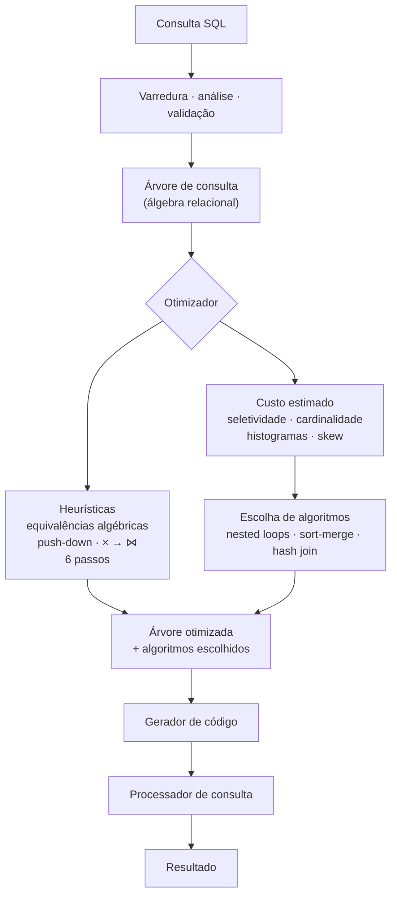

> **O que observar:** as duas formas de otimizar se complementam. As **heurísticas** reorganizam a **árvore** (que operador vem antes); o **custo** escolhe **como** executar cada operador (qual algoritmo) e em que ordem juntar as tabelas, usando estimativas de **quantas tuplas** cada passo produz.

---

## 1. Por que isso está aqui?

- As transformações de dados feitas com o **SparkSQL** são, muitas vezes, **equivalentes a uma consulta SQL** (slide).
- Na [Aula 10](10_spark_pratica_sparksql.md) vimos que o **Catalyst** pega o plano lógico e gera um plano físico mais barato. Esta aula explica **o que** um otimizador desse tipo faz e **por quê**, com a teoria clássica de bancos de dados.
- Em sistemas distribuídos, o ganho de otimizar é ainda maior: cada tupla a menos num resultado intermediário é uma tupla a menos para **mover pela rede** num shuffle.

**Processamento de consulta** (slide) = todo o processo de execução da consulta, **desde o *parsing* do SQL até o retorno do resultado final** ao usuário.

---

## 2. Etapas do processamento de consulta


| Etapa | Entra | Sai |
|---|---|---|
| Varredura, análise e validação | Texto SQL | **Árvore de consulta** (representação interna) |
| Otimizador | Árvore de consulta | **Plano de execução**: árvore otimizada + algoritmo escolhido para cada operador |
| Gerador de código | Plano de execução (físico) | Instruções executáveis |
| Processador de consulta | Código | Resultado, acessando armazenamento, buffers e índices |

> **Comparação com o Spark (`explain`):** *Parsed Logical Plan* ≈ saída da análise; *Analyzed Logical Plan* ≈ depois da validação; *Optimized Logical Plan* ≈ heurísticas aplicadas; *Physical Plan* ≈ plano de execução com algoritmos ([Aula 10, §7](10_spark_pratica_sparksql.md#7-sparksql-e-o-otimizador-catalyst)).

---

## 3. Varredura, análise e validação

| Fase | O que faz | Exemplo de erro detectado |
|---|---|---|
| **Varredura** (*scanner*) | Identifica os **tokens**: palavras-chave SQL, nomes de atributos, nomes de relações | — |
| **Analisador sintático** (*parser*) | Verifica a **sintaxe**: a consulta segue as regras da gramática da linguagem? | `SELECT nome FORM aluno` (`FORM` no lugar de `FROM`) |
| **Validação** | Verifica a **semântica**: os nomes de atributos e relações existem e fazem sentido **no esquema** do banco consultado? | `SELECT salario FROM aluno` quando `aluno` não tem a coluna `salario` |

Depois dessas fases, cria-se uma **representação interna** da consulta, geralmente uma **árvore de consulta** com os operadores na forma de **álgebra relacional**.

---

## 4. Árvore de consulta

A forma mais comum de representação é a **árvore algébrica de consulta**:
- **relações de entrada** = **nós folha**;
- **operações da álgebra relacional** = **nós internos**.

**Lembrete dos operadores** (detalhes em [11a](11a_introducao_algebra_relacional.md)):

| Símbolo | Operador | SQL | Efeito |
|---|---|---|---|
| σ<sub>c</sub>(R) | Seleção | `WHERE c` | Filtra **linhas** |
| π<sub>a,b</sub>(R) | Projeção | `SELECT a, b` | Escolhe **colunas** |
| R × S | Produto cartesiano | `FROM R, S` / `CROSS JOIN` | Toda tupla de R com toda tupla de S |
| R ⋈<sub>c</sub> S | Junção | `JOIN ... ON c` | Pares que satisfazem `c` (= σ<sub>c</sub>(R × S)) |

### Exemplo do slide

```sql
SELECT A.MATRICULA, A.PNOME, D.DEPARTAMENTO_NOME
FROM ALUNO A, DEPARTAMENTO D
WHERE A.CODIGO_DEPARTAMENTO = D.ID;
```

Em álgebra relacional: **π**<sub>A.MATRICULA, A.PNOME, D.DEPARTAMENTO_NOME</sub>(ALUNO A **⋈**<sub>A.CODIGO_DEPARTAMENTO = D.ID</sub> DEPARTAMENTO D)

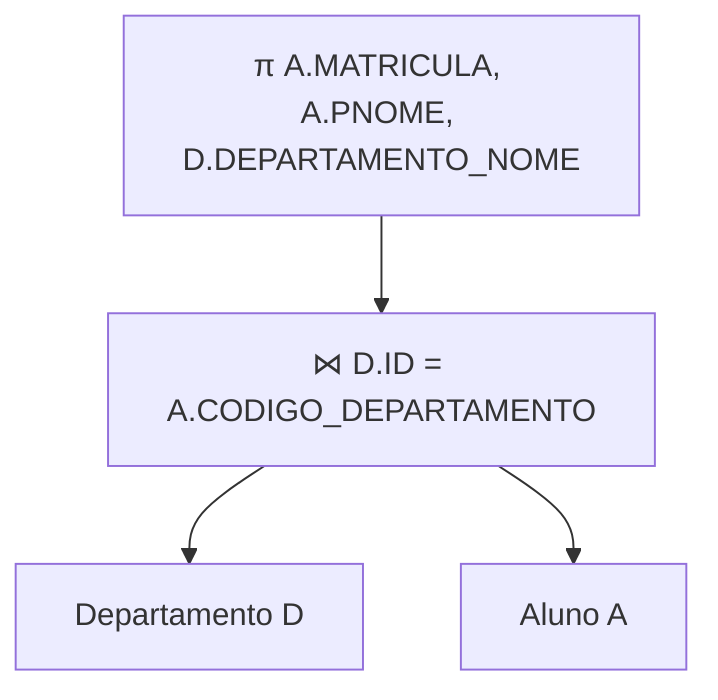

### Como a árvore é executada

A execução segue **pós-ordem**: **de baixo para cima e da esquerda para a direita**. Um operador executa quando as relações de que precisa (seus filhos) estão **disponíveis**.

No exemplo: (1) Departamento e Aluno estão disponíveis (folhas); (2) executa-se a junção; (3) sobre o resultado, a projeção.

### Exercício do slide: desenhe a árvore

```sql
SELECT A.PNOME, D.DEPARTAMENTO_NOME
FROM ALUNO A, DEPARTAMENTO D
WHERE A.CODIGO_DEPARTAMENTO = D.ID
  AND A.IDADE > 20;
```

<details><summary><b>Resposta (árvore inicial, como no slide)</b></summary>

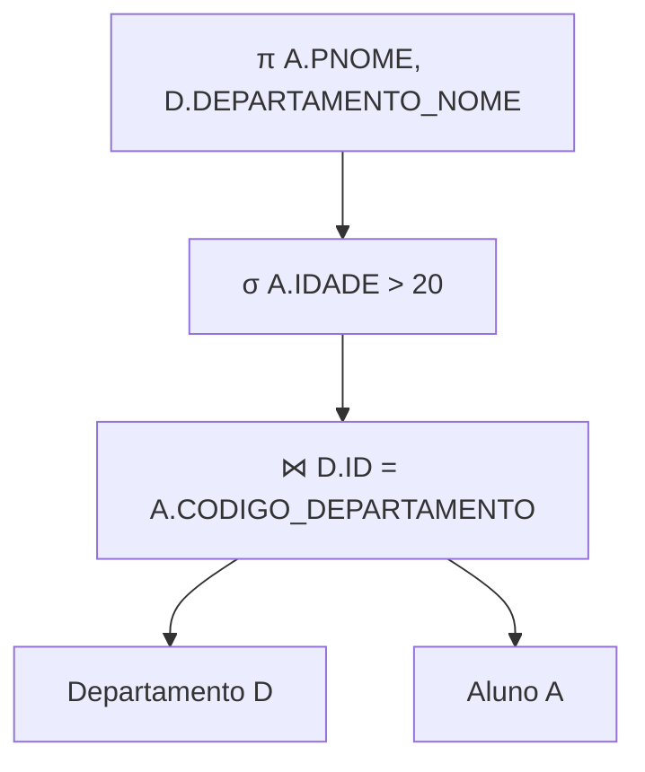

A tradução direta coloca o `WHERE` **inteiro** acima da junção. A condição de igualdade entre as tabelas vira a condição da **junção**, e `IDADE > 20` vira uma **seleção**. É uma árvore **correta**, mas **não otimizada**: a seleção poderia descer até `Aluno` ([§6.1](#61-selection-push-down-executar-a-seleção-o-mais-cedo-possível)).
</details>

---

## 5. O otimizador de consultas

**Uma mesma consulta pode ter várias árvores equivalentes** (mesmo resultado):

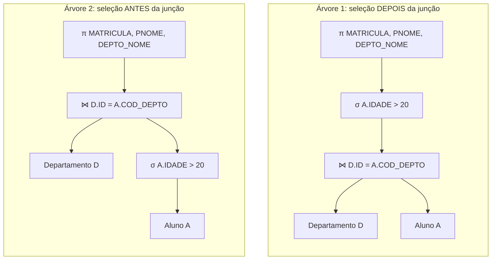

> **O que observar:** as duas devolvem as mesmas tuplas. Na árvore 2, a junção recebe **menos tuplas** de Aluno, logo trabalha menos.

**Objetivo do otimizador:** gerar o plano (a árvore) de **menor custo computacional**.

**Atenção à palavra "otimizador" (slide):** ela é **enganosa**. O plano gerado **não é o ótimo**, e sim um **suficientemente bom**, porque há muitas variáveis que o sistema nem sempre conhece:
- a forma como os arquivos ou tabelas estão armazenados;
- as combinações de operadores;
- as estimativas de quantas tuplas haverá na saída de cada operação.

As otimizações se baseiam em **reordenar operadores** de forma que o resultado final seja **equivalente** ao da consulta de entrada. As reordenações permitidas vêm das **equivalências algébricas**.

### 5.1 Equivalências algébricas

Duas expressões E1 e E2 são **equivalentes** quando produzem **exatamente a mesma relação para qualquer instância válida** do banco. As mais conhecidas (slide):

**(1) Cascata de seleção** — uma seleção com condição composta por vários `AND` pode virar uma sequência de seleções aninhadas:

> σ<sub>c1 AND c2</sub>(R) ≡ σ<sub>c1</sub>(σ<sub>c2</sub>(R))

```sql
SELECT * FROM Aluno A WHERE A.ano_ingresso > 2024 AND A.idade < 25;
```

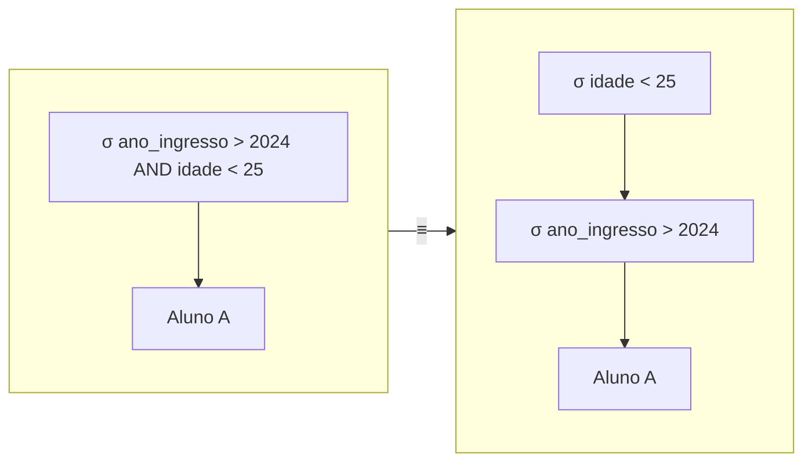

> **Para que serve:** separadas, cada seleção pode **descer independentemente** na árvore até a tabela que ela usa.

**(2) Cascata de projeção** — uma sequência de projeções aninhadas se reduz a **uma única projeção** com os atributos da **mais externa**:

> π<sub>L1</sub>(π<sub>L2</sub>(R)) ≡ π<sub>L1</sub>(R), quando L1 ⊆ L2

Exemplo do slide: π<sub>nome</sub>(σ<sub>idade<25</sub>(π<sub>nome, idade</sub>(Aluno))) ≡ π<sub>nome</sub>(σ<sub>idade<25</sub>(Aluno)). A projeção intermediária π<sub>nome, idade</sub> é redundante. Lida ao contrário, a regra permite **criar** projeções intermediárias (ver *projection push-down*).

**(3) Comutatividade de seleção** — a ordem de duas seleções não altera o resultado:

> σ<sub>c1</sub>(σ<sub>c2</sub>(R)) ≡ σ<sub>c2</sub>(σ<sub>c1</sub>(R))

> **Para que serve:** permite aplicar **primeiro a seleção mais restritiva** (a que elimina mais tuplas).

**(4) Comutatividade do produto cartesiano** — R × S ≡ S × R. (Muda só a ordem das colunas, que não importa numa relação.)

**(5) Comutatividade da junção** — R ⋈<sub>c</sub> S ≡ S ⋈<sub>c</sub> R, para a **maioria** dos tipos de junção.

> **Exceção importante:** a comutatividade **não vale** para **junções externas**: `Aluno LEFT OUTER JOIN Departamento` mantém todos os alunos; `Departamento LEFT OUTER JOIN Aluno` mantém todos os departamentos. São resultados diferentes. (Trocar a ordem **e** o lado — LEFT por RIGHT — preserva o resultado.)

---

## 6. Otimização baseada em heurísticas

> **[P2] Na lista de tópicos.** Exercício modelo: desenhar a árvore e dizer quais heurísticas aplicar e **por quê** ([Aula 12, ex. 8](12_joins_spark_revisao_prova.md#exercício-8--sparksql--álgebra-relacional--otimização)).

A otimização pode ser **baseada em heurísticas** ou **baseada em estimativa de custo**.

**Heurística** = aplicar "**regras que geralmente funcionam**". A ideia principal: **aplicar primeiro as operações que reduzem o tamanho dos resultados intermediários**. As regras da aula:

1. ***Selection push-down***: executar a **seleção** o mais cedo possível;
2. ***Projection push-down***: executar a **projeção** o mais cedo possível;
3. **Evitar produto cartesiano** e trocá-lo por **junção**.

### 6.1 *Selection push-down*: executar a seleção o mais cedo possível

**Regra:** aplicar as seleções nas relações **antes** de qualquer junção ou produto cartesiano. Assim, a junção recebe **menos tuplas**.

**Exemplo do slide** — mesmas tabelas usadas na aula toda:

**Aluno**

| ID | MATRICULA | PNOME | IDADE | CODIGO_DEPARTAMENTO |
|---|---|---|---|---|
| 0 | 12122 | João | 20 | 255 |
| 1 | 89749 | Alice | 30 | 280 |
| 2 | 12312 | Bob | 26 | 255 |
| 3 | 54654 | José | 21 | 255 |

**Departamento**

| ID | DEPARTAMENTO_NOME |
|---|---|
| 255 | Computação |
| 280 | Geografia |

**Sem push-down** (σ acima da junção): a junção produz **4 tuplas** (todo aluno tem departamento) e só depois a seleção descarta o João.

| ID | MATRICULA | PNOME | IDADE | COD_DEPTO | DEPARTAMENTO_NOME |
|---|---|---|---|---|---|
| 0 | 12122 | João | 20 | 255 | Computação |
| 1 | 89749 | Alice | 30 | 280 | Geografia |
| 2 | 12312 | Bob | 26 | 255 | Computação |
| 3 | 54654 | José | 21 | 255 | Computação |

**Com push-down** (σ<sub>IDADE>20</sub> direto sobre Aluno): João (idade **20**, que **não** é > 20) sai **antes**; a junção recebe 3 alunos e produz **3 tuplas**.

| ID | MATRICULA | PNOME | IDADE | COD_DEPTO | DEPARTAMENTO_NOME |
|---|---|---|---|---|---|
| 1 | 89749 | Alice | 30 | 280 | Geografia |
| 2 | 12312 | Bob | 26 | 255 | Computação |
| 3 | 54654 | José | 21 | 255 | Computação |

> **Escala:** aqui a economia é de 1 tupla. Com 10 milhões de alunos e um filtro que mantém 1%, a junção passa a receber 100 mil tuplas em vez de 10 milhões. Em Spark, isso é 99% menos dados no shuffle da junção.

### 6.2 *Projection push-down*: executar a projeção o mais cedo possível

**Regra:** **descartar as colunas desnecessárias o mais perto possível das tabelas originais**, usando também a **cascata de projeção**. Isso **reduz a largura dos registros**, economizando memória RAM (e, em sistemas distribuídos, rede).

**Que colunas manter?** Numa tabela, só sobrevivem as colunas que algum operador **acima** ainda vai usar: as do **resultado final** (π do topo), as de **condições de seleção** que ainda não foram aplicadas e as de **condições de junção**.

**Exemplo do slide** — *"Nome dos departamentos que têm alunos com idade > 20"*:

π<sub>D.DEPARTAMENTO_NOME</sub>(σ<sub>A.IDADE>20</sub>(Departamento D ⋈<sub>D.ID = A.CODIGO_DEPARTAMENTO</sub> Aluno A))

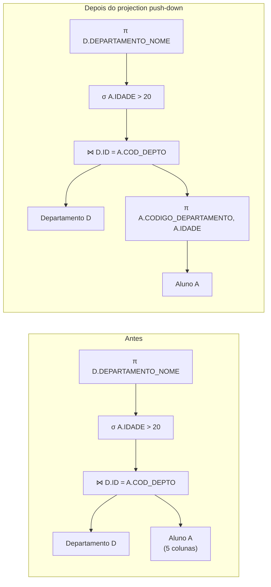

> **O que observar:** de Aluno, só são necessárias `CODIGO_DEPARTAMENTO` (para a junção) e `IDADE` (para a seleção, que nesse slide continua acima da junção). `ID`, `MATRICULA` e `PNOME` são descartadas **logo na leitura**: cada tupla de Aluno passa de 5 para 2 colunas. Departamento já tem só as 2 colunas necessárias (`ID` para a junção, `DEPARTAMENTO_NOME` para o resultado).

### 6.3 "Projection push-down — é possível aqui?" (slide)

Consulta: π<sub>A.MATRICULA, A.PNOME, D.DEPARTAMENTO_NOME</sub>(σ<sub>A.IDADE>20</sub>(Departamento D ⋈<sub>D.ID = A.CODIGO_DEPARTAMENTO</sub> Aluno A))

<details><summary><b>Resposta e raciocínio</b></summary>

**Sim, mas o ganho é pequeno.** De Aluno, ainda são necessárias:
- `MATRICULA` e `PNOME` → estão no **resultado final**;
- `IDADE` → usada pela **seleção** acima;
- `CODIGO_DEPARTAMENTO` → usada pela **junção**.

Só **`ID`** pode ser descartada: π<sub>MATRICULA, PNOME, IDADE, CODIGO_DEPARTAMENTO</sub>(Aluno). Se a seleção também for empurrada para baixo, dá para aplicar σ<sub>IDADE>20</sub> **antes** e projetar depois, descartando também `IDADE`:

π<sub>MATRICULA, PNOME, CODIGO_DEPARTAMENTO</sub>(σ<sub>IDADE>20</sub>(Aluno))

**Lição:** o *projection push-down* rende mais quando a consulta usa **poucas** colunas de tabelas **largas**. Quando quase todas as colunas são necessárias, sobra pouco a cortar.
</details>

### 6.4 Evitar produto cartesiano: trocá-lo por junção

**Regra:** se uma consulta tem um **produto cartesiano seguido de uma seleção que relaciona as duas tabelas**, o produto deve ser **substituído por uma junção**.

**Por quê:** o produto cartesiano gera **todas** as combinações (|R| × |S| tuplas), quase todas inúteis; a junção processa **só os cruzamentos válidos**.

**Lembrete:** uma junção pode ser definida como **produto cartesiano seguido de seleção**:

> R ⋈<sub>c</sub> S ≡ σ<sub>c</sub>(R × S)

**Exemplo do slide:** Aluno (4 tuplas) × Cursos (3 tuplas) = **12** combinações; dessas, só as **4** com `codigo_curso = id` interessam. A junção chega direto nas 4.

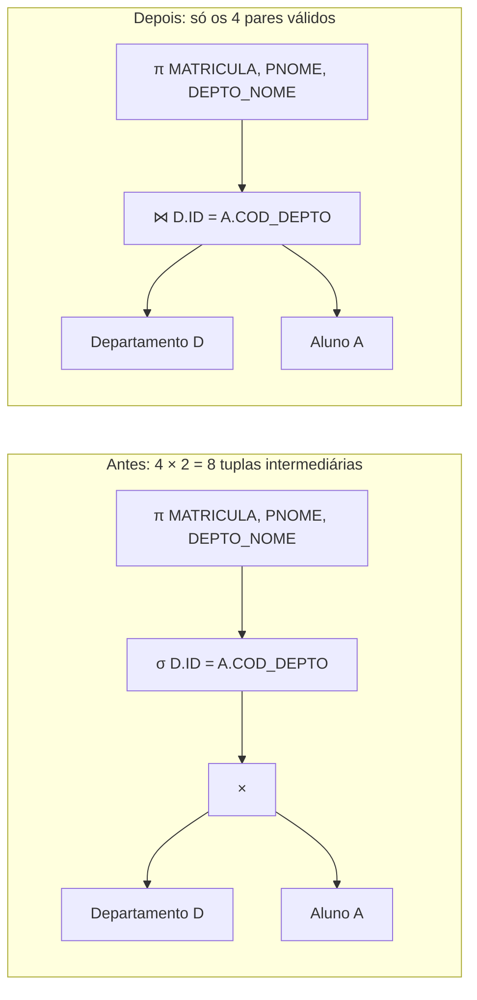

> Com 1 milhão de alunos e mil departamentos, o produto teria **1 bilhão** de tuplas intermediárias; a junção, 1 milhão.

---

## 7. Algoritmo heurístico em 6 passos

Algoritmo básico (slide) para aplicar as regras heurísticas:

| Passo | Ação | Equivalência / regra usada |
|---|---|---|
| **1** | **Quebrar** as seleções com condições conjuntivas (`AND`) em uma **cascata** de seleções | Cascata de seleção |
| **2** | **Mover** cada seleção **o mais profundo possível** na árvore | *Selection push-down* (comutatividade de σ com × e ⋈) |
| **3** | **Reordenar** os nós folha de modo que as **seleções mais restritivas** sejam executadas **primeiro** | Comutatividade (e associatividade) de × e ⋈ |
| **4** | **Combinar** produtos cartesianos com as seleções logo acima deles para formar **junções** | σ<sub>c</sub>(R × S) ≡ R ⋈<sub>c</sub> S |
| **5** | **Quebrar** as projeções, quando possível | Cascata de projeção |
| **6** | **Mover** as projeções quebradas **o mais profundo possível**, criando novas projeções quando necessário | *Projection push-down* |

### 7.1 Exercício 1 — árvore inicial

**Consulta (SQL):**

```sql
SELECT Unome
FROM Funcionario, Trabalha_em, Projeto
WHERE Projnome = 'Aquarius' AND Projnumero = Pnr
  AND FCpf = Cpf AND Data_nasc > '31-12-1957';
```

**Relações:** `Funcionario(Cpf, Unome, Data_nasc, Telefone)`, `Trabalha_em(Pnr, FCpf)`, `Projeto(Projnumero, Projnome)`.

**Em álgebra relacional:**

π<sub>Unome</sub>(σ<sub>Projnome='Aquarius' ∧ Projnumero=Pnr ∧ FCpf=Cpf ∧ Data_nasc>'31-12-1957'</sub>((Funcionario × Trabalha_em) × Projeto))

> **Leitura da consulta:** "sobrenome dos funcionários nascidos depois de 1957 que trabalham no projeto Aquarius". `Trabalha_em` liga funcionário (FCpf → Cpf) e projeto (Pnr → Projnumero).

**Árvore inicial** (tradução direta: produtos cartesianos embaixo, uma seleção gigante acima, projeção no topo):

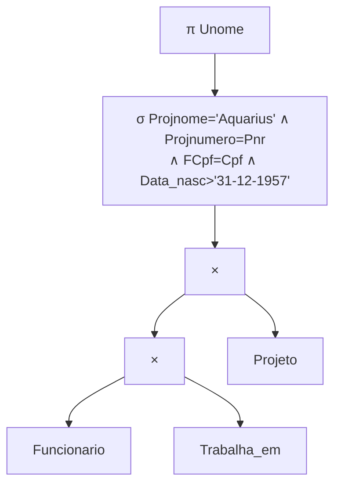

> **Custo dessa árvore:** com 1000 funcionários, 5000 linhas em Trabalha_em e 50 projetos, o produto teria 1000 × 5000 × 50 = **250 milhões** de tuplas, para no fim sobrar um punhado.

### 7.2 Exercício 2 — aplicando os 6 passos

**Passo 1 — quebrar a seleção conjuntiva em cascata:**

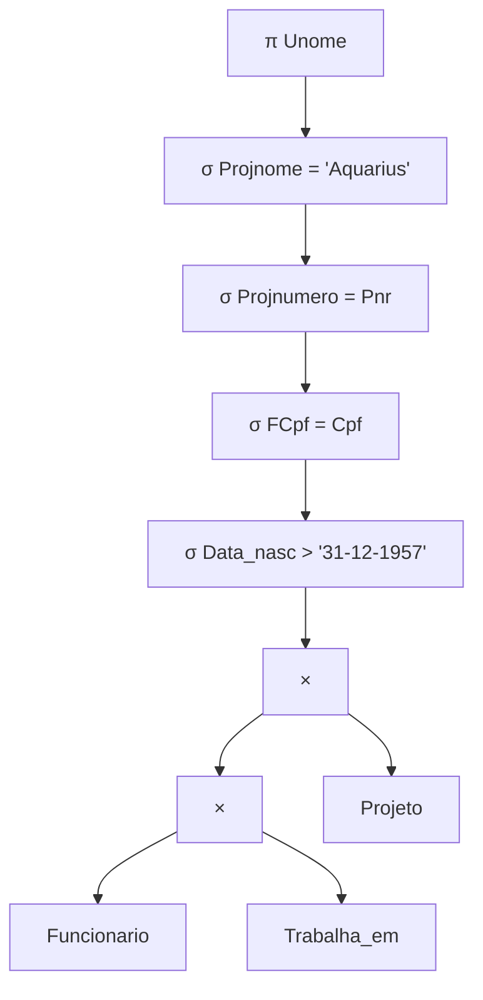

**Passo 2 — mover cada seleção o mais fundo possível.** Cada seleção desce até o ponto mais baixo em que **todas as colunas que ela usa** estão disponíveis:
- `Data_nasc > ...` usa só Funcionario → desce até **Funcionario**;
- `Projnome = 'Aquarius'` usa só Projeto → desce até **Projeto**;
- `FCpf = Cpf` usa Trabalha_em **e** Funcionario → fica logo acima do **× entre os dois**;
- `Projnumero = Pnr` usa Projeto **e** Trabalha_em → só pode ficar acima do **× de cima**.

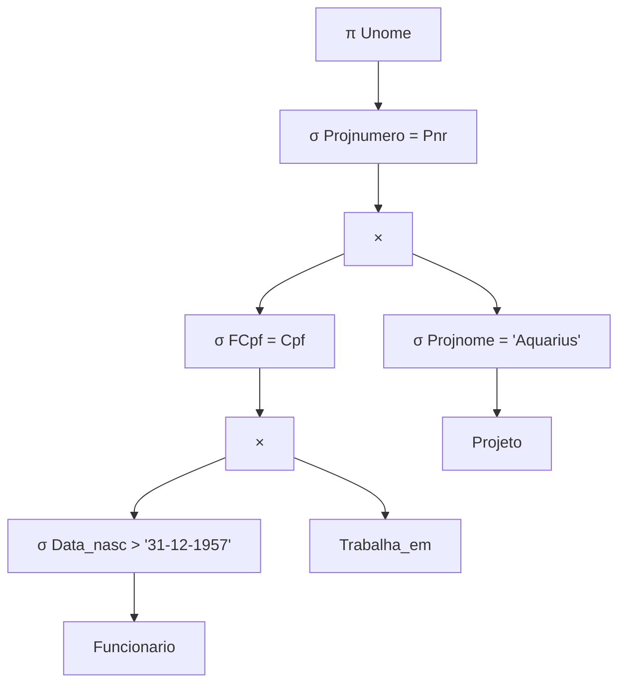

**Passo 3 — reordenar: seleções mais restritivas primeiro.** `Projnome = 'Aquarius'` seleciona **um único projeto** (muito restritiva), enquanto `Data_nasc > 1957` deve manter muitos funcionários. Então o primeiro cruzamento passa a ser **Projeto com Trabalha_em**, e Funcionario entra por último:

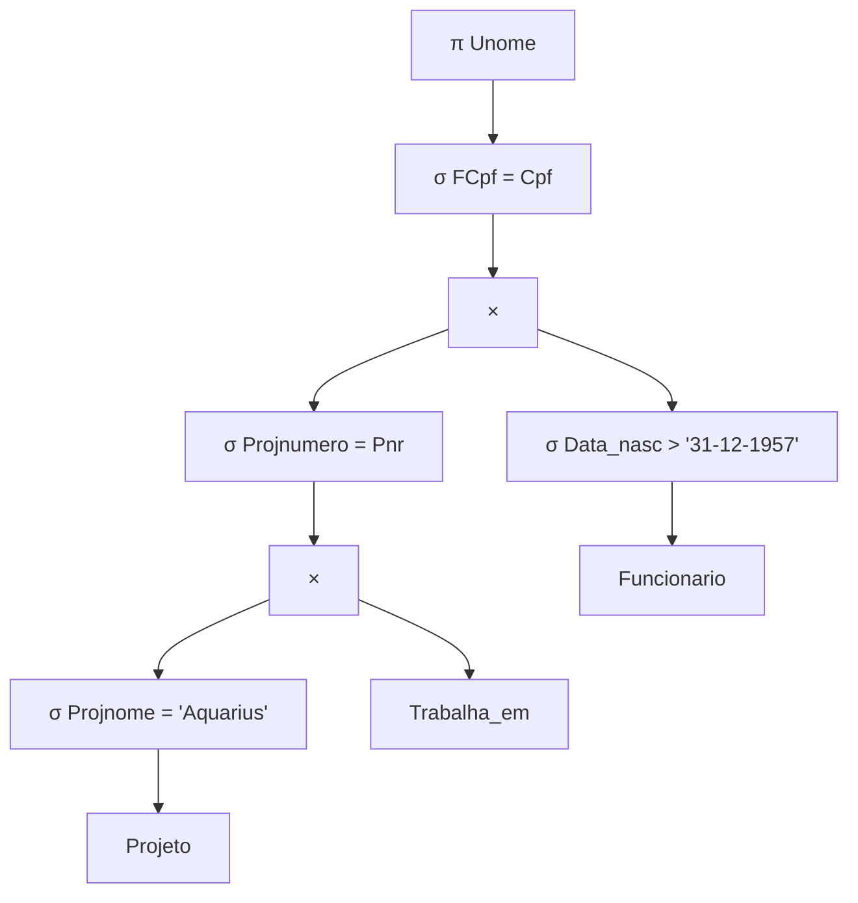

> **O que observar:** agora o primeiro cruzamento envolve **1 projeto** com Trabalha_em, o que gera poucas tuplas. Só depois entra Funcionario. As condições de ligação também trocaram de lugar: `Projnumero = Pnr` fica embaixo e `FCpf = Cpf` em cima.

**Passo 4 — combinar × + σ em junções:**

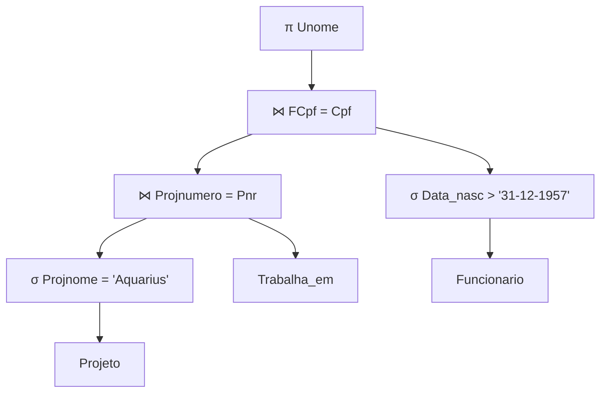

**Passos 5 e 6 — quebrar e descer as projeções** (árvore final otimizada). Em cada ramo, mantêm-se só as colunas usadas acima:
- de **Projeto**: só `Projnumero` (para a junção com Trabalha_em);
- de **Trabalha_em**: `Pnr` (junção com Projeto) e `FCpf` (junção com Funcionario);
- de **Funcionario**: `Unome` (resultado) e `Cpf` (junção).

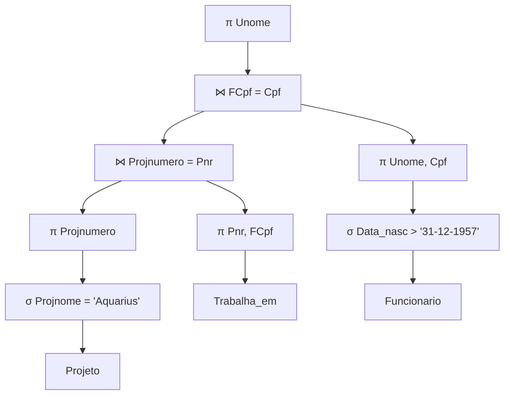

> **Nota sobre o slide:** na árvore final do slide, a projeção sobre Trabalha_em está escrita como **π<sub>Projnumero, FCpf</sub>**. Trabalha_em não tem o atributo `Projnumero` (ela tem `Pnr` e `FCpf`), então o correto é **π<sub>Pnr, FCpf</sub>**. É um erro de digitação; a intenção é manter a coluna que liga ao projeto e a que liga ao funcionário.
>
> **Para ir além:** dá para inserir ainda uma π<sub>FCpf</sub> logo acima da junção `Projnumero = Pnr` (depois dela, só `FCpf` é usado). O slide não inclui esse passo.

**Comparando o antes e o depois:**

| | Árvore inicial | Árvore otimizada |
|---|---|---|
| Produtos cartesianos | 2 | 0 (viraram junções) |
| Seleções | 1, no topo | 2, junto às tabelas |
| Primeiro cruzamento | Funcionario × Trabalha_em (enorme) | 1 projeto ⋈ Trabalha_em (pequeno) |
| Colunas carregadas | Todas, até o topo | Só as necessárias, desde as folhas |

---

## 8. Otimização baseada em estimativa de custo

> **[P2]** Ela listou só a **ideia geral** da otimização por custo e da estimativa de cardinalidade: priorize os conceitos e as contas simples.

**Ideia (slide):** usar técnicas de otimização tradicionais que **pesquisam o espaço de soluções** (os planos possíveis) em busca de uma solução que **minimize uma função objetivo** (o custo).

- As **funções de custo não são exatas**: são **estimativas**.
- O **espaço de soluções é grande** (muitas ordens de junção × muitos algoritmos), então costuma haver um **limite** de quantos planos são analisados.

### 8.1 Componentes de custo

| Componente | O que mede |
|---|---|
| **Acesso a armazenamento secundário** | Transferir (ler e gravar) **blocos** de dados entre o disco e os buffers da memória principal |
| **Armazenamento em disco** | Guardar em disco **arquivos intermediários** |
| **Computação** | Realizar as operações **em memória** (comparações, ordenações, hashing) |
| **Uso de memória** | **Número de buffers** de memória principal necessários |
| **Comunicação** | Enviar a consulta e os resultados ao usuário final; **em sistemas distribuídos, inclui a transferência entre os computadores durante a avaliação da consulta** |

> **Em Computação Escalável**, o último item é muitas vezes o **maior**: o shuffle do Spark é exatamente custo de comunicação.

### 8.2 Escopo da aula (slide)

Muitos desses custos dependem de existirem **índices** (estruturas como árvores que aceleram buscas) e do **tipo de armazenamento** (dados ordenados ou não). Por isso, a aula vê **só a ideia geral** da otimização por custo, com foco no **custo de computação**, medido em **número de tuplas**: os principais algoritmos e a **estimativa de cardinalidade**. O custo real deveria considerar o **acesso a blocos** conforme o armazenamento.

---

## 9. Algoritmos de seleção e seletividade

Operadores do banco têm algoritmos para **seleção**, **projeção** e **junção**.

### 9.1 Pesquisa linear

**Pesquisa linear** (força bruta): recupera **cada** tupla e testa se ela satisfaz a condição.
- **Custo computacional:** o **tamanho da entrada** (|R| tuplas testadas).

### 9.2 Seletividade de uma condição

> **Seletividade(S) = tuplas que satisfazem a condição ÷ número total de tuplas da relação**, um número **entre 0 e 1**.

| Valor | Significado |
|---|---|
| S = 0 | **Nenhuma** tupla satisfaz a condição |
| S = 1 | **Todas** satisfazem |
| S pequena | Condição **restritiva**: sobra pouco |

**Exemplos do slide** — tabelas `Pedidos` (10.000 tuplas) e `Clientes` (1.000 tuplas):

| Condição | Cálculo | Seletividade |
|---|---|---|
| 200 clientes têm `estado = 'PR'` | 200 / 1.000 | **0,2** |
| `id = 001` em Pedidos, sendo `id` **chave** | 1 / 10.000 | **0,0001** |

> Numa condição de igualdade sobre uma **chave**, a seletividade é sempre 1 / |R|: no máximo uma tupla passa.

**Para a otimização:** queremos **diminuir ao máximo** o tamanho das relações intermediárias. **Quanto menor a seletividade, menor a relação de saída** da seleção, e por isso seleções de **seletividade baixa** devem ser aplicadas **primeiro** (é o passo 3 do algoritmo heurístico, agora com número).

> **Pegadinha de vocabulário:** "seletividade **baixa**" = condição **muito** seletiva (filtra muito). O número pequeno é a **fração que sobra**.

---

## 10. Algoritmos de junção

> **[P2] Na lista de tópicos ("principais algoritmos de junção").** Exercício modelo: dizer se o algoritmo proposto é adequado e sugerir outro ([Aula 12, ex. 10](12_joins_spark_revisao_prova.md#exercício-10--escolha-do-algoritmo-de-join)).

Para **equijunção** (*inner join* com igualdade), R ⋈<sub>R.rid = S.sid</sub> S, três algoritmos:

### 10.1 *Nested loops* (laços aninhados)

O algoritmo **padrão**, de **força bruta**:

```text
para cada tupla t em R:            -- laço externo
    para cada tupla s em S:        -- laço interno
        se t.rid == s.sid:
            emitir (t, s)
```

- **Custo:** **|R| × |S|** comparações.
- **Vantagem:** não precisa de **nenhuma estrutura auxiliar** nem de ordenação; funciona para **qualquer** condição (até `<`, `>`, `LIKE`).

### 10.2 *Sort-merge join* (ordenação e intercalação)

1. **Ordena** R pela chave de junção (`rid`) e S pela sua (`sid`);
2. **Varre as duas ao mesmo tempo**, como na intercalação do *mergesort*: avança o ponteiro do lado com a chave menor e emite os pares quando as chaves são iguais.

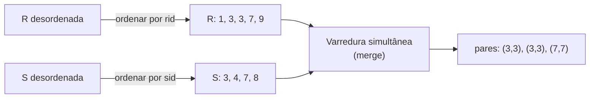

- **Custo (slide):** custo de **ordenar R** + custo de **ordenar S** + **custo linear** da relação com **maior número de tuplas** (a varredura).
- Ordenar custa da ordem de *n* log *n*; se as relações **já estão ordenadas** pela chave, sobra só a varredura linear.

### 10.3 *Hash join*

Usa uma **tabela hash** para verificar a existência das chaves:

1. **Fase de construção (*build*):** escolhe-se uma das relações (digamos S) e constrói-se uma **tabela hash** indexada pela chave de junção (`sid`);
2. **Fase de sondagem (*probe*):** para cada tupla de R, calcula-se o hash de `rid` e **procura-se** na tabela as tuplas de S com a mesma chave.

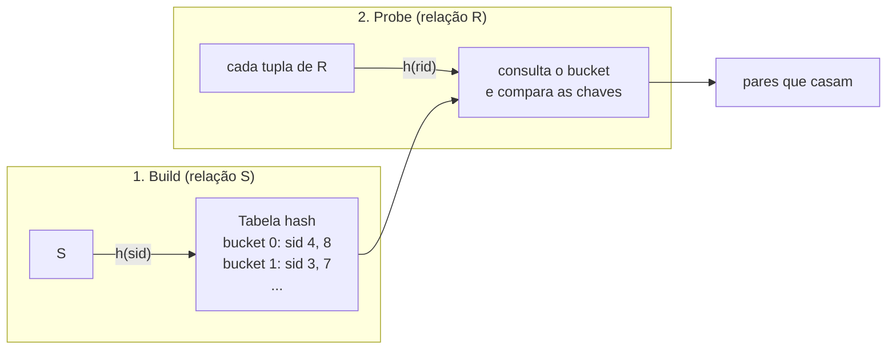

- **Custo (slide):** **|R| + |S|** (cada tupla é visitada uma vez) + o custo de **construir** a tabela hash de S.
- **Requisito:** a tabela hash precisa **caber na memória**. Por isso se constrói sobre a relação **menor**.

> **Já vimos isso:** no [exercício 4 do 09b](09b_programacao_scala.md#exercício-4--cruzar-clientes-e-pedidos), a versão com `for` aninhado era um *nested loops*, e a versão que montava um `Map` de clientes por ID era um *hash join*.

### 10.4 Comparação e quando usar cada um

**Exemplo numérico** (ilustrativo, contando comparações/visitas de tupla): Clientes (1.000) ⋈ Pedidos (10.000).

| Algoritmo | Conta | Ordem de grandeza |
|---|---|---|
| Nested loops | 1.000 × 10.000 | **10.000.000** |
| Sort-merge | ordenar 1.000 (≈ 1.000 · log₂1.000 ≈ 10⁴) + ordenar 10.000 (≈ 10.000 · log₂10.000 ≈ 1,3·10⁵) + varrer 10.000 | **≈ 150.000** |
| Hash join | construir com 1.000 + sondar 10.000 | **≈ 11.000** |

**Regras gerais (slide; dependem da implementação de cada sistema):**

| Situação | Algoritmo | Por quê |
|---|---|---|
| Cardinalidade **baixa** / entradas com **poucas tuplas** | **Nested loops** | Com poucas tuplas, o algoritmo que **não precisa de estrutura adicional** é adequado |
| Cardinalidade **baixa a média** e **pelo menos uma relação cabe na RAM** | **Hash join** | A tabela hash precisa caber na memória |
| Cardinalidade **alta** e as relações **não cabem na memória** | **Sort-merge** | O custo de ordenar **se paga** nesses casos (ordenação externa funciona em disco) |

---

## 11. Fator de seleção de junção

**Fator de seleção de junção** = a fração das tuplas do produto cartesiano que **de fato** são juntadas:

> **Fator de seleção de junção = tuplas geradas pela junção ÷ número de tuplas do produto cartesiano entre as duas relações**

É um indicativo importante para escolher o algoritmo de menor custo.

**Exemplo do slide** — `Clientes.id = Pedidos.cliente_id`, com Pedidos (10.000) e Clientes (1.000). Como `cliente_id` é **chave estrangeira**, **todo pedido tem exatamente um cliente**, então a junção gera **10.000** tuplas:

> Fator = 10.000 ÷ (1.000 × 10.000) = 10.000 ÷ 10.000.000 = **0,001**

> **Nota (slide):** podem existir clientes sem pedido, mas todo pedido tem um cliente. Por isso o resultado tem exatamente |Pedidos| tuplas. **Regra prática:** numa junção por chave estrangeira → chave primária, o resultado tem o tamanho da tabela do lado da chave estrangeira, e o fator é 1 ÷ |tabela da chave primária|.

**Usando o fator para estimar o tamanho da saída:** |R ⋈ S| ≈ fator × |R| × |S|. Isso alimenta a decisão de **ordem das junções**: juntar primeiro os pares com resultado menor.

---

## 12. Estimativa de cardinalidade

**Estimativa de cardinalidade** é um dos componentes principais da otimização por custo: **estimar o tamanho (nº de tuplas) do resultado de uma operação com base em estatísticas**. Ela permite:
- **ordenar operações** para diminuir as tuplas intermediárias;
- **selecionar os algoritmos** de menor custo (ver a tabela da [§10.4](#104-comparação-e-quando-usar-cada-um)).

### 12.1 Metadados do catálogo do SGBD

Para estimar custos, o SGBD guarda no **catálogo**:
- número de tuplas de cada relação;
- tamanho da tupla;
- número de **blocos** ocupados pela relação;
- número de **valores distintos** de cada atributo;
- número **médio** de tuplas que satisfazem uma igualdade num atributo.

### 12.2 Hipótese de distribuição uniforme

**Exemplo do slide:** `Clientes` tem 1.000 tuplas e a coluna `estado` assume 3 valores: PR, SP e RJ. **Supondo distribuição uniforme**, cada estado tem 1/3 dos clientes:

> Cardinalidade estimada de `estado = 'X'` = 1.000 × 1/3 ≈ **334** tuplas

> (1.000 ÷ 3 = 333,3; o slide arredonda **para cima**, 334. É uma **estimativa**, então o arredondamento não importa; a fórmula sim: **|R| × 1 / nº de valores distintos**.)

### 12.3 Assimetria de dados (*data skew*)

**Raramente** a distribuição é uniforme. Se cerca de **60% dos clientes são de SP**:

| Estado | Estimativa uniforme | Real (60% SP; resto dividido, por exemplo) | Erro |
|---|---|---|---|
| SP | 334 | **600** | estimativa ≈ 44% menor que o real |
| PR | 334 | 200 | estimativa 67% maior |
| RJ | 334 | 200 | estimativa 67% maior |

**Consequência (slide):** o otimizador pode escolher, por exemplo, aplicar `estado = 'SP'` contando que ela **diminuirá muito** as tuplas para a próxima operação; por causa da assimetria, isso **não acontece**, e o tempo da consulta é afetado (talvez escolhendo um algoritmo de junção que só valia para entradas pequenas).

> **Ligação com o Spark:** é o mesmo *skew* do notebook da Aula 10 ([§4.3](10_spark_pratica_sparksql.md#43-prévia-data-skew-assimetria-de-dados)): 900 de 1000 vendas eram de SP e uma partição ficou com 95% do trabalho. No otimizador, o *skew* **engana a estimativa**; na execução distribuída, **desequilibra a carga**. A Aula 12 trata o *skew* no Spark.

### 12.4 Histogramas

Para lidar com isso, **coletam-se estatísticas sobre a distribuição dos dados**; uma forma comum de representá-las é o **histograma**: quantas tuplas há em cada valor (ou faixa de valores) do atributo.

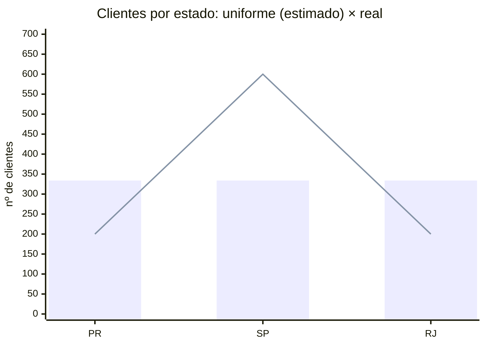

> **O que observar:** as barras são a hipótese uniforme; a linha é a distribuição real que um **histograma** guardaria. Com o histograma, a estimativa para SP passa a ser 600, e não 334.

A estimativa de cardinalidade dá uma informação importante sobre o **custo estimado** de uma operação e, por fim, ajuda a **escolher os algoritmos**.

### 12.5 Causas comuns de erro na estimativa (slide)

| Causa | Exemplo / explicação |
|---|---|
| **Estatísticas desatualizadas** | O banco não atualizou as estatísticas depois de uma grande carga ou remoção de dados |
| **Correlação entre colunas** | Supor **independência** entre colunas correlacionadas: `Cidade = 'São Paulo' AND Estado = 'SP'`. Multiplicar as seletividades (ex.: 0,1 × 0,6 = 0,06) **subestima** o resultado, pois toda linha com cidade São Paulo já tem estado SP (o certo seria ≈ 0,1) |
| **Propagação de erros em árvores complexas** | Erros nos operadores de baixo **se multiplicam** a cada junção acima |
| **Funções e expressões** | `WHERE UPPER(nome) = 'ANA'` frequentemente impede o uso das estatísticas da coluna `nome` (o banco não sabe a distribuição de `UPPER(nome)`) |

### 12.6 Tópicos recentes (só citados no slide)

- Uso de **algoritmos de *machine learning*** para estimar a cardinalidade;
- Uso de **estruturas probabilísticas** para recuperar essas estimativas.

(Os slides seguintes da aula mostram figuras da palestra de Carsten Binnig, TU Darmstadt, na sessão "*Query Optimization Unleashed*" da SIGMOD/PODS 2025; ficam como "Para ir além".)

---

## 13. Gerador de código e processador de consulta

| Componente | Papel (slide) |
|---|---|
| **Gerador de código** | Traduz o **plano físico** do otimizador (a árvore otimizada com os algoritmos escolhidos) em **instruções executáveis** |
| **Processador de consulta** | **Executa** essas instruções. Interage com a parte mais "baixo nível" do banco: **forma de acesso e armazenamento**, **gerenciamento de buffer**, **gerenciamento de índices** etc. |

> No Spark, o equivalente é o *whole-stage code generation* (os `*(1)`, `*(2)` do `explain`, [Aula 10, §9](10_spark_pratica_sparksql.md#9-lendo-um-explain)) e a execução das tasks nos executors.

---

## 14. Ponte com o Spark

| Conceito desta aula | Onde aparece no Spark (Aula 10) |
|---|---|
| Árvore de consulta / plano lógico | `explain(extended = true)`: *Parsed/Analyzed Logical Plan* |
| Heurísticas (regras) | *Optimized Logical Plan*: o Catalyst aplica regras como empurrar filtros e projeções |
| *Selection push-down* | `Filter` logo acima do `FileScan` |
| *Projection push-down* | `FileScan csv [id_venda, categoria, valor, estado]`: só as colunas usadas são lidas |
| Escolha de algoritmo | *Physical Plan*: `HashAggregate`, `SortMergeJoin`, `BroadcastHashJoin`… |
| Comunicação como custo | `Exchange` (shuffle) |
| Cardinalidade / skew | Estatísticas de tabela, AQE e o tema da Aula 12 |

> **Prévia da Aula 12 (último slide):** **Broadcast Join** e **Hash Join no Spark**, e o problema do **data skew** no Spark, além de exercícios sobre o conteúdo para a prova. O *broadcast join* é um hash join distribuído em que a tabela **pequena** é enviada inteira a cada executor (a fase *build* acontece em todos), evitando o shuffle da tabela grande.

---

## 15. Treino

### Árvores de consulta

**T1 — Desenhe a árvore inicial e a otimizada.**
`Produto(id, nome, preco, id_categoria)`, `Categoria(id, nome_cat)`.

```sql
SELECT P.nome
FROM Produto P, Categoria C
WHERE P.id_categoria = C.id AND C.nome_cat = 'Livros' AND P.preco < 50;
```

<details><summary><b>Gabarito T1</b></summary>

**Inicial:** π<sub>P.nome</sub>(σ<sub>P.id_categoria=C.id ∧ C.nome_cat='Livros' ∧ P.preco<50</sub>(Produto × Categoria))

**Otimizada** (passos: quebrar σ → descer σ → × + σ = ⋈ → descer π):

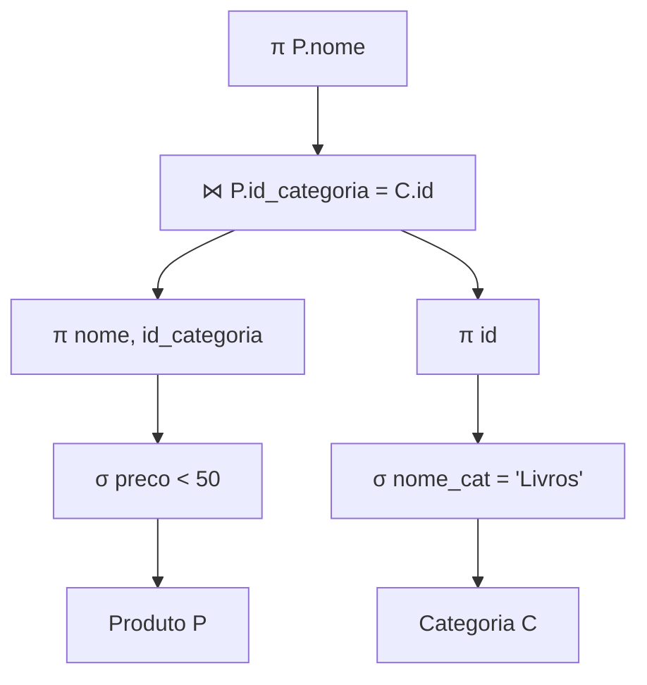

De Produto ficam `nome` (resultado) e `id_categoria` (junção); `preco` some depois do filtro. De Categoria fica só `id`.
</details>

**T2 — Três tabelas.** `Aluno(mat, nome, curso_id)`, `Matricula(mat_aluno, disc_id, nota)`, `Disciplina(id, titulo, creditos)`. Consulta: nomes dos alunos com **nota ≥ 9** em disciplinas de **4 créditos**. Escreva a álgebra inicial e a árvore otimizada.

<details><summary><b>Gabarito T2</b></summary>

**Inicial:** π<sub>nome</sub>(σ<sub>mat=mat_aluno ∧ disc_id=id ∧ nota≥9 ∧ creditos=4</sub>((Aluno × Matricula) × Disciplina))

**Otimizada:**

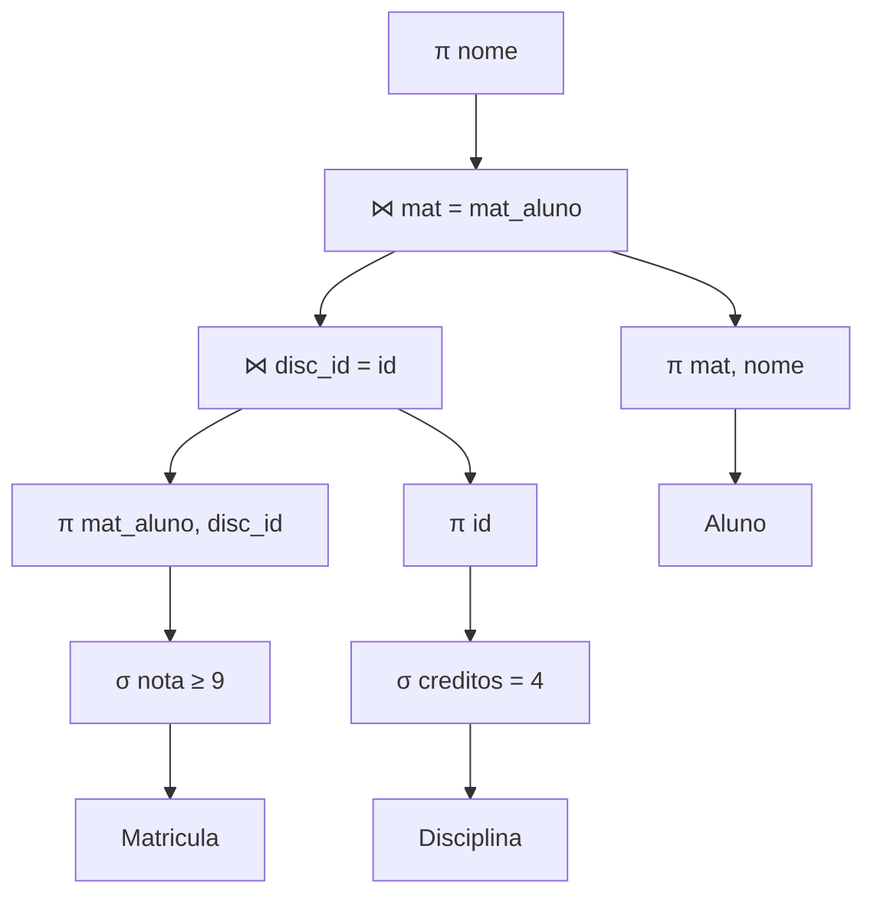

Matricula e Disciplina, que têm seleções, são juntadas **primeiro** (passo 3); Aluno, sem filtro, entra por último. Aluno não tem seleção, mas tem projeção (`curso_id` sai).
</details>

**T3 — Esta transformação está correta?** Para cada item, diga se a árvore resultante é equivalente.

(a) Trocar `Aluno LEFT OUTER JOIN Departamento` por `Departamento LEFT OUTER JOIN Aluno`.
(b) Descer σ<sub>A.idade > D.idade_minima</sub> para logo acima de `Aluno`, abaixo da junção com `Departamento`.
(c) Aplicar π<sub>nome</sub>(Aluno) **abaixo** da junção `Aluno.curso_id = Curso.id`.
(d) Trocar σ<sub>A.curso_id = C.id</sub>(Aluno × Curso) por Aluno ⋈<sub>A.curso_id = C.id</sub> Curso.
(e) Trocar σ<sub>idade>20</sub>(σ<sub>curso='CC'</sub>(Aluno)) por σ<sub>curso='CC'</sub>(σ<sub>idade>20</sub>(Aluno)).

<details><summary><b>Gabarito T3</b></summary>

(a) **Não.** Junções externas **não comutam**: a primeira mantém todos os alunos; a segunda, todos os departamentos.
(b) **Não.** A condição usa uma coluna de **Departamento** (`idade_minima`); só pode ficar onde as duas tabelas estão disponíveis, isto é, acima do × (ou como condição da junção).
(c) **Não.** A projeção descarta `curso_id`, que a junção acima ainda precisa. O correto é π<sub>nome, curso_id</sub>(Aluno).
(d) **Sim.** É a definição de junção: σ<sub>c</sub>(R × S) ≡ R ⋈<sub>c</sub> S.
(e) **Sim.** Comutatividade da seleção.
</details>

### Contas

**C1 — Seletividade.** `Funcionario` tem 5.000 tuplas; 250 trabalham no departamento 7; `cpf` é chave. Calcule a seletividade de (a) `depto = 7`; (b) `cpf = '123'`; (c) qual aplicar primeiro numa cascata?

<details><summary><b>Gabarito C1</b></summary>

(a) 250 / 5.000 = **0,05**. (b) 1 / 5.000 = **0,0002**. (c) A de **menor** seletividade: `cpf = '123'` (sobra no máximo 1 tupla).
</details>

**C2 — Fator de seleção de junção.** `Departamento` (50 tuplas) ⋈ `Funcionario` (5.000 tuplas) por `Funcionario.depto = Departamento.id`, onde todo funcionário tem exatamente um departamento. Quantas tuplas a junção gera e qual o fator?

<details><summary><b>Gabarito C2</b></summary>

Cada funcionário casa com exatamente 1 departamento → **5.000 tuplas**. Produto cartesiano: 50 × 5.000 = 250.000. Fator = 5.000 / 250.000 = **0,02** (= 1/50).
</details>

**C3 — Cardinalidade.** `Pedidos` tem 12.000 tuplas; a coluna `status` tem 4 valores distintos. (a) Estimativa uniforme para `status = 'cancelado'`. (b) O histograma mostra 300 pedidos cancelados. Qual o erro da estimativa uniforme e que risco isso traz?

<details><summary><b>Gabarito C3</b></summary>

(a) 12.000 × 1/4 = **3.000**. (b) A estimativa é **10×** maior que o real (3.000 vs 300). O otimizador pode deixar de aplicar esse filtro cedo (achando que ele é pouco restritivo) ou escolher um algoritmo de junção pensado para entradas grandes (sort-merge), quando um nested loops ou hash join sobre 300 tuplas seria mais barato.
</details>

**C4 — Correlação.** `Cliente` tem 10.000 tuplas; 10% moram na cidade de São Paulo e 30% no estado SP. Qual a estimativa para `cidade = 'São Paulo' AND estado = 'SP'` supondo independência? Qual o valor real provável?

<details><summary><b>Gabarito C4</b></summary>

Independência: 10.000 × 0,10 × 0,30 = **300**. Mas todo cliente da cidade de São Paulo está no estado SP, então o real é ≈ 10.000 × 0,10 = **1.000**. A estimativa ficou ≈ 3× abaixo. É a causa de erro "correlação entre colunas".
</details>

### Escolha de algoritmo

**A1 — Qual algoritmo de junção?** (a) Duas tabelas de 50 tuplas cada. (b) `Pedidos` (50 milhões, não cabe na RAM) ⋈ `UF` (27 tuplas). (c) Duas tabelas de 2 bilhões de tuplas cada, nenhuma cabe na memória. (d) Junção com condição `R.preco < S.preco_max`.

<details><summary><b>Gabarito A1</b></summary>

(a) **Nested loops**: poucas tuplas (2.500 comparações), sem custo de montar estruturas. (b) **Hash join**, construindo a tabela hash sobre `UF` (cabe facilmente na memória) e sondando com `Pedidos`. (No Spark, um *broadcast hash join*.) (c) **Sort-merge**: nenhuma cabe na RAM; o custo de ordenar se paga. (d) **Nested loops**: hash join e sort-merge (na forma da aula) servem para **igualdade** (equijunção); com desigualdade, o nested loops é o que funciona em geral.
</details>

**A2 — Custos.** R tem 2.000 tuplas e S tem 500. Calcule (contando tuplas, como na aula) o custo do nested loops e do hash join (construindo sobre S).

<details><summary><b>Gabarito A2</b></summary>

Nested loops: 2.000 × 500 = **1.000.000**. Hash join: |R| + |S| = 2.000 + 500 = **2.500** (mais a construção da tabela hash de S, que é proporcional a 500). Constrói-se sobre S por ser a **menor**.
</details>

---

## Erros comuns / o que cai em prova

1. **Árvore de consulta:** **folhas = relações**, **nós internos = operadores**; executa **de baixo para cima, da esquerda para a direita** (pós-ordem).
2. **"Otimizador" não acha o ótimo**: acha um plano **bom o suficiente** com base em **estimativas**.
3. **Junções externas não comutam** (LEFT/RIGHT OUTER).
4. **Uma seleção só desce até onde todas as colunas que ela usa existem.** Condição com colunas de duas tabelas fica acima do cruzamento delas.
5. **Uma projeção não pode descartar colunas usadas acima** (junção, seleção pendente, resultado).
6. **σ<sub>c</sub>(R × S) ≡ R ⋈<sub>c</sub> S**: trocar × + σ por ⋈ é o passo 4.
7. **Ordem dos 6 passos:** quebrar σ → descer σ → mais restritiva primeiro → × vira ⋈ → quebrar π → descer π.
8. **Seletividade = fração que passa** (0 a 1). **Menor = mais restritiva** → aplicar primeiro.
9. **Fator de seleção de junção = |R ⋈ S| ÷ (|R| × |S|).** FK → PK: o resultado tem o tamanho da tabela da FK.
10. **Custos:** nested loops **|R|·|S|**; sort-merge **ordenar R + ordenar S + linear**; hash join **|R| + |S|** + construção.
11. **Quando usar:** poucas tuplas → nested loops; uma cabe na RAM → hash; nenhuma cabe → sort-merge.
12. **Distribuição uniforme:** |R| × 1 / nº de valores distintos. *Skew* engana essa estimativa; **histogramas** corrigem.
13. **Correlação entre colunas** faz a multiplicação de seletividades **subestimar** o resultado.
14. **Custo de comunicação** pesa muito em sistemas distribuídos (shuffle).

---

## Fontes

- **Slides da aula:** Shimomura, L. C. *Computação Escalável — Introdução a processamento de Consultas, Aula 11 (06/11)*; e slides 12–24 de *Programação com Apache Spark (30/10)*, que antecipam o mesmo conteúdo.
- **Tabela de operadores da álgebra relacional** citada no slide: <http://victorlimeira.github.io/banco_dados_web/aulas/semana04_alg_relaciona.pdf>
- **Slides de Carsten Binnig** (TU Darmstadt), sessão "*Query Optimization Unleashed*", SIGMOD/PODS 2025, citados na parte de tópicos recentes: <https://2025.sigmod.org/warmup.shtml>
- **Para ir além (fora de `fontes/`):** Elmasri, R.; Navathe, S. B. *Sistemas de Banco de Dados*, Pearson — capítulos de processamento e otimização de consultas (de onde vem o esquema `Funcionario`/`Trabalha_em`/`Projeto` do exercício Aquarius).
- **Spark (ponte com a Aula 10):** *Spark SQL Performance Tuning* (estratégias de junção, AQE): <https://spark.apache.org/docs/3.5.0/sql-performance-tuning.html>

---

## Conclusão para revisão

### Resumo em 10 pontos

1. **Processamento de consulta:** varredura/análise/validação → **árvore de consulta** → **otimizador** → plano de execução → **gerador de código** → **processador**.
2. **Varredura** (tokens), **análise sintática** (gramática), **validação** (nomes existem no esquema?).
3. **Árvore de consulta:** folhas = relações; nós internos = operadores (σ, π, ×, ⋈); executada em **pós-ordem**.
4. Uma consulta tem **várias árvores equivalentes**; o otimizador busca a de **menor custo**, que é **boa o suficiente**, não necessariamente ótima.
5. **Equivalências:** cascata de σ, cascata de π, comutatividade de σ, de × e de ⋈ (**não** de outer joins).
6. **Heurísticas:** *selection push-down*, *projection push-down*, trocar × por ⋈; ideia central: **reduzir cedo os resultados intermediários**.
7. **6 passos:** quebrar σ → descer σ → restritivas primeiro → × + σ = ⋈ → quebrar π → descer π.
8. **Custo:** estimado; componentes = disco, armazenamento intermediário, computação, memória e **comunicação**. **Seletividade** = fração que passa (menor = mais restritiva). **Fator de seleção de junção** = |R ⋈ S| / (|R|·|S|).
9. **Junções:** **nested loops** (|R|·|S|; poucas tuplas), **hash join** (|R|+|S| + construção; uma relação cabe na RAM), **sort-merge** (ordenações + linear; relações grandes que não cabem).
10. **Cardinalidade:** estimada pelo catálogo; a hipótese **uniforme** falha com ***skew***; **histogramas** ajudam; erros vêm de estatísticas velhas, colunas correlacionadas, propagação em árvores e funções no `WHERE`.

### Tabela de conceitos-chave

| Termo | Definição em uma linha | Quando usar / lembrar |
|---|---|---|
| Árvore de consulta | Representação da consulta em álgebra relacional | Saída da análise; base da otimização |
| Pós-ordem | De baixo para cima, esquerda para direita | Ordem de execução da árvore |
| Equivalência algébrica | Duas expressões com o mesmo resultado sempre | Justifica cada reordenação |
| Cascata de seleção | σ<sub>c1∧c2</sub> ≡ σ<sub>c1</sub>(σ<sub>c2</sub>) | Passo 1 |
| Cascata de projeção | π<sub>L1</sub>(π<sub>L2</sub>) ≡ π<sub>L1</sub> | Passos 5–6 |
| *Selection push-down* | Seleção o mais cedo possível | Menos tuplas nas junções |
| *Projection push-down* | Descartar colunas o mais cedo possível | Registros mais estreitos |
| × → ⋈ | σ<sub>c</sub>(R × S) ≡ R ⋈<sub>c</sub> S | Evitar o produto cartesiano |
| Otimização heurística | Regras que geralmente funcionam | Reorganizar a árvore |
| Otimização por custo | Minimizar um custo **estimado** | Escolher ordem e algoritmos |
| Seletividade | Tuplas que passam ÷ total | Menor → aplicar antes |
| Nested loops | Compara todo par | Poucas tuplas; qualquer condição |
| Sort-merge | Ordena e intercala | Relações grandes, fora da RAM |
| Hash join | Build na menor + probe na maior | Uma relação cabe na RAM |
| Fator de seleção de junção | \|R ⋈ S\| ÷ \|R × S\| | Estimar o tamanho da junção |
| Cardinalidade | Nº de tuplas de um resultado | Base do custo |
| *Data skew* | Distribuição não uniforme | Estimativas erradas |
| Histograma | Distribuição real dos valores | Estimativas melhores |

### Perguntas de autoavaliação

<details><summary><b>1. Cite as etapas do processamento de consultas e o que sai de cada uma.</b></summary>

**Varredura, análise e validação** → árvore de consulta; **otimizador** → plano de execução (árvore otimizada com algoritmos escolhidos); **gerador de código** → instruções executáveis; **processador** → resultado.
</details>

<details><summary><b>2. Por que se diz que a palavra "otimizador" é enganosa?</b></summary>

Porque o plano gerado não é o ótimo, e sim um **suficientemente bom**. O otimizador trabalha com **estimativas** (de tamanho dos resultados, do armazenamento, das combinações de operadores) e explora só **parte** do enorme espaço de planos possíveis.
</details>

<details><summary><b>3. Explique <i>selection push-down</i> com o exemplo Aluno/Departamento.</b></summary>

Aplicar σ<sub>IDADE>20</sub> diretamente sobre Aluno, **antes** da junção com Departamento. João (idade 20) é descartado antes, e a junção processa 3 alunos em vez de 4. Em tabelas grandes, isso reduz drasticamente o trabalho (e, num sistema distribuído, os dados enviados pela rede).
</details>

<details><summary><b>4. Por que a comutatividade da junção não vale para LEFT OUTER JOIN?</b></summary>

Porque o LEFT OUTER JOIN preserva **todas as tuplas da relação da esquerda** (preenchendo com `null` quando não há par). Trocar a ordem muda qual relação é preservada, e portanto o resultado.
</details>

<details><summary><b>5. No exercício Aquarius, por que Projeto passa a ser juntada antes de Funcionario?</b></summary>

Pelo passo 3: as **seleções mais restritivas** devem ser executadas primeiro. `Projnome = 'Aquarius'` deixa **um único projeto**, e juntá-lo primeiro com Trabalha_em gera um resultado intermediário pequeno (só quem trabalha no Aquarius). `Data_nasc > 1957` deve manter muitos funcionários, então Funcionario entra depois.
</details>

<details><summary><b>6. Defina seletividade e diga qual condição deve ser aplicada primeiro.</b></summary>

Seletividade = tuplas que satisfazem a condição ÷ total de tuplas (entre 0 e 1). Aplica-se primeiro a de **menor** seletividade, que é a mais restritiva e produz a menor relação intermediária.
</details>

<details><summary><b>7. Compare os três algoritmos de junção quanto a custo e a quando usar.</b></summary>

**Nested loops:** |R|·|S|; bom para entradas pequenas (não precisa de estrutura extra) e para condições que não são igualdade. **Hash join:** |R|+|S| + construção da tabela hash; exige que a relação de *build* caiba na memória; cardinalidade baixa a média. **Sort-merge:** ordenar R + ordenar S + varredura linear; bom para relações grandes que não cabem na memória (o custo da ordenação se paga), ou já ordenadas.
</details>

<details><summary><b>8. Como o <i>data skew</i> atrapalha a estimativa de cardinalidade e como os histogramas ajudam?</b></summary>

A estimativa simples supõe **distribuição uniforme** (|R| / nº de valores distintos). Com *skew* (ex.: 60% dos clientes em SP), a estimativa para SP fica muito abaixo do real, e o otimizador pode escolher uma ordem ou algoritmo ruins. **Histogramas** guardam a distribuição real dos valores, permitindo estimar 600 em vez de 334.
</details>

### Checklist

**Sei explicar…**
- [ ] as 4 etapas do processamento de consultas
- [ ] varredura × análise sintática × validação
- [ ] árvore de consulta e ordem de execução
- [ ] as 5 equivalências da aula (e a exceção dos outer joins)
- [ ] as 3 heurísticas e o algoritmo de 6 passos
- [ ] os componentes de custo (incluindo comunicação)
- [ ] seletividade, fator de seleção de junção e cardinalidade
- [ ] nested loops, sort-merge e hash join: custo e quando usar
- [ ] *data skew*, histogramas e as causas de erro de estimativa

**Sei fazer…**
- [ ] traduzir SQL → álgebra relacional → árvore inicial
- [ ] otimizar uma árvore passo a passo (o Aquarius sem olhar)
- [ ] dizer se uma transformação de árvore é válida
- [ ] calcular seletividade, fator de junção e cardinalidade uniforme
- [ ] escolher o algoritmo de junção para um cenário

### Ligação com a próxima aula

A [**Aula 12**](12_joins_spark_revisao_prova.md) traz esses algoritmos para o mundo distribuído: **Broadcast Join** (um hash join em que a tabela pequena vai inteira para cada executor) e **Hash Join no Spark**, além do **data skew** como problema de **execução** (partições desequilibradas, como no notebook da Aula 10). A aula também terá **exercícios para a prova**. Para revisar a notação de álgebra relacional (σ, π, ρ, ×, ∪, ∩, −, ⋈, ÷, agrupamento), use o material complementar [11a](11a_introducao_algebra_relacional.md).
