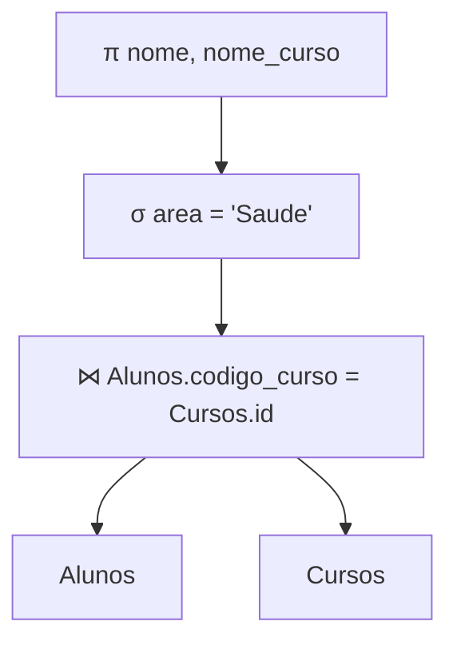

# 11a — Introdução à Álgebra Relacional (material complementar)

> **Computação Escalável (2COP022)** · Profa. Larissa C. Shimomura · PDF sem data (*Introducao_Algebra_Relacional.pdf*, 45 slides)
> **Status:** **está na lista de tópicos da P2** ("introdução a álgebra relacional"; ver o aviso [P2] abaixo). Serve de apoio para a notação usada na [Aula 11 — Processamento e otimização de consultas](11_processamento_otimizacao_consultas.md) (árvores de consulta, σ, π, ⋈).
> **Tempo estimado de leitura:** 30–40 min

> **[P2] O que a Larissa disse na revisão** ([orientações completas](12b_orientacoes_prova2.md))
> - **Atualização:** "Introdução a álgebra relacional" **está na lista de tópicos da P2**. Não é só apoio: a notação aparece no exercício de **SparkSQL → álgebra relacional** ([ex. 8 da Aula 12](12_joins_spark_revisao_prova.md#exercício-8--sparksql--álgebra-relacional--otimização)).

---

## 1. Ideia geral

- Consultar um banco = fazer "**perguntas**" a ele. Como linguagem natural é ambígua, usa-se uma **linguagem de consulta**.
- Para bancos relacionais: **SQL** é a linguagem **prática**; **álgebra relacional** (e o cálculo relacional) são as linguagens **teórico-formais**.
- **Modelo relacional (recapitulação):** relação = "tabela" R(A1, …, An); atributos = "colunas"; cada linha = **tupla**; o **esquema é fixo**.
- **Álgebra relacional** = conjunto de **operadores baseados em teoria dos conjuntos** que recuperam, combinam e modificam relações para responder a uma consulta.

**Duas propriedades:**

| Propriedade | Significado | Consequência |
|---|---|---|
| **Closure** ("*relations in, relations out*") | O resultado de um operador é **também uma relação** | Dá para **encadear** operadores: a saída de um é a entrada do outro (é o que forma uma árvore de consulta) |
| **Baseada em conjuntos** | **Não há tuplas duplicadas** | Uma projeção pode devolver **menos** tuplas que a entrada |

---

## 2. Tabelas de exemplo (usadas em todos os slides)

**Aluno(matricula, nome, codigo_curso)**

| matricula | nome | codigo_curso |
|---|---|---|
| 1001 | Joao | 23 |
| 1002 | Angela | 23 |
| 1003 | Pedro | 22 |
| 1004 | Mateus | 20 |

**Cursos(id, nome_curso, area)**

| id | nome_curso | area |
|---|---|---|
| 23 | Nutrição | Saúde |
| 22 | Medicina | Saúde |
| 20 | Matemática | Exatas |

---

## 3. Os operadores em uma tabela

| Operador | Notação | O que faz | Exemplo com as tabelas | Resultado | SQL |
|---|---|---|---|---|---|
| **Seleção** | σcondição(R) | Filtra **linhas** (partição horizontal); mesmo esquema da entrada | σcodigo_curso=23(Aluno) | Joao, Angela | `WHERE` |
| **Projeção** | πatributos(R) | Escolhe **colunas** (partição vertical); remove duplicatas | πcodigo_curso(Aluno) | 23, 22, 20 (3 tuplas, não 4) | `SELECT col` (`DISTINCT`) |
| **Renomeação** | ρnovo(R) · ρantigo→novo(R) | Renomeia a relação ou um atributo | ρcodigo_curso→id_curso(Aluno) | Mesma tabela, coluna `id_curso` | `AS` |
| **Produto cartesiano** | R × S | Toda tupla de R com toda tupla de S; n + m atributos, \|R\|·\|S\| tuplas | Aluno × Cursos | 4 × 3 = **12** tuplas, 6 colunas | `CROSS JOIN` / `FROM R, S` |
| **União** | R ∪ S | Tuplas de R **ou** de S | — | ver §4 | `UNION` |
| **Interseção** | R ∩ S | Tuplas de R **e** de S | — | ver §4 | `INTERSECT` |
| **Subtração (diferença)** | R − S | Tuplas de R que **não** estão em S | — | ver §4 | `EXCEPT` |
| **Junção** | R ⋈c S | Pares que satisfazem `c`; **= σc(R × S)** | Aluno ⋈codigo_curso=id Cursos | 4 tuplas (cada aluno com seu curso) | `JOIN … ON` |
| **Junção natural** | R * S | Equijunção em **todos os atributos de mesmo nome**; cada um aparece **uma vez** | Aluno * Cursos (com `Cursos(codigo_curso, …)`) | 4 tuplas, coluna `codigo_curso` única | `NATURAL JOIN` |
| **Divisão** | R ÷ S | Valores de R que se relacionam com **todos** os valores de S | ver §6 | — | (sem operador direto) |
| **Agrupamento** | atributos𝒢funções(R) | Agrupa e aplica **AVG, SUM, MAX, MIN, COUNT** por grupo | codigo_curso𝒢COUNT(matricula)(Aluno) | 23 → 2, 22 → 1, 20 → 1 | `GROUP BY` |

**Básicos × derivados:** união, produto cartesiano, seleção, projeção e subtração (o slide também lista interseção) são as operações básicas; **junção** é uma **combinação** delas (× seguido de σ). Agrupamento, ordenação e outros tipos de junção (externas etc.) são **operações estendidas**.

**Equijunção:** junção cuja condição é uma **igualdade** (`R.a1 = S.a2`). Tem tratamento especial porque existem métodos mais eficientes para ela (hash join, sort-merge: [Aula 11, §10](11_processamento_otimizacao_consultas.md#10-algoritmos-de-junção)).

> **Junção = × + σ, visualmente:** de 12 combinações do produto Aluno × Cursos, a seleção `codigo_curso = id` mantém só 4 (Joao–Nutrição, Angela–Nutrição, Pedro–Medicina, Mateus–Matemática). É exatamente a troca "× por ⋈" da otimização heurística.

---

## 4. União, interseção e subtração

Exigem relações **união-compatíveis**: **mesmo número de atributos**, e atributos correspondentes do **mesmo domínio** (tipo).

| Aluno_1 | | | Aluno_2 | | |
|---|---|---|---|---|---|
| 1001 | Joao | 23 | 1300 | Rafael | 21 |
| 1002 | Angela | 23 | 1400 | Alice | 22 |
| 1003 | Pedro | 22 | 1002 | Angela | 23 |
| 1004 | Mateus | 20 | | | |

| Operação | Resultado | Nº de tuplas |
|---|---|---|
| Aluno_1 ∪ Aluno_2 | Joao, Angela, Pedro, Mateus, Rafael, Alice (Angela **uma vez só**) | **6** |
| Aluno_1 ∩ Aluno_2 | Angela | **1** |
| Aluno_1 − Aluno_2 | Joao, Pedro, Mateus | **3** |

---

## 5. Encadeamento e árvore de operações

- Há **ordem de precedência** entre os operadores (os unários, como σ e π, ligam antes dos binários), mas ela pode ser alterada com **parênteses**. **O uso de parênteses é fortemente recomendado** (slide).
- Uma expressão encadeada é representada por uma **árvore de operações**: folhas = relações, nós internos = operadores. **Um operador executa assim que seus filhos estão disponíveis.** Essa árvore é a base do processamento e da otimização de consultas (Aula 11).

**Exemplo do slide:** πnome, nome_curso(σarea='Saude'(Alunos ⋈Alunos.codigo_curso = Cursos.id Cursos))

Execução: (1) junção de Alunos com Cursos → (2) seleção da área Saúde → (3) projeção. Resultado: Joao–Nutrição, Angela–Nutrição, Pedro–Medicina.

---

## 6. Divisão (consultas "em todos")

**R ÷ S** devolve os valores dos atributos de R (que não estão em S) que aparecem combinados com **todos** os valores de S. Requisitos: R tem **mais atributos** que S e **pelo menos um em comum**.

**Exemplo do slide:** *"Quais alunos estão matriculados em **todos** os cursos da área Saúde?"* — supondo que Aluno ganhou a tupla extra `(1001, Joao, 22)` (Joao em dois cursos):

> Aluno ÷ πcodigo_curso(σarea='Saude'(Cursos))

| Passo | Resultado |
|---|---|
| Divisor S = cursos de Saúde | {23, 22} |
| Quem tem **23 e 22** em Aluno? | Só Joao (1001 com 23 **e** com 22). Angela só tem 23; Pedro só 22 |
| **Aluno ÷ S** | **(1001, Joao)** |

> O slide mostra as tuplas de Joao que "cobrem" o divisor (`1001 Joao 23`, `1001 Joao 22`); o resultado da divisão em si é só **(matricula, nome) = (1001, Joao)**, sem a coluna `codigo_curso`.

---

## 7. Exercícios do slide (com resposta)

| # | Pergunta | Álgebra relacional | SQL |
|---|---|---|---|
| **1** | Nome e matrícula dos alunos com **idade > 20** — `Aluno(matricula, nome, idade, codigo_curso)` | πnome, matricula(σidade>20(Aluno)) | `SELECT nome, matricula FROM Aluno WHERE idade > 20;` |
| **2** | Nomes de **todas as pessoas** (alunos ou professores) cadastradas em algum curso — `Aluno` e `Professor`, ambos `(matricula, nome, codigo_curso)` | πnome(Aluno) ∪ πnome(Professor) | `SELECT nome FROM Aluno UNION SELECT nome FROM Professor;` |
| **3** | Nome do aluno e do curso, **só para cursos da área Engenharia** — `Curso(codigo_curso, nome_curso, area)` | πAluno.nome, Curso.nome_curso(σCurso.area='Engenharia'(Curso ⋈Curso.codigo_curso = Aluno.codigo_curso Aluno)) | `SELECT a.nome, c.nome_curso FROM Aluno a JOIN Curso c ON a.codigo_curso = c.codigo_curso WHERE c.area = 'Engenharia';` |
| **4** | **Média de idade** por curso | codigo_curso𝒢AVG(idade) → media_idade(Aluno) | `SELECT codigo_curso, AVG(idade) AS media_idade FROM Aluno GROUP BY codigo_curso;` |

**Observações:**
- **Ex. 1:** a ordem importa — primeiro σ (precisa de `idade`), depois π. Projetar antes descartaria `idade`.
- **Ex. 2 — "são união-compatíveis?"** As duas relações têm o mesmo esquema, então sim. A projeção em `nome` vem **antes** da união porque a pergunta pede só nomes. Como é conjunto, um nome que aparece nas duas tabelas sai **uma vez**.
- **Ex. 3:** esta é a forma **não otimizada** (σ acima da junção). Pela Aula 11, a seleção `area = 'Engenharia'` deveria descer até `Curso` (*selection push-down*).

---

## 8. Mapa álgebra ↔ SQL (resumo do slide)

| Álgebra | SQL |
|---|---|
| σarea='Saude'(Cursos), com πnome_curso | `SELECT nome_curso FROM Cursos WHERE area = 'Saude';` |
| πnome(Aluno) | `SELECT nome FROM Aluno;` |
| Aluno × Cursos | `SELECT * FROM Aluno CROSS JOIN Cursos;` |
| Aluno ⋈Aluno.codigo_curso = Cursos.id Cursos | `SELECT nome, nome_curso FROM Aluno, Cursos WHERE Aluno.codigo_curso = Cursos.id;` **ou** `… FROM Aluno a JOIN Cursos c ON a.codigo_curso = c.id;` |
| πnome, nome_curso(σarea='Saude'(Aluno ⋈ Cursos)) | `SELECT nome, nome_curso FROM Aluno a JOIN Cursos c ON a.codigo_curso = c.id WHERE c.area = 'Saude';` |

> **Diferença sutil:** a álgebra trabalha com **conjuntos** (sem duplicatas); o SQL trabalha com **multiconjuntos** (mantém duplicatas, a menos que se use `DISTINCT`). Por isso π equivale, rigorosamente, a `SELECT DISTINCT`.

---

## Revisão rápida

**Em 6 pontos:**
1. Álgebra relacional = linguagem **formal** de consultas; SQL = linguagem **prática**.
2. **Closure:** relação entra, relação sai → operadores se **encadeiam** numa **árvore**.
3. **Conjuntos:** sem duplicatas (π pode reduzir o nº de tuplas).
4. **σ** filtra linhas, **π** escolhe colunas, **ρ** renomeia, **×** combina tudo com tudo, **∪ ∩ −** exigem **união-compatibilidade**.
5. **⋈ = σ sobre ×**; **equijunção** usa igualdade; **junção natural** iguala atributos de mesmo nome e os mostra uma vez; **divisão** responde "**em todos**".
6. **Agrupamento** (𝒢) aplica COUNT/SUM/AVG/MIN/MAX por grupo = `GROUP BY`.

**Autoavaliação:**

<b>1. Por que πcodigo_curso(Aluno) devolve 3 tuplas, se Aluno tem 4?</b>

Porque a álgebra relacional trabalha com **conjuntos**: os dois alunos do curso 23 geram a mesma tupla `(23)`, que aparece uma vez só.

<b>2. Quantas tuplas e colunas tem Aluno × Cursos? E Aluno ⋈codigo_curso=id Cursos?</b>

Produto: 4 × 3 = **12** tuplas, 3 + 3 = **6** colunas. Junção: **4** tuplas (cada aluno com o seu curso), as mesmas 6 colunas.

<b>3. O que é preciso para fazer R ∪ S, e qual pergunta pede divisão?</b>

R e S precisam ser **união-compatíveis** (mesmo nº de atributos, mesmos domínios). A divisão serve para perguntas com "**em todos**" / "para todo" (ex.: alunos matriculados em todos os cursos de Saúde).

**Ligação:** a [Aula 11](11_processamento_otimizacao_consultas.md) usa essa notação para desenhar **árvores de consulta** e reordená-las por **equivalências algébricas** (cascata e comutatividade de σ, π, ×, ⋈).
