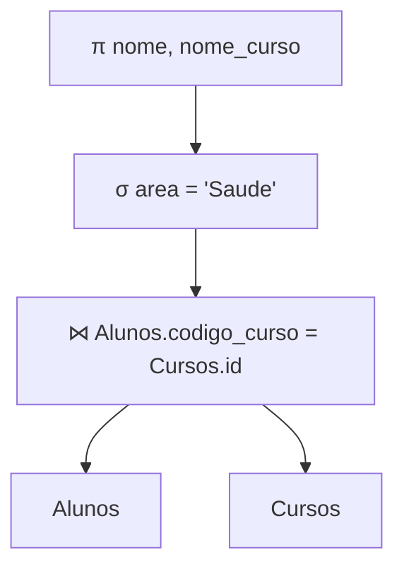

# 11a — Álgebra relacional (versão P2)

> Material complementar (PDF sem data) · Profa. Larissa C. Shimomura
> **Filtro:** [12c](12c_orientacoes_prova2_revisao2.md). A álgebra é a **notação** dos exercícios que caem: código Spark → álgebra ([10](10_spark_pratica_sparksql.md)) e árvore + otimização ([11](11_processamento_otimizacao_consultas.md)).
> **Cortado desta versão:** **renomeação (ρ)** ("eu não passei para vocês", não cai), união/interseção/subtração, junção natural, divisão, agrupamento, os exercícios do slide e o mapa para SQL. Cálculo relacional de tuplas foi só citado. A versão completa está no histórico do git.

---

## Operadores que aparecem nos exercícios

| Operador | Notação | O que faz | Spark |
|---|---|---|---|
| **Seleção** | σcondição(R) | Filtra **linhas**; condições compostas com **∧** (e) / **∨** (ou) | `filter` / `where` |
| **Projeção** | πatributos(R) | Escolhe **colunas** (sem duplicatas: é conjunto) | `select` |
| **Produto cartesiano** | R × S | Toda tupla de R com toda tupla de S: \|R\| · \|S\| tuplas | `crossJoin` |
| **Junção** | R ⋈c S | Pares que satisfazem `c`; **R ⋈c S = σc(R × S)** | `join` |

- **Closure** ("relação entra, relação sai"): a saída de um operador é a entrada do próximo, e é isso que forma a **árvore de consulta**.
- **Equijunção:** junção com condição de igualdade (`R.a = S.b`). É o caso dos algoritmos hash join e sort-merge.
- **Parênteses:** use sempre. Eles definem a ordem (ex.: `(Aluno × Matricula) × Disciplina`).

## Exemplo

πnome, nome_curso(σarea='Saude'(Alunos ⋈Alunos.codigo_curso = Cursos.id Cursos))

Ordem de execução: junção → seleção → projeção (de baixo para cima). Na expressão, lê-se de dentro para fora.

**Atenção à ordem σ/π:** em πnome(σidade>20(Aluno)), a σ vem antes porque precisa de `idade`; projetar antes descartaria a coluna.
