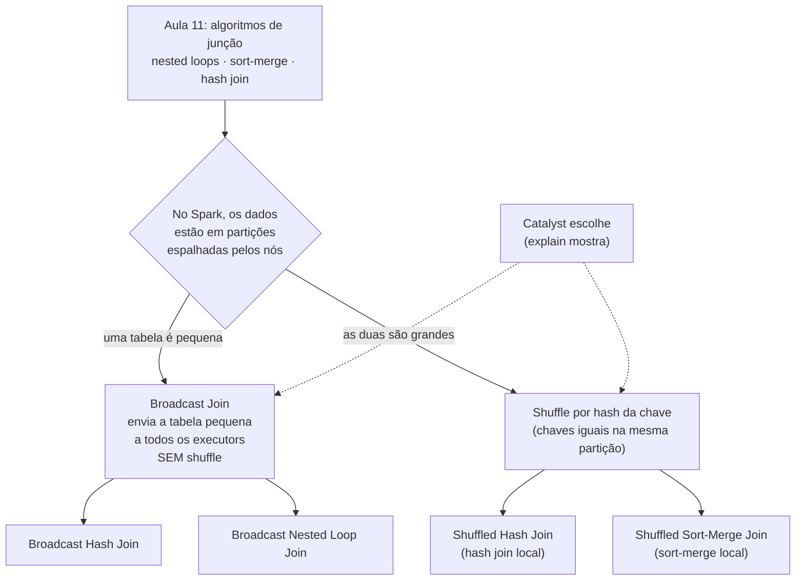
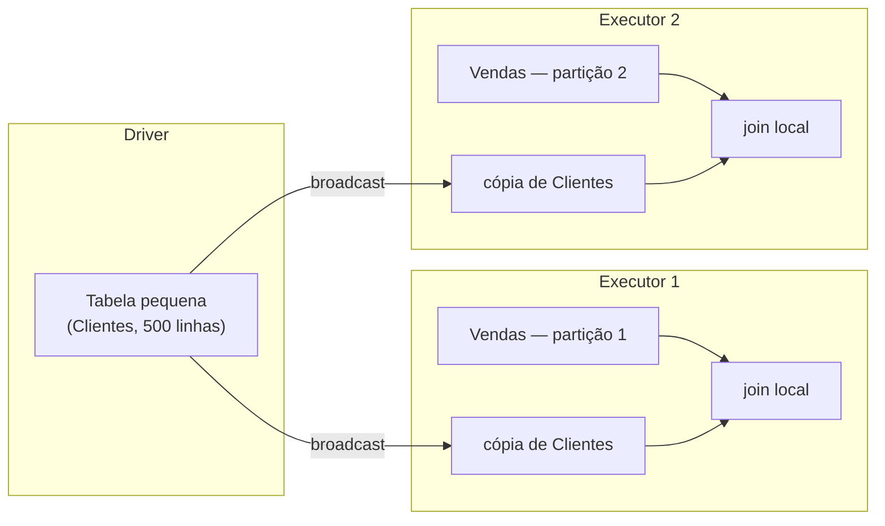
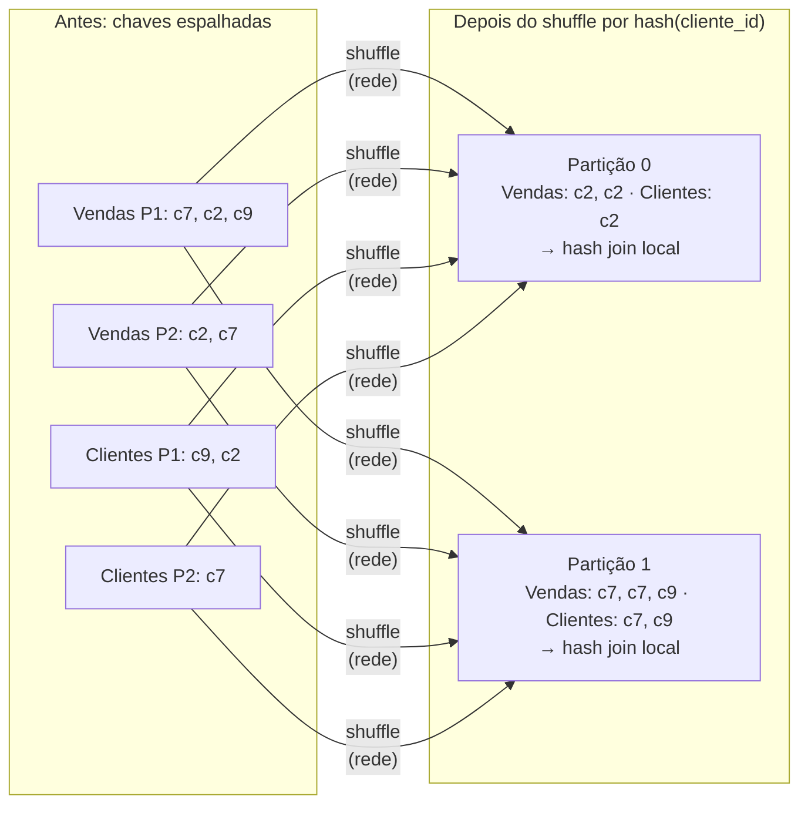
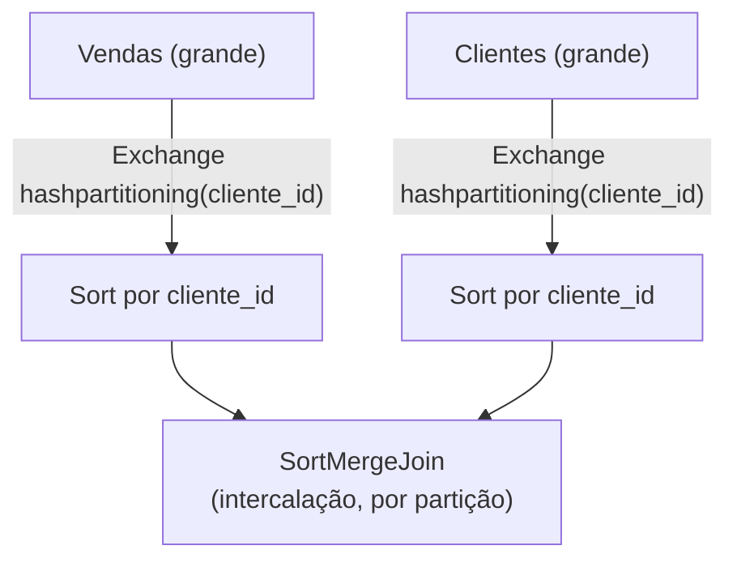
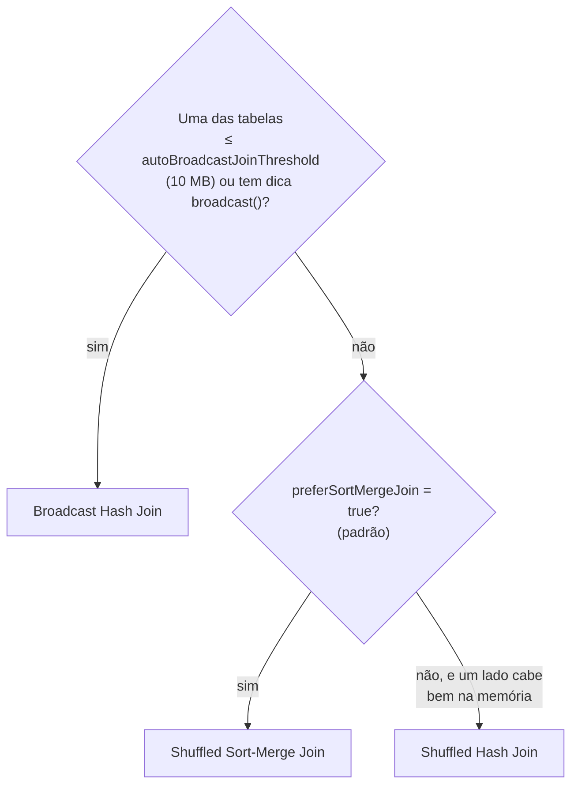
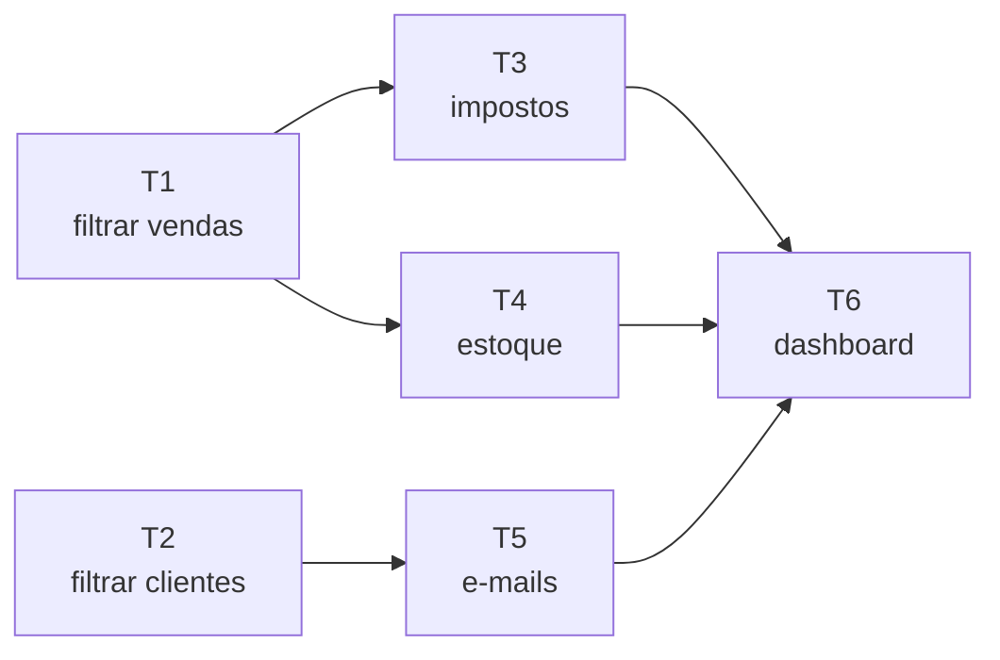
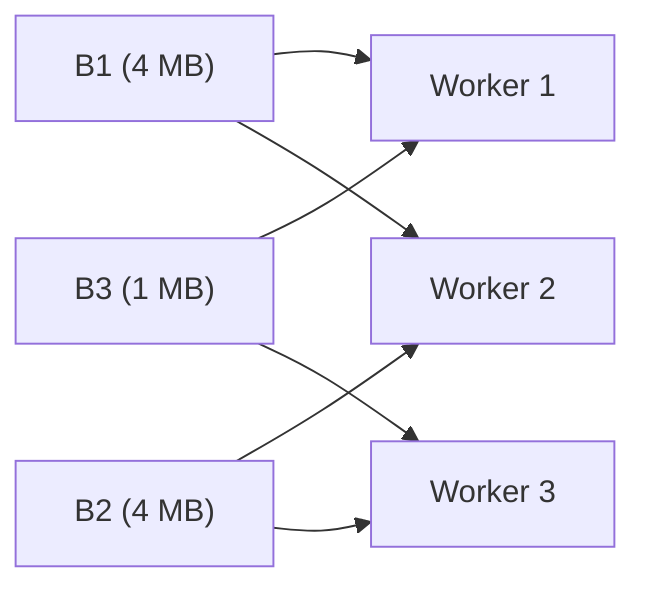
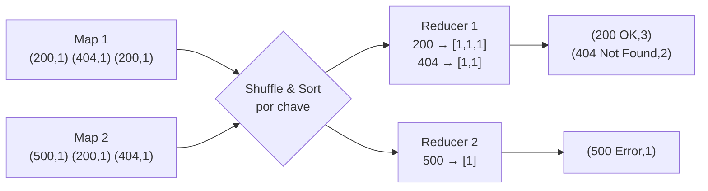
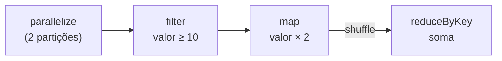
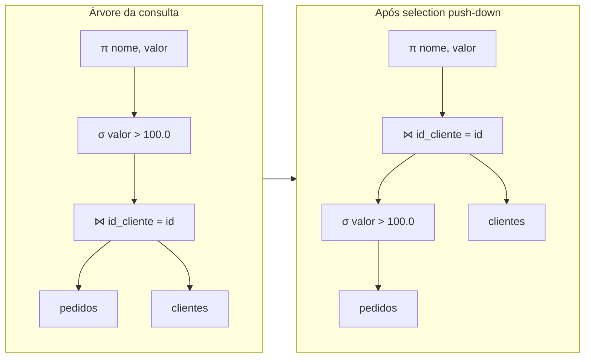

# Aula 12 — Algoritmos de join no Spark e exercícios para a prova

> **Computação Escalável (2COP022)** · Profa. Larissa C. Shimomura · Aula 12 (última antes da **P2, 27/11**)
> **Tópicos:** **Parte A:** por que join é caro no Spark (shuffle), Broadcast Join (Broadcast Hash Join e Broadcast Nested Loop Join), Shuffled Hash Join, Shuffled Sort-Merge Join, como o Catalyst escolhe, `autoBroadcastJoinThreshold`, dica `broadcast()`, UDFs, processamento aproximado de consultas (AQP). **Parte B:** a lista de tópicos da prova e os **exercícios de revisão** da professora, resolvidos.
> **Pré-requisitos:** [Aula 10](10_spark_pratica_sparksql.md) (SparkSQL, Catalyst, `explain`, shuffle) e [Aula 11](11_processamento_otimizacao_consultas.md) (nested loops, sort-merge, hash join)
> **Base:** slides `aula12_algoritmos_join_spark.pdf` + notebook `fontes/códigos/ExemploExecutorService/SparkJoin_Catalyst.ipynb`
> **Tempo estimado de estudo:** 2 h 30 (Parte A ≈ 1 h; Parte B serve como simulado)

> **[P2] O que cai** ([orientações da 2ª revisão](12c_orientacoes_prova2_revisao2.md))
> - **Algoritmos de junção**, no formato: "considere as relações e o plano físico proposto: o algoritmo é o mais adequado? Justifique; se não, sugira o melhor". **Lista P2, Ex. 9 (certeza)**, resolvido no Exercício 11.
> - O que lembrar: **hash join precisa de memória** para a tabela hash; **sort-merge tem o custo de ordenar**. Broadcast: sem shuffle, mas uma tabela tem de ser pequena (~10 MB).
> - **Não cai:** a saída do Catalyst/`explain()`, *hash partitioning* em detalhe, e o Broadcast Nested Loop Join ("nunca vi acontecer"). Por isso A6 (notebook) e A7 foram **cortados** desta versão. O Exercício 4 (Java) também não cai.
> - Exercícios 1 a 10: resolvidos nas revisões; o que mudou em cada um está nas [orientações da 2ª revisão](12c_orientacoes_prova2_revisao2.md#5-o-que-muda-em-relação-ao-12b).

---

## Sumário

**Parte A — Joins no Spark**
1. [Mapa da aula](#mapa-da-aula)
2. [Por que o join é caro no Spark](#a1-por-que-o-join-é-caro-no-spark)
3. [Broadcast Join](#a2-broadcast-join)
4. [Shuffled Hash Join](#a3-shuffled-hash-join)
5. [Shuffled Sort-Merge Join](#a4-shuffled-sort-merge-join)
6. [Comparação e como o Spark escolhe](#a5-comparação-e-escolha)
9. [Quadro "onde usar" e treino da Parte A](#a8-quadro-onde-usar-e-treino)

**Parte B — Revisão para a prova**
10. [Tópicos da prova (4º bimestre)](#b1-tópicos-da-prova)
11. [Exercícios da professora, resolvidos](#b2-exercícios-de-revisão-resolvidos)

**Fechamento**
12. [Erros comuns / o que cai em prova](#erros-comuns--o-que-cai-em-prova)
13. [Fontes](#fontes)
14. [Conclusão para revisão](#conclusão-para-revisão)

---

## Mapa da aula



> **O que observar:** os algoritmos do Spark são os **mesmos três da Aula 11**, executados **dentro de cada partição**. A pergunta nova é **como fazer as tuplas que casam estarem na mesma partição**: ou se **copia a tabela pequena para todo mundo** (broadcast), ou se **redistribuem as duas pelo hash da chave** (shuffle).

---

# Parte A — Joins no Spark

## A1. Por que o join é caro no Spark

- Em um DAG do Spark, uma das fases mais custosas é o **shuffle**, quando há **movimentação de dados entre as partições** ([Aula 09, §C7](09_nosql_cap_spark_rdd.md#c7-shuffle-no-spark)).
- Num join, além do custo de produzir os resultados intermediários (o que a Aula 11 contava em número de tuplas), no Spark é preciso considerar o **custo do shuffle**: o componente de **comunicação** da [Aula 11, §8.1](11_processamento_otimizacao_consultas.md#81-componentes-de-custo).

**O problema:** a tupla de Vendas com `cliente_id = 7` pode estar na partição 3 do nó A, e o Cliente 7 na partição 1 do nó B. Para juntá-las, uma das duas precisa **viajar**. As duas estratégias do Spark respondem de jeitos diferentes a "**quem viaja?**":

| Estratégia | Quem viaja pela rede |
|---|---|
| **Broadcast** | Só a tabela **pequena**, inteira, uma cópia para cada executor |
| **Shuffle** | As **duas** tabelas, redistribuídas pelo hash da chave de junção |

---

## A2. Broadcast Join

**`broadcast`** envia uma variável ou tabela **pequena e somente leitura** para ficar **em cache na memória de cada Executor**.

**Ideia do Broadcast Join:** enviar o **DataFrame menor** para **todos** os executors e fazer a junção **localmente** em cada partição do DataFrame maior.



> **O que observar:** as partições de **Vendas não saem do lugar**. Cada executor recebe uma cópia **inteira** de Clientes e junta com o que já tem. Nenhuma tupla de Vendas atravessa a rede.

| | |
|---|---|
| **Ponto positivo** | **Não há shuffle** de dados: cada partição recebe o DataFrame pequeno inteiro |
| **Ponto negativo** | Só funciona se um dos DataFrames for **pequeno o suficiente para caber na memória do Driver e dos Executors** (ele passa pelo Driver antes de ser distribuído) |
| **Limite automático** | **10 MB** por padrão, configurável em **`spark.sql.autoBroadcastJoinThreshold`** (`-1` desliga o broadcast automático) |

**Algoritmo local** — dentro de cada partição, ainda se escolhe um algoritmo de junção:

| Variante | Algoritmo local | Quando |
|---|---|---|
| **Broadcast Hash Join** | **Hash join**: constrói uma **tabela hash** com o DataFrame **menor** (build) e sonda com as tuplas da partição (probe) | **O caso comum** (equijunção) |
| **Broadcast Nested Loop Join** | **Nested loops** local | Quando os **dois** DataFrames são bem pequenos, ou a condição não é de igualdade; **menos comum** em planos físicos reais |

> **Ligação com a Aula 11:** o Broadcast Hash Join é o hash join da aula anterior, com a fase **build** executada **em cada executor** sobre a mesma cópia da tabela pequena, e a fase **probe** sobre a partição local da tabela grande.

---

## A3. Shuffled Hash Join

Quando **nenhuma** das tabelas é pequena o bastante para broadcast:

1. **Shuffle** das **duas** tabelas, usando **particionamento por hash** da chave de junção (`HashPartitioning`): cada tupla vai para a partição `hash(chave) mod n`. Isso **garante que todas as chaves iguais terminem na mesma partição** (o *hash partitioning*; "não precisa lembrar dessa parte da prova").
2. Em cada partição, **hash join**: um dos lados vira a **tabela hash** (build) e o outro **busca as chaves** (probe).



> **O que observar:** depois do shuffle, **todo** `c2` (de Vendas e de Clientes) está na partição 0, e todo `c7` e `c9` na partição 1. Cada partição pode ser juntada **sozinha**. O preço foi mover **as duas tabelas** pela rede.

---

## A4. Shuffled Sort-Merge Join

- **Mesmo shuffle** por hash da chave que o Shuffled Hash Join;
- Mas, em cada partição, usa-se o **sort-merge** no lugar do hash join: **ordena** os dois lados pela chave e os **intercala**.

**Por que existir, se ordenar é caro?** Porque **escala melhor quando a memória é o fator limitante**:
- **Hash join** → a **tabela hash precisa caber na memória**. Com datasets muito grandes, a memória geralmente é limitada.
- **Sort-merge** → a ordenação pode **usar o disco** (ordenação externa) e a intercalação só precisa ver um trecho de cada lado por vez.

Por isso, **é bastante comum o Spark escolher o Shuffled Sort-Merge Join** para juntar duas tabelas grandes. (Na configuração padrão, `spark.sql.join.preferSortMergeJoin = true`.)



> **O que observar:** é a forma do plano físico que o Spark monta: dois `Exchange hashpartitioning` (os shuffles), dois `Sort` e um `SortMergeJoin`.

---

## A5. Comparação e escolha

| Algoritmo | Shuffle? | Algoritmo local | Exige | Bom para |
|---|---|---|---|---|
| **Broadcast Hash Join** | **Não** (só envia a pequena) | Hash join | Uma tabela **pequena** (≤ 10 MB por padrão), cabendo no Driver e nos Executors | **Tabela grande × tabela pequena** (fato × dimensão) — o mais rápido quando possível |
| **Broadcast Nested Loop Join** | Não | Nested loops | Tabela(s) **muito** pequena(s) | Casos raros; condições que não são igualdade |
| **Shuffled Hash Join** | **Sim, as duas** | Hash join | Cada partição de um lado cabe na memória | Tabelas médias/grandes com memória suficiente |
| **Shuffled Sort-Merge Join** | **Sim, as duas** | Sort-merge | Nada especial (pode usar disco) | **Duas tabelas grandes**; **escolha comum do Spark** |

**Árvore de decisão simplificada** (comportamento padrão do Spark 3.5 para equijunções):



> **Relação com as regras da Aula 11:** poucas tuplas → nested loops; uma relação cabe na memória → hash join; relações grandes que não cabem → sort-merge. O Spark acrescenta uma camada **antes**: "dá para **evitar o shuffle** com broadcast?".

---

## A6. O que ela destacou na 2ª revisão

- **Shuffle:** reparticiona os dados para que **as mesmas chaves das duas tabelas caiam na mesma partição**; em cada partição roda-se o algoritmo local. **O objetivo não é terminar com uma partição só:** o resultado fica distribuído (no broadcast, nas partições da tabela maior).
- **Broadcast:** manda a tabela pequena **inteira** a todos os nós (não um pedaço). A tabela hash é montada **dentro de cada partição**, sobre as chaves de junção da tabela pequena; cada partição junta localmente e no fim o resultado é **concatenado**.
- **Shuffled Sort-Merge** também é escolhido quando os dados **já estão agrupados/ordenados** (ex.: depois de um `groupBy`) e porque "memória é uma coisa preciosa" nesse tipo de arquitetura.
- **Hash partitioning** (o hash usado para reparticionar no shuffle): "não precisa lembrar dessa parte da prova".

---

## A8. Quadro "onde usar" e treino

| Situação | Algoritmo / ação |
|---|---|
| Tabela fato grande × tabela dimensão pequena (≤ 10 MB) | **Broadcast Hash Join** (automático) |
| Tabela pequena, mas acima de 10 MB e cabendo na memória | `broadcast(df)` (dica) ou aumentar `autoBroadcastJoinThreshold` |
| Duas tabelas grandes | **Shuffled Sort-Merge Join** (padrão) |
| Duas tabelas grandes, memória sobrando, sem querer ordenar | Shuffled Hash Join (`preferSortMergeJoin=false` ou dica `SHUFFLE_HASH`) |
| Tabela "pequena" que não cabe na memória do Driver/Executors | **Não** usar broadcast (risco de falta de memória) |
| Ver qual algoritmo foi escolhido | `explain()`: `BroadcastHashJoin`, `SortMergeJoin`, `ShuffledHashJoin`, `BroadcastNestedLoopJoin` |
| Contar shuffles de um join | Contar os `Exchange hashpartitioning` (o `BroadcastExchange` **não** é shuffle) |

**Q1 — Qual algoritmo?** (a) `Pedidos` (80 GB) ⋈ `Estados` (27 linhas). (b) `Cliques` (2 TB) ⋈ `Sessoes` (600 GB). (c) `Produtos` (300 MB) ⋈ `Vendas` (1 TB), com executors de 8 GB.

<details><summary><b>Gabarito Q1</b></summary>

(a) **Broadcast Hash Join**: `Estados` tem poucos KB, abaixo de 10 MB; nada de shuffle de 80 GB. (b) **Shuffled Sort-Merge Join**: as duas são enormes e nenhuma cabe na memória; é a escolha padrão do Spark. (c) 300 MB passa do limite automático, então o Spark escolheria sort-merge, mas **cabe** na memória do Driver e dos executors: dá para forçar com `broadcast(produtos)` (ou subir o limite) e evitar o shuffle de 1 TB. Vale **medir**.
</details>

**Q3 — Por que o Spark costuma preferir sort-merge a shuffled hash join?**

<details><summary><b>Gabarito Q3</b></summary>

Porque o hash join exige que a **tabela hash caiba na memória**, e com datasets muito grandes a memória é o fator limitante. O sort-merge escala melhor: a ordenação pode usar disco e a intercalação percorre os dois lados sequencialmente. O custo extra de ordenar se paga pela robustez.
</details>

---

# Parte B — Revisão para a prova

## B1. Tópicos da prova

Lista dos slides ("Tópicos — 4º Bimestre"), com o material de estudo correspondente:

| Bloco | Tópico | Onde estudar |
|---|---|---|
| **Programação paralela** | Padrões e ideia geral | [06](06_padroes_de_paralelismo.md) |
| | Decomposição de dados e de tarefas | [06, §2](06_padroes_de_paralelismo.md) |
| | Balanceamento de carga | [07](07_threads_balanceamento_executor.md) |
| | Programação paralela em Java | **Não cai código Java** (ver [12c](12c_orientacoes_prova2_revisao2.md)) |
| **Arquivos distribuídos e Big Data** | Conceitos de Big Data | [08, Bloco B](08_forkjoin_bigdata_hadoop.md) |
| | Hadoop e HDFS | [08, Bloco B](08_forkjoin_bigdata_hadoop.md) |
| | Introdução a programação funcional com Scala | [09, Bloco B](09_nosql_cap_spark_rdd.md) e [09b](09b_programacao_scala.md) |
| | Spark: execução e programação | [09, Bloco C](09_nosql_cap_spark_rdd.md) e [10](10_spark_pratica_sparksql.md) |
| | SparkSQL | [10](10_spark_pratica_sparksql.md) e esta aula |
| **Processamento de consulta** | Passo a passo do processamento de consulta | [11](11_processamento_otimizacao_consultas.md) |
| | Introdução a álgebra relacional | [11a](11a_introducao_algebra_relacional.md) |
| | Otimização baseada em heurísticas | [11, §6–7](11_processamento_otimizacao_consultas.md) |
| | Ideia geral da otimização baseada em custo e estimativa de cardinalidade | [11, §8–12](11_processamento_otimizacao_consultas.md) |
| | Principais algoritmos de junção | [11, §10](11_processamento_otimizacao_consultas.md) e esta aula, Parte A |

> **Atenção:** **NoSQL, CAP e BASE** não aparecem na lista de tópicos, mas **aparecem nos exercícios** (§B2, exercício 9). Estude também ([09, Bloco A](09_nosql_cap_spark_rdd.md)).

**Revisão de conceito que os slides retomam:**
- **4 passos para paralelizar:** (1) **identificação do paralelismo** — onde há tarefas e operações independentes; (2) **estrutura do algoritmo** — que padrão usar; (3) **estruturas de suporte** — dados, comunicação, particionamento e sincronização; (4) **mecanismos de implementação** — linguagens, bibliotecas, frameworks.
- **Organização por tarefas:** **paralelismo por tarefas** (tarefas muito independentes, algoritmo linear) ou **divisão e conquista** (tarefas independentes que precisam ser combinadas no fim, de forma recursiva).
- **Organização por dados:** estruturas recursivas → **dados recursivos** ou **divisão e conquista**; estruturas lineares → **decomposição geométrica** (dividir como regiões de uma geometria). Atualizar dados compartilhados exige cuidado (tempo de sincronização). Se a computação de cada partição é **estritamente local**, o problema é **embaraçosamente paralelo** e usa-se **paralelismo por tarefas**.

---

## B2. Exercícios de revisão resolvidos

> Onde os slides trazem resposta, ela está reproduzida. Onde a resposta está só em figura ou não foi dada, a solução vem marcada como **[resolução do material]**.

### Exercício 1 — Decomposição de dados × de tarefas

> *Defina decomposição de dados e decomposição de tarefas.*

**Resposta (slide):**
- **Decomposição de dados:** dividir grandes conjuntos de dados (vetores, matrizes, imagens) em **pedaços menores e independentes**. Cada unidade de processamento recebe uma parte e executa **a mesma operação** sobre o seu pedaço.
- **Decomposição de tarefas:** dividir o problema com foco nas **ações, funções ou etapas** a realizar, independentemente dos dados. O problema vira **várias tarefas distintas** executadas ao mesmo tempo por processadores diferentes.

> **Para fixar:** dados = "**mesma** operação, **pedaços diferentes**"; tarefas = "**operações diferentes**, ao mesmo tempo".

### Exercício 2 — Grafo de dependência de tarefas

> *Construa o grafo de dependências, identifique o que pode executar em paralelo e indique o padrão de estrutura de algoritmo (Mattson et al.).*

```text
Algoritmo ProcessaVendas(lista_vendas, cadastro_clientes)
  T1: validas          <- filtrar_vendas_validas(lista_vendas)
  T2: clientes_ativos  <- filtrar_clientes_ativos(cadastro_clientes)
  T3: total_impostos   <- calcular_impostos(validas)
  T4: relatorio_estoque <- atualizar_estoque(validas)
  T5: campanha_email   <- gerar_emails_promocionais(clientes_ativos)
  T6: relatorio_final  <- consolidar_dashboard(total_impostos, relatorio_estoque, campanha_email)
  Retornar relatorio_final
```

**[resolução do material]** Para cada tarefa, pergunte: **de quais saídas ela precisa?** A aresta vai **da tarefa que produz para a que consome** (nota do slide: T1 → T3).



| Nível | Tarefas em paralelo | Por quê |
|---|---|---|
| 1 | **T1 e T2** | Usam entradas diferentes e não dependem de nada |
| 2 | **T3, T4 e T5** | T3 e T4 só precisam de T1; T5 só de T2 |
| 3 | **T6** | Precisa de T3, T4 e T5 |

**Padrão:** a decomposição é **por tarefas** (funções distintas), não é recursiva, e as dependências formam um grafo simples que se resolve **ordenando** as tarefas → **Paralelismo por Tarefas** (*Task Parallelism*), com os padrões de apoio **Group Tasks/Order Tasks** da [Aula 06](06_padroes_de_paralelismo.md). (Não é divisão e conquista: não há divisão recursiva do mesmo problema.)

### Exercício 3 — Granularidade × número de threads

> *Explique o trade-off entre a granularidade das tarefas e o número de threads.*

**Resposta (slide):** o trade-off é entre **balanceamento de carga** e **custo de gerenciamento (overhead)**.
- **Granularidade fina** (muitas tarefas pequenas, mais threads): distribui melhor o trabalho e evita núcleos ociosos, mas gera **alto overhead** de criação, escalonamento e sincronização, podendo deixar o programa **mais lento**.
- **Granularidade grossa** (poucas tarefas grandes, menos threads): **overhead mínimo**, mas aumenta o risco de **desbalanceamento** e subutilização se alguma tarefa demorar muito mais que as outras.
- **Ideal:** tarefas **pequenas o suficiente para ocupar todo o hardware**, mas **grandes o bastante para compensar o custo de gerenciá-las**.

**Balanceamento — os dois tipos (slide):** **estático** — a divisão é feita **antes** da execução e o tamanho do bloco de cada thread é fixo; **dinâmico** — a divisão acontece **durante** a execução, e as threads pedem trabalho conforme terminam o anterior.

### Exercício 4 — Programa Java (`RastreioPool`)

**Não cai** (Java não cai; o exercício de "quantas tarefas/threads e qual decomposição" sobre código também não). A resolução está no histórico do git.

### Exercício 5 — HDFS: blocos e replicação

> *Cada linha ocupa 1 MB; bloco máximo de 4 MB; 3 DataNodes com 8 MB de disco cada; fator de replicação 2. Qual o particionamento inicial e onde fica cada réplica?*

Dados: **9 linhas** (Linha 02 a Linha 10), 1 MB cada = 9 MB.

**Resposta (slide):**

| Bloco | Linhas | Tamanho |
|---|---|---|
| **B1** | 02 a 05 | 4 MB |
| **B2** | 06 a 09 | 4 MB |
| **B3** | 10 | **1 MB** (o último bloco ocupa só o necessário) |

| Worker | Blocos | Ocupado | Livre |
|---|---|---|---|
| Worker 1 | B1 (4) + B3 (1) | 5 MB | 3 MB |
| Worker 2 | B2 (4) + B1 (4) | 8 MB | **0 MB** (capacidade máxima) |
| Worker 3 | B3 (1) + B2 (4) | 5 MB | 3 MB |



> **Conferência:** fator 2 → cada bloco em **2 workers diferentes** (nunca duas cópias no mesmo nó); total armazenado = 9 MB × 2 = **18 MB** dos 24 MB disponíveis. Se um worker cair, todo bloco ainda tem uma cópia viva.

### Exercício 6 — MapReduce: contagem de códigos de status

> *Logs em 2 blocos (2 workers), 2 Mappers e 2 Reducers. Descreva entradas e saídas de Map, Shuffle & Sort e Reduce.*

- **Bloco 1 (Worker 1):** `"200 OK"`, `"404 Not Found"`, `"200 OK"`
- **Bloco 2 (Worker 2):** `"500 Error"`, `"200 OK"`, `"404 Not Found"`

**Resposta (slide):**

| Fase | Entrada | Saída |
|---|---|---|
| **Map 1** (Worker 1) | as 3 linhas do bloco 1 | `("200 OK",1)`, `("404 Not Found",1)`, `("200 OK",1)` |
| **Map 2** (Worker 2) | as 3 linhas do bloco 2 | `("500 Error",1)`, `("200 OK",1)`, `("404 Not Found",1)` |
| **Shuffle & Sort** | os 6 pares | **Reducer 1:** `("200 OK",[1,1,1])`, `("404 Not Found",[1,1])` · **Reducer 2:** `("500 Error",[1])` |
| **Reduce 1** | `("200 OK",[1,1,1])`, `("404 Not Found",[1,1])` | `("200 OK",3)`, `("404 Not Found",2)` |
| **Reduce 2** | `("500 Error",[1])` | `("500 Error",1)` |



> A divisão das chaves entre os reducers é feita pelo **hash da chave** (por isso uma mesma chave vai sempre para o mesmo reducer). Com um *combiner*, o Map 1 já enviaria `("200 OK",2)` em vez de dois `("200 OK",1)`.

**Vantagens e desvantagens do MapReduce (slide):** simples (2 fases) e escala para grandes volumes **×** nem todo algoritmo se traduz em map/reduce, resultados intermediários em disco, e o shuffle/sort pesa no desempenho.

### Exercício 7 — Spark: DAG e quando executa

> **Resolvido na 2ª revisão.** O DAG **cai**: desenhe **só as operações escritas** (sem os dados), incluindo o `parallelize`. "Em que linha executa?" ficou **indefinido** ("vou pensar"). A mensagem da linha 5 aparece de qualquer jeito.

> *Qual o DAG de `rdd_prova`? Em que linha ele começa a ser executado de fato?*

```scala
1  val dados = sc.parallelize(Seq(("A", 10), ("B", 20), ("A", 30), ("C", 5), ("B", 15)), 2)
2  val rdd_filtrado = dados.filter(par => par._2 >= 10)
3  val rdd_mapeado = rdd_filtrado.map(par => (par._1, par._2 * 2))
4  val rdd_prova = rdd_mapeado.reduceByKey((valor1, valor2) => valor1 + valor2)
5  println("DAG montado com sucesso!")
6  val resultado = rdd_prova.collect()
7  println(resultado.mkString(", "))
```

**DAG (slide):** `parallelize` → `filter` → `map` → `reduceByKey`.



**Executa de fato na linha 6**: `collect()` é a primeira **ação**. As linhas 1–4 só montam o DAG (*lazy evaluation*); a linha 5 imprime antes de qualquer processamento.

**[resolução do material] — o que a linha 7 imprime:**

| Etapa | Resultado |
|---|---|
| `filter(_._2 >= 10)` | `(A,10) (B,20) (A,30) (B,15)` — sai `(C,5)` |
| `map(valor × 2)` | `(A,20) (B,40) (A,60) (B,30)` |
| `reduceByKey(+)` | `(A,80) (B,70)` |

Saída: **`(A,80), (B,70)`** (a ordem entre A e B pode variar). `filter` e `map` são estreitas; `reduceByKey` é larga, e é ali que o DAG se divide em dois *stages*.

### Exercício 8 — SparkSQL → álgebra relacional → otimização

> **Resolvido na 2ª revisão.** Na álgebra, **qualquer representação equivalente vale** (σ antes ou depois da junção, × + σ, relações trocadas): "eu não tô pedindo para otimizar". Na pergunta das heurísticas, dê as **três justificativas** do *selection push-down*: consulta equivalente; reduz as tuplas antes da junção (a operação mais custosa); o atributo do filtro está em uma só relação.

> *Qual a representação em álgebra relacional deste programa?*

```scala
val resultado = pedidos
  .filter(pedidos("valor") > 100.0)
  .join(clientes, pedidos("id_cliente") === clientes("id"))
  .select(clientes("nome"), pedidos("valor"))
```

**Resposta (slide):**

> π<sub>clientes.nome, pedidos.valor</sub>( σ<sub>valor>100.0</sub>(pedidos) ⋈<sub>id_cliente = id</sub> clientes )

Note que a seleção já está **abaixo** da junção, porque o `filter` foi escrito **antes** do `join`.

**Segunda parte (slide):** *dada a consulta π<sub>nome, valor</sub>(σ<sub>valor>100.0</sub>(pedidos ⋈<sub>id_cliente=id</sub> clientes)), desenhe a árvore e diga que heurísticas aplicar e por quê.*



**Resposta (slide):** neste caso, **só o *selection push-down*** de `valor > 100.0` se aplica: a condição usa apenas a coluna `valor`, de `pedidos`, então pode ser aplicada **antes** da junção, reduzindo as tuplas que entram nela. Não há produto cartesiano para trocar por junção, e há uma única seleção (nada a quebrar em cascata).

> **Observação:** se `pedidos` e `clientes` tiverem colunas além das usadas, o *projection push-down* também seria possível (de `pedidos` só são necessárias `id_cliente` e `valor`; de `clientes`, `id` e `nome`). O gabarito do slide considera apenas o selection push-down; numa questão de prova, vale citar a projeção **justificando** com as colunas usadas.
>
> **E no Spark?** O Catalyst faz esse push-down sozinho, mesmo que o `filter` seja escrito **depois** do `join`.

### Exercício 9 — NoSQL, BASE × ACID

> *(a) Cite os principais tipos de bancos NoSQL e sua ideia principal. (b) Explique BASE e as desvantagens dos sistemas BASE em comparação ao ACID.*

**(a)** ([09, §A2](09_nosql_cap_spark_rdd.md#a2-bancos-de-dados-nosql))

| Tipo | Ideia principal | Exemplo |
|---|---|---|
| **Chave-valor** | Grande conjunto de pares (chave, valor), como um dicionário; a chave é um ID único que acelera a consulta | Redis (sessões de usuário) |
| **Documentos** | Registros semi-estruturados e flexíveis em JSON/BSON; cada documento é autocontido | MongoDB |
| **Grafos** | Nós e arestas; foco em caminhos e relacionamentos | Neo4j (que é ACID), Amazon Neptune |
| **Colunares** | Dados armazenados por coluna, não por linha | Cassandra, HBase (consultas analíticas) |

**(b)** **BASE** = ***Basically Available*** (responde na maior parte do tempo, priorizando a continuidade), ***Soft state*** (o estado muda sozinho por causa da replicação em segundo plano), ***Eventually consistent*** (sem novas escritas, todos os nós convergem para o mesmo valor). **Desvantagem em relação ao ACID:** o ACID garante que os dados estão **corretos**, mesmo que precise **reportar falha** (nem sempre está disponível); o BASE garante **disponibilidade**, mas o dado lido **pode estar incorreto/desatualizado** dependendo do momento da consulta. Para aplicações que não toleram dado errado (saldo bancário, estoque), isso é inaceitável.

### Exercício 10 — Escolha do algoritmo de join

> **Resolvido na 2ª revisão**, com esta resposta-modelo: "O algoritmo de junção proposto **não é o mais adequado**, pois como existe uma tabela pequena de aproximadamente 2 KB, essa pode ser enviada através de **broadcast** e, por consequência, não realizar um processo de **shuffle**, que costuma ser mais custoso que o broadcast, principalmente para dados pequenos. O algoritmo adequado seria um **Broadcast Join**" (pode escrever só "broadcast join").

> *VENDAS (tabela fato): 500 milhões de tuplas (~40 GB), distribuída aleatoriamente em 320 partições, sem ordenação por `id_loja`. LOJAS (dimensão): 50 tuplas (~2 KB). O otimizador propõe um **Shuffled Sort-Merge Join** (redistribuir as duas tabelas por hash de `id_loja` e ordenar antes de mesclar). É o mais adequado? Se não, qual?*

**Resposta (slide):** **não é o mais adequado.** LOJAS tem cerca de **2 KB**, então pode ser enviada a todas as partições por **broadcast**, evitando o **shuffle**, que costuma ser bem mais custoso que o broadcast (principalmente para dados pequenos). O algoritmo indicado é o **Broadcast Hash Join**.

**[resolução do material] — por que a diferença é tão grande:**

| | Shuffled Sort-Merge Join (proposto) | Broadcast Hash Join |
|---|---|---|
| Dados pela rede | **~40 GB** de VENDAS + 2 KB de LOJAS | **2 KB × nº de executors** |
| Ordenação | 500 milhões de tuplas | Nenhuma |
| Trabalho local | Merge em cada partição | Tabela hash de 50 linhas + probe em cada uma das 320 partições, onde elas já estão |
| Cabe no limite automático? | — | Sim: 2 KB ≪ 10 MB |

> Se o otimizador escolheu sort-merge mesmo assim, provavelmente **não sabia** o tamanho de LOJAS (estatísticas ausentes ou desatualizadas — uma das causas de erro de estimativa da Aula 11). A correção prática é a dica **`broadcast(lojas)`**.

---

### Exercício 11 — Transações × Contas (lista P2, Ex. 9 — certeza)

> *Ambiente distribuído (data lake particionado ou banco paralelo); a **memória disponível por nó executor para tabelas hash é limitada a 512 MB**.*
> - *TRANSACOES: 400 milhões de tuplas (**45 GB**), já armazenada fisicamente particionada e **pré-ordenada por `id_conta`**.*
> - *CONTAS: 60 milhões de tuplas (**8 GB**), também particionada e **pré-ordenada por `id_conta`**.*
>
> *Para a junção sobre `id_conta`, o plano físico inicial propõe **Shuffled Hash Join**. É o mais adequado? Justifique; se não, sugira o melhor.*

**Resposta (gabarito, como ela leu em aula):** "O **Shuffled Sort-Merge Join** (ou Sort-Merge Join) é o algoritmo mais adequado para este cenário, porque lida de forma escalável com **duas relações grandes** (45 GB e 8 GB) **sem exigir que uma delas caiba integralmente na memória** para a construção de uma tabela hash. Além disso, como ambas as tabelas **já estão pré-ordenadas** pelo atributo de junção (`id_conta`), **o custo de ordenação é eliminado**, permitindo realizar a junção por meio de uma simples **varredura sequencial** (fase *merge* do algoritmo)."

| | Shuffled Hash Join (proposto) | Sort-Merge Join |
|---|---|---|
| Memória | Tabela hash por partição; a chave de 8–45 GB **não cabe** em 512 MB | Não monta tabela hash |
| Ordenação | — | **Já feita** (pré-ordenadas): o custo cai para a varredura |
| Trabalho restante | Montar a tabela hash + sondar | Só "casar" as duas tabelas (*merge*) |

- **"O pulo do gato" é a pré-ordenação.** Pensando no custo (a tabela dos slides): não precisa fazer tabela hash e não precisa ordenar.
- **E se não estivessem ordenadas?** Ela acha que o sort-merge **ainda seria** o mais adequado (a tabela hash não cabe na memória); ordenar custa algo como *n* log *n*, e o Spark tem bons algoritmos de ordenação.
- No enunciado lido em aula havia uma informação que "a gente não vai usar, só para assustar": **o enunciado pode trazer dado irrelevante**.

---

## Erros comuns / o que cai em prova

1. **No Spark, o custo do join inclui o shuffle** (comunicação), não só o número de tuplas.
2. **Broadcast Join não faz shuffle**: envia a tabela **pequena** inteira a cada executor. Exige que ela caiba na memória do **Driver e dos Executors**.
3. **Limite automático do broadcast = 10 MB** (`spark.sql.autoBroadcastJoinThreshold`; `-1` desliga).
4. **Broadcast Hash Join** (hash local, o comum) × **Broadcast Nested Loop Join** (raro, tabelas minúsculas ou condição não-igualdade).
5. **Shuffled Hash Join e Shuffled Sort-Merge Join fazem shuffle das duas tabelas** por `HashPartitioning`; diferem no algoritmo local.
6. **Sort-merge escala melhor com pouca memória** e é a escolha **comum** do Spark para duas tabelas grandes.
7. **No `explain`:** `BroadcastExchange` = envio da tabela pequena (**não** é shuffle); `Exchange hashpartitioning` = shuffle; `BuildRight`/`BuildLeft` = lado da tabela hash.
8. **O Catalyst empurra filtros para antes do join** mesmo se escritos depois; dobra constantes; junta filtros; lê só as colunas necessárias.
9. **Filtros sobre `cast(...)` ou UDFs não vão para `PushedFilters`.**
10. **Tabela fato grande × dimensão minúscula com sort-merge = escolha ruim** → broadcast.
11. **Grafo de dependência:** aresta da tarefa **produtora** para a **consumidora**.
12. **HDFS:** último bloco ocupa só o necessário; réplicas do mesmo bloco em nós **diferentes**.
13. **Spark executa na ação** (`collect`), não na transformação.
14. **Exercício de heurística com uma seleção e uma junção:** a resposta esperada é o **selection push-down**.

---

## Fontes

- **Slides da aula:** Shimomura, L. C. *Computação Escalável — Algoritmos de Join no Spark e Exercícios* (`fontes/aulas/aula12_algoritmos_join_spark.pdf`, 54 slides).
- **Notebook da professora:** `fontes/códigos/ExemploExecutorService/SparkJoin_Catalyst.ipynb` (todas as saídas de plano citadas).
- **Apache Spark — documentação oficial (3.5):**
  - Performance Tuning — estratégias de join, `autoBroadcastJoinThreshold`, dicas de join, AQE: <https://spark.apache.org/docs/3.5.0/sql-performance-tuning.html>
  - Join hints (sintaxe `/*+ BROADCAST */`, `MERGE`, `SHUFFLE_HASH`): <https://spark.apache.org/docs/3.5.0/sql-ref-syntax-qry-select-hints.html>
  - UDFs escalares (link do slide): <https://spark.apache.org/docs/latest/sql-ref-functions-udf-scalar.html>
  - Agregações por *sketch* / AQP (link do slide): <https://spark.apache.org/docs/4.2.0-preview3/sql-ref-sketch-aggregates.html>
- **Figura citada nos slides:** Stanford CS149 (<https://gfxcourses.stanford.edu/cs149/fall25/lecture/>).
- **Mattson, Sanders & Massingill**, *Patterns for Parallel Programming* — padrões citados no exercício 2 (ver [06](06_padroes_de_paralelismo.md) para as páginas).

---

## Conclusão para revisão

### Resumo em 10 pontos

1. No Spark, juntar tabelas exige que as tuplas que casam estejam **na mesma partição**; o custo do join inclui o **shuffle**.
2. **Broadcast Join:** envia a tabela **pequena** inteira para cada executor e junta localmente; **sem shuffle**; exige caber na memória do Driver e dos Executors; limite automático **10 MB** (`autoBroadcastJoinThreshold`).
3. Dentro do broadcast: **Broadcast Hash Join** (comum) ou **Broadcast Nested Loop Join** (raro).
4. **Shuffled Hash Join:** shuffle das duas tabelas por `HashPartitioning` + hash join em cada partição.
5. **Shuffled Sort-Merge Join:** mesmo shuffle + sort-merge local; escala melhor quando a memória é limitada; é a **escolha comum** do Spark para duas tabelas grandes.
6. **No `explain`:** `BroadcastHashJoin` + `BroadcastExchange` (sem shuffle) × `SortMergeJoin` + dois `Exchange hashpartitioning` + dois `Sort`.
7. **O Catalyst** dobra constantes, junta filtros, empurra filtros para antes do join e para a leitura (`PushedFilters`), e lê só as colunas necessárias (`ReadSchema`).
8. Dá para **influenciar** a escolha: `broadcast(df)`, `autoBroadcastJoinThreshold`, `preferSortMergeJoin`. **UDFs** estendem o SparkSQL, mas são caixa-preta para o otimizador. **AQP** troca precisão por custo em dados enormes.
9. **Prova:** programação paralela (padrões, decomposição, balanceamento, Java), Big Data (Hadoop/HDFS, Scala, Spark, SparkSQL), processamento de consulta (álgebra, heurísticas, custo/cardinalidade, junções) — e NoSQL/BASE nos exercícios.
10. Os exercícios cobram **aplicar**: montar grafo de dependência, contar tarefas/threads num código Java, distribuir blocos e réplicas no HDFS, simular MapReduce, montar o DAG e achar a ação no Spark, traduzir SparkSQL para álgebra, aplicar heurísticas e **escolher o algoritmo de join**.

### Tabela de conceitos-chave

| Termo | Definição em uma linha | Quando usar / lembrar |
|---|---|---|
| Broadcast | Cópia de dado pequeno e somente leitura em cada executor | Tabela dimensão pequena |
| Broadcast Hash Join | Hash join local com a tabela pequena replicada | Grande × pequena (≤ 10 MB) |
| Broadcast Nested Loop Join | Nested loops local com tabela replicada | Tabelas minúsculas; raro |
| `autoBroadcastJoinThreshold` | Tamanho máximo para broadcast automático (10 MB) | `-1` desliga |
| `broadcast(df)` | Dica para forçar o broadcast | Tabela pequena que o Spark não reconhece |
| `HashPartitioning` | Shuffle que manda cada chave para `hash mod n` | Base dos joins com shuffle |
| Shuffled Hash Join | Shuffle + hash join local | Grandes, com memória suficiente |
| Shuffled Sort-Merge Join | Shuffle + ordenação + intercalação | Grandes; padrão do Spark |
| `BuildRight` / `BuildLeft` | Lado usado para construir a tabela hash | Ler o `explain` |
| `BroadcastExchange` | Envio da tabela pequena | **Não** é shuffle |
| *Constant folding* | Calcular expressões constantes na otimização | `24*60` → `1440` |
| `PushedFilters` / `ReadSchema` | Filtros e colunas entregues à fonte | Push-down no Spark |
| UDF | Função definida pelo usuário | Lógica sem equivalente nativo; caixa-preta |
| AQP | Processamento aproximado de consultas | TBs de dados, resposta aproximada |

### Perguntas de autoavaliação

<details><summary><b>1. Por que o Broadcast Join não precisa de shuffle?</b></summary>

Porque, em vez de redistribuir as duas tabelas pela chave, ele envia **uma cópia inteira da tabela pequena** para cada executor. Cada partição da tabela grande fica onde está e encontra localmente todas as tuplas da pequena com que pode casar.
</details>

<details><summary><b>2. Qual a limitação do Broadcast Join e qual parâmetro a controla?</b></summary>

A tabela enviada precisa **caber na memória do Driver e de cada Executor**. O broadcast automático só acontece para tabelas até **`spark.sql.autoBroadcastJoinThreshold`** (padrão 10 MB; `-1` desliga).
</details>

<details><summary><b>3. O que o Shuffled Hash Join e o Shuffled Sort-Merge Join têm em comum, e em que diferem?</b></summary>

**Em comum:** fazem **shuffle das duas tabelas** por `HashPartitioning` da chave, garantindo chaves iguais na mesma partição. **Diferença:** o algoritmo local — hash join (precisa que a tabela hash caiba na memória) × sort-merge (ordena e intercala; escala melhor com pouca memória, por isso é a escolha comum do Spark).
</details>

<details><summary><b>4. No notebook, o filtro <code>valor > 1440</code> foi escrito depois do join. Onde ele aparece no plano otimizado e por quê?</b></summary>

**Antes do join**, direto sobre a tabela de vendas (`Filter` sobre o `Range`). O Catalyst aplica o *selection push-down*: como a condição só usa colunas de vendas, filtrar antes reduz as tuplas que entram na junção, sem mudar o resultado.
</details>

<details><summary><b>5. Uma tabela fato de 40 GB vai ser juntada com uma dimensão de 2 KB por Shuffled Sort-Merge Join. O que você recomendaria?</b></summary>

**Broadcast Hash Join** (ex.: com `broadcast(dimensao)`). Evita o shuffle de 40 GB e a ordenação de centenas de milhões de tuplas; a tabela de 2 KB cabe com folga na memória de todos os executors.
</details>

<details><summary><b>6. No grafo do exercício ProcessaVendas, quais tarefas podem rodar em paralelo e qual padrão usar?</b></summary>

**T1 ‖ T2**, depois **T3 ‖ T4 ‖ T5**, por fim **T6**. Decomposição por tarefas, sem recursão → **Paralelismo por Tarefas**, ordenando as tarefas conforme o grafo de dependência.
</details>

### Checklist

**Sei explicar…**
- [ ] por que o join no Spark envolve shuffle
- [ ] Broadcast Hash Join, Broadcast Nested Loop Join, Shuffled Hash Join e Shuffled Sort-Merge Join
- [ ] quando o Spark faz broadcast (10 MB) e como forçar/desligar
- [ ] por que o sort-merge é a escolha comum para tabelas grandes
- [ ] o que o Catalyst fez em cada célula do notebook
- [ ] UDF e AQP em uma frase

**Sei resolver…**
- [ ] grafo de dependência de tarefas e escolha do padrão
- [ ] distribuição de blocos e réplicas no HDFS
- [ ] entradas e saídas de Map, Shuffle e Reduce
- [ ] DAG de um RDD e a linha em que ele executa
- [ ] SparkSQL → álgebra → árvore → heurísticas
- [ ] escolha do algoritmo de join para um cenário

### Próximo passo

É a última aula antes da **P2 (27/11)**. Sugestão de revisão: refazer os exercícios da §B2 **sem olhar as respostas**, depois as questões de treino de cada arquivo ([06](06_padroes_de_paralelismo.md) → [11](11_processamento_otimizacao_consultas.md)), priorizando os tópicos da [lista da prova](#b1-tópicos-da-prova).
