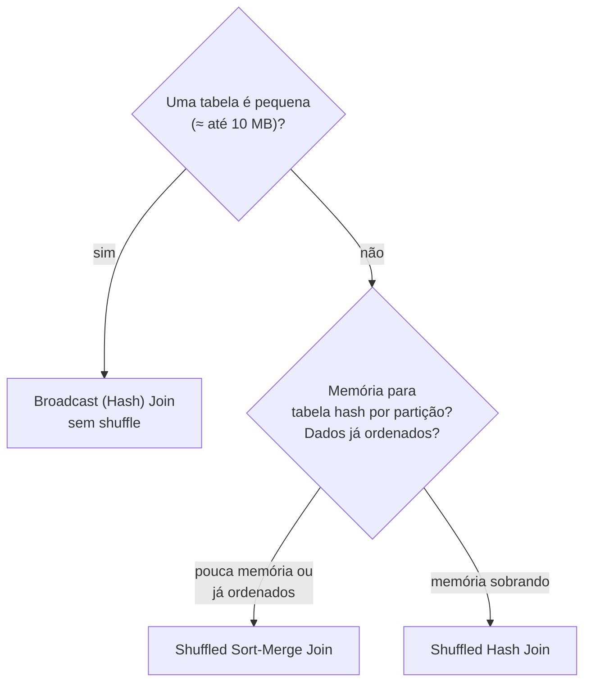
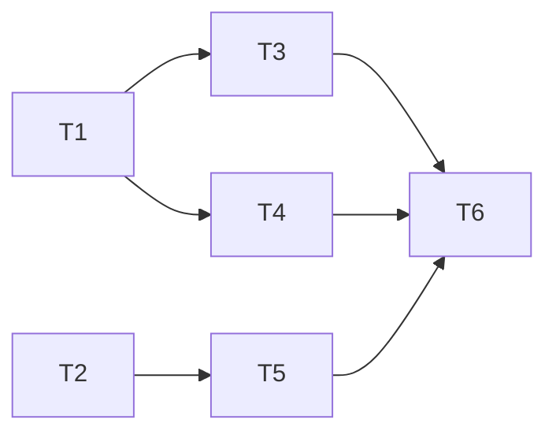

# Aula 12 — Joins no Spark e exercícios para a prova (versão P2)

> Aula 12 · Profa. Larissa C. Shimomura · **P2: 27/11**
> **Filtro:** [12c](12c_orientacoes_prova2_revisao2.md). **Cai:** algoritmos de junção (conceito + exercício "o algoritmo proposto é o mais adequado? Justifique; se não, sugira"). Ex. 9 da lista P2 (Transações × Contas) é **certeza**.
> **Cortado desta versão:** o notebook `SparkJoin_Catalyst` e a leitura de `explain()` (a "saída do Catalyst" não cai), *hash partitioning* em detalhe (não cai), Broadcast Nested Loop Join (ela não vai falar dele), UDFs, AQP, configurações e o exercício do `RastreioPool` em Java. A versão completa está no histórico do git.

---

# Parte A — Algoritmos de junção

## A1. Os três algoritmos clássicos

| Algoritmo | Ideia | O que lembrar |
|---|---|---|
| **Nested loops** | Um `for` dentro de outro: compara toda tupla de R com toda de S (\|R\| × \|S\|) | O mais básico; sem estrutura auxiliar |
| **Hash join** | Monta uma **tabela hash** de uma relação (em geral a **menor**) sobre a **chave de junção** (*build*) e aplica a **mesma função** à outra para casar (*probe*) | **Precisa de memória** para a tabela hash |
| **Sort-merge join** | **Ordena** as duas pela chave de junção e avança ponteiros comparando (*merge*) | **Custo adicional de ordenar**; se já estão ordenadas, sobra só a varredura |

Regra geral: poucas tuplas → nested loops; uma relação cabe na memória → hash join; relações grandes que não cabem → sort-merge.

## A2. No Spark: o problema é o shuffle

As tuplas que casam podem estar em partições de nós diferentes. Ou **se copia a tabela pequena para todo mundo** (broadcast), ou **se redistribuem as duas pelo hash da chave** (shuffle), que é a parte cara.

| Algoritmo no Spark | Quando | Vantagem | Desvantagem / custo |
|---|---|---|---|
| **Broadcast (Hash) Join** | **Uma tabela é pequena** (padrão do Spark: ~**10 MB**) | **Sem shuffle**: envia-se uma **cópia inteira** da pequena a todos os nós; cada partição da grande monta uma tabela hash local da pequena, junta **localmente** e o resultado é **concatenado**. A cópia é bem mais barata que o shuffle | **Uma tabela tem de ser pequena**, o que limita o uso em larga escala |
| **Shuffled Hash Join** | **As duas são grandes** | Não precisa ordenar | Há shuffle; **cada partição monta uma tabela hash**, então **todas precisam de memória** |
| **Shuffled Sort-Merge Join** | **As duas são grandes** | **Não monta tabela hash** (economiza memória, que "é uma coisa preciosa"); bom quando os dados **já estão agrupados/ordenados** (ex.: depois de um `groupBy`). É a escolha comum do Spark | Há shuffle; precisa **ordenar** as chaves em cada partição |

**O shuffle (explicação dela):** reparticiona os dados para que **as mesmas chaves das duas tabelas caiam na mesma partição**; em cada partição roda-se o algoritmo local. **O objetivo não é terminar com uma partição só:** o resultado fica distribuído (no broadcast, nas partições da tabela maior).



---

# Parte B — Exercícios

## B1. Tópicos da prova

O que cai e como cai está no [12c](12c_orientacoes_prova2_revisao2.md); por arquivo: [06](06_padroes_de_paralelismo.md) (decomposição, estruturas), [07](07_threads_balanceamento_executor.md) (granularidade, balanceamento), [08](08_forkjoin_bigdata_hadoop.md) (Big Data, HDFS, MapReduce), [09](09_nosql_cap_spark_rdd.md) (NoSQL, CAP, BASE, DAG), [10](10_spark_pratica_sparksql.md) (RDD × DataFrame, Spark → álgebra), [11](11_processamento_otimizacao_consultas.md) (árvore, heurísticas), e a Parte A acima (joins).

## B2. Exercícios de revisão resolvidos

### Exercício 1 — Decomposição de dados × de tarefas

- **Dados:** dividir grandes conjuntos (vetores, matrizes, imagens) em **pedaços menores e independentes**; cada unidade aplica **a mesma operação** ao seu pedaço.
- **Tarefas:** dividir o problema pelas **ações, funções ou etapas**; **tarefas distintas** rodam ao mesmo tempo.

### Exercício 2 — Grafo de dependência de tarefas

> **Status:** como exercício sobre código, ela disse que não cobra; mas o Ex. 2 da lista P2 pede algo parecido em pseudocódigo ([06, §5](06_padroes_de_paralelismo.md#5-grafo-de-dependência-de-tarefas)). Saiba fazer.

```text
T1: validas           <- filtrar_vendas_validas(lista_vendas)
T2: clientes_ativos   <- filtrar_clientes_ativos(cadastro_clientes)
T3: total_impostos    <- calcular_impostos(validas)
T4: relatorio_estoque <- atualizar_estoque(validas)
T5: campanha_email    <- gerar_emails_promocionais(clientes_ativos)
T6: relatorio_final   <- consolidar_dashboard(total_impostos, relatorio_estoque, campanha_email)
```



Em paralelo: **T1 ‖ T2**; depois **T3 ‖ T4 ‖ T5**, desde que T1 e T2 tenham terminado; por fim T6. Padrão: **Task Parallelism** (decomposição por tarefas; não é D&C, pois não há divisão recursiva).

### Exercício 3 — Granularidade × número de threads

Trade-off **balanceamento × overhead**. Fina: balanceia bem, mas tem alto overhead. Grossa: overhead mínimo, mas há risco de desbalanceamento. Ideal: pequenas o bastante para ocupar o hardware, grandes o bastante para compensar o gerenciamento. Ver [07](07_threads_balanceamento_executor.md).

### Exercício 4 — Programa Java (`RastreioPool`)

**Não cai** (Java não cai; exercício de "qual decomposição" sobre código também não). Removido.

### Exercício 5 — HDFS: blocos e replicação

> *1 linha = 1 MB; bloco máximo de 4 MB; 3 DataNodes de 8 MB; replicação 2.* Dados: **Linha 02 a Linha 10** (9 linhas; **pegadinha**: não há Linha 01).

| Bloco | Linhas | Tamanho |
|---|---|---|
| B1 | 02–05 | 4 MB |
| B2 | 06–09 | 4 MB |
| B3 | 10 | **1 MB** |

| Worker | Blocos | Ocupado |
|---|---|---|
| W1 | B1 + B3 | 5 MB |
| W2 | B2 + B1 | **8 MB (cheio)** |
| W3 | B3 + B2 | 5 MB |

Cada bloco em 2 workers diferentes; se qualquer worker cair, nenhum bloco se perde.

### Exercício 6 — MapReduce: contagem de códigos de status

Bloco 1 (W1): `200 OK`, `404 Not Found`, `200 OK` · Bloco 2 (W2): `500 Error`, `200 OK`, `404 Not Found`.

| Fase | Saída |
|---|---|
| Map 1 | `("200 OK",1)`, `("404 Not Found",1)`, `("200 OK",1)` |
| Map 2 | `("500 Error",1)`, `("200 OK",1)`, `("404 Not Found",1)` |
| Entrada Reducer 1 | `("200 OK",[1,1,1])`, `("404 Not Found",[1,1])` |
| Entrada Reducer 2 | `("500 Error",[1])` |
| Saída Reducer 1 | `("200 OK",3)`, `("404 Not Found",2)` |
| Saída Reducer 2 | `("500 Error",1)` |

### Exercício 7 — Spark: DAG e quando executa

```scala
1  val dados = sc.parallelize(Seq(("A", 10), ("B", 20), ("A", 30), ("C", 5), ("B", 15)), 2)
2  val rdd_filtrado = dados.filter(par => par._2 >= 10)
3  val rdd_mapeado = rdd_filtrado.map(par => (par._1, par._2 * 2))
4  val rdd_prova = rdd_mapeado.reduceByKey((valor1, valor2) => valor1 + valor2)
5  println("DAG montado com sucesso!")
6  val resultado = rdd_prova.collect()
7  println(resultado.mkString(", "))
```

- **DAG do `rdd_prova`:** `parallelize → filter → map → reduceByKey`. Desenhe **só as operações** ("a gente pede só as operações que estão sendo escritas"), sem os dados.
- **Para que serve:** tolerância a falhas (linhagem) e *lazy evaluation* ([09, §6.3](09_nosql_cap_spark_rdd.md#63-transformações-ações-dag-e-lineage)).
- **Executa de fato na linha 6:** o `collect()` é a primeira **ação** (puxa os dados de todas as partições para o driver; é o "gatilho"). A linha 5 imprime de qualquer jeito. (Se esta pergunta cai: **indefinido**, ela disse "vou pensar".)

### Exercício 8 — SparkSQL → álgebra relacional → otimização

```scala
val resultado = pedidos
  .filter(pedidos("valor") > 100.0)
  .join(clientes, pedidos("id_cliente") === clientes("id"))
  .select(clientes("nome"), pedidos("valor"))
```

**(a) Álgebra:** π<sub>nome, valor</sub>( σ<sub>valor>100</sub>(pedidos) ⋈<sub>id_cliente = id</sub> clientes ). **Qualquer representação equivalente vale** (σ depois da junção, × + σ, relações trocadas).

**(b) Dada π<sub>nome, valor</sub>(σ<sub>valor>100</sub>(pedidos ⋈<sub>id_cliente=id</sub> clientes)): quais heurísticas e por quê?**
**Selection push-down** de `valor > 100` para `pedidos`, porque (1) a consulta continua **equivalente**; (2) **reduz as tuplas** antes da operação mais cara, a junção; (3) `valor` pertence **só a `pedidos`**. Variação da aula: com mais uma condição sobre clientes (`nome = 'João'`), quebrar em cascata e descer cada uma; se `nome` for chave primária, sobra uma linha só.

### Exercício 9 — NoSQL, BASE × ACID

Tipos de NoSQL e BASE × ACID: ver [09, §2–3](09_nosql_cap_spark_rdd.md#2-bancos-nosql-not-only-sql).

### Exercício 10 — Escolha do algoritmo de join

> *VENDAS: 500 mi de tuplas (~40 GB), aleatória em 320 partições. LOJAS: 50 tuplas (~2 KB). O otimizador propõe **Shuffled Sort-Merge Join** (redistribui as duas por `id_loja` e ordena). É o mais adequado?*

**Resposta-modelo:** "O algoritmo proposto **não é o mais adequado**, pois como existe uma tabela pequena de aproximadamente 2 KB, ela pode ser enviada por **broadcast** e, por consequência, não realizar o processo de **shuffle**, que costuma ser mais custoso que o broadcast, principalmente para dados pequenos. O adequado é o **Broadcast Join** (Broadcast Hash Join)." A tabela LOJAS vai **inteira** a todos os nós.

### Exercício 11 — Transações × Contas (lista P2, Ex. 9 — certeza)

> *Memória por executor para tabelas hash: **512 MB**. TRANSACOES: 400 mi de tuplas (45 GB), particionada e **pré-ordenada por `id_conta`**. CONTAS: 60 mi de tuplas (8 GB), também **pré-ordenada por `id_conta`**. Plano proposto: **Shuffled Hash Join**. É o mais adequado?*

**Resposta-modelo:** "Não. O **Shuffled Sort-Merge Join** é o mais adequado, porque lida de forma escalável com **duas relações grandes** (45 GB e 8 GB) **sem exigir que uma delas caiba integralmente na memória** para construir uma tabela hash. Além disso, como as duas **já estão pré-ordenadas** pelo atributo de junção (`id_conta`), **o custo de ordenação é eliminado**, e a junção é feita por uma simples **varredura sequencial** (a fase *merge*)."

- **"O pulo do gato" = a pré-ordenação.** Não precisa montar tabela hash nem ordenar; só "casar" as duas.
- Mesmo **sem** a pré-ordenação, ela acha que o sort-merge ainda seria melhor (a tabela hash não cabe em 512 MB).
- O enunciado pode trazer informação que **não é usada** ("só para assustar").

---

## Checklist

- [ ] Explico nested loops, hash join e sort-merge e o "o que lembrar" de cada um
- [ ] Explico broadcast × shuffled hash × shuffled sort-merge, com vantagem e custo
- [ ] Resolvo Vendas × Lojas (→ broadcast) e Transações × Contas (→ sort-merge), com a justificativa completa
